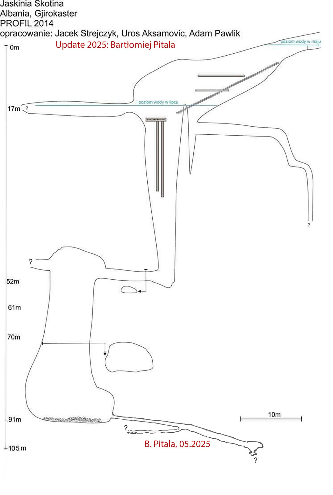

# About

## To Do
Dive 
Dry 
Photogram

## About
Divers who explored it in 2025: [Bartłomiej Pitala](https://www.facebook.com/groups/795192310689730/user/100004480630887/), [Tomasz Wciórka](https://www.facebook.com/groups/795192310689730/user/100006132738719/), and [Mariusz Banaszak](https://www.facebook.com/groups/795192310689730/user/100001608667454/) ([Facebook Post](https://www.facebook.com/groups/795192310689730/permalink/2764947903714151))

[Suggested connection to Like Virua?](https://inca-al.org/en/activities/international-day-of-biodiversity-22-may-2014)

# References

- [Visit-gjirokaster.com - Skotini Cave](https://visit-gjirokastra.com/article/the_cave_of_skotini)
- [2025 Exploration - Facebook Post](https://www.facebook.com/groups/795192310689730/permalink/2764947903714151)
