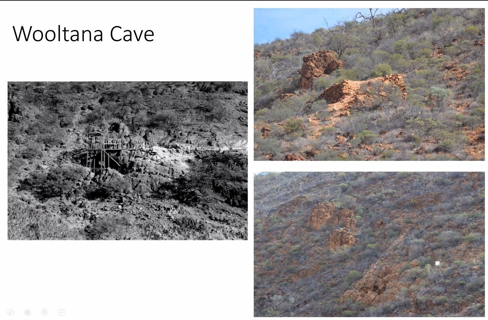
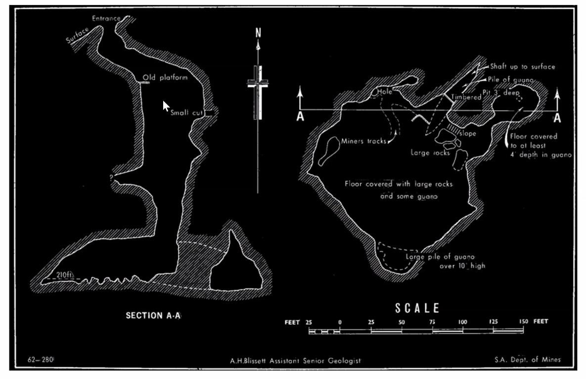

# About

Gammon Ranges

## About

# Maps

# Additional Notes

"Analysis of guano specimens from Wooltana cave, formerly occupied by ghost bats (Macroderma gigas), shows the principal mineral is whitlockite with seven other crystalline phases."
- **MapCarta:** https://mapcarta.com/N3645336098

# References

- [GoogleMaps](https://goo.gl/maps/m9mLAEd2m49ZE53f7)
- [Mindat.org](https://www.mindat.org/loc-269720.html)
- [Minerals of the Wooltana Cave](https://www.tandfonline.com/doi/abs/10.1080/03721426.2014.11649009)
