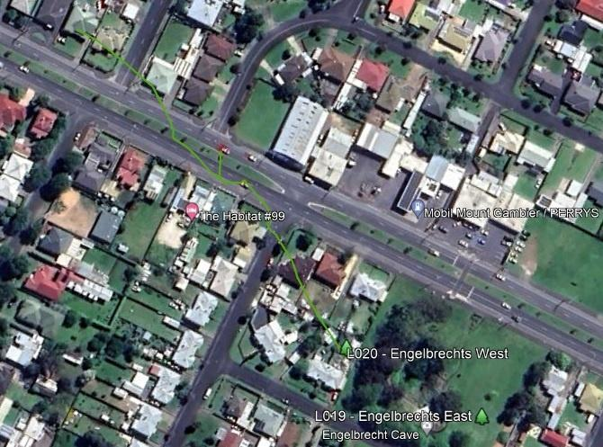

# Maps

5L19/20 Fault Lines (Lewis)

5L19/20 (Horne) 

5L019 Englebrecht's East (Richards, 2022)

## Survey
KML Survey: Englebrecht's E Extension - KML.kml

[Englebrecht's East Extension](../South%20Australia/Englebrecht%27s%20East%20Extension.md) (Richards)

Englebrecht's West Survey (Richards)

# Images

- [5L19-20 - Englebrecht's Cave - 20230713_151715 - 3f121da8-6d271bdf](../../Assets/23fa11717d52575d7e40631fa2a131bd0c222b385d73b750111e0a26299649c6.jpg)
- [5L19-20 - Englebrecht's Cave - 20230713_151744 - ef8fa107-6d271bdf](../../Assets/b587a79a46460a6eb2641837e7089851928042c4c71955b9fbc48f79adc13a32.jpg)
- [5L19-20 - Englebrecht's Cave - 5L019-20 Engelbrechts with streets - 3271295b-6d271bdf](../../Regions/Oceania/Australia/5L%20-%20Mt%20Gambier/Maps/5L019-20%20-%20Engelbrecht%27s%20%28Lewis%29.jpg)
- [5L19-20 - Englebrecht's Cave - EEX Overlay (In Progress) - 42049248-6d271bdf](../../Regions/Oceania/Australia/5L%20-%20Mt%20Gambier/Maps/5L019%20-%20Englebrecht%27s%20East%20%28Extension%20Overlay%29.jpg)
- [5L19-20 - Englebrecht's Cave - Eng E (Sat) - 48b0e016-6d271bdf](../../Regions/Oceania/Australia/5L%20-%20Mt%20Gambier/Maps/5L019%20-%20Englebrecht%27s%20East%20-%20Satellite%20%28Richards%2C%202022%29.jpg)
- [5L19-20 - Englebrecht's Cave - Englebrechts (lewy) - 8e78a58c-6d271bdf](../../Regions/Oceania/Australia/5L%20-%20Mt%20Gambier/Maps/5L019-20%20-%20Englebrecht%27s%20Cave%20-%20Fault%20Lines%20%28Lewis%29.jpg)

# References

- [ABC Australia - Instagram](https://www.instagram.com/p/Ck5FcAAgw9O/)
