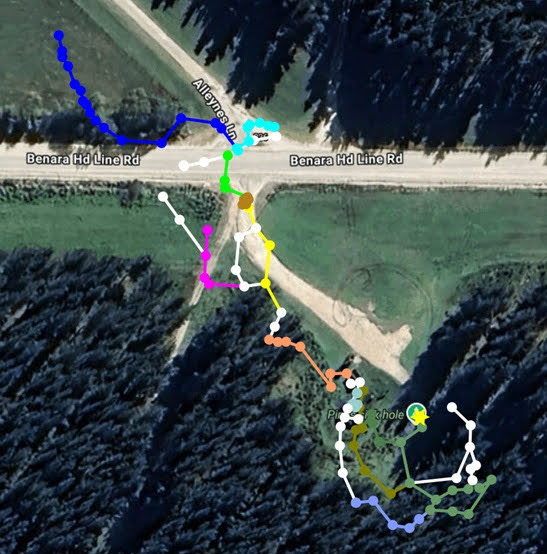

# About

- [Source](https://www.forestrysa.com.au/visit-our-forests/green-triangle-forest/caving/)

Booking is through Forestry SA [here](https://forestrysa2.rezdy.com/387300/pines-and-mud-hole-caves)

# Maps

[5L061 - The Pines (Passos, 2024) (Hi-Res) - MAP](../../Regions/Oceania/Australia/5L%20-%20Mt%20Gambier/Maps/5L061%20-%20The%20Pines%20%28Passos%2C%202024%29%20%28Hi-Res%29.pdf)
- [5L061 - The Pines - Photogram & Satellite (Passos, 2025) - MAP](../../Regions/Oceania/Australia/5L%20-%20Mt%20Gambier/Maps/5L061%20-%20The%20Pines%20-%20Photogram%20%26%20Satellite%20%28Passos%2C%202025%29.jpg)
[5L061 - The Pines (ACE, 2020) - MAP](../../Regions/Oceania/Australia/5L%20-%20Mt%20Gambier/Maps/5L061%20-%20The%20Pines%20%28ACE%2C%202020%29.png)
[5L061 - The Pines - Bunyips & CCR (Funda-Fundova, 2004) - MAP](../../Regions/Oceania/Australia/5L%20-%20Mt%20Gambier/Maps/5L061%20-%20The%20Pines%20-%20Bunyips%20%26%20CCR%20%28Funda-Fundova%2C%202004%29.jpg)
[5L061 Pines - MAP](../../Regions/Oceania/Australia/5L%20-%20Mt%20Gambier/Maps/5L061%20Pines.jfif)

Full Line Survey (Richards)

Initial photogrammetry without Crazy Wombat Tunnel (Passos)

## Survey
TML Data: [Pines](../../Regions/Oceania/Australia/5L%20-%20Mt%20Gambier/MNemo_Data/Pines.tml) [Pines](../../Regions/Oceania/Australia/5L%20-%20Mt%20Gambier/MNemo_Data/Pines.tml)
KML Survey: [Pines April 2022 - KML](../../Regions/Oceania/Australia/5L%20-%20Mt%20Gambier/KML_Data/Pines%20April%202022.kml)

[5L061 - Initial Survey](../../Assets/797d141e8a00ba95b90f663a2bf89e5037cdc6d4d058e1fc753226aa296949a9.png)
[5L061 - Survey to CCR](../../Assets/4a2a799914fc9fb35aa7fb779eb0151e3c58539339f263e4146463b4d712f9c0.png)

- [5L61 - The Pines - 5L061 - Pines - full line survey - baf11292-5529d2bd](../../Assets/fa526af3cac7ea07d4b5360fd3fe81ea59bfbb1f1dbb4c330749e8680762c40d.jpg)
- [Pines-cwt - 715a4f61-5529d2bd](../../Assets/7b973b71dece676bae00e3dc3bcf8a393137d638cf0e275f575916517e2e5335.kml)

# Source notes

Media - Crazy Wombat Tunnel 

## Lower South East Cave Reference — Page 126

The Pines is one of the most popular cave diving sites in the Lower South East as it is picturesque and readily accessible via a small artificially-cut ramp. Lying serenely in a forest of Californian pines (Pinus radiata) which were planted in 1953 (and which are overdue for felling at this writing!), the small "cenote"-style sinkhole entrance is a portal to a large boulder-strewn cavern which is filled with "air-clear" water.
The talus mound slopes away quickly to the south, dropping to a readily-attained depth of around 27 metres some 40 metres penetration distance from the entrance lake, and to more than 30m in a small, very silty alcove behind some of the huge boulders which lie against the wall. Daylight - and most of the lake surface can easily be seen from most areas in the main chamber, and in ideal conditions divers can clearly see their companions on the far side of the chamber without the aid of artificial lighting. However, there are several more technically-demanding areas where no natural light ever penetrates, and some of these can only be safely reached by divers who are trained and experienced in the skills and techniques needed to negotiate underwater restrictions in zero-visibility conditions.
There is strong evidence to support rumours of a major ceiling collapse occurring in the mid-
1970s at around the 25-metre level; a prominently-vandalized wall apparently broke away and fell, cutting off all access to a much deeper lower chamber (perhaps in the order of 45 metres depth or more) from which fossil bones were previously collected The water-surface of the cave is almost always completely covered by dense duckweed, and rare. cave crustacea (including syncarids Koonunga crenorum) have also been collected from this site

## Forestry SA

L0061, Thin Roof: Y, Fence: R. Dimensions: ?. Features: Named after plantation very popular diving site.

## Trimix Divers — The Pines - 5L61

“The Pines” (CEGSA cave feature number 5L61), also known by locals as “Springs Cave”, is located west of Mount Gambier. It used to be in a pine forest, but as can be seen from Richard Harris’ photo, the trees have been chopped down now. “The Pines” is one of the most popular cave diving sites around Mt. Gambier; it has a very easy “jump in” access via a cut ramp and steps, so cars can be parked right next to the entrance. A casual stroll down to the water and away you go!
From the small entrance lake, the cave bellows out into a classic sinkhole-type cavern called the Main Chamber. On a sunny day, there is enough light from the entrance lake to get around most of the Main Chamber without any torches. The cavern is much larger than in other cave-level diving sites in the Mt. Gambier area. Around the entrance lake the cave is also a harbour for various life-forms, including rare syncarids (Koonunga crenarum).

The Main Chamber reaches a depth of about 20m, from where there are various passages leading to areas such as The White Room, Wedge Room and The Dark Room with a max depth of around 33-34m. The Back Passages of Pines have been well dived as can be seen from the many “polished” silt-free passages, yet they are great fun to explore and could still be full of surprises for those who keep looking for them. In July 2003 Petra Fundova and David Funda discovered over 100 metres of virgin passages with an average depth of about 36-37m, commencing from the Dark Room, about 70 metres line distance from the entrance. These passages lead off in a NW direction to another big uncollapsed chamber which is only about 65m from Nettle Cave (5L186) on the other side of the dirt access road. In total, this new extension has about doubled the volume of this very interesting dive site!

The Land Managers of this site are SA Forestry who must be contacted through their office in Mount Gambier for all site access information.CDAA Rated as “penetration”.

# Images

- [5L61 - The Pines - 2019-04-20 08.50.46 - 1df25bda-5529d2bd](../../Assets/5bf17d1c29c6205fe8741192de313f142be234ddf38615f3cef5636d7d44d52e.jpg)
- [5L61 - The Pines - 2019-04-20 08.50.50 - 378ca694-5529d2bd](../../Assets/7ad7680e0cb08b53f4526d74de9dcc35d4dd8e1a2aba6c7d9baf24958f704074.jpg)
- [5L61 - The Pines - 2021-05-16 09.59.24 - eb42b737-5529d2bd](../../Assets/28d3728748b79cd0f1978d1ff5a5442fdd5aaf661bc347b279a700830d9c44a2.jpg)
- [5L61 - The Pines - 2021-05-16 10.00.42 - 47120d39-5529d2bd](../../Assets/5551678639334bca91e2c5e10ea573a3a6d98ae6ff89b9e8ecd7265b285c2be3.jpg)
- [5L61 - The Pines - 2021-05-16 10.00.59 - 1c88751d-5529d2bd](../../Assets/6429a26fbbe770a4d73272fdd549814bba3a983ea14437c3bfcb9b0b15af523d.jpg)
- [5L61 - The Pines - 2294875 - 96a9f557-5529d2bd](../../Assets/2e2c22ea3d2d74f90ba4a219a6a2c711b47ce6324e0f1129681dc645c06290f7.gif)
- [5L61 - The Pines - 3Y2A4691 - a347354d-5529d2bd](../../Assets/751fee60cdaf1ee985f123a1b1caf3b11d642d2197aa01b393732bc83f9c69c3.jpeg) — Will Passos
- [5L61 - The Pines - 3Y2A4708 - f89c1b19-5529d2bd](../../Assets/176fad56fa978218ac50c47913da949989a58b2cdd34beb9f32090ff413d73a4.jpeg) — Will Passos
- [5L61 - The Pines - 3Y2A4729 - e2facb19-5529d2bd](../../Assets/b42f25b88768c047d179a46837d003c2c1a7ed367a01b074dce8aa5c0c4d856a.jpeg) — Will Passos
- [5L61 - The Pines - 3Y2A4738 - 2ad13564-5529d2bd](../../Assets/873791548f5233ec0f40a1169a6b3db6a2a225724e321532911b6dbde816dc6d.jpeg) — Will Passos
- [5L61 - The Pines - 3Y2A4764 - a54a7575-5529d2bd](../../Assets/4e6de3177fb3e40d8bd61e0d7d76f9747ce268de537cadfff7da974da8293f43.jpeg)
- [5L61 - The Pines - 3Y2A4773 - e52b016b-5529d2bd](../../Assets/be815cddecc7e6391eab608d4749c4d4efc93b5f670b5aaad88f8c7a1b6977d9.jpeg)
- [5L61 - The Pines - 3Y2A4778 - c2f5fefe-5529d2bd](../../Assets/fe8fcf927cac7fb7097f13e09e1d6f0705dd23af85e3bf4a732fa4efc5228719.jpeg) — Will Passos
- [5L61 - The Pines - 3Y2A5172 - ada84dee-5529d2bd](../../Assets/b14a008a7bd44b1a2e1b87635e91712caeb1fe3a39c98a29c8d177541778a33d.jpeg) — Will Passos
- [5L61 - The Pines - 3Y2A5189 - f3946fe8-5529d2bd](../../Assets/6f3f5c19709d6afdab349f2d2d7c0f34c0bd7f1e0b6a1633d0e525e32615f49c.jpeg) — Will Passos
- [5L61 - The Pines - 3Y2A5200 - f8febf28-5529d2bd](../../Assets/40d005eb9f089133feecbb796184d0c867e843f8802f1d81d2f5064cf9694c73.jpeg) — Will Passos
- [5L61 - The Pines - 3Y2A5243 - ef271598-5529d2bd](../../Assets/6a026c9020af30cb5ca60a7e39e50b04db9c62642e8d01517d964b96a953db47.jpeg) — Will Passos
- [5L61 - The Pines - 3Y2A5364 - 18781acc-5529d2bd](../../Assets/ca1fb302926486694d470e36d6e0dcf014221b0e7b28eb2440a94d27a87796fa.jpeg) — Will Passos
- [5L61 - The Pines - 3Y2A5380 - a18745bf-5529d2bd](../../Assets/b6d59fb8bef79137ae91270f9bf16f4a689e2e73594c9f26bc1446fd4f8695ab.jpeg) — Will Passos
- [5L61 - The Pines - 3Y2A5397 - 8ed9f9a6-5529d2bd](../../Assets/df8bc85d4c07b5206ca04eeab01b564966b3e19ceabfd3f3be8925ec7b389cd1.jpeg) — Will Passos
- [5L61 - The Pines - 5L061 - Pines - full line survey - baf11292-5529d2bd](../../Assets/fa526af3cac7ea07d4b5360fd3fe81ea59bfbb1f1dbb4c330749e8680762c40d.jpg) — GrubbyWombat
- [5L61 - The Pines - abz-pines (Large) - 7dec334a-5529d2bd](../../Assets/a290254671e25e9feac75f5aae413559798626ac180338a06d1c732942844836.jpg)

- [5L61 - The Pines - 3Y2A5172 - ada84dee-5529d2bd](../../Assets/b14a008a7bd44b1a2e1b87635e91712caeb1fe3a39c98a29c8d177541778a33d.jpeg)
- [5L61 - The Pines - 3Y2A5380 - a18745bf-5529d2bd](../../Assets/b6d59fb8bef79137ae91270f9bf16f4a689e2e73594c9f26bc1446fd4f8695ab.jpeg)
- [5L61 - The Pines - 3Y2A5243 - ef271598-5529d2bd](../../Assets/6a026c9020af30cb5ca60a7e39e50b04db9c62642e8d01517d964b96a953db47.jpeg)
- [5L61 - The Pines - 3Y2A4729 - e2facb19-5529d2bd](../../Assets/b42f25b88768c047d179a46837d003c2c1a7ed367a01b074dce8aa5c0c4d856a.jpeg)
- [5L61 - The Pines - 3Y2A4778 - c2f5fefe-5529d2bd](../../Assets/fe8fcf927cac7fb7097f13e09e1d6f0705dd23af85e3bf4a732fa4efc5228719.jpeg)
- [5L61 - The Pines - 3Y2A4738 - 2ad13564-5529d2bd](../../Assets/873791548f5233ec0f40a1169a6b3db6a2a225724e321532911b6dbde816dc6d.jpeg)
- [5L61 - The Pines - 3Y2A5189 - f3946fe8-5529d2bd](../../Assets/6f3f5c19709d6afdab349f2d2d7c0f34c0bd7f1e0b6a1633d0e525e32615f49c.jpeg)
- [5L61 - The Pines - 3Y2A5364 - 18781acc-5529d2bd](../../Assets/ca1fb302926486694d470e36d6e0dcf014221b0e7b28eb2440a94d27a87796fa.jpeg)
- [5L61 - The Pines - 3Y2A4691 - a347354d-5529d2bd](../../Assets/751fee60cdaf1ee985f123a1b1caf3b11d642d2197aa01b393732bc83f9c69c3.jpeg)
- [5L61 - The Pines - 3Y2A4708 - f89c1b19-5529d2bd](../../Assets/176fad56fa978218ac50c47913da949989a58b2cdd34beb9f32090ff413d73a4.jpeg)
- [5L61 - The Pines - 3Y2A5397 - 8ed9f9a6-5529d2bd](../../Assets/df8bc85d4c07b5206ca04eeab01b564966b3e19ceabfd3f3be8925ec7b389cd1.jpeg)
- [5L61 - The Pines - 5L061 - Pines - full line survey - baf11292-5529d2bd](../../Assets/fa526af3cac7ea07d4b5360fd3fe81ea59bfbb1f1dbb4c330749e8680762c40d.jpg)
- [5L61 - The Pines - 3Y2A5200 - f8febf28-5529d2bd](../../Assets/40d005eb9f089133feecbb796184d0c867e843f8802f1d81d2f5064cf9694c73.jpeg)
- [Map_v1 - ae3260e2-5529d2bd](../../Regions/Oceania/Australia/5L%20-%20Mt%20Gambier/Maps/5L061%20-%20The%20Pines%20%28Passos%2C%202024%29%20%28Hi-Res%29.pdf)

# References

- [YouTube - 1st Person narrated](https://youtu.be/ncqghvGpgR0)
- [YouTube - 360 video](https://www.youtube.com/watch?v=HN3KTAinHnw)
- [Initial ABC Article](https://www.abc.net.au/news/2025-03-11/pines-cave-tunnel-extension-discovered-by-divers-limestone-coast/105013424)
- [ABC TV News Segment](https://www.youtube.com/watch?v=LsDDuTw4eHA)
- [ABC Adelaide Facebook Post](https://www.facebook.com/abcadelaide/posts/pfbid035hTeTpqvydwwXkc4tT8vFaA3MSRNo77eMqZx4ktsGZgsEWD7qVYiTV1jC5XSVGb7l)
- [Scuba Diver Magazine - "Exploring Pines Cave"](https://app.scubadivermag.com/issues/scuba-diver-anz-85/exploring-pines-cave)
- [Lower South East Cave Reference (Horne, 1993)](../../Regions/Oceania/Australia/5L%20-%20Mt%20Gambier/Maps/Lower%20South%20East%20Cave%20Reference%20%28Horne%2C%201993%29.pdf)
- [Cave Diving Down Under — 5L-61.gif](https://www.cavediving.net.au/images/articles/maps/5L-61.gif)
- [Trimix Divers — The Pines - 5L61](https://www.trimixdivers.com/trimix5/?p=4951)
- [Pines 3d model](https://sketchfab.com/models/9afbfe2aa4304384924ac841a83202de/embed)
- [dcb0647b-1f8a-4fcc-83d7-2fb6f3147450](https://www.youtube.com/watch?v=FzJrVbQ3mp4)
