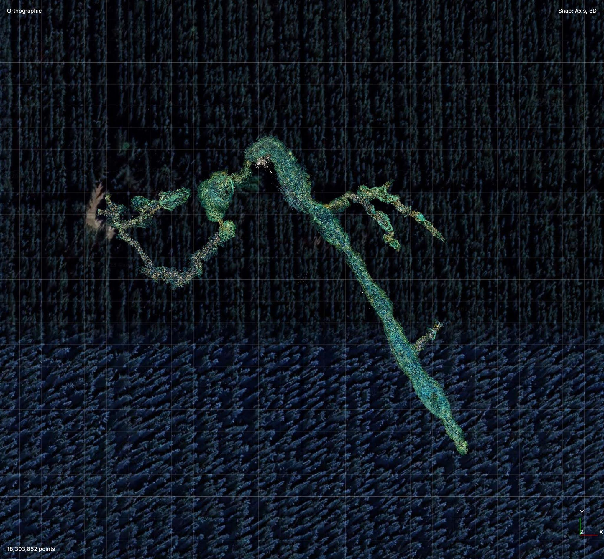
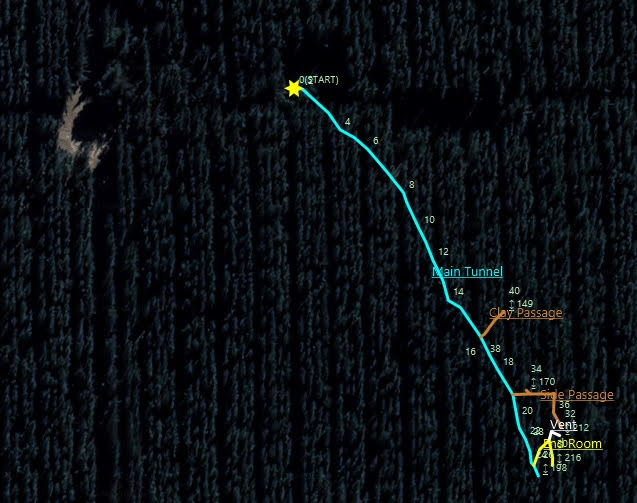
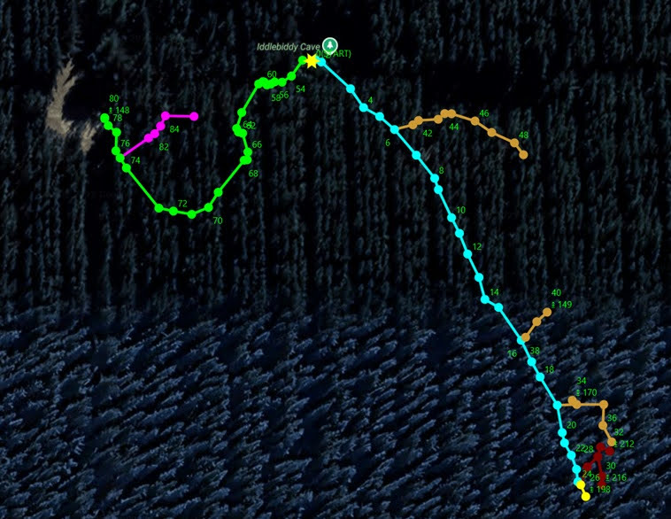

# About

Iddlebiddy Cave is a 250m single passage-way, which runs from the entrance chamber and ends in a small, silty room containing an array of largely-formed clay deposits.

Divers must take care when venturing into this cave, as the soft walls and delicate features located in the long passage make the water susceptible to clouding. Divers are encouraged to take their time passing through the passage, to enjoy the many cave features and avoid causing finning or physical damage.

This cave is only available on Saturdays and Sundays. A maximum of four divers per day, multiple dives per day.

A locked hatch has been placed at this site, with the key available for collection from the Mount Gambier Visitor Centre. At least two members of the dive party must be present to show their issued dive permits and collect the key in person.

### Entrance

The entrance is via a locked hatch that opens to reveal a solution tube about 8m deep and 1.5m wide. You will need either a wire rope ladder or a-frame and ropes to enter the cave. Someone should descend first and then all tanks and equipment lowered down before the other divers descend.  Once down the tube there is a metal platform where you can don your tanks and some stairs leading into the water

### Access

[https://www.forestrysa.com.au/visit-our-forests/green-triangle-forest/caving/](https://www.forestrysa.com.au/visit-our-forests/green-triangle-forest/caving/)

## About

# Maps

5L250 - Iddlebiddy - Will Passos (Dec 2023).pdf

## Survey
TML Data: Iddlebiddy.tml
KML Survey: Iddlebiddy.kml

- [5L250 - Iddlebiddy Cave - Diver at the main Iddlebiddy tunnel section - 22781733-5a860a82](../../Assets/e8c140997f879c2a2bd6b49cb90caecba08f5aa4dbdb6cec4981e840e31984e3.jpeg)
- [5L250 - Iddlebiddy Cave - 5L250 - Iddlebiddy - full line survey - 69193e1d-5a860a82](../../Assets/e6ed1545275763cc90f2e1f025052e3b7ce447e3e07af63fad016852f3790592.jpg)
- [5L250 - Iddlebiddy Cave - Map Overlay (googlemaps) - e90f909f-5a860a82](../../Assets/08fd53f0b24691c7195a7360a6ceb9fe0253eda5a0b42fd0553a30f49727dd26.jpeg)
- [Iddlebiddy - f89d1bdd-5a860a82](../../Regions/Oceania/Australia/5L%20-%20Mt%20Gambier/KML_Data/Iddlebiddy.kml)

# Source notes

## Lower South East Cave Reference — Page 488

At the time of its discovery by a small party of unqualified local divers in late 1983 or early 1984, Iddlebiddy Cave (a satirisation of the mighty "Cocklebiddy Cave" in the Nullarbor, because of its smaller but similar underwater appearance) was one of the most significant cave diving finds of the decade.
The cave's discoverers kept the feature's location a closely-guarded secret for many years, and the first truly-representative map of the cave was only compiled after members of the Cave Divers Association of Australia undertook an officially-sanctioned assessment and research dive on November 26th, 1988. A more detailed survey was later initiated by the CDAA, and it was this work, from the efforts of Tony Hambling, Frank Homewood and John McCormick, that the map on the opposite page was produced.
Like many cave features in this area, the entrance to 51.250 is a relatively insignificant chimney- like vertical solution-tube about 0.7 metres in diameter which drops for about 6 metres into a small, humid cavity containing a very deep pool of blue-green water. The pool is actually "roof-hole" to a very large submerged room, where a silt mound below the entrance attests to the many animals -- and a young human - which tragically ended their days in this cave.

The flooded chamber has a short, narrow passage leading off to the north-west, but the main run is in the form of a single, large passage which heads south-east. This passage is generally about 12 metres wide and 5 metres high, and it contains many interesting sedimentary and morphological features which are seen in no other south-eastern caves The floor of the cave is almost totally covered in large, thick blocks of multilayered clay, giving it an "alligator-skin" of tessellated appearance in many areas. The known cave ends in a low, extremely silty chamber where clay seems to be "flowing" out of the walls
Iddlebiddy Cave is indeed a valuable cave diving site worthy of considerable protection

## Forestry SA

L0250, Thin Roof: N, Fence: N. Dimensions: ?. Features: popular diving site

# Images

- [5L250 - Iddlebiddy Cave - 5L250 - Iddlebiddy - full line survey - 69193e1d-5a860a82](../../Assets/e6ed1545275763cc90f2e1f025052e3b7ce447e3e07af63fad016852f3790592.jpg) — Grubby Wombat
- [5L250 - Iddlebiddy Cave - Cave entrance - 4ba3c9e5-5a860a82](../../Assets/04374cb2431adf287eb127fc44d30bd07b99299f3eddaa054bfac32d3dcd83cf.jpg)
- [5L250 - Iddlebiddy Cave - Diver at the main Iddlebiddy tunnel section - 22781733-5a860a82](../../Assets/e8c140997f879c2a2bd6b49cb90caecba08f5aa4dbdb6cec4981e840e31984e3.jpeg)
- [5L250 - Iddlebiddy Cave - Forestry sign and dive gear setup bench at Iddlebiddy Cave entrance - 5245249e-5a860a82](../../Assets/1b5da18eb264b4fbce6800d9b4c9a1abc8b21173d1ffd10ba046c98038041f91.jpg)
- [5L250 - Iddlebiddy Cave - Forestry sign at Iddlebiddy Cave entrance - f878cd6a-5a860a82](../../Assets/dc8594561e451b5fba0508d9ddb6bae64b94823e8855630c9d9628bcf9724ad1.jpg)
- [5L250 - Iddlebiddy Cave - Iddlebiddy Cave entrance after hatch opened - d9f7e9b9-5a860a82](../../Assets/26431b6f8c5a197edd01c35749b8c5b4848574dc8f5f2308660b6a3422dc89e5.jpg)
- [5L250 - Iddlebiddy Cave - Map Overlay (googlemaps) - e90f909f-5a860a82](../../Assets/08fd53f0b24691c7195a7360a6ceb9fe0253eda5a0b42fd0553a30f49727dd26.jpeg)
- [5L250 - Iddlebiddy Cave - Screenshot 2023-10-24 at 11.33.29 pm - f12fea14-5a860a82](../../Assets/331a68ab02cb9de99d04fd79b2af564eabe6d02572807c731711a81e5bee6c6a.png)

- [5L250 - Iddlebiddy Cave - 5L250 - Iddlebiddy - full line survey - 69193e1d-5a860a82](../../Assets/e6ed1545275763cc90f2e1f025052e3b7ce447e3e07af63fad016852f3790592.jpg)
- [Iddlebiddy Map Dec23 - 8c073f79-5a860a82](../../Regions/Oceania/Australia/5L%20-%20Mt%20Gambier/Maps/5L250%20-%20Iddlebiddy%20-%20Will%20Passos%20%28Dec%202023%29.pdf)

# References

- [Clay formations in US cave (like Iddlebiddy)](https://www.facebook.com/reel/507424628475090)
- [Lower South East Cave Reference (Horne, 1993)](../../Regions/Oceania/Australia/5L%20-%20Mt%20Gambier/Maps/Lower%20South%20East%20Cave%20Reference%20%28Horne%2C%201993%29.pdf)
- [Cave Diving Down Under — 5L-250.gif map](https://www.cavediving.net.au/images/articles/maps/5L-250.gif)
- [df00a6a8-c184-472d-a46e-e5fe00585dc2](https://www.youtube.com/watch?v=DNh7DX5QidQ)
- [b7a3eb21-0830-4486-8ac6-170a65c335b8](https://www.youtube.com/watch?v=cRxXXUKfOTw)
- [83ee4507-4180-4626-8e17-698691bf97c7](https://www.youtube.com/watch?v=k3gbjbuN3ps)
