# Additional Notes

You'll begin with a walk over the surface limestone, where you'll enjoy impressive views of the rock formations and karst landscape. You might glimpse some local wildlife, such as wallabies, lizards, scrub wrens and lyre birds. This is a different kind of cave tour – you won't forget Archway Cave's huge entrances, massive formations, colourful twilight zones and picturesque views. It even has a gold miners dance platform, built in 1880.

It's a good idea to wear sturdy shoes and bring a camera. Bring a packed lunch if you're planning a day at Abercrombie Caves. There is no mobile phone reception in this park.

# Source notes

<!-- ASF slide images: start -->
## ASF slide images

Images are from the ASF Joe N. Jennings slide catalogue. Each caption preserves the catalogue description and links to its source record.

### Abercrombie area

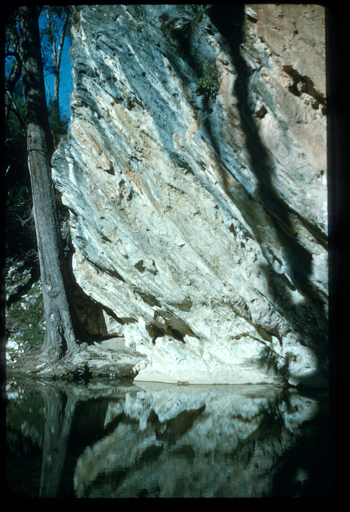
*ASF Joe N. Jennings slide catalogue, JNJ-S-00236, Box 45. Catalogue description: Steeply inclined marble, Abercrombie Caves, May 1955. [ASF record](https://st1.asflib.net/MEDIA/ASFJJSlidesCatalogue/Box%2045/JNJ-S-00236.html).*

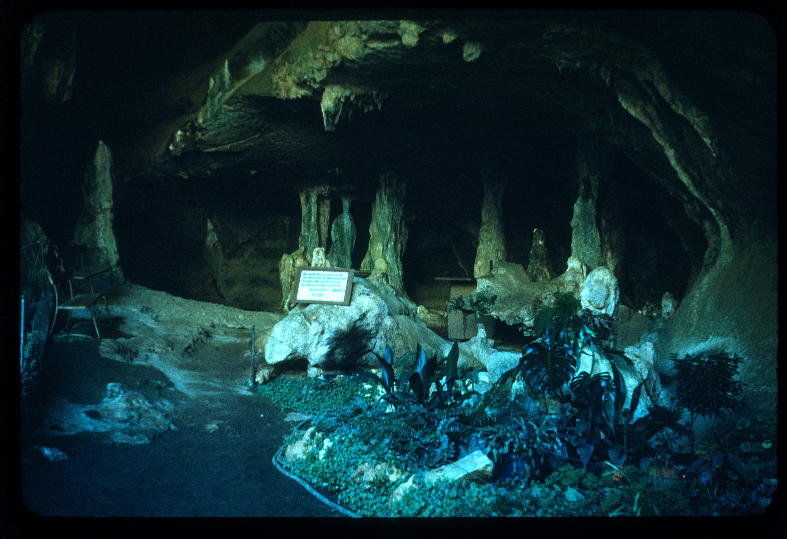
*ASF Joe N. Jennings slide catalogue, JNJ-S-00237, Box 45. Catalogue description: Abercrombie Caves. [ASF record](https://st1.asflib.net/MEDIA/ASFJJSlidesCatalogue/Box%2045/JNJ-S-00237.html).*

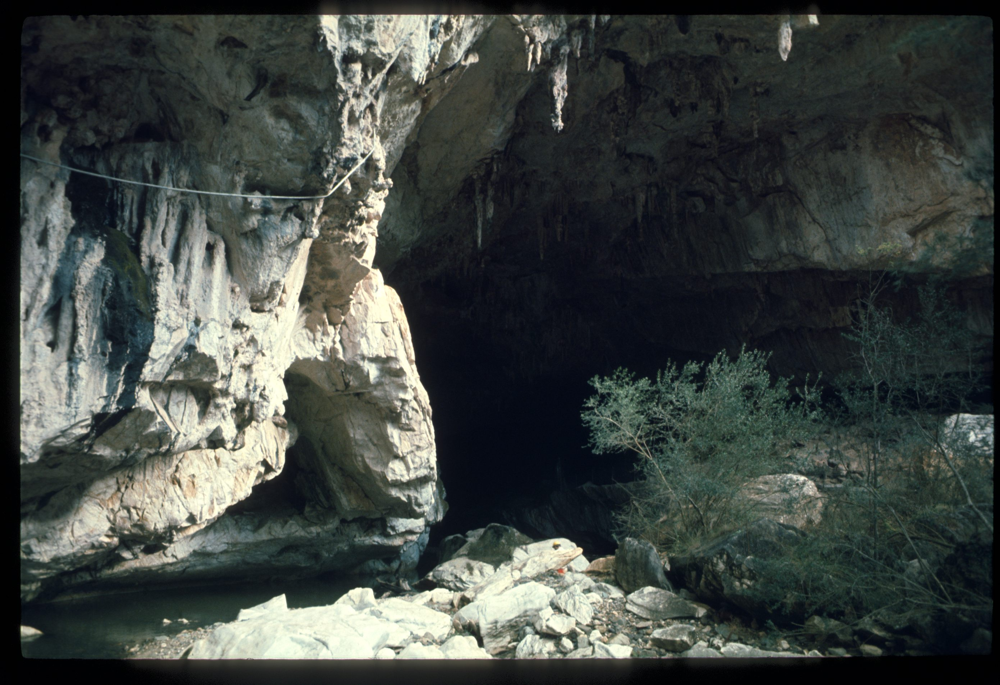
*ASF Joe N. Jennings slide catalogue, JNJ-S-00242, Box 45. Catalogue description: Abercrombie Arch Cave North end. [ASF record](https://st1.asflib.net/MEDIA/ASFJJSlidesCatalogue/Box%2045/JNJ-S-00242.html).*

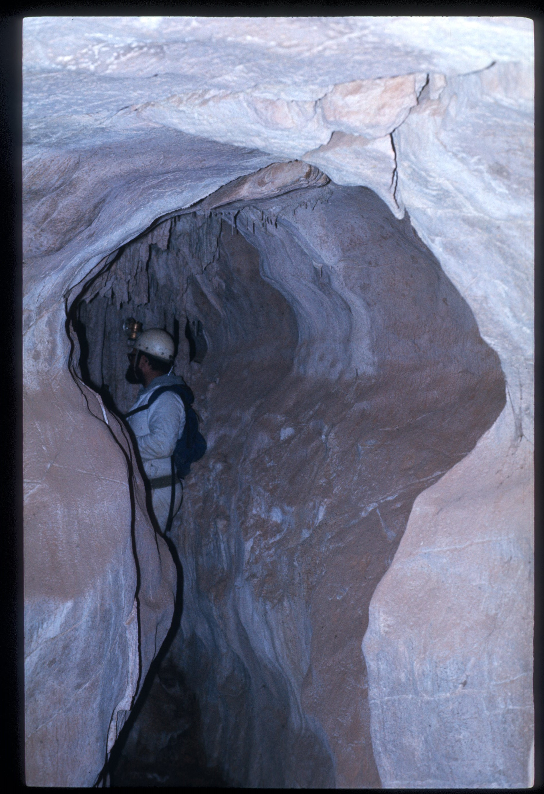
*ASF Joe N. Jennings slide catalogue, JNJ-S-00244, Box 45. Catalogue description: Abercrombie, King Solomons, Key-hole passage. [ASF record](https://st1.asflib.net/MEDIA/ASFJJSlidesCatalogue/Box%2045/JNJ-S-00244.html).*

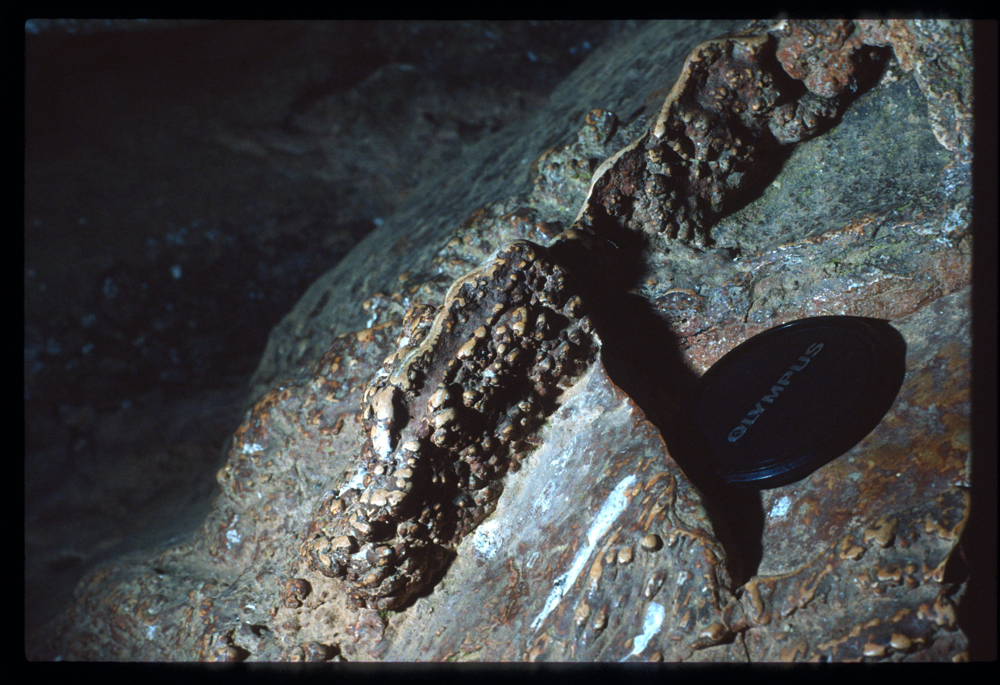
*ASF Joe N. Jennings slide catalogue, JNJ-S-00259, Box 45. Catalogue description: Cave coral polished by rock wallabies. [ASF record](https://st1.asflib.net/MEDIA/ASFJJSlidesCatalogue/Box%2045/JNJ-S-00259.html).*

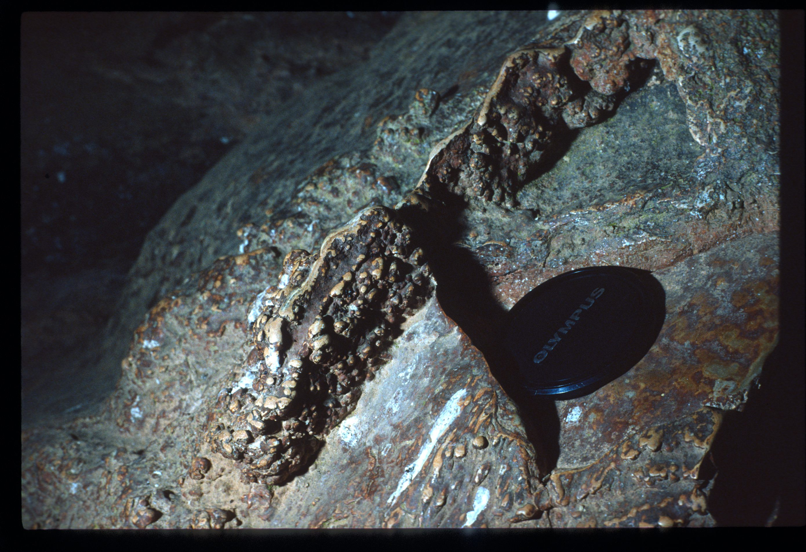
*ASF Joe N. Jennings slide catalogue, JNJ-S-00260, Box 45. Catalogue description: Cave coral polished by rock wallabies. [ASF record](https://st1.asflib.net/MEDIA/ASFJJSlidesCatalogue/Box%2045/JNJ-S-00260.html).*

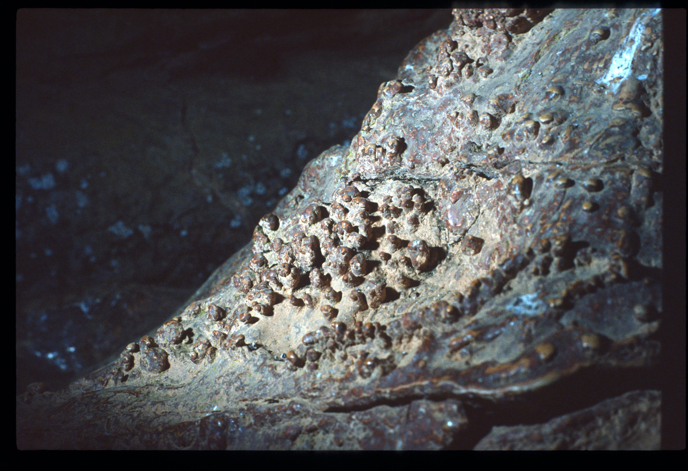
*ASF Joe N. Jennings slide catalogue, JNJ-S-00261, Box 45. Catalogue description: Cave coral polished by rock wallabies. [ASF record](https://st1.asflib.net/MEDIA/ASFJJSlidesCatalogue/Box%2045/JNJ-S-00261.html).*

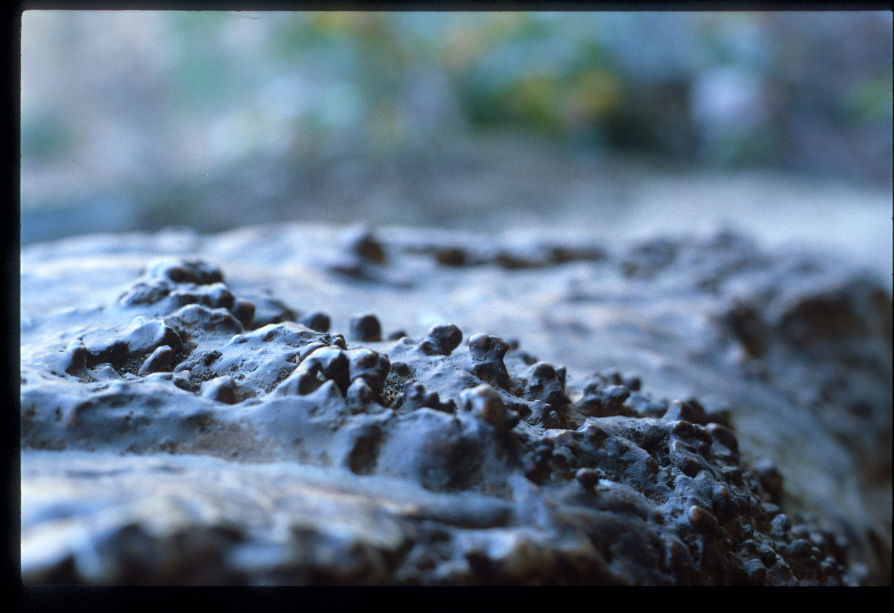
*ASF Joe N. Jennings slide catalogue, JNJ-S-00263, Box 45. Catalogue description: Cave coral polished by rock wallabies. [ASF record](https://st1.asflib.net/MEDIA/ASFJJSlidesCatalogue/Box%2045/JNJ-S-00263.html).*

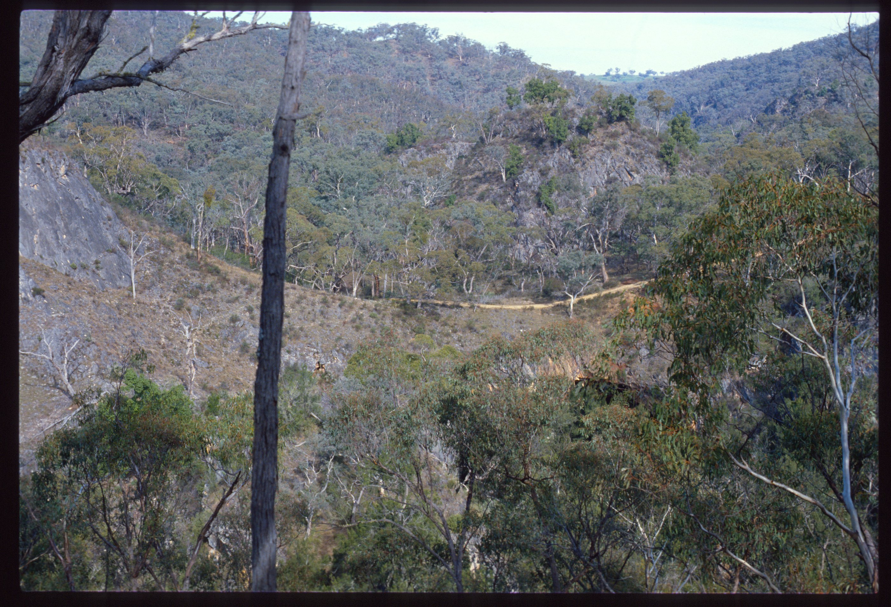
*ASF Joe N. Jennings slide catalogue, JNJ-S-1016-01, Box 1016. Catalogue description: Old valley above Abercrombie arch. [ASF record](https://st1.asflib.net/MEDIA/ASFJJSlidesCatalogue/Box%201016/JNJ-S-1016-01.html).*

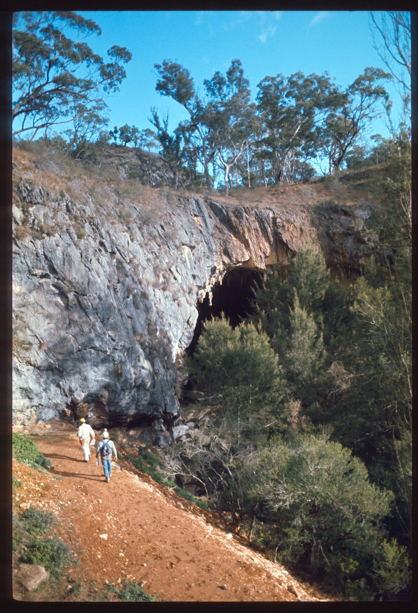
*ASF Joe N. Jennings slide catalogue, JNJ-S-1016-02, Box 1016. Catalogue description: Arch cave and portal. [ASF record](https://st1.asflib.net/MEDIA/ASFJJSlidesCatalogue/Box%201016/JNJ-S-1016-02.html).*

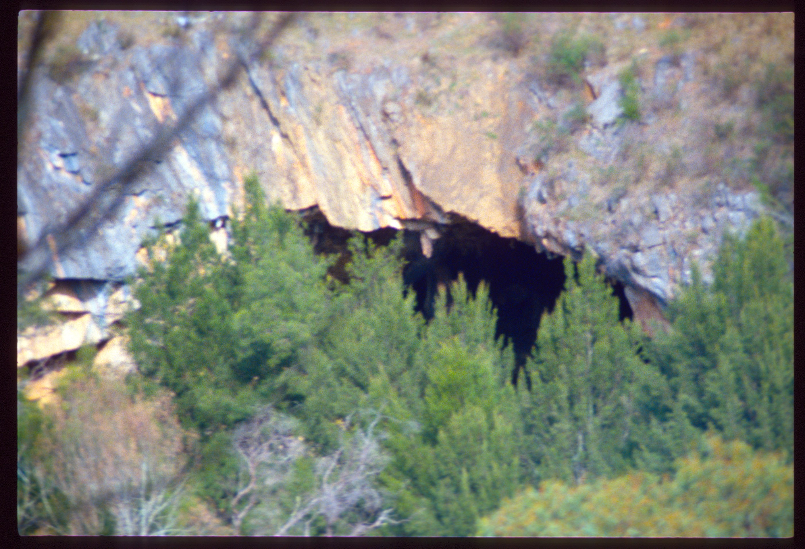
*ASF Joe N. Jennings slide catalogue, JNJ-S-1016-03, Box 1016. Catalogue description: North portal Abercrombie Arch. [ASF record](https://st1.asflib.net/MEDIA/ASFJJSlidesCatalogue/Box%201016/JNJ-S-1016-03.html).*

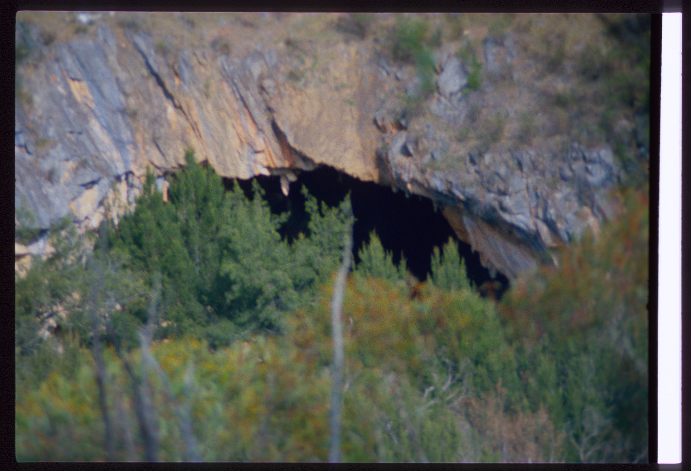
*ASF Joe N. Jennings slide catalogue, JNJ-S-1016-04, Box 1016. Catalogue description: North portal Abercrombie Arch. [ASF record](https://st1.asflib.net/MEDIA/ASFJJSlidesCatalogue/Box%201016/JNJ-S-1016-04.html).*

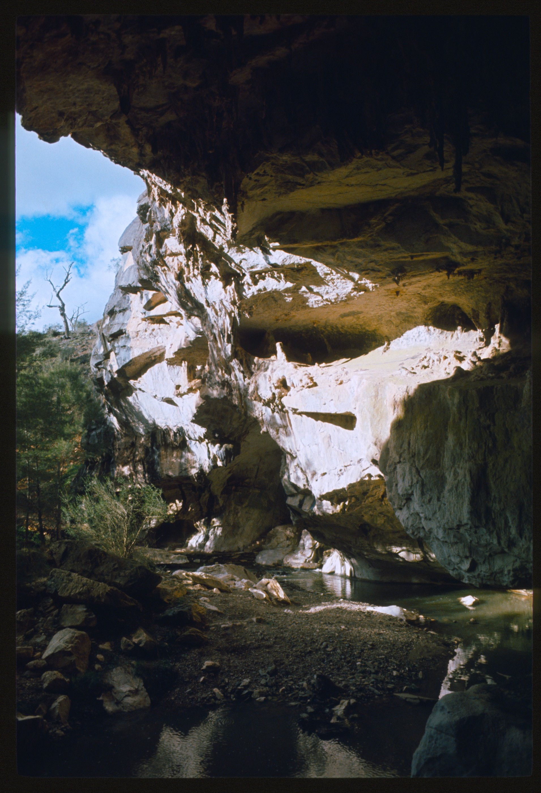
*ASF Joe N. Jennings slide catalogue, JNJ-S-1016-05, Box 1016. Catalogue description: Abercrombie Arch cave North portal. [ASF record](https://st1.asflib.net/MEDIA/ASFJJSlidesCatalogue/Box%201016/JNJ-S-1016-05.html).*

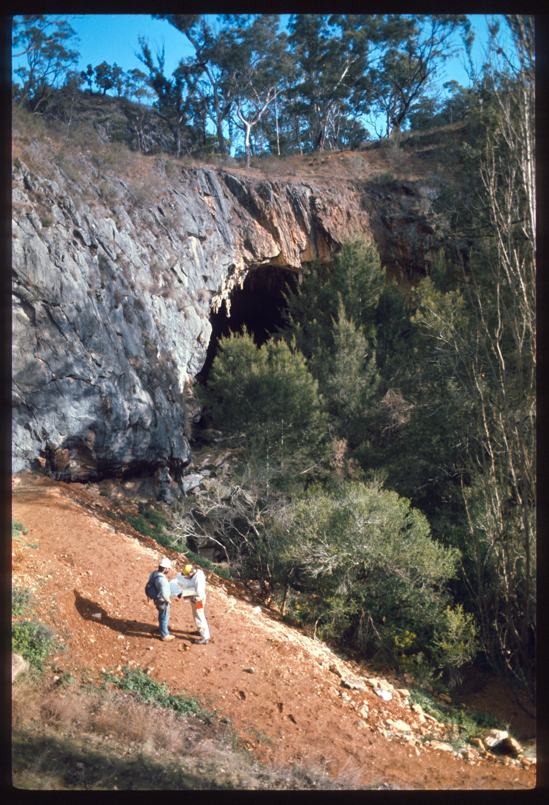
*ASF Joe N. Jennings slide catalogue, JNJ-S-1016-06, Box 1016. Catalogue description: Abercrombie North portal. [ASF record](https://st1.asflib.net/MEDIA/ASFJJSlidesCatalogue/Box%201016/JNJ-S-1016-06.html).*

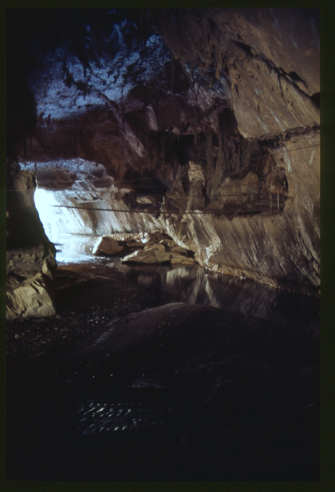
*ASF Joe N. Jennings slide catalogue, JNJ-S-1016-07, Box 1016. Catalogue description: Abercrombie - Adrian Davey. [ASF record](https://st1.asflib.net/MEDIA/ASFJJSlidesCatalogue/Box%201016/JNJ-S-1016-07.html).*

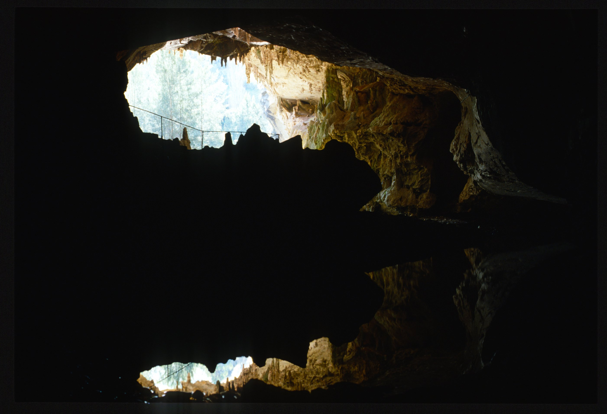
*ASF Joe N. Jennings slide catalogue, JNJ-S-1016-08, Box 1016. Catalogue description: North portal Abercrombie Arch. [ASF record](https://st1.asflib.net/MEDIA/ASFJJSlidesCatalogue/Box%201016/JNJ-S-1016-08.html).*

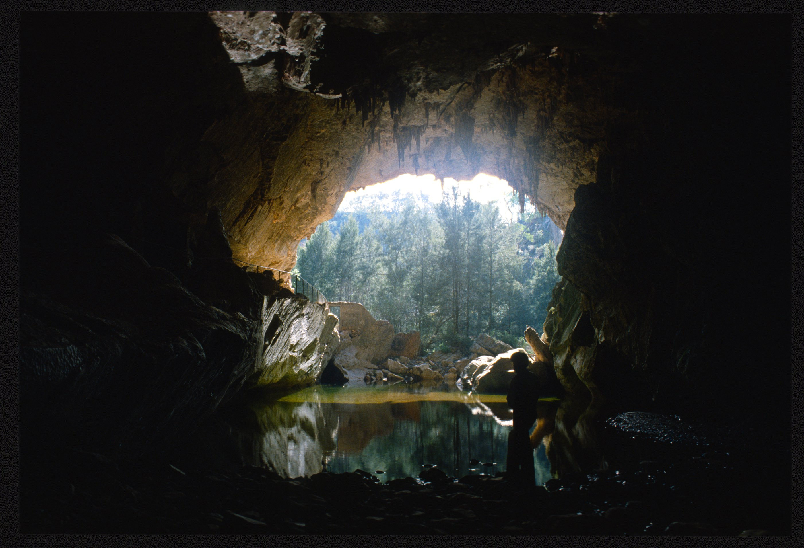
*ASF Joe N. Jennings slide catalogue, JNJ-S-1016-09, Box 1016. Catalogue description: North portal Abercrombie Arch. [ASF record](https://st1.asflib.net/MEDIA/ASFJJSlidesCatalogue/Box%201016/JNJ-S-1016-09.html).*

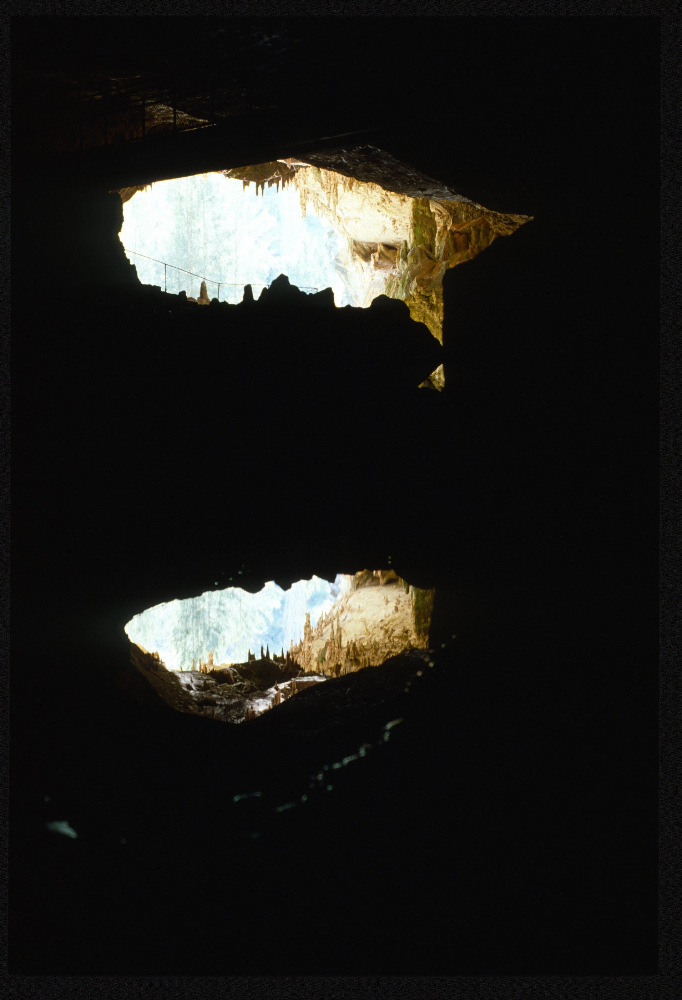
*ASF Joe N. Jennings slide catalogue, JNJ-S-1016-10, Box 1016. Catalogue description: North portal Abercrombie Arch. [ASF record](https://st1.asflib.net/MEDIA/ASFJJSlidesCatalogue/Box%201016/JNJ-S-1016-10.html).*

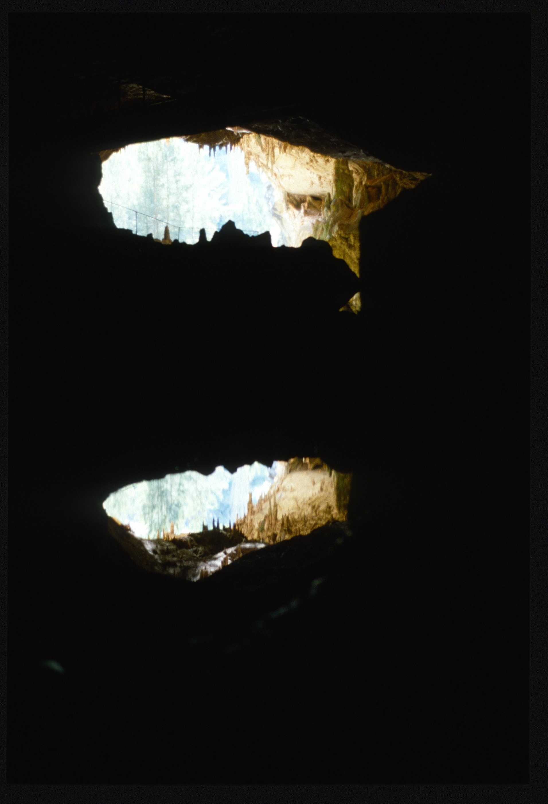
*ASF Joe N. Jennings slide catalogue, JNJ-S-1016-11, Box 1016. Catalogue description: North portal Abercrombie Arch. [ASF record](https://st1.asflib.net/MEDIA/ASFJJSlidesCatalogue/Box%201016/JNJ-S-1016-11.html).*

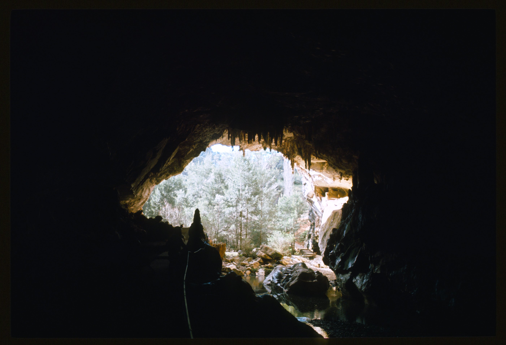
*ASF Joe N. Jennings slide catalogue, JNJ-S-1016-12, Box 1016. Catalogue description: North portal Abercrombie Arch. [ASF record](https://st1.asflib.net/MEDIA/ASFJJSlidesCatalogue/Box%201016/JNJ-S-1016-12.html).*

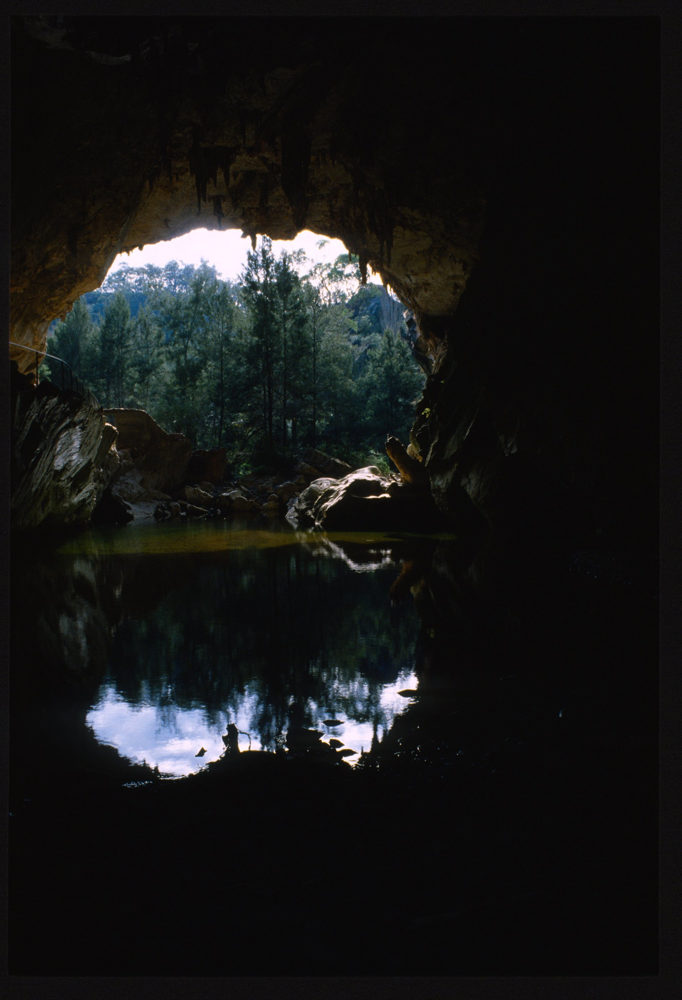
*ASF Joe N. Jennings slide catalogue, JNJ-S-1016-13, Box 1016. Catalogue description: North portal Abercrombie Arch. [ASF record](https://st1.asflib.net/MEDIA/ASFJJSlidesCatalogue/Box%201016/JNJ-S-1016-13.html).*

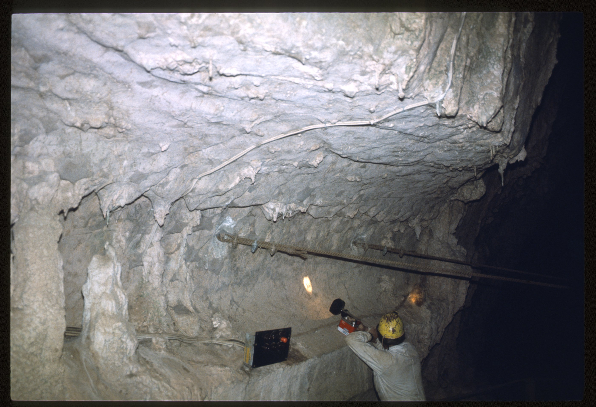
*ASF Joe N. Jennings slide catalogue, JNJ-S-1016-14, Box 1016. Catalogue description: Abercrombie Arch - Channel incut with pendants. [ASF record](https://st1.asflib.net/MEDIA/ASFJJSlidesCatalogue/Box%201016/JNJ-S-1016-14.html).*

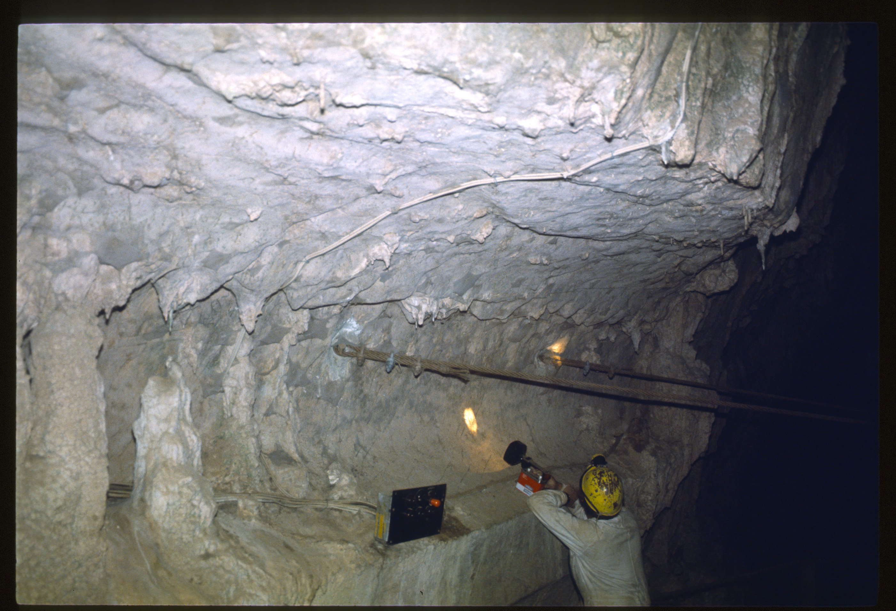
*ASF Joe N. Jennings slide catalogue, JNJ-S-1016-15, Box 1016. Catalogue description: Abercrombie Arch - Channel incut with pendants. [ASF record](https://st1.asflib.net/MEDIA/ASFJJSlidesCatalogue/Box%201016/JNJ-S-1016-15.html).*

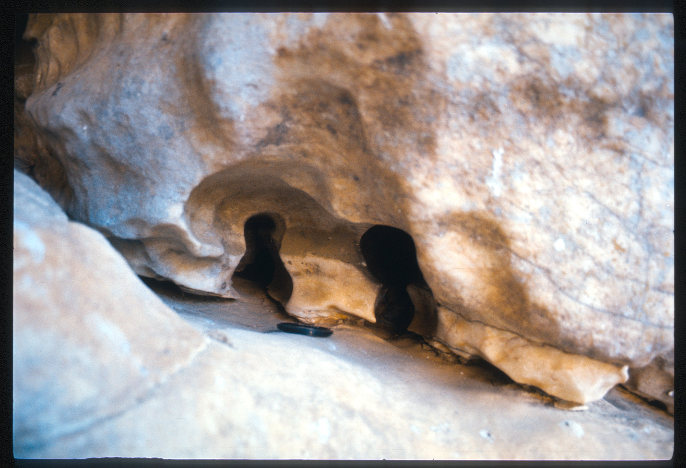
*ASF Joe N. Jennings slide catalogue, JNJ-S-1016-16, Box 1016. Catalogue description: Abercrombie Arch - Anastomoses in cross section. [ASF record](https://st1.asflib.net/MEDIA/ASFJJSlidesCatalogue/Box%201016/JNJ-S-1016-16.html).*

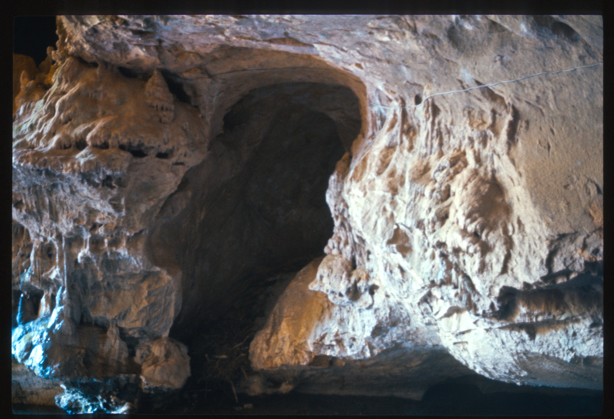
*ASF Joe N. Jennings slide catalogue, JNJ-S-1016-17, Box 1016. Catalogue description: Abercrombie Arch - Low level branch. [ASF record](https://st1.asflib.net/MEDIA/ASFJJSlidesCatalogue/Box%201016/JNJ-S-1016-17.html).*

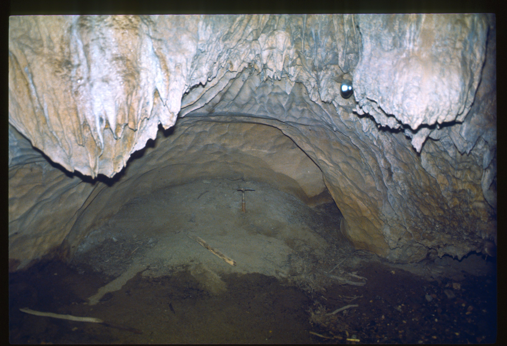
*ASF Joe N. Jennings slide catalogue, JNJ-S-1016-18, Box 1016. Catalogue description: Abercrombie Arch - ? Meander niche. [ASF record](https://st1.asflib.net/MEDIA/ASFJJSlidesCatalogue/Box%201016/JNJ-S-1016-18.html).*

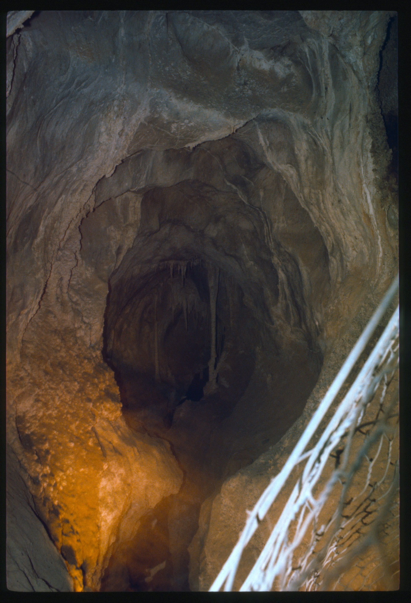
*ASF Joe N. Jennings slide catalogue, JNJ-S-1016-19, Box 1016. Catalogue description: Abercrombie Arch - Keyhole passage. [ASF record](https://st1.asflib.net/MEDIA/ASFJJSlidesCatalogue/Box%201016/JNJ-S-1016-19.html).*

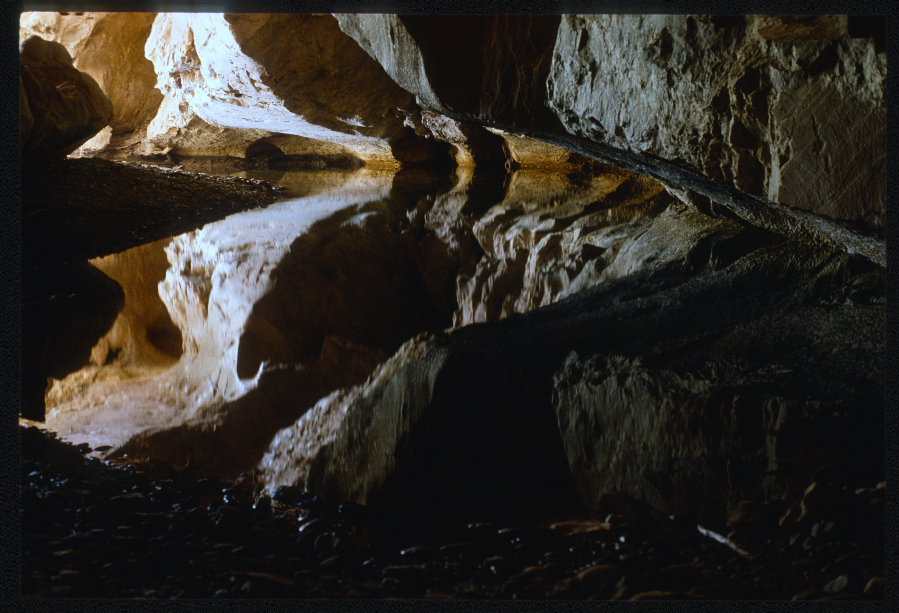
*ASF Joe N. Jennings slide catalogue, JNJ-S-1016-20, Box 1016. Catalogue description: Abercrombie Arch - Channel incut. [ASF record](https://st1.asflib.net/MEDIA/ASFJJSlidesCatalogue/Box%201016/JNJ-S-1016-20.html).*

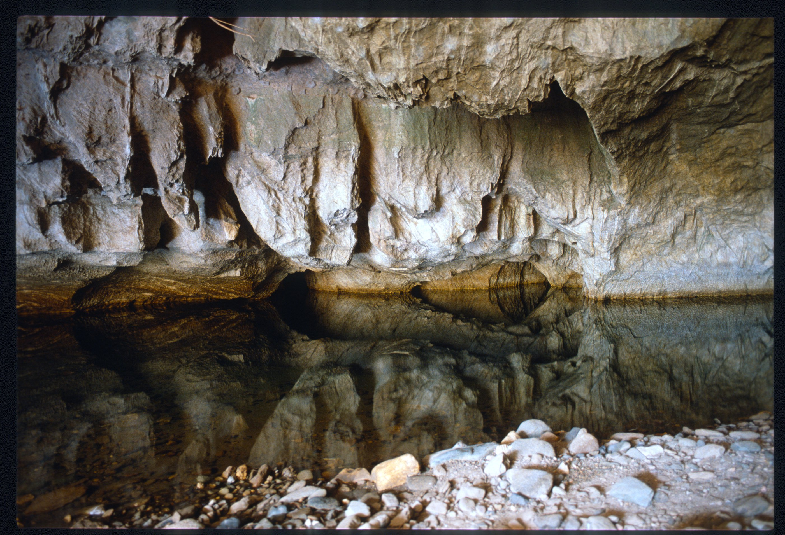
*ASF Joe N. Jennings slide catalogue, JNJ-S-1016-21, Box 1016. Catalogue description: Abercrombie Arch - Roof pendants. [ASF record](https://st1.asflib.net/MEDIA/ASFJJSlidesCatalogue/Box%201016/JNJ-S-1016-21.html).*

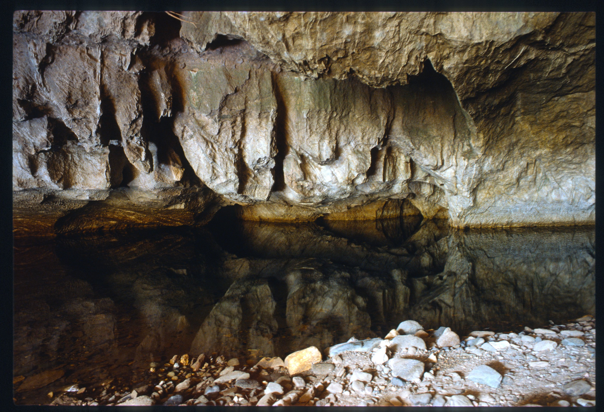
*ASF Joe N. Jennings slide catalogue, JNJ-S-1016-22, Box 1016. Catalogue description: Abercrombie Arch - Roof pendants. [ASF record](https://st1.asflib.net/MEDIA/ASFJJSlidesCatalogue/Box%201016/JNJ-S-1016-22.html).*

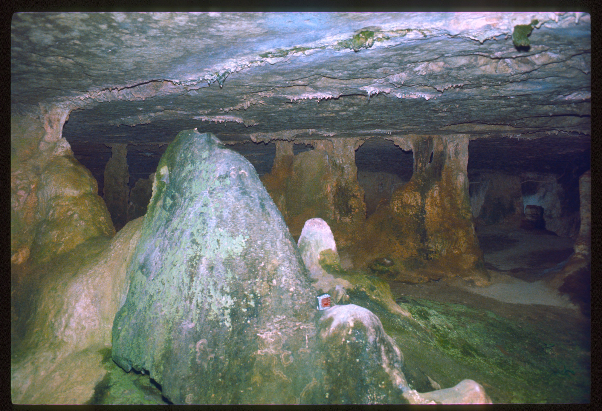
*ASF Joe N. Jennings slide catalogue, JNJ-S-1016-23, Box 1016. Catalogue description: Abercrombie Arch North end - Flat roof and phototropism. [ASF record](https://st1.asflib.net/MEDIA/ASFJJSlidesCatalogue/Box%201016/JNJ-S-1016-23.html).*

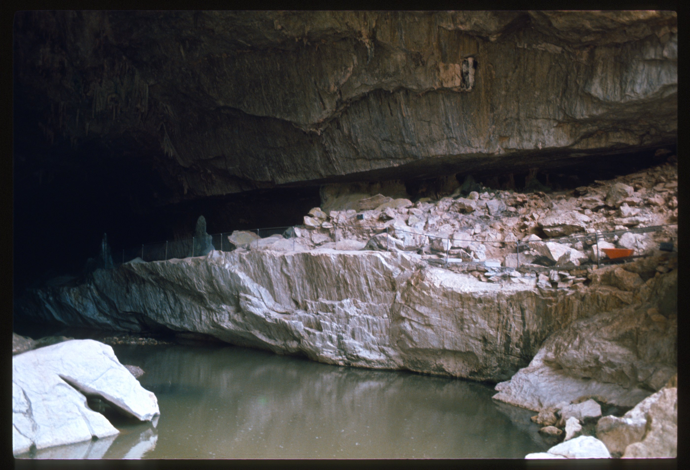
*ASF Joe N. Jennings slide catalogue, JNJ-S-1016-24, Box 1016. Catalogue description: Abercrombie Arch North end - Old level. [ASF record](https://st1.asflib.net/MEDIA/ASFJJSlidesCatalogue/Box%201016/JNJ-S-1016-24.html).*

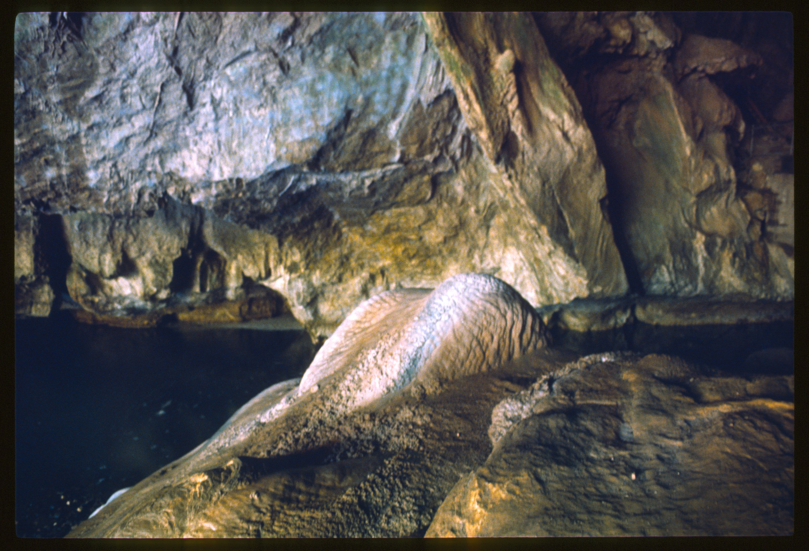
*ASF Joe N. Jennings slide catalogue, JNJ-S-1016-25, Box 1016. Catalogue description: Abercrombie Arch North end - ? phototropism. [ASF record](https://st1.asflib.net/MEDIA/ASFJJSlidesCatalogue/Box%201016/JNJ-S-1016-25.html).*

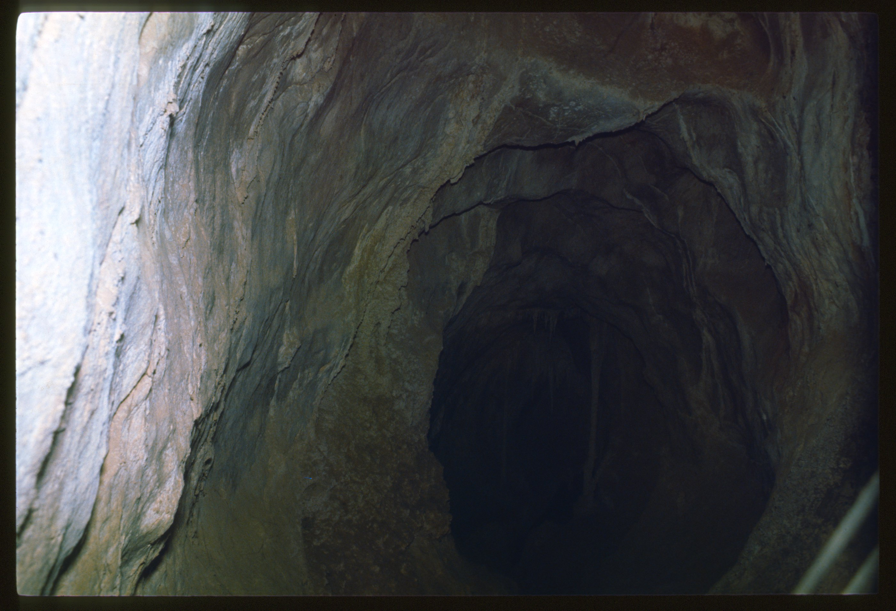
*ASF Joe N. Jennings slide catalogue, JNJ-S-1016-26, Box 1016. Catalogue description: Abercrombie Arch - Old pressure passage. [ASF record](https://st1.asflib.net/MEDIA/ASFJJSlidesCatalogue/Box%201016/JNJ-S-1016-26.html).*

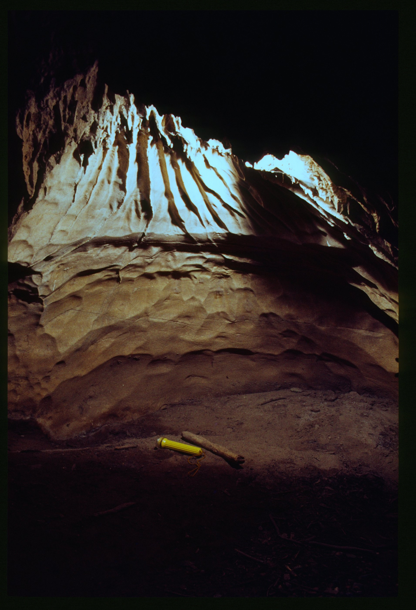
*ASF Joe N. Jennings slide catalogue, JNJ-S-1016-27, Box 1016. Catalogue description: Abercrombie Arch - Meander niche. [ASF record](https://st1.asflib.net/MEDIA/ASFJJSlidesCatalogue/Box%201016/JNJ-S-1016-27.html).*

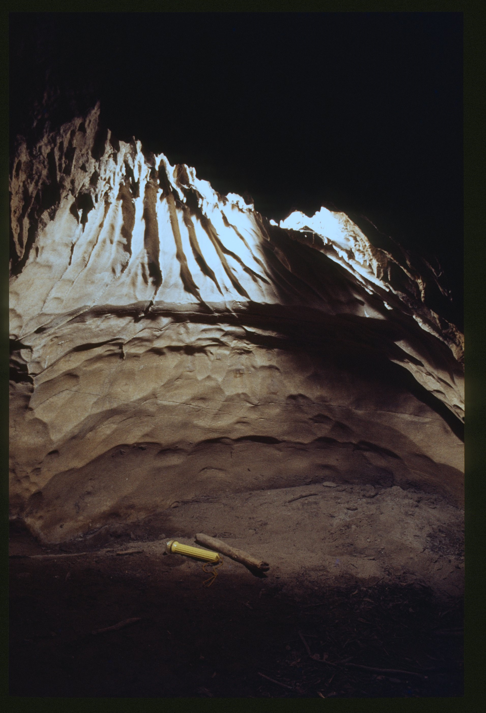
*ASF Joe N. Jennings slide catalogue, JNJ-S-1016-28, Box 1016. Catalogue description: Abercrombie - Adrian Davey. [ASF record](https://st1.asflib.net/MEDIA/ASFJJSlidesCatalogue/Box%201016/JNJ-S-1016-28.html).*

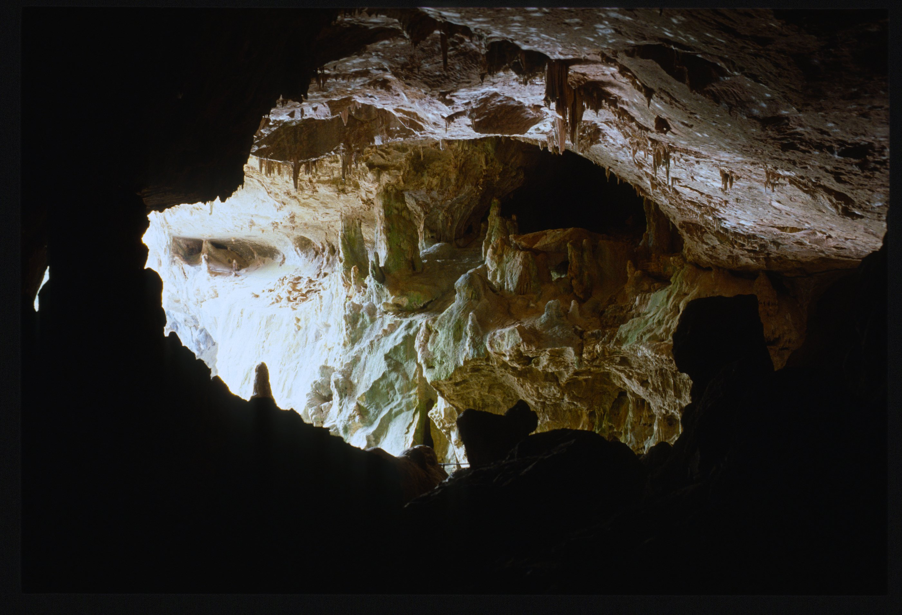
*ASF Joe N. Jennings slide catalogue, JNJ-S-1016-29, Box 1016. Catalogue description: Abercrombie Arch - Koh-i-noor. [ASF record](https://st1.asflib.net/MEDIA/ASFJJSlidesCatalogue/Box%201016/JNJ-S-1016-29.html).*

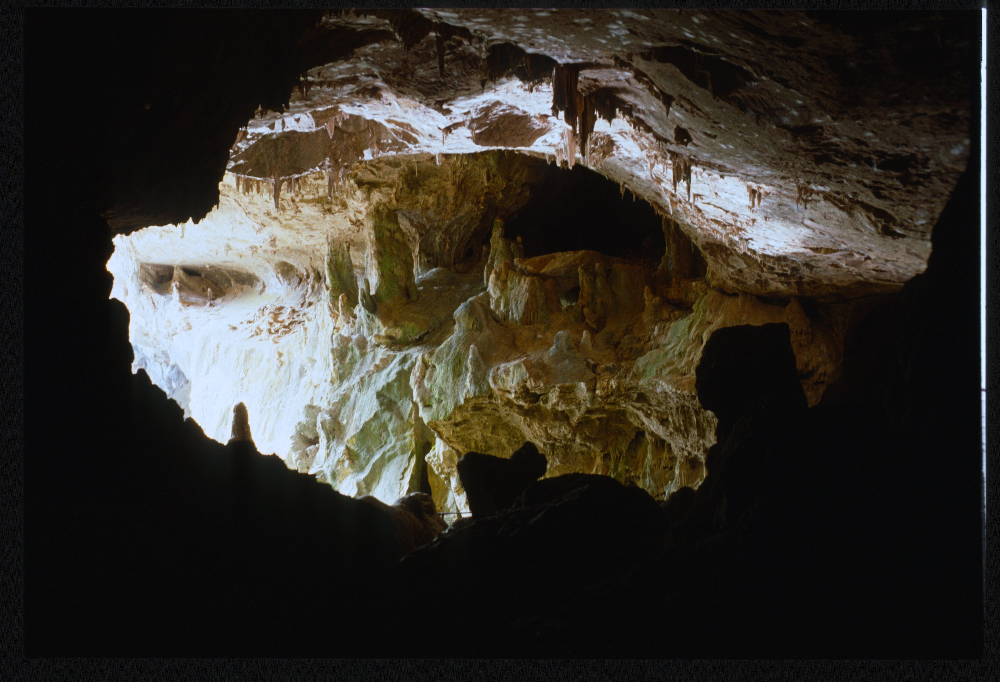
*ASF Joe N. Jennings slide catalogue, JNJ-S-1016-30, Box 1016. Catalogue description: Abercrombie Arch - Koh-i-noor. [ASF record](https://st1.asflib.net/MEDIA/ASFJJSlidesCatalogue/Box%201016/JNJ-S-1016-30.html).*

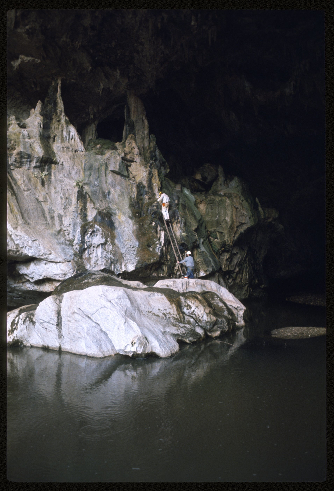
*ASF Joe N. Jennings slide catalogue, JNJ-S-1016-31, Box 1016. Catalogue description: Abercrombie Arch cave North end - Artificial aids. [ASF record](https://st1.asflib.net/MEDIA/ASFJJSlidesCatalogue/Box%201016/JNJ-S-1016-31.html).*

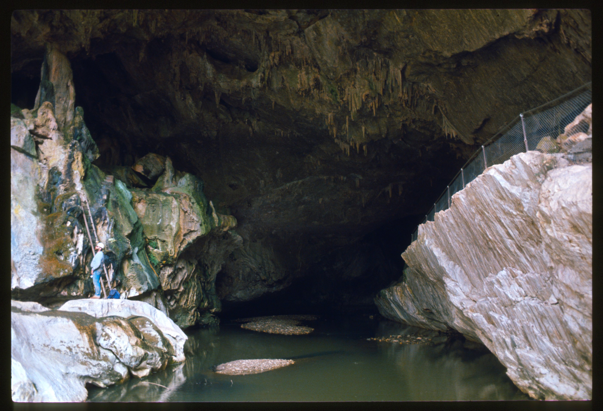
*ASF Joe N. Jennings slide catalogue, JNJ-S-1016-32, Box 1016. Catalogue description: Abercrombie Arch cave North end. [ASF record](https://st1.asflib.net/MEDIA/ASFJJSlidesCatalogue/Box%201016/JNJ-S-1016-32.html).*

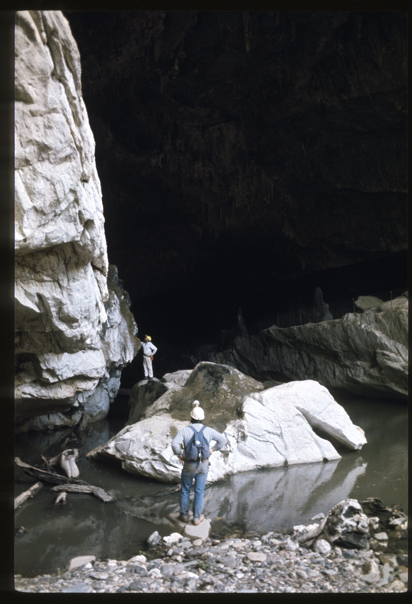
*ASF Joe N. Jennings slide catalogue, JNJ-S-1016-33, Box 1016. Catalogue description: Abercrombie Arch cave North end. [ASF record](https://st1.asflib.net/MEDIA/ASFJJSlidesCatalogue/Box%201016/JNJ-S-1016-33.html).*

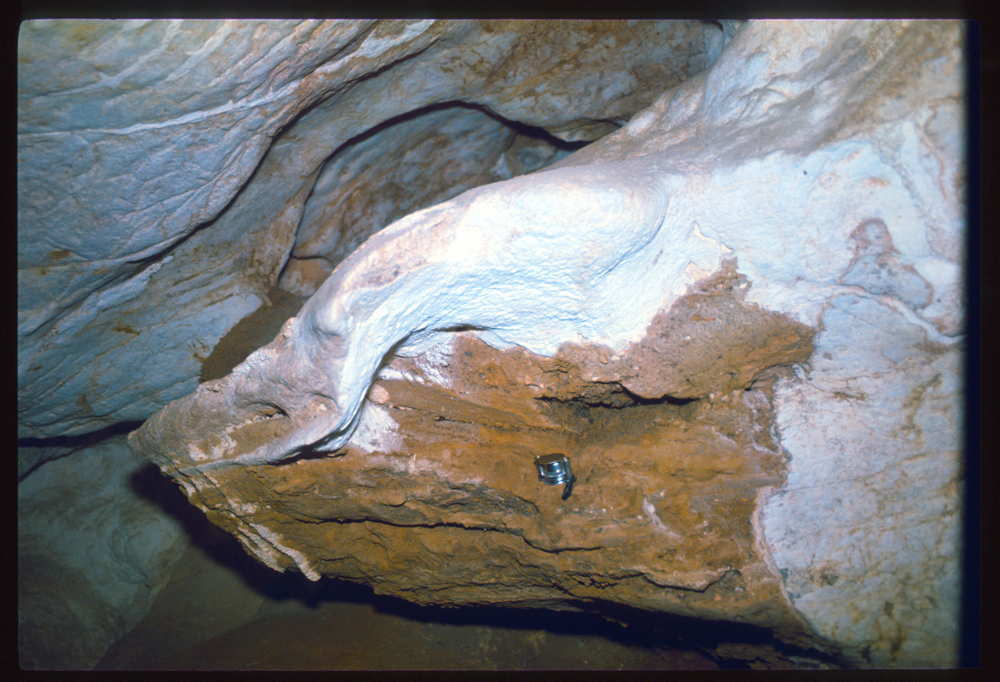
*ASF Joe N. Jennings slide catalogue, JNJ-S-1016-34, Box 1016. Catalogue description: Abercrombie Bushrangers cave - Old alluvium est 34,000 B.P.. [ASF record](https://st1.asflib.net/MEDIA/ASFJJSlidesCatalogue/Box%201016/JNJ-S-1016-34.html).*

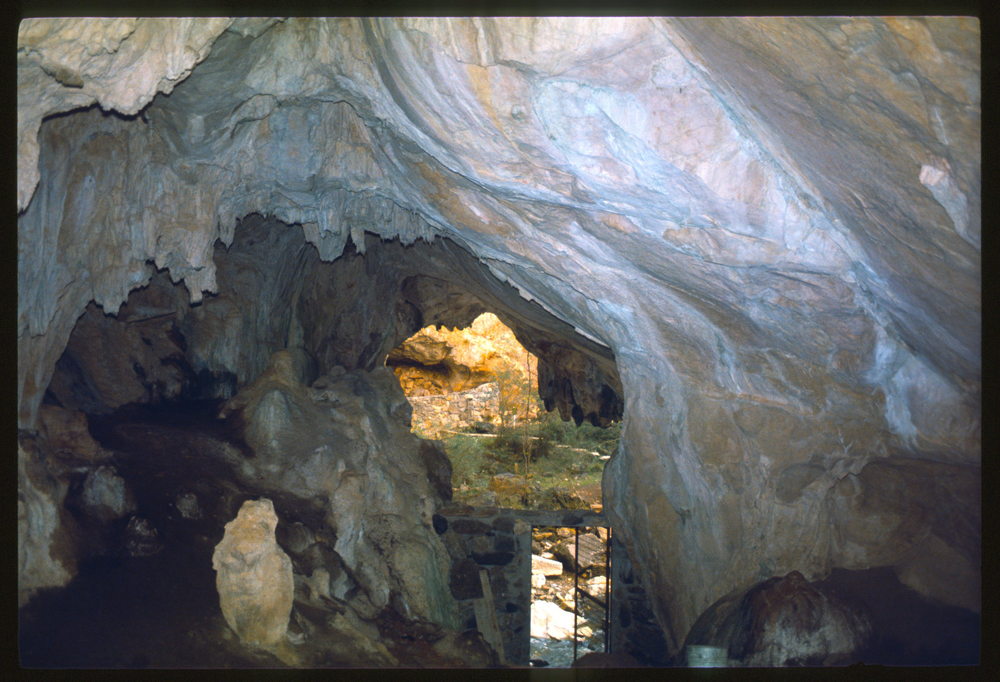
*ASF Joe N. Jennings slide catalogue, JNJ-S-1016-35, Box 1016. Catalogue description: Abercrombie Bushrangers cave towards the Arch. [ASF record](https://st1.asflib.net/MEDIA/ASFJJSlidesCatalogue/Box%201016/JNJ-S-1016-35.html).*

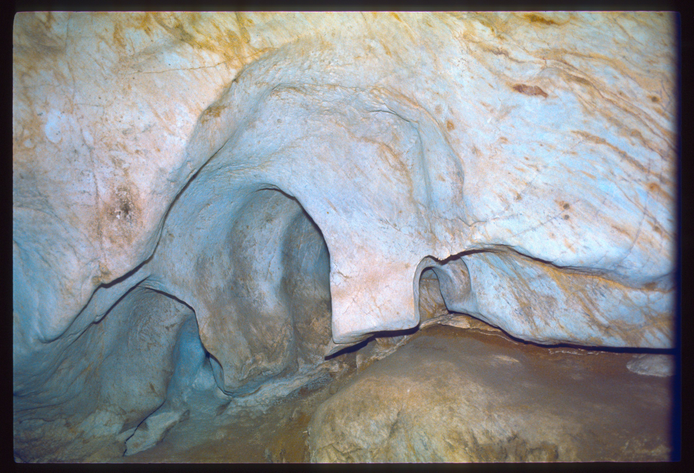
*ASF Joe N. Jennings slide catalogue, JNJ-S-1016-36, Box 1016. Catalogue description: Abercrombie Bushrangers cave - Pendants. [ASF record](https://st1.asflib.net/MEDIA/ASFJJSlidesCatalogue/Box%201016/JNJ-S-1016-36.html).*

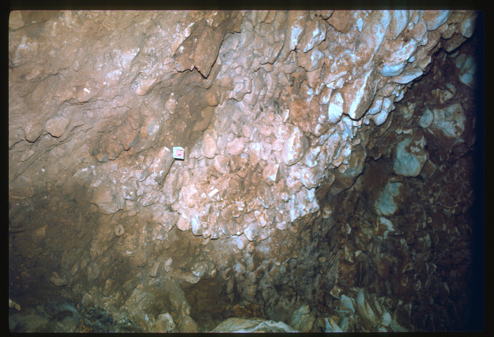
*ASF Joe N. Jennings slide catalogue, JNJ-S-1016-37, Box 1016. Catalogue description: Abercrombie Cavthedral cave - Limestone weathering debris. [ASF record](https://st1.asflib.net/MEDIA/ASFJJSlidesCatalogue/Box%201016/JNJ-S-1016-37.html).*

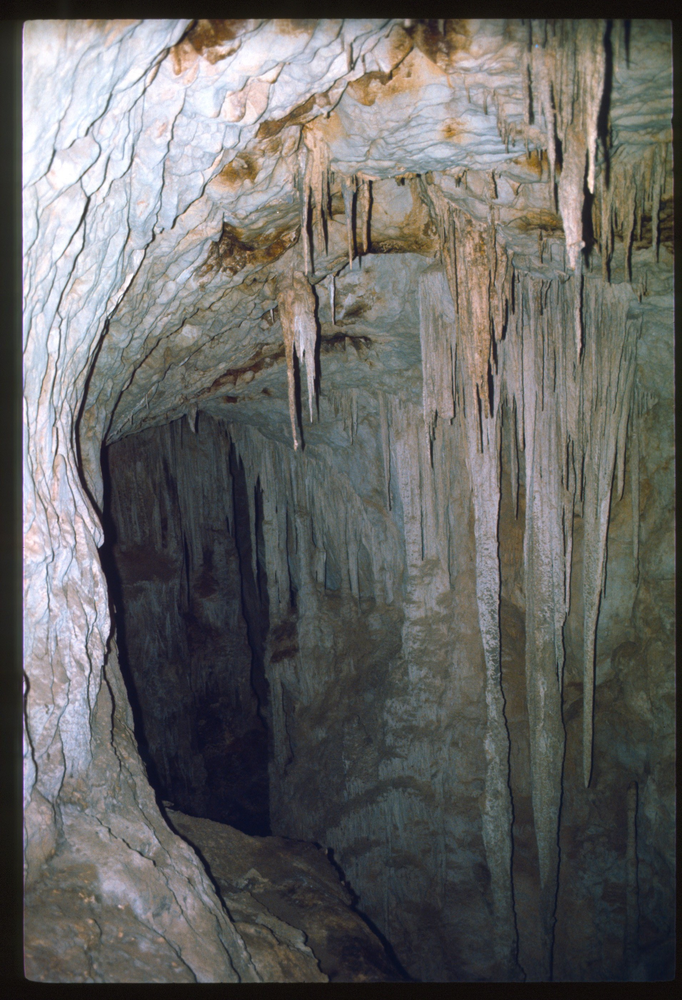
*ASF Joe N. Jennings slide catalogue, JNJ-S-1016-38, Box 1016. Catalogue description: Abercrombie Cavthedral cave - Old pressure passage. [ASF record](https://st1.asflib.net/MEDIA/ASFJJSlidesCatalogue/Box%201016/JNJ-S-1016-38.html).*

### Arch Cave

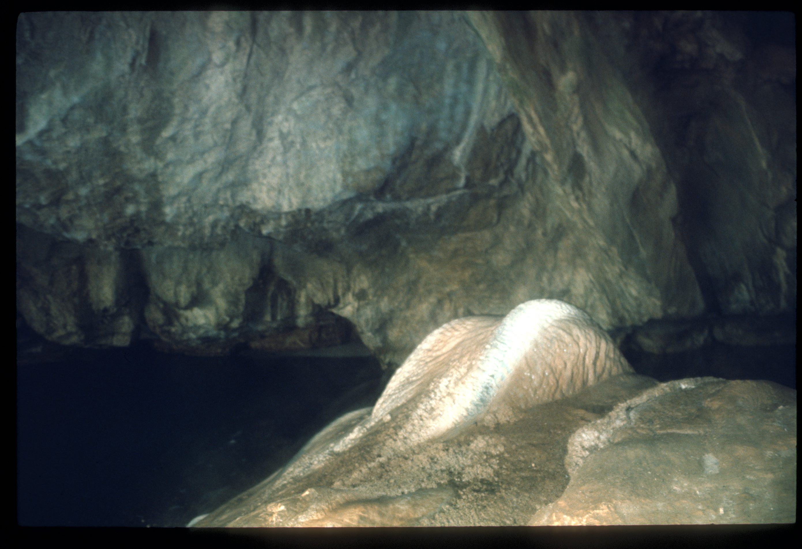
*ASF Joe N. Jennings slide catalogue, JNJ-S-00240, Box 45. Catalogue description: Abercrombie Arch Cave North end & phototropism. [ASF record](https://st1.asflib.net/MEDIA/ASFJJSlidesCatalogue/Box%2045/JNJ-S-00240.html).*

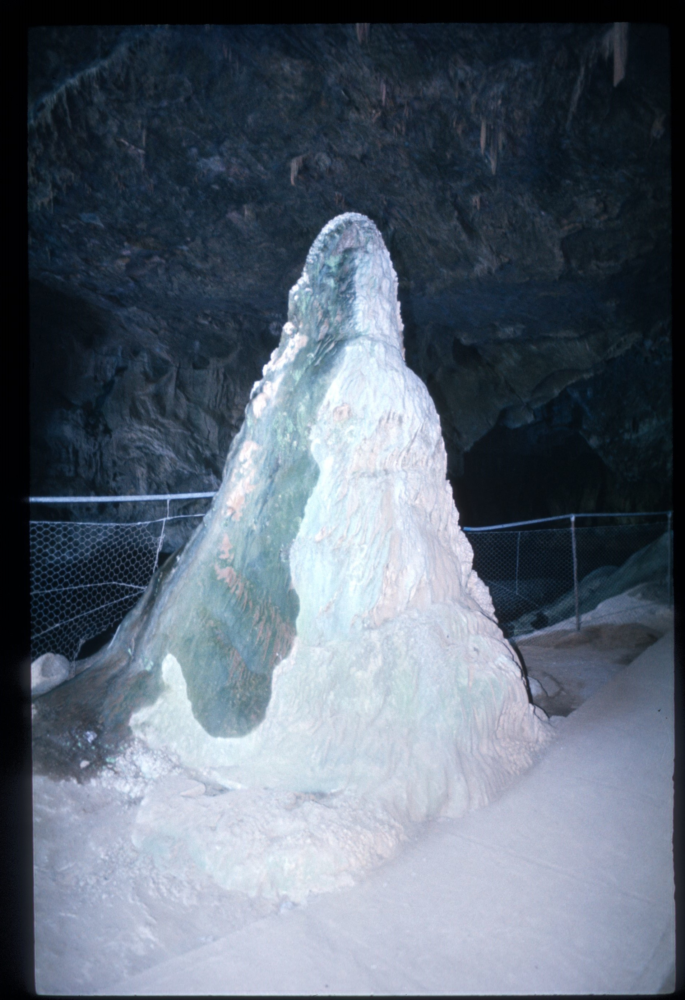
*ASF Joe N. Jennings slide catalogue, JNJ-S-00245, Box 45. Catalogue description: Abercrombie, Arch Cave, Algal effect stalagmite. [ASF record](https://st1.asflib.net/MEDIA/ASFJJSlidesCatalogue/Box%2045/JNJ-S-00245.html).*

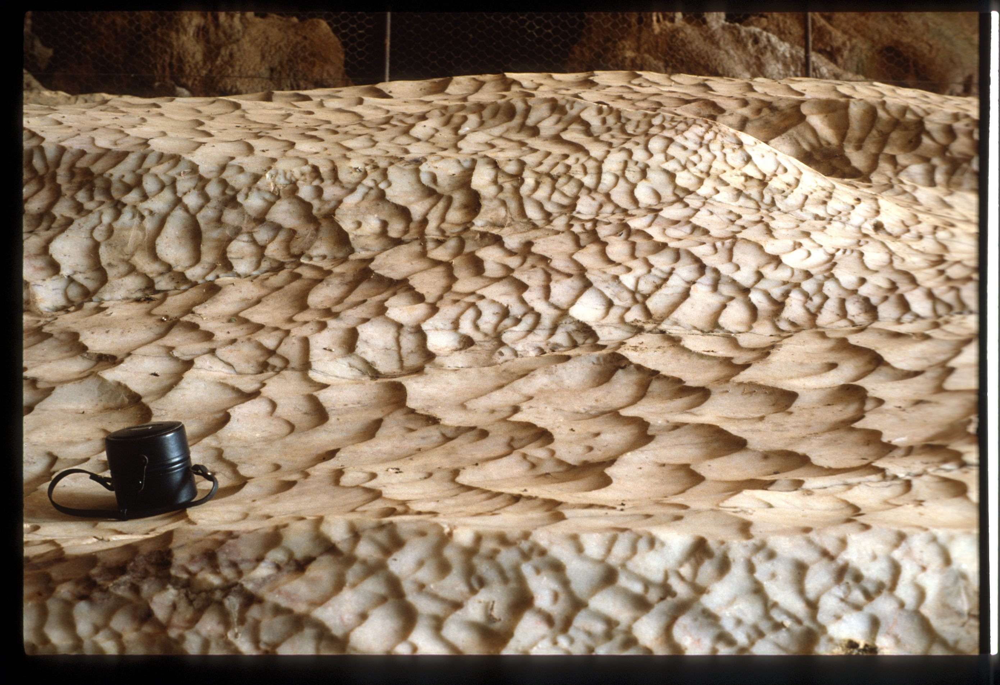
*ASF Joe N. Jennings slide catalogue, JNJ-S-00246, Box 45. Catalogue description: Abercrombie, Arch Cave, Water scallops. [ASF record](https://st1.asflib.net/MEDIA/ASFJJSlidesCatalogue/Box%2045/JNJ-S-00246.html).*

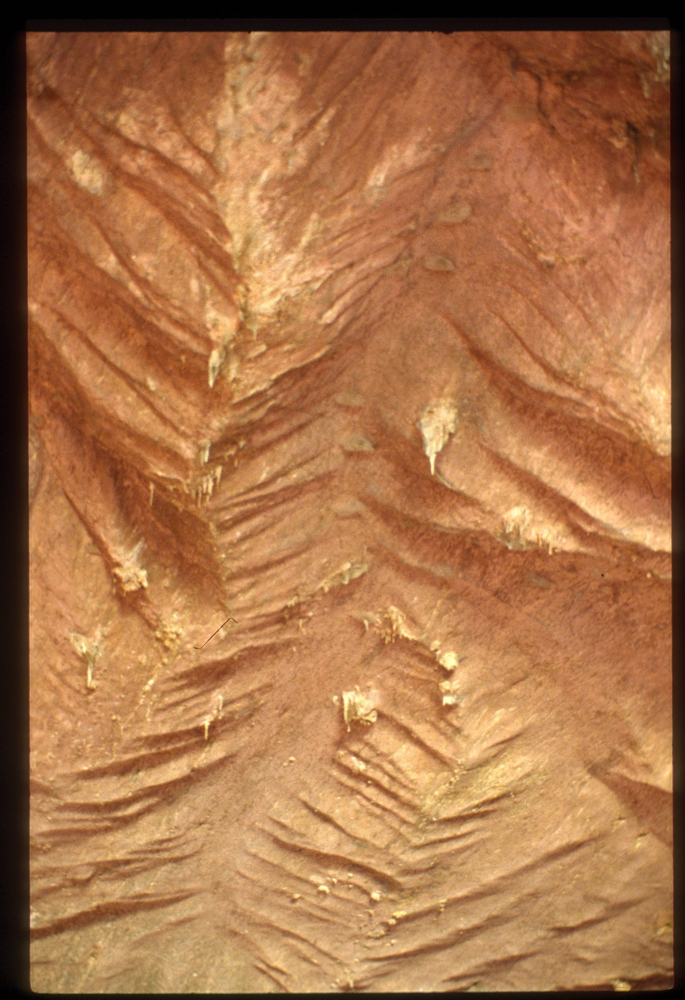
*ASF Joe N. Jennings slide catalogue, JNJ-S-00247, Box 45. Catalogue description: Abercrombie, Arch Cave, Hall of Terpsichore, Decken Karren. [ASF record](https://st1.asflib.net/MEDIA/ASFJJSlidesCatalogue/Box%2045/JNJ-S-00247.html).*

*ASF Joe N. Jennings slide catalogue, JNJ-S-00248, Box 45. Catalogue description: Abercrombie, Arch Cave, Hall of Terpsichore, R Curl type flutes.. [ASF record](https://st1.asflib.net/MEDIA/ASFJJSlidesCatalogue/Box%2045/JNJ-S-00248.html).*

*ASF Joe N. Jennings slide catalogue, JNJ-S-00249, Box 45. Catalogue description: Abercrombie, Arch Cave, Hall of Terpsichore, R Curl type flutes.. [ASF record](https://st1.asflib.net/MEDIA/ASFJJSlidesCatalogue/Box%2045/JNJ-S-00249.html).*

*ASF Joe N. Jennings slide catalogue, JNJ-S-00250, Box 45. Catalogue description: Abercrombie, Arch Cave, Hall of Terpsichore, R Curl type flutes.. [ASF record](https://st1.asflib.net/MEDIA/ASFJJSlidesCatalogue/Box%2045/JNJ-S-00250.html).*

*ASF Joe N. Jennings slide catalogue, JNJ-S-00251, Box 45. Catalogue description: Abercrombie, Arch Cave, Hall of Terpsichore, R Curl type flutes.. [ASF record](https://st1.asflib.net/MEDIA/ASFJJSlidesCatalogue/Box%2045/JNJ-S-00251.html).*

*ASF Joe N. Jennings slide catalogue, JNJ-S-00252, Box 45. Catalogue description: Abercrombie, Arch Cave, Algal effect stalagmite. [ASF record](https://st1.asflib.net/MEDIA/ASFJJSlidesCatalogue/Box%2045/JNJ-S-00252.html).*

*ASF Joe N. Jennings slide catalogue, JNJ-S-00253, Box 45. Catalogue description: Abercrombie, Arch Cave, Hall of Terpsichore, Decken Karren. [ASF record](https://st1.asflib.net/MEDIA/ASFJJSlidesCatalogue/Box%2045/JNJ-S-00253.html).*

*ASF Joe N. Jennings slide catalogue, JNJ-S-00254, Box 45. Catalogue description: Abercrombie, Arch Cave, Elongate Stalagmites. [ASF record](https://st1.asflib.net/MEDIA/ASFJJSlidesCatalogue/Box%2045/JNJ-S-00254.html).*

*ASF Joe N. Jennings slide catalogue, JNJ-S-00255, Box 45. Catalogue description: Abercrombie, Arch Cave, Channel Incuts. [ASF record](https://st1.asflib.net/MEDIA/ASFJJSlidesCatalogue/Box%2045/JNJ-S-00255.html).*

*ASF Joe N. Jennings slide catalogue, JNJ-S-00256, Box 45. Catalogue description: Abercrombie, Arch Cave, Channel Incuts. [ASF record](https://st1.asflib.net/MEDIA/ASFJJSlidesCatalogue/Box%2045/JNJ-S-00256.html).*

*ASF Joe N. Jennings slide catalogue, JNJ-S-00257, Box 45. Catalogue description: Abercrombie, Arch Cave, Channel Incuts. [ASF record](https://st1.asflib.net/MEDIA/ASFJJSlidesCatalogue/Box%2045/JNJ-S-00257.html).*

*ASF Joe N. Jennings slide catalogue, JNJ-S-00258, Box 45. Catalogue description: Abercrombie, Arch Cave, R Curl type flutes.. [ASF record](https://st1.asflib.net/MEDIA/ASFJJSlidesCatalogue/Box%2045/JNJ-S-00258.html).*

*ASF Joe N. Jennings slide catalogue, JNJ-S-00262, Box 45. Catalogue description: Out of South Portal, Abercrombie, Arch Cave. [ASF record](https://st1.asflib.net/MEDIA/ASFJJSlidesCatalogue/Box%2045/JNJ-S-00262.html).*

*ASF Joe N. Jennings slide catalogue, JNJ-S-00264, Box 45. Catalogue description: Abercrombie, Arch Cave, Decken Karren. [ASF record](https://st1.asflib.net/MEDIA/ASFJJSlidesCatalogue/Box%2045/JNJ-S-00264.html).*

*ASF Joe N. Jennings slide catalogue, JNJ-S-00265, Box 45. Catalogue description: Abercrombie, Arch Cave. [ASF record](https://st1.asflib.net/MEDIA/ASFJJSlidesCatalogue/Box%2045/JNJ-S-00265.html).*

*ASF Joe N. Jennings slide catalogue, JNJ-S-00266, Box 45. Catalogue description: Abercrombie, Arch Cave, Decken Karren. [ASF record](https://st1.asflib.net/MEDIA/ASFJJSlidesCatalogue/Box%2045/JNJ-S-00266.html).*

*ASF Joe N. Jennings slide catalogue, JNJ-S-00267, Box 45. Catalogue description: Abercrombie, Arch Cave, Elongate stals & algae. [ASF record](https://st1.asflib.net/MEDIA/ASFJJSlidesCatalogue/Box%2045/JNJ-S-00267.html).*

### Bushrangers Cave

*ASF Joe N. Jennings slide catalogue, JNJ-S-00241, Box 45. Catalogue description: Abercrobie Bushrangers Cave, Jointed wall & phreatic. [ASF record](https://st1.asflib.net/MEDIA/ASFJJSlidesCatalogue/Box%2045/JNJ-S-00241.html).*

### Cathedral Cave

*ASF Joe N. Jennings slide catalogue, JNJ-S-00243, Box 45. Catalogue description: Abercrombie Cathedral Cave, entrance series?. [ASF record](https://st1.asflib.net/MEDIA/ASFJJSlidesCatalogue/Box%2045/JNJ-S-00243.html).*

<!-- ASF slide images: end -->

# References

- [National Parks NSW](https://www.nationalparks.nsw.gov.au/things-to-do/guided-tours/archway-cave-tour)
