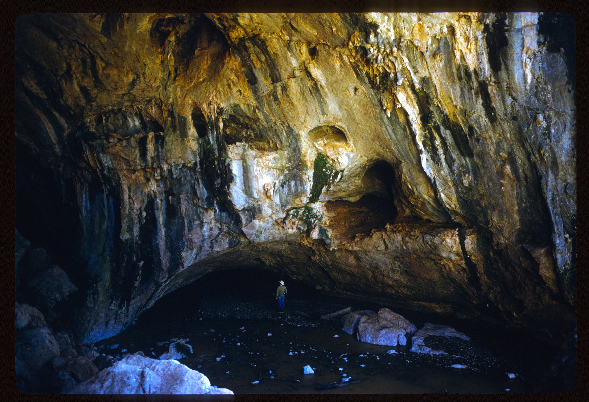
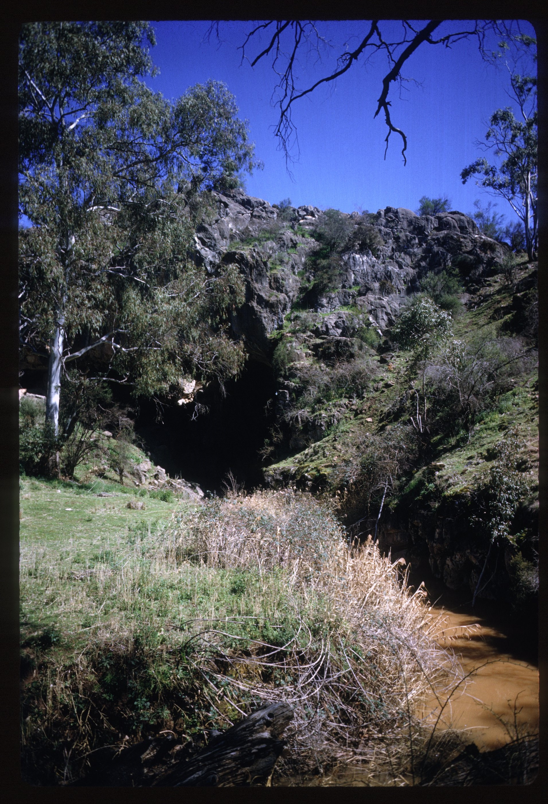
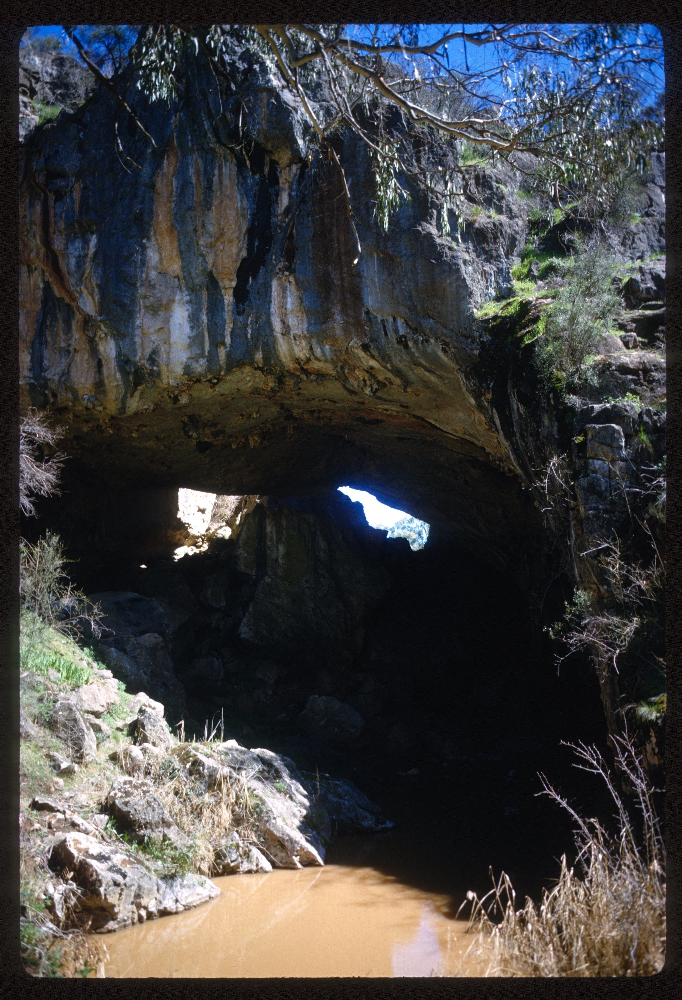
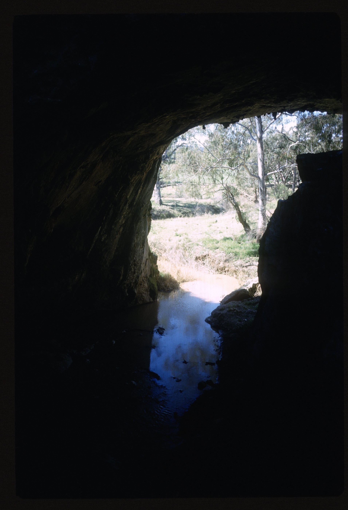
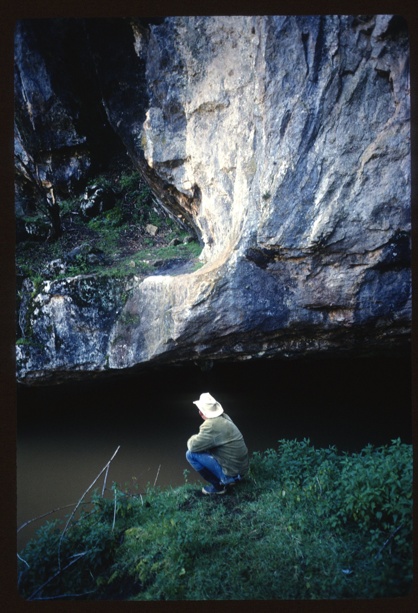
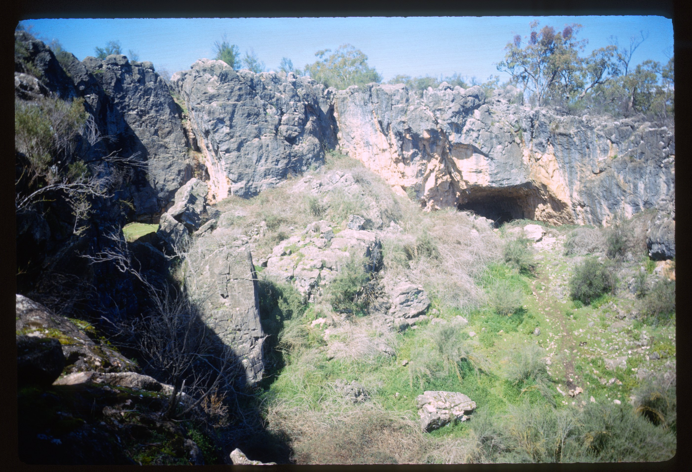

# About

Borenore Karst Conservation Reserve

# Source notes

<!-- ASF slide images: start -->
## ASF slide images

Images are from the ASF Joe N. Jennings slide catalogue. Each caption preserves the catalogue description and links to its source record.

*ASF Joe N. Jennings slide catalogue, JNJ-S-1017-01, Box 1017. Catalogue description: Borenore Arch cave upstream end. [ASF record](https://st1.asflib.net/MEDIA/ASFJJSlidesCatalogue/Box%201017/JNJ-S-1017-01.html).*

*ASF Joe N. Jennings slide catalogue, JNJ-S-1017-02, Box 1017. Catalogue description: Borenore Arch cave upstream end. [ASF record](https://st1.asflib.net/MEDIA/ASFJJSlidesCatalogue/Box%201017/JNJ-S-1017-02.html).*

*ASF Joe N. Jennings slide catalogue, JNJ-S-1017-03, Box 1017. Catalogue description: Borenore Arch cave upstream end. [ASF record](https://st1.asflib.net/MEDIA/ASFJJSlidesCatalogue/Box%201017/JNJ-S-1017-03.html).*

*ASF Joe N. Jennings slide catalogue, JNJ-S-1017-04, Box 1017. Catalogue description: Borenore Arch cave looking upstream. [ASF record](https://st1.asflib.net/MEDIA/ASFJJSlidesCatalogue/Box%201017/JNJ-S-1017-04.html).*

*ASF Joe N. Jennings slide catalogue, JNJ-S-1017-05, Box 1017. Catalogue description: Borenore Arch cave - Higher level incut at lower end. [ASF record](https://st1.asflib.net/MEDIA/ASFJJSlidesCatalogue/Box%201017/JNJ-S-1017-05.html).*

*ASF Joe N. Jennings slide catalogue, JNJ-S-1017-06, Box 1017. Catalogue description: Borenore Arch cave - Collapse retreat two levels. [ASF record](https://st1.asflib.net/MEDIA/ASFJJSlidesCatalogue/Box%201017/JNJ-S-1017-06.html).*

<!-- ASF slide images: end -->

# References

- [National Parks NSW](https://www.nationalparks.nsw.gov.au/things-to-do/walking-tracks/arch-loop-track/map)
