# About

More than 190 caves in the region, most well known are:
[Drum Cave](Drum%20Cave.md)
[Blowfly Cave](Blowfly%20Cave.md)
[Grill Cave](Grill%20Cave.md)
[Argyle Hole](Argyle%20Hole.md)
Canberra-Steampipe
B4-5 (Fossil Cave-[Hogans Hole](Hogans%20Hole.md))
[Acoustic Pot](Acoustic%20Pot.md)
Hollands Hole

# Additional Notes

- **National Parks NSW:** https://www.nationalparks.nsw.gov.au/visit-a-park/parks/bungonia-national-park

- **Travel Made Me Do It:** https://travelmademedoit.com/bungonia-national-park/
- **Fat Canyoners:** https://fatcanyoners.org/2009/10/16/bungonia-canyoning-and-caving/

- **Wikipedia:** https://en.wikipedia.org/wiki/Bungonia_Caves

# Source notes

## ASF slide images

Images are from the ASF Joe N. Jennings slide catalogue. Each caption preserves the catalogue description and links to its source record.

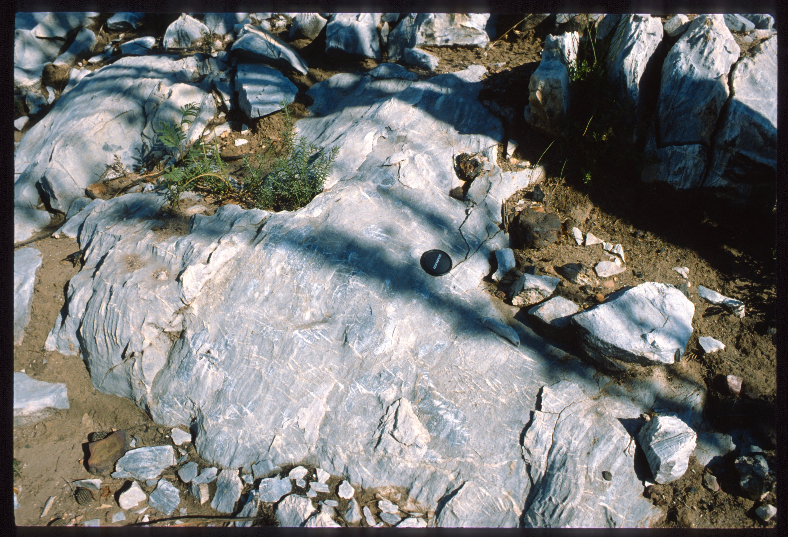
*ASF Joe N. Jennings slide catalogue, JNJ-S-1020-01, Box 1020. Catalogue description: Bushfire flaking. [ASF record](https://st1.asflib.net/MEDIA/ASFJJSlidesCatalogue/Box%201020/JNJ-S-1020-01.html).*

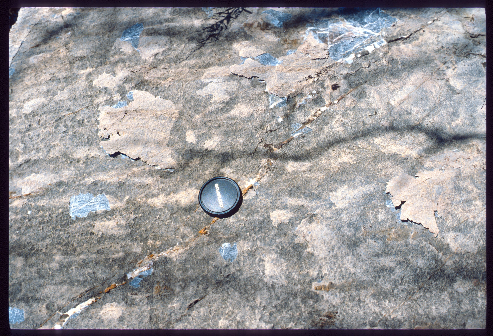
*ASF Joe N. Jennings slide catalogue, JNJ-S-1020-02, Box 1020. Catalogue description: Bushfire flaking. [ASF record](https://st1.asflib.net/MEDIA/ASFJJSlidesCatalogue/Box%201020/JNJ-S-1020-02.html).*

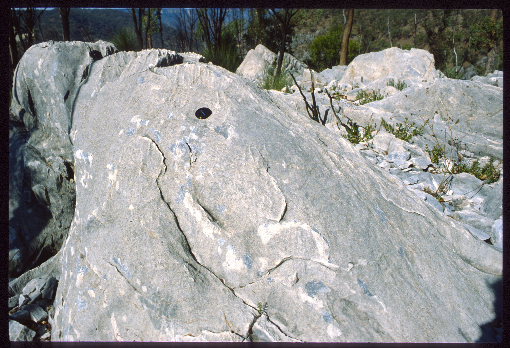
*ASF Joe N. Jennings slide catalogue, JNJ-S-1020-03, Box 1020. Catalogue description: Fire flaking and exfolration - Top of Devils Staircase. [ASF record](https://st1.asflib.net/MEDIA/ASFJJSlidesCatalogue/Box%201020/JNJ-S-1020-03.html).*

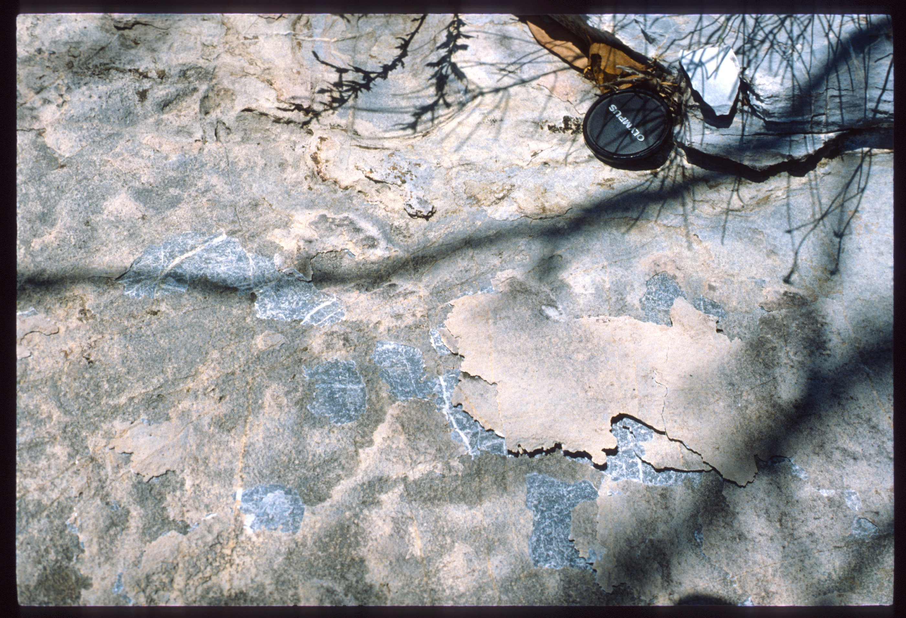
*ASF Joe N. Jennings slide catalogue, JNJ-S-1020-04, Box 1020. Catalogue description: Bushfire flaking. [ASF record](https://st1.asflib.net/MEDIA/ASFJJSlidesCatalogue/Box%201020/JNJ-S-1020-04.html).*

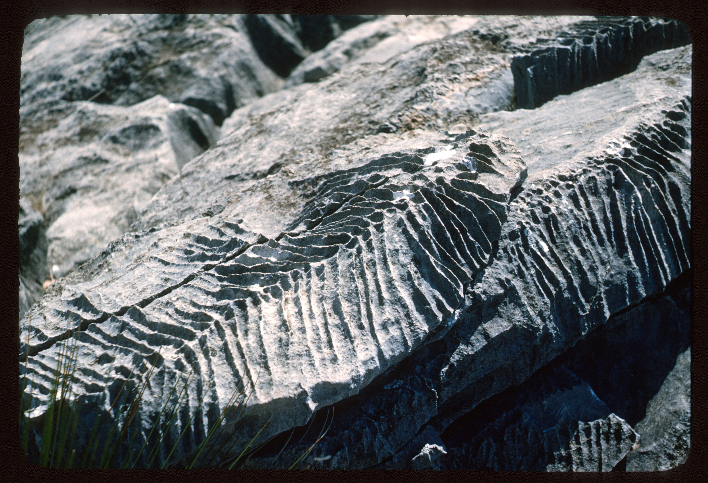
*ASF Joe N. Jennings slide catalogue, JNJ-S-1020-05, Box 1020. Catalogue description: Solution flutes. [ASF record](https://st1.asflib.net/MEDIA/ASFJJSlidesCatalogue/Box%201020/JNJ-S-1020-05.html).*

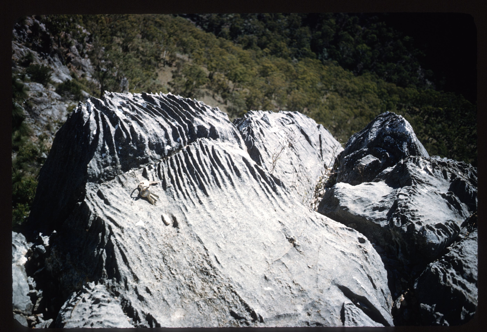
*ASF Joe N. Jennings slide catalogue, JNJ-S-1020-06, Box 1020. Catalogue description: Rillenkarren - Ebensflocher. [ASF record](https://st1.asflib.net/MEDIA/ASFJJSlidesCatalogue/Box%201020/JNJ-S-1020-06.html).*

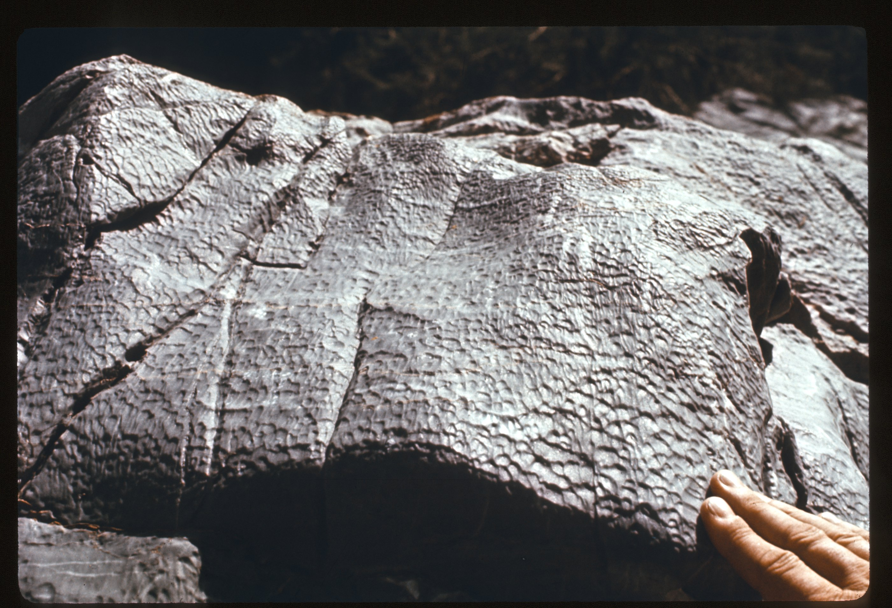
*ASF Joe N. Jennings slide catalogue, JNJ-S-1020-07, Box 1020. Catalogue description: Downward current markings - Bolder choke - Bungonia Gorge. [ASF record](https://st1.asflib.net/MEDIA/ASFJJSlidesCatalogue/Box%201020/JNJ-S-1020-07.html).*

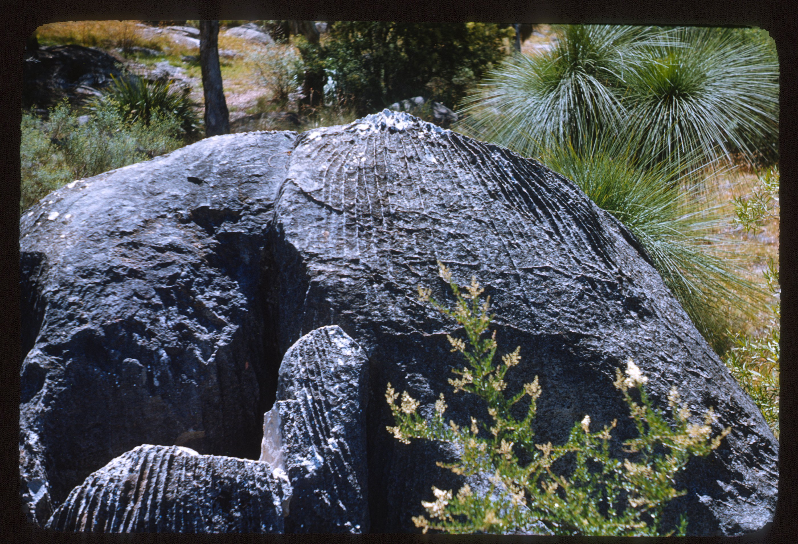
*ASF Joe N. Jennings slide catalogue, JNJ-S-1020-08, Box 1020. Catalogue description: Beehive with solution flutes. [ASF record](https://st1.asflib.net/MEDIA/ASFJJSlidesCatalogue/Box%201020/JNJ-S-1020-08.html).*

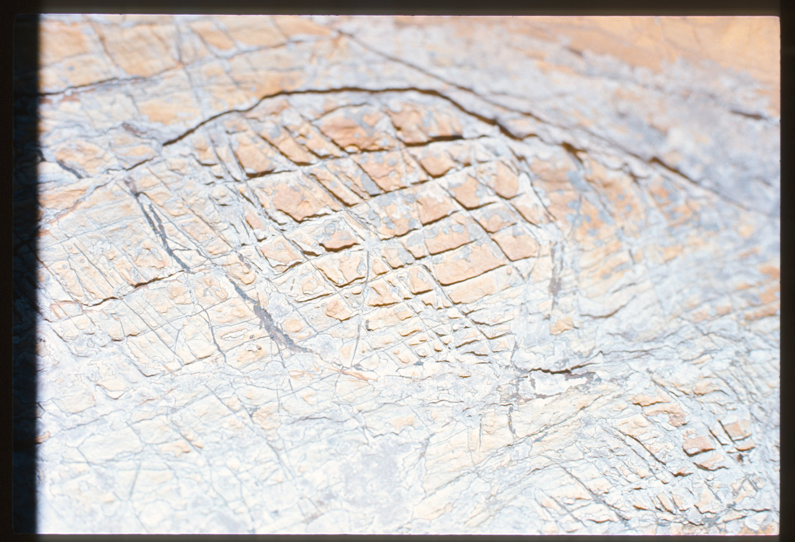
*ASF Joe N. Jennings slide catalogue, JNJ-S-1020-09, Box 1020. Catalogue description: Boxwork siltstone. [ASF record](https://st1.asflib.net/MEDIA/ASFJJSlidesCatalogue/Box%201020/JNJ-S-1020-09.html).*

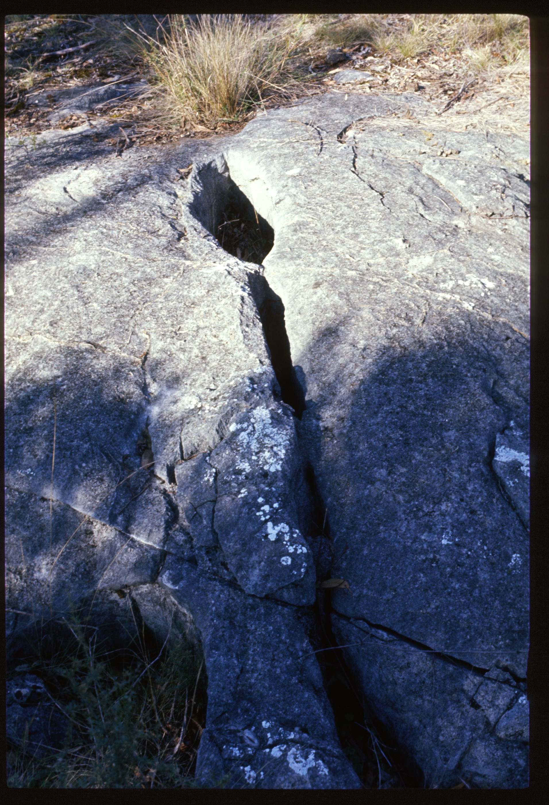
*ASF Joe N. Jennings slide catalogue, JNJ-S-1020-10, Box 1020. Catalogue description: Grike formation. [ASF record](https://st1.asflib.net/MEDIA/ASFJJSlidesCatalogue/Box%201020/JNJ-S-1020-10.html).*

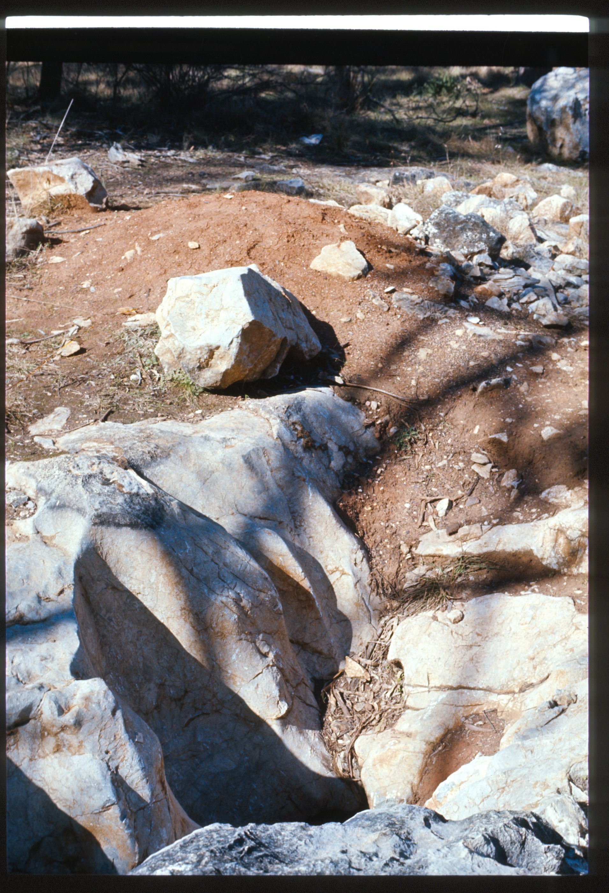
*ASF Joe N. Jennings slide catalogue, JNJ-S-1020-11, Box 1020. Catalogue description: Subsoil solution. [ASF record](https://st1.asflib.net/MEDIA/ASFJJSlidesCatalogue/Box%201020/JNJ-S-1020-11.html).*

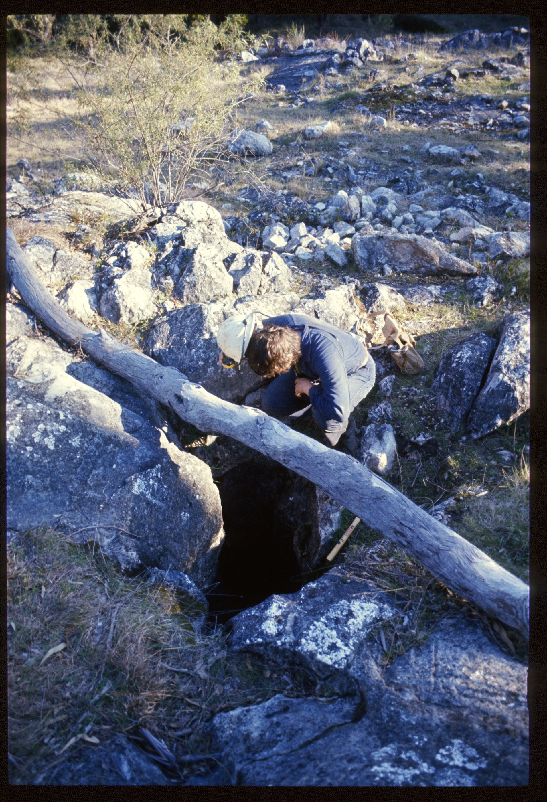
*ASF Joe N. Jennings slide catalogue, JNJ-S-1020-12, Box 1020. Catalogue description: Shaft. [ASF record](https://st1.asflib.net/MEDIA/ASFJJSlidesCatalogue/Box%201020/JNJ-S-1020-12.html).*

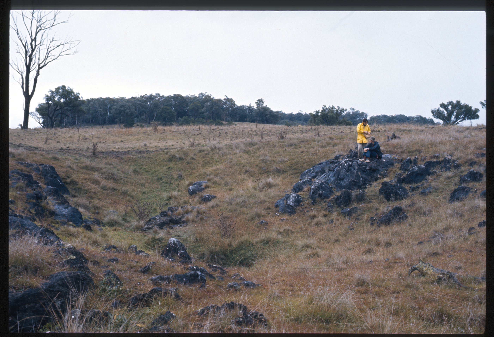
*ASF Joe N. Jennings slide catalogue, JNJ-S-1020-13, Box 1020. Catalogue description: Doline - Folly Point limestone. [ASF record](https://st1.asflib.net/MEDIA/ASFJJSlidesCatalogue/Box%201020/JNJ-S-1020-13.html).*

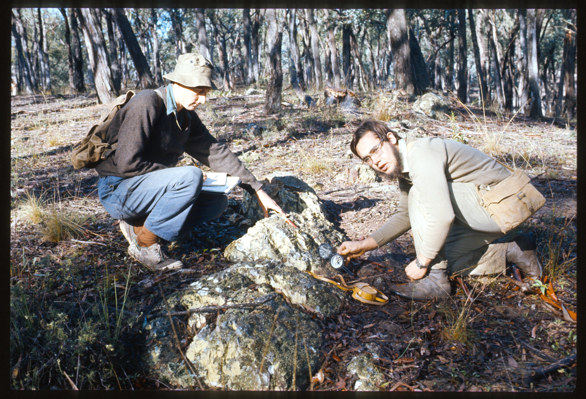
*ASF Joe N. Jennings slide catalogue, JNJ-S-1020-14, Box 1020. Catalogue description: Geological mapping - Bungonia - GF - AO. [ASF record](https://st1.asflib.net/MEDIA/ASFJJSlidesCatalogue/Box%201020/JNJ-S-1020-14.html).*

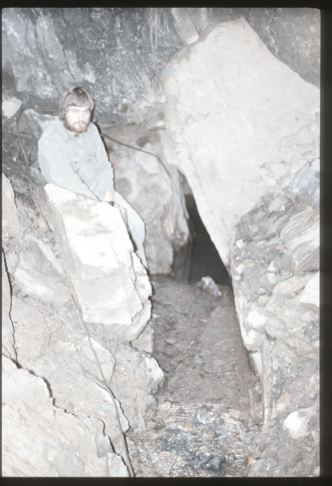
*ASF Joe N. Jennings slide catalogue, JNJ-S-1020-15, Box 1020. Catalogue description: Efflux Cave. [ASF record](https://st1.asflib.net/MEDIA/ASFJJSlidesCatalogue/Box%201020/JNJ-S-1020-15.html).*

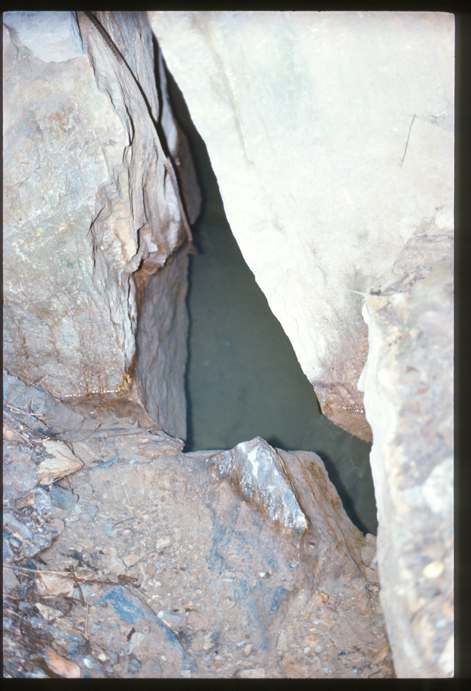
*ASF Joe N. Jennings slide catalogue, JNJ-S-1020-16, Box 1020. Catalogue description: Efflux Cave. [ASF record](https://st1.asflib.net/MEDIA/ASFJJSlidesCatalogue/Box%201020/JNJ-S-1020-16.html).*

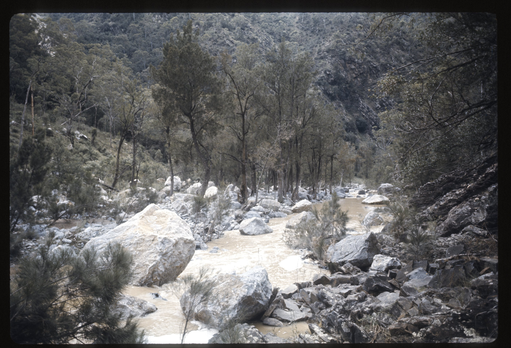
*ASF Joe N. Jennings slide catalogue, JNJ-S-1020-17, Box 1020. Catalogue description: Quarry refuse in Bumgonia Creek. [ASF record](https://st1.asflib.net/MEDIA/ASFJJSlidesCatalogue/Box%201020/JNJ-S-1020-17.html).*

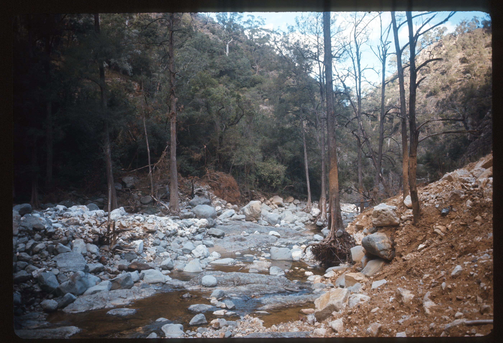
*ASF Joe N. Jennings slide catalogue, JNJ-S-1020-18, Box 1020. Catalogue description: Location of dam at ML 29 dump - Barbers Creek. [ASF record](https://st1.asflib.net/MEDIA/ASFJJSlidesCatalogue/Box%201020/JNJ-S-1020-18.html).*

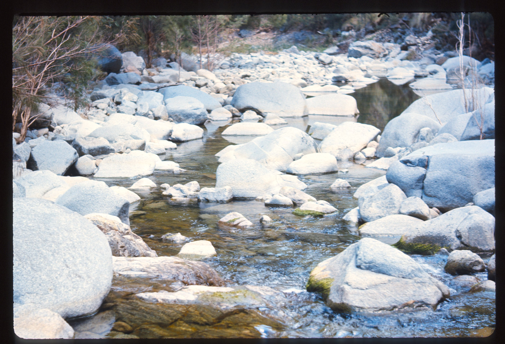
*ASF Joe N. Jennings slide catalogue, JNJ-S-1020-19, Box 1020. Catalogue description: Barbers Creek - Upstream of dump. [ASF record](https://st1.asflib.net/MEDIA/ASFJJSlidesCatalogue/Box%201020/JNJ-S-1020-19.html).*

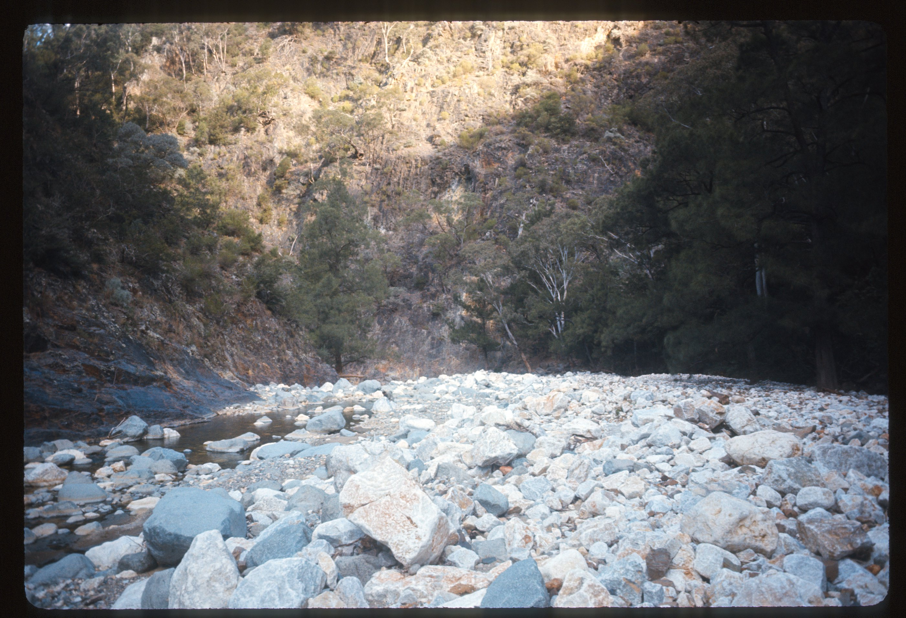
*ASF Joe N. Jennings slide catalogue, JNJ-S-1020-20, Box 1020. Catalogue description: Barbers Creek - Below ML 29 dump. [ASF record](https://st1.asflib.net/MEDIA/ASFJJSlidesCatalogue/Box%201020/JNJ-S-1020-20.html).*

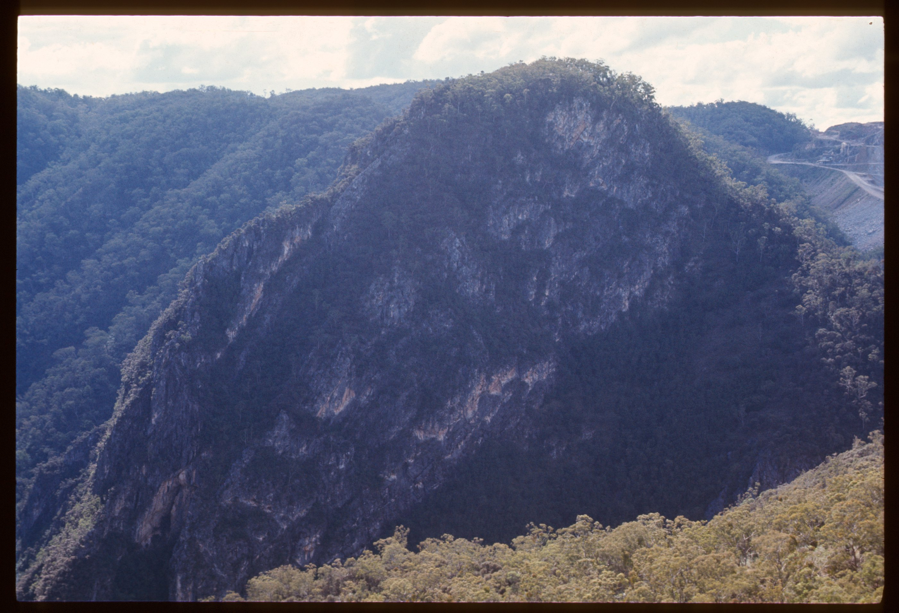
*ASF Joe N. Jennings slide catalogue, JNJ-S-1020-21, Box 1020. Catalogue description: Frome Hill. [ASF record](https://st1.asflib.net/MEDIA/ASFJJSlidesCatalogue/Box%201020/JNJ-S-1020-21.html).*

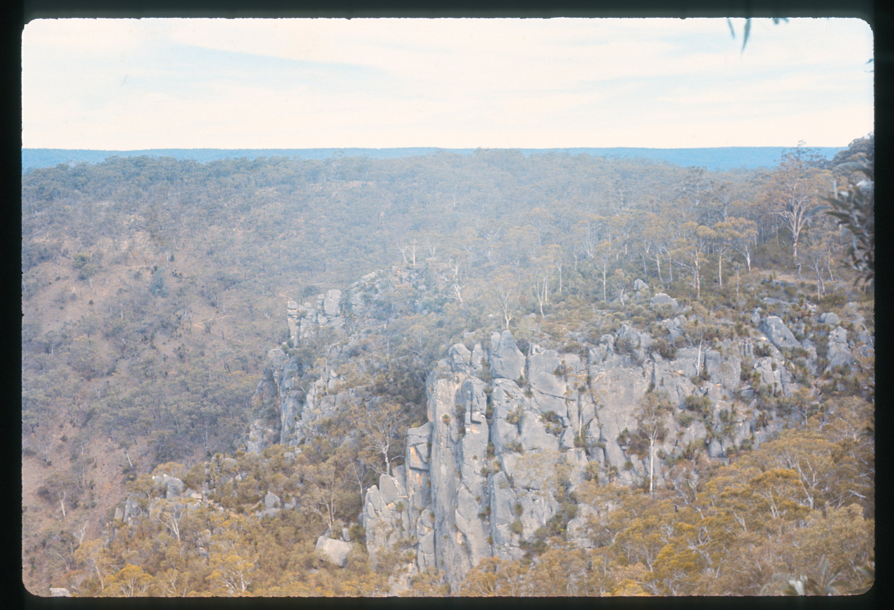
*ASF Joe N. Jennings slide catalogue, JNJ-S-1020-22, Box 1020. Catalogue description: Top of Devils Staircase - Folly Point. [ASF record](https://st1.asflib.net/MEDIA/ASFJJSlidesCatalogue/Box%201020/JNJ-S-1020-22.html).*

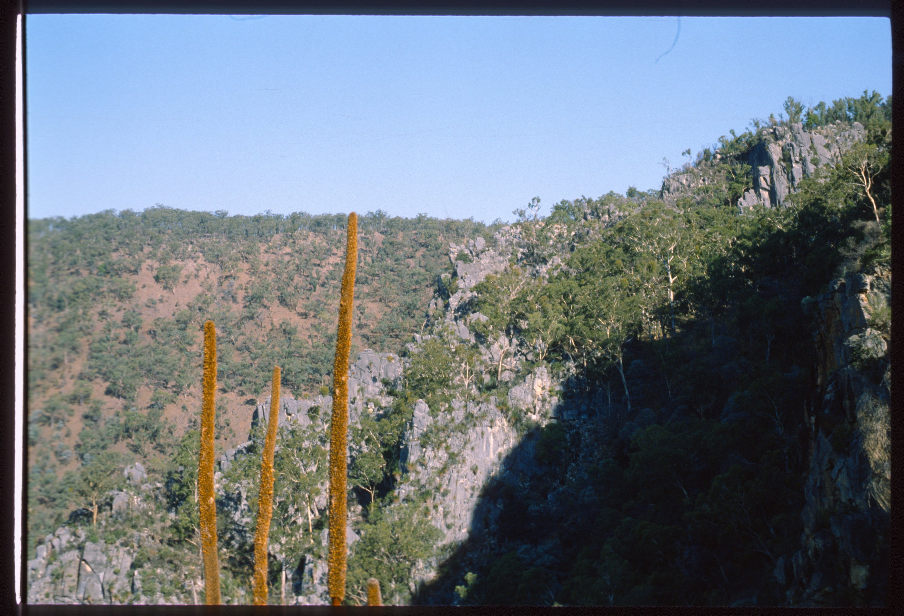
*ASF Joe N. Jennings slide catalogue, JNJ-S-1020-23, Box 1020. Catalogue description: Devils Staircase from Adams Lookout. [ASF record](https://st1.asflib.net/MEDIA/ASFJJSlidesCatalogue/Box%201020/JNJ-S-1020-23.html).*

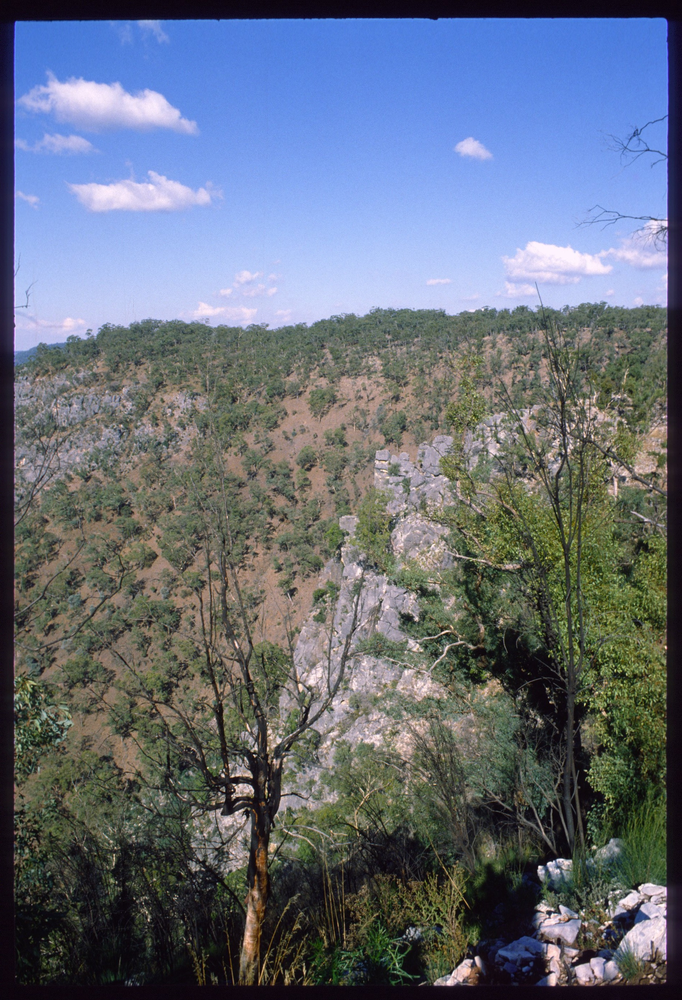
*ASF Joe N. Jennings slide catalogue, JNJ-S-1020-24, Box 1020. Catalogue description: Folly Point from Adams Lookout. [ASF record](https://st1.asflib.net/MEDIA/ASFJJSlidesCatalogue/Box%201020/JNJ-S-1020-24.html).*

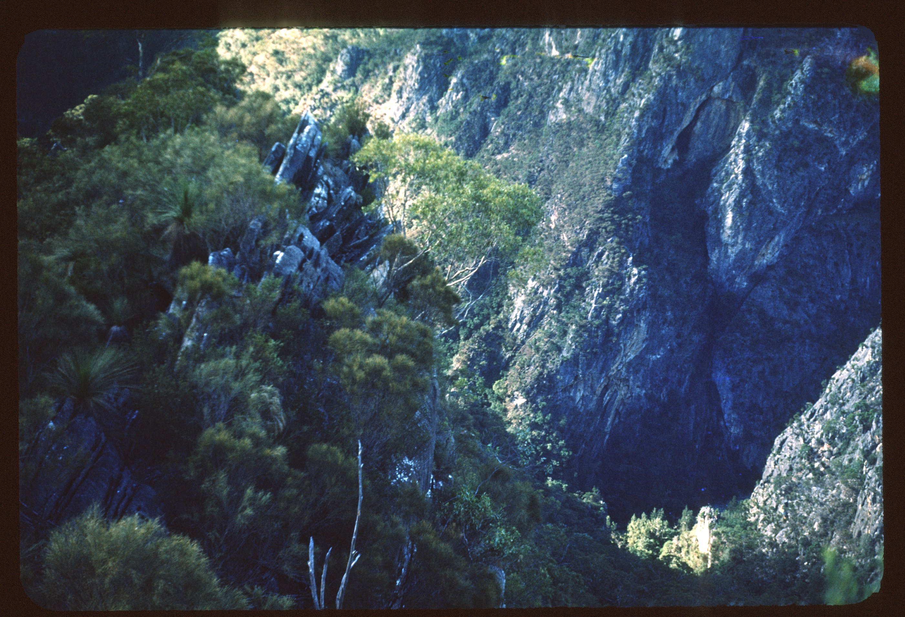
*ASF Joe N. Jennings slide catalogue, JNJ-S-1020-25, Box 1020. Catalogue description: Bungonia Gorge. [ASF record](https://st1.asflib.net/MEDIA/ASFJJSlidesCatalogue/Box%201020/JNJ-S-1020-25.html).*

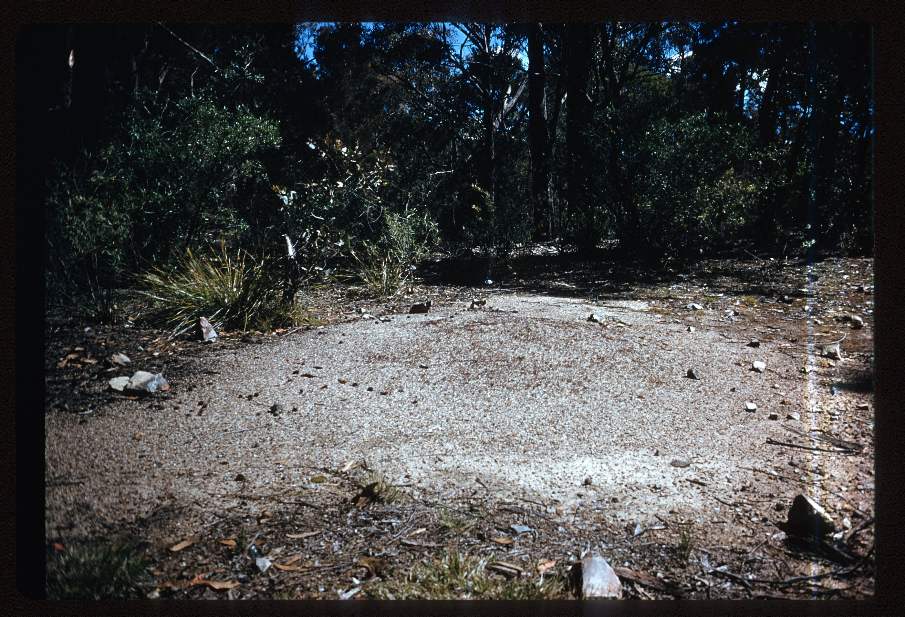
*ASF Joe N. Jennings slide catalogue, JNJ-S-1020-26, Box 1020. Catalogue description: Anthill and ants. [ASF record](https://st1.asflib.net/MEDIA/ASFJJSlidesCatalogue/Box%201020/JNJ-S-1020-26.html).*

<!-- ASF slide images: end -->

# References

- [NUCC](https://nucc.caves.org.au/locations/bungonia/)
