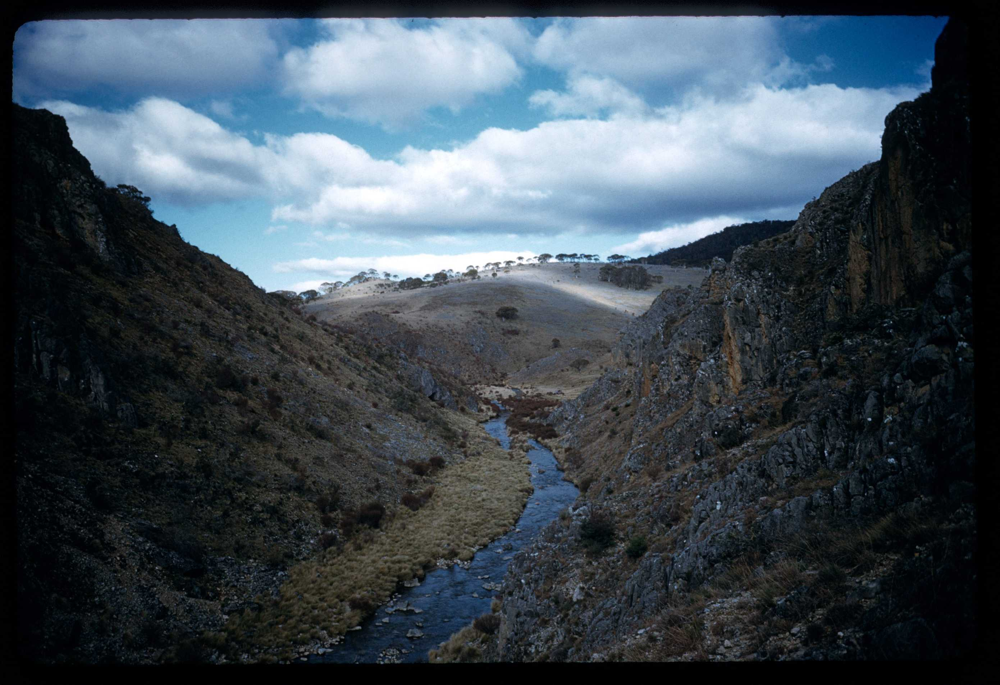
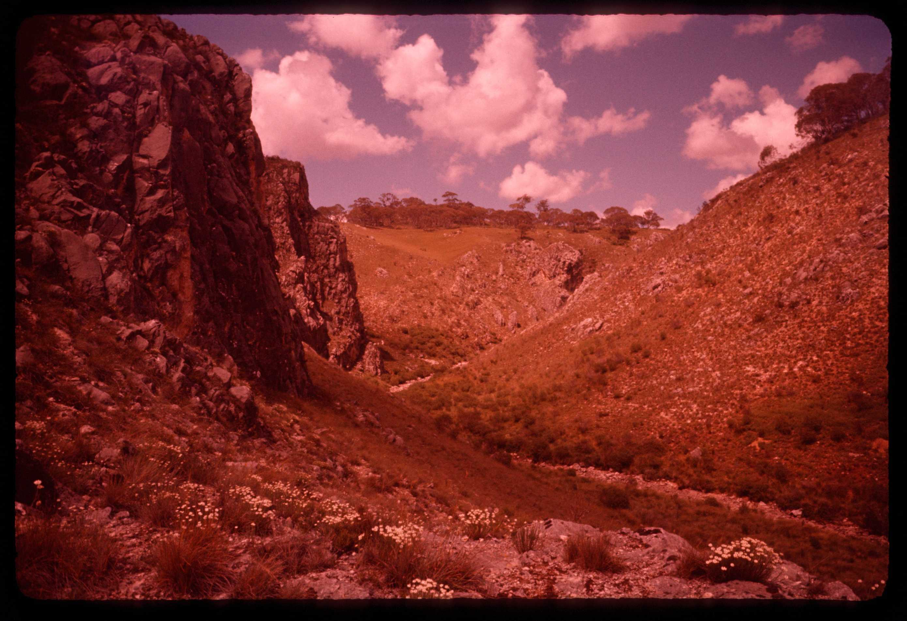
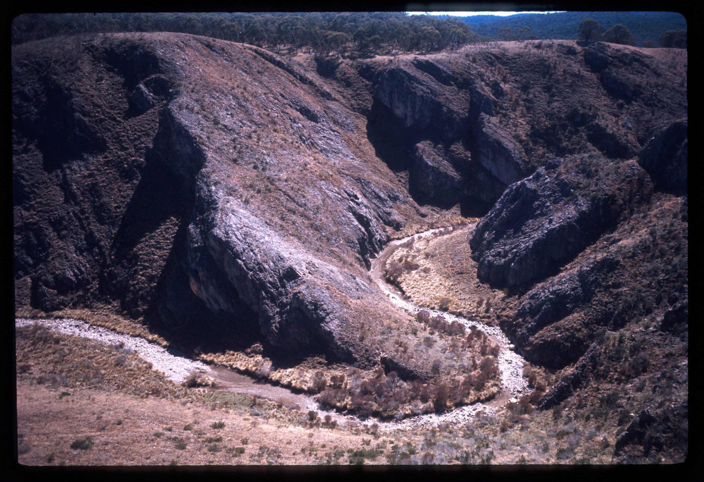

## ASF slide images

Images are from the ASF Joe N. Jennings slide catalogue. Each caption preserves the catalogue description and links to its source record.

*ASF Joe N. Jennings slide catalogue, ASF-S-03254, Box 14. Catalogue description: Gorge between Cooleman Cave and Blue Water Hole, Oct 1957. [ASF record](https://st1.asflib.net/MEDIA/ASFJJSlidesCatalogue/Box%2014/ASF-S-03254.html).*

*ASF Joe N. Jennings slide catalogue, ASF-S-03255, Box 14. Catalogue description: Gorge above Cooleman Cave. [ASF record](https://st1.asflib.net/MEDIA/ASFJJSlidesCatalogue/Box%2014/ASF-S-03255.html).*

*ASF Joe N. Jennings slide catalogue, ASF-S-03271, Box 14. Catalogue description: Incised meander by Cooleman Cave, Cooleman Plain, Nov 1967. [ASF record](https://st1.asflib.net/MEDIA/ASFJJSlidesCatalogue/Box%2014/ASF-S-03271.html).*

<!-- ASF slide images: end -->
