# About

List of caves in Jenolan System
- Lucas, River, Chifley, Imperial, Orient, Ribbon, Pool of Cerberus, Jubilee, Temple of Baal, [Nettle Cave](Nettle%20Cave%20-%20Jenolan.md), The Grand Arch, Elder Cave, Aladdin Cave, [Jersey Cave](Jersey%20Cave.md), [Arch Cave](Arch%20Cave.md)

# Additional Notes

- **Wikipedia:** https://en.wikipedia.org/wiki/Jenolan_Caves

"Since 2011, the CSIRO in association with the Australian Nuclear Science and Technology Organisation began using a new hand-held mapping system to map some of the caves in three-dimensional detail."
- **Official Website:** https://www.jenolancaves.org.au/

- **SUSS:** https://suss.caves.org.au/cave/jenolan_mammoth/Mammoth/

Repository for [Mammoth Cave](../Western%20Australia/Mammoth%20Cave.md) - survex files & jpgs of survey record sheets
- **Jenolan River Walking Track:** https://www.nationalparks.nsw.gov.au/things-to-do/walking-tracks/jenolan-river-walking-track/local-alerts

- **Vimeo:** https://vimeo.com/143679112
- [Trimix Divers — Jenolan Caves](https://www.trimixdivers.com/trimix5/?page_id=4374)

- [Cave Diving Down Under — Jenolan Caves](https://www.cavediving.net.au/index.php/caves/?region=Jenolan)

- **LizRogers:** https://lizrogersphotography.com/2014/07/diving-jenolan-caves/

# Source notes

<!-- ASF slide images: start -->
## ASF slide images

Images are from the ASF Joe N. Jennings slide catalogue. Each caption preserves the catalogue description and links to its source record.

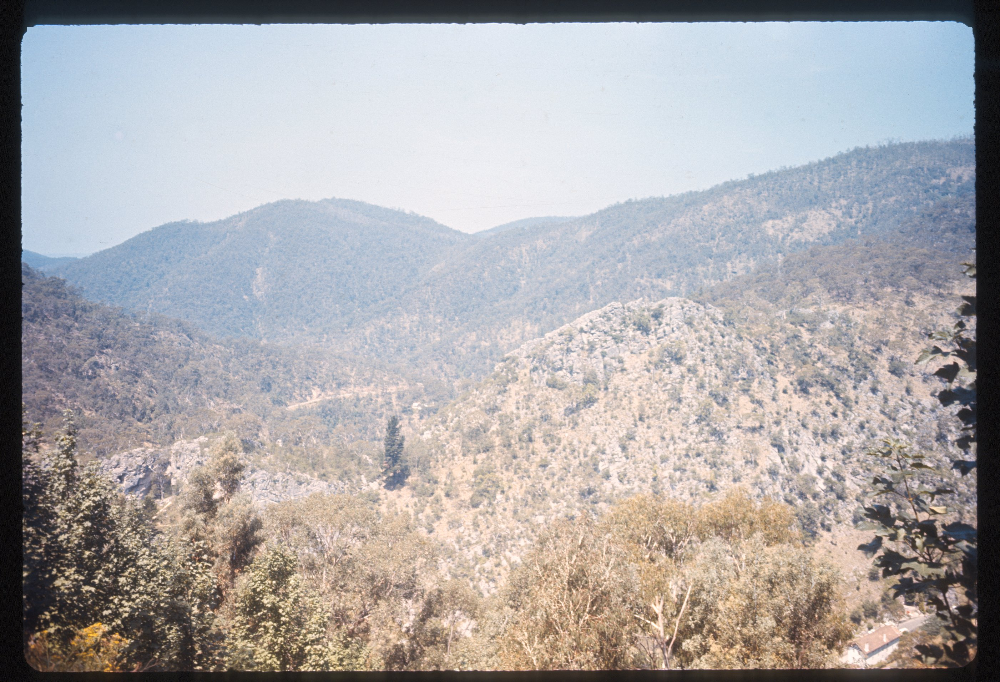
*ASF Joe N. Jennings slide catalogue, JNJ-S-1018-01, Box 1018. Catalogue description: Lucas Rocks - Barrier of limestone across Jenolan Valley. [ASF record](https://st1.asflib.net/MEDIA/ASFJJSlidesCatalogue/Box%201018/JNJ-S-1018-01.html).*

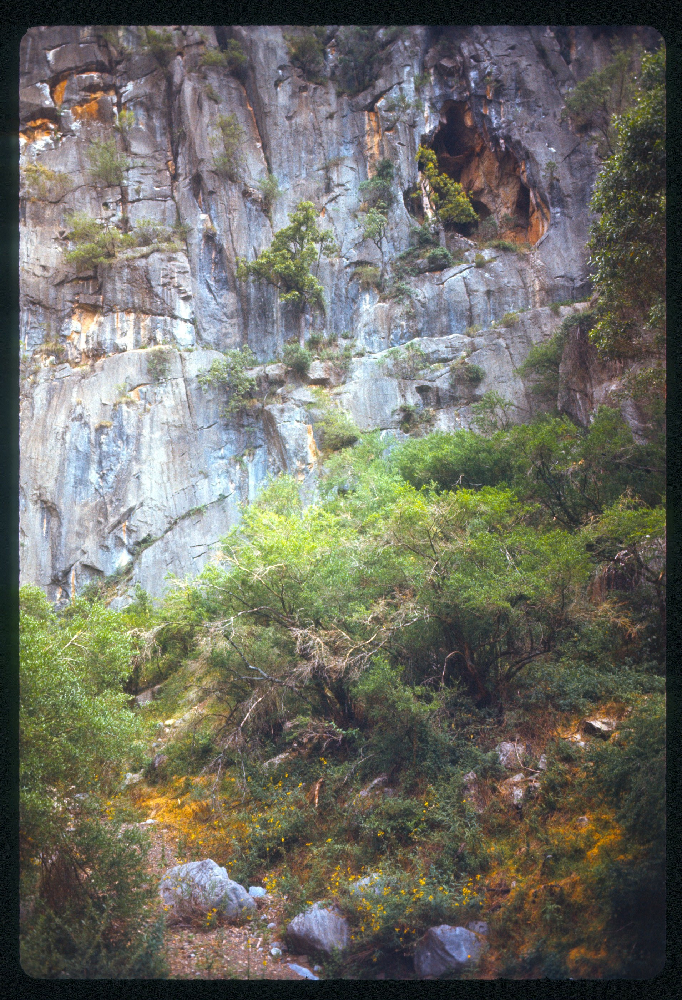
*ASF Joe N. Jennings slide catalogue, JNJ-S-1018-02, Box 1018. Catalogue description: Cave entrance above dry bed of - below playing fields and above Devil's Coachhouse. [ASF record](https://st1.asflib.net/MEDIA/ASFJJSlidesCatalogue/Box%201018/JNJ-S-1018-02.html).*

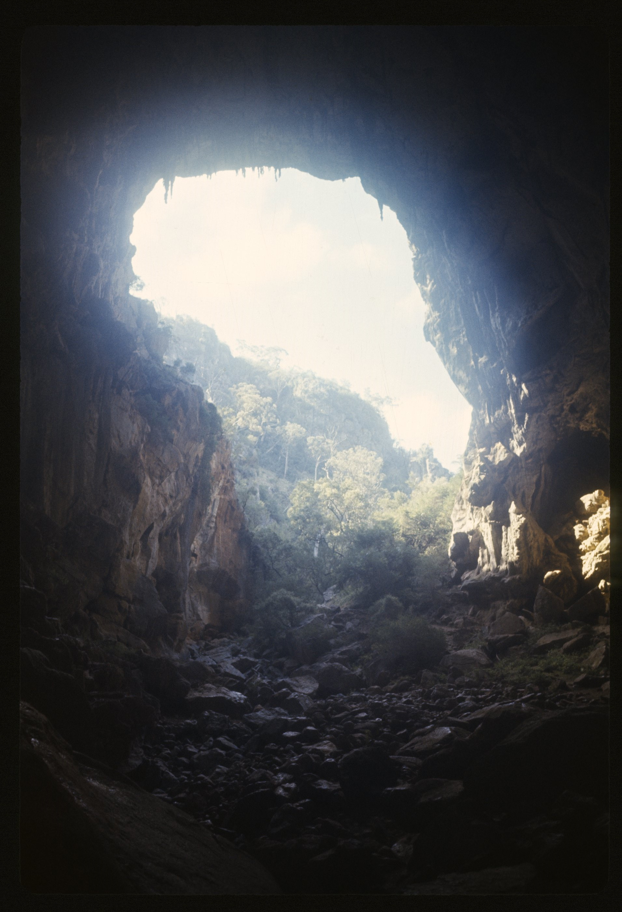
*ASF Joe N. Jennings slide catalogue, JNJ-S-1018-03, Box 1018. Catalogue description: Devil's Coachhouse. [ASF record](https://st1.asflib.net/MEDIA/ASFJJSlidesCatalogue/Box%201018/JNJ-S-1018-03.html).*

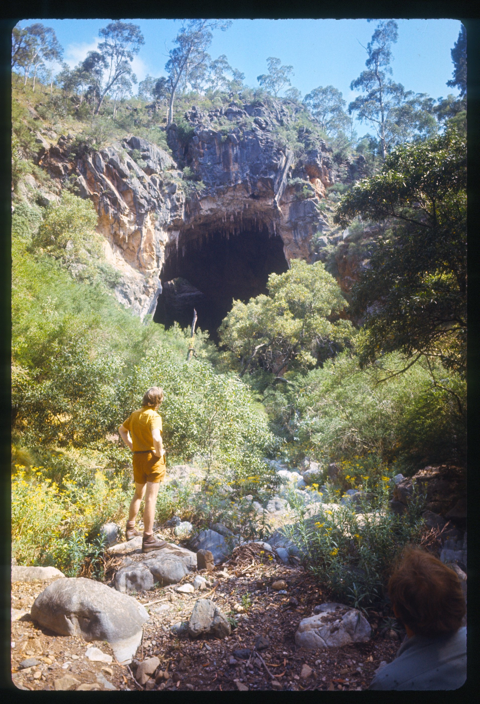
*ASF Joe N. Jennings slide catalogue, JNJ-S-1018-04, Box 1018. Catalogue description: Devil's Coachhouse. [ASF record](https://st1.asflib.net/MEDIA/ASFJJSlidesCatalogue/Box%201018/JNJ-S-1018-04.html).*

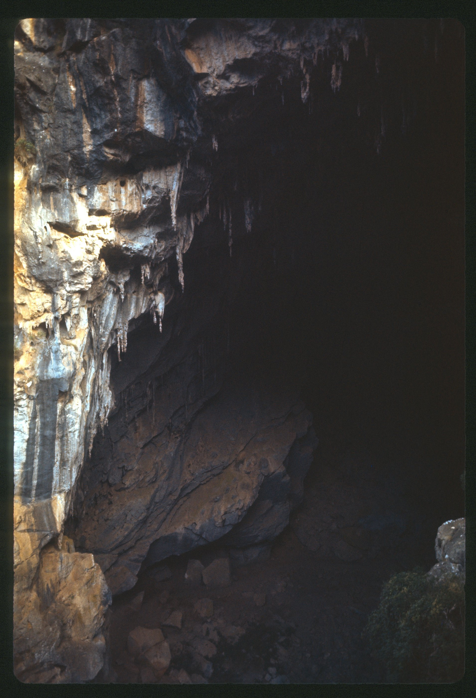
*ASF Joe N. Jennings slide catalogue, JNJ-S-1018-05, Box 1018. Catalogue description: Devil's Coachhouse. [ASF record](https://st1.asflib.net/MEDIA/ASFJJSlidesCatalogue/Box%201018/JNJ-S-1018-05.html).*

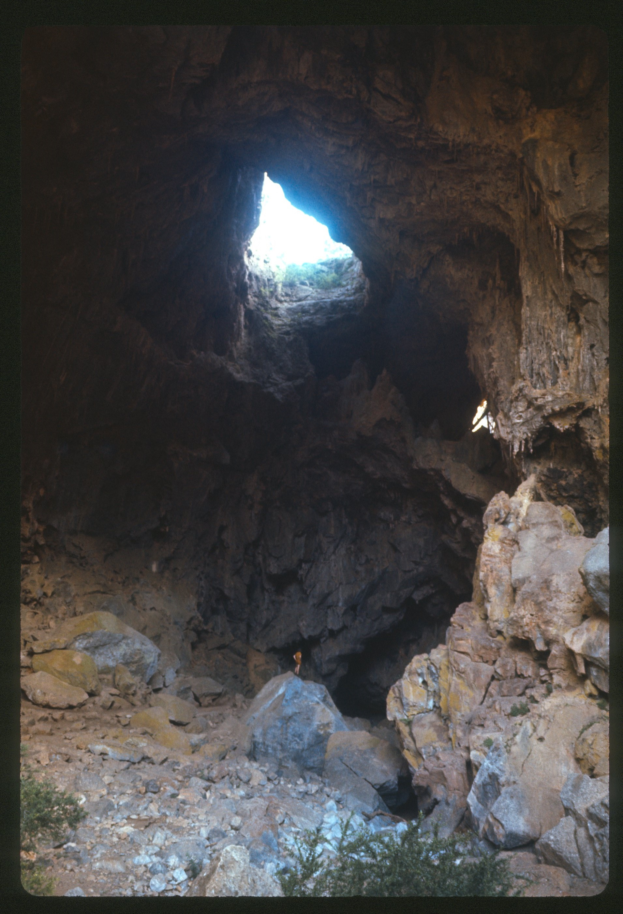
*ASF Joe N. Jennings slide catalogue, JNJ-S-1018-06, Box 1018. Catalogue description: Devil's Coachhouse. [ASF record](https://st1.asflib.net/MEDIA/ASFJJSlidesCatalogue/Box%201018/JNJ-S-1018-06.html).*

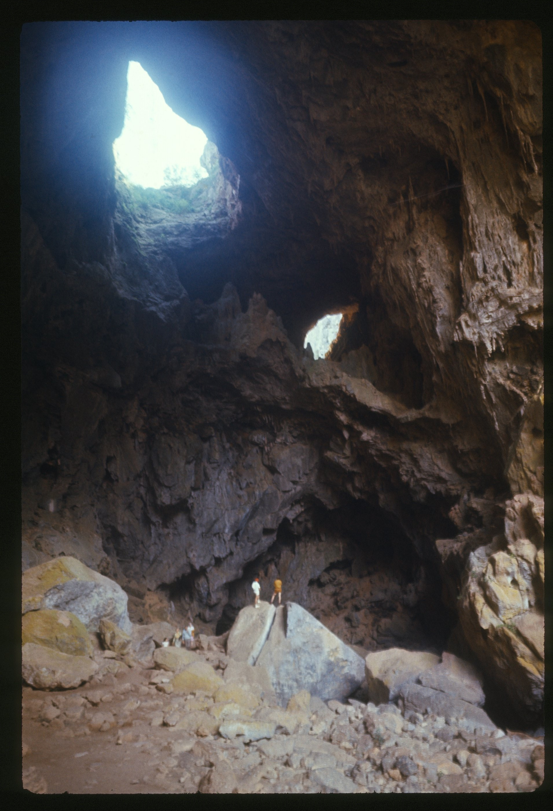
*ASF Joe N. Jennings slide catalogue, JNJ-S-1018-07, Box 1018. Catalogue description: Devil's Coachhouse. [ASF record](https://st1.asflib.net/MEDIA/ASFJJSlidesCatalogue/Box%201018/JNJ-S-1018-07.html).*

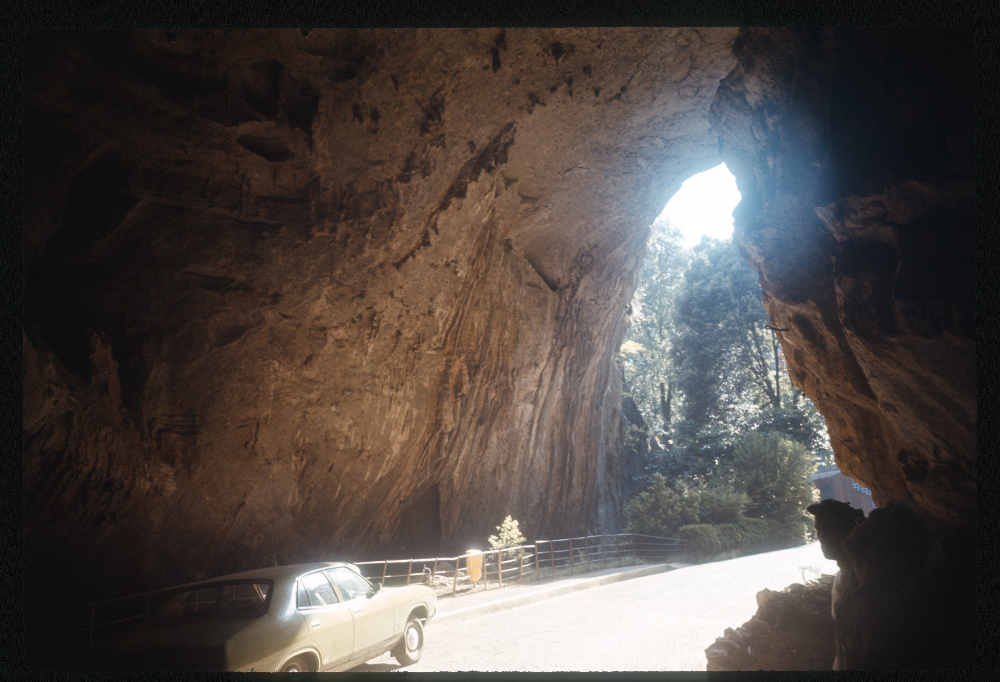
*ASF Joe N. Jennings slide catalogue, JNJ-S-1018-08, Box 1018. Catalogue description: Grand Arch. [ASF record](https://st1.asflib.net/MEDIA/ASFJJSlidesCatalogue/Box%201018/JNJ-S-1018-08.html).*

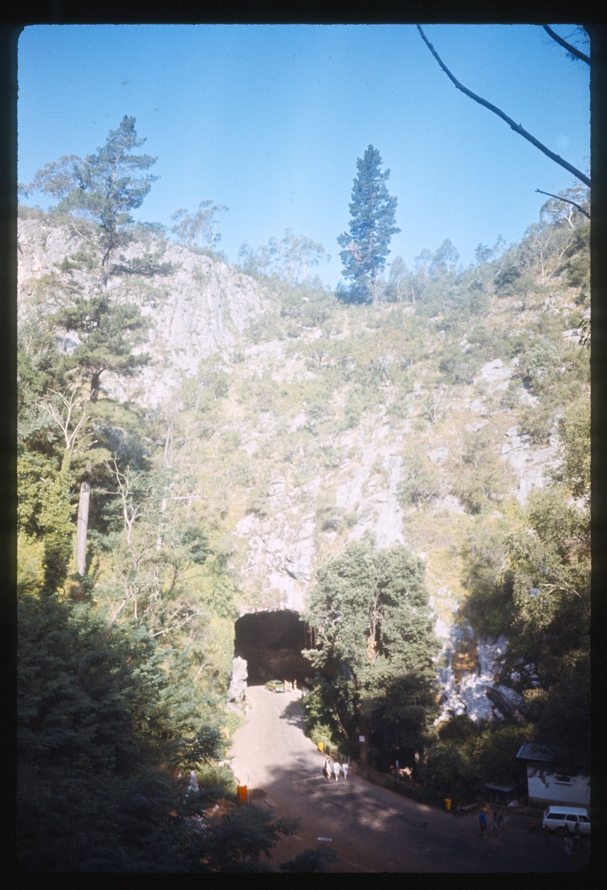
*ASF Joe N. Jennings slide catalogue, JNJ-S-1018-09, Box 1018. Catalogue description: Grand Arch. [ASF record](https://st1.asflib.net/MEDIA/ASFJJSlidesCatalogue/Box%201018/JNJ-S-1018-09.html).*

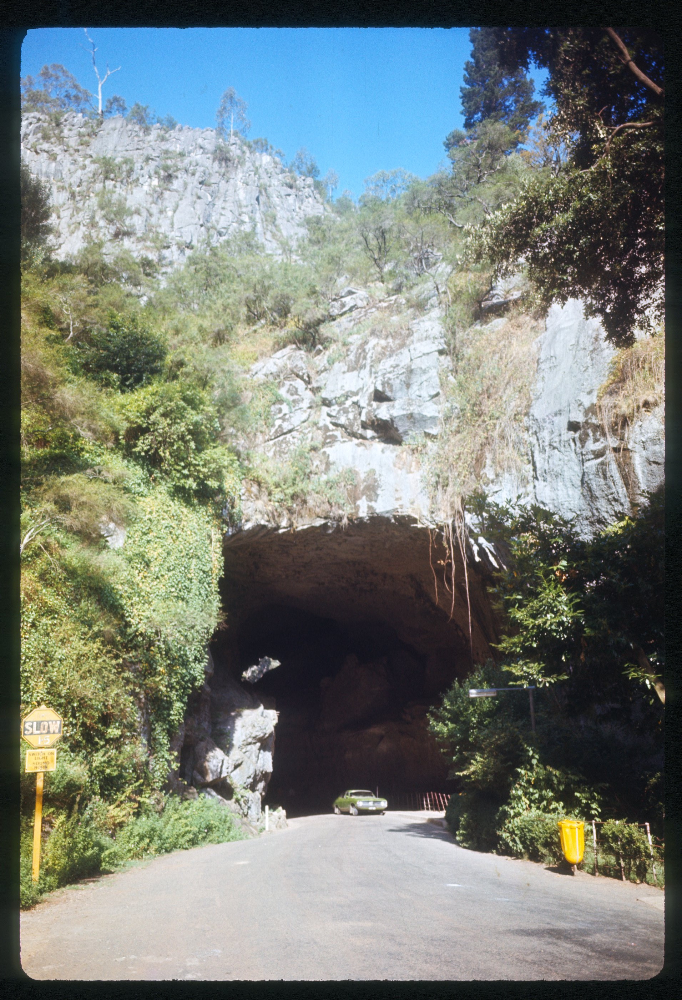
*ASF Joe N. Jennings slide catalogue, JNJ-S-1018-10, Box 1018. Catalogue description: Grand Arch. [ASF record](https://st1.asflib.net/MEDIA/ASFJJSlidesCatalogue/Box%201018/JNJ-S-1018-10.html).*

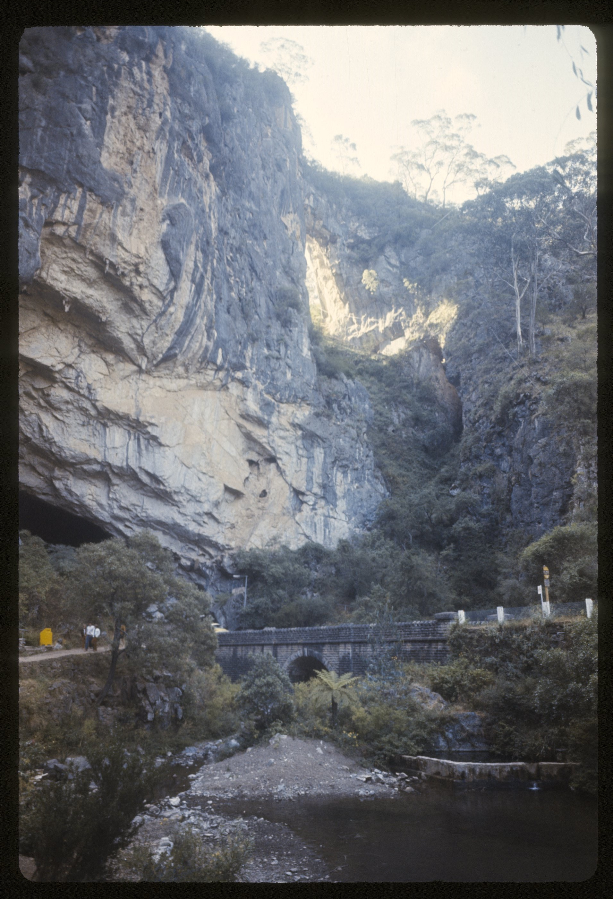
*ASF Joe N. Jennings slide catalogue, JNJ-S-1018-11, Box 1018. Catalogue description: Three Waters below Grange Arch and Carlotta Arch. [ASF record](https://st1.asflib.net/MEDIA/ASFJJSlidesCatalogue/Box%201018/JNJ-S-1018-11.html).*

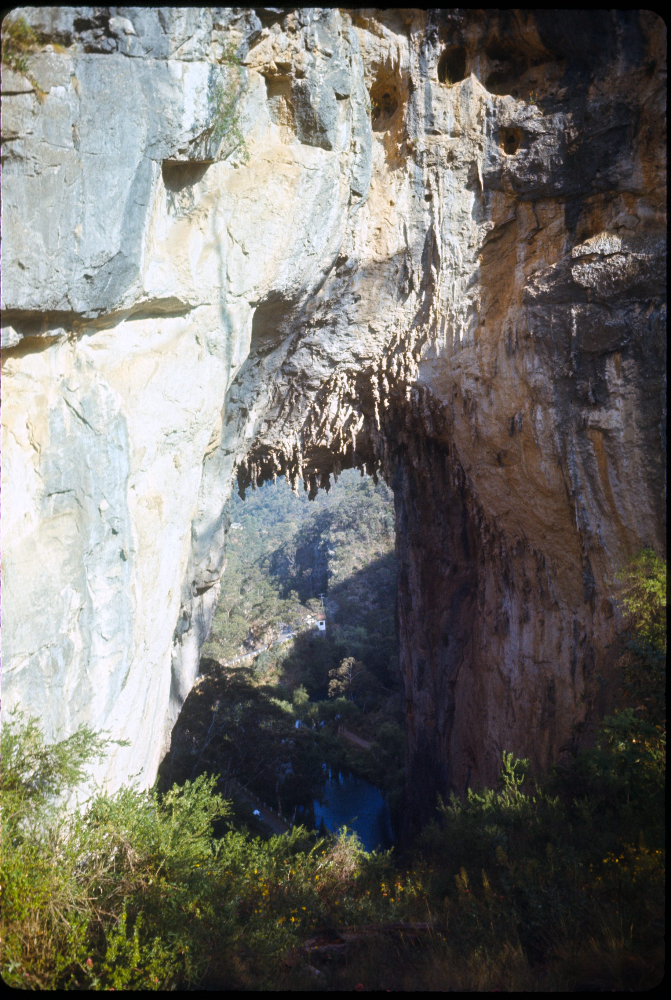
*ASF Joe N. Jennings slide catalogue, JNJ-S-1018-12, Box 1018. Catalogue description: Carlotta Arch. [ASF record](https://st1.asflib.net/MEDIA/ASFJJSlidesCatalogue/Box%201018/JNJ-S-1018-12.html).*

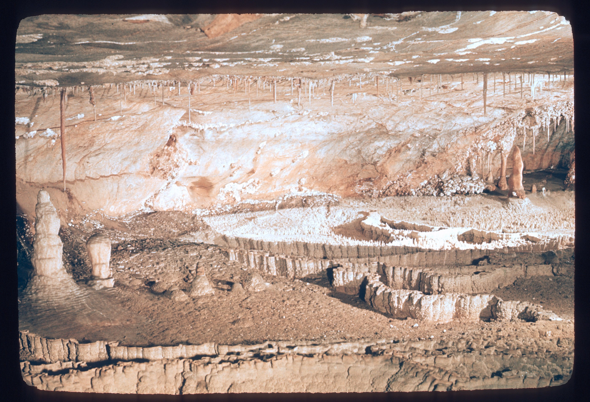
*ASF Joe N. Jennings slide catalogue, JNJ-S-1018-13, Box 1018. Catalogue description: C rystal City - Imperial Cave - All Rights Douglass Baglin St Leonards N.S.W. [ASF record](https://st1.asflib.net/MEDIA/ASFJJSlidesCatalogue/Box%201018/JNJ-S-1018-13.html).*

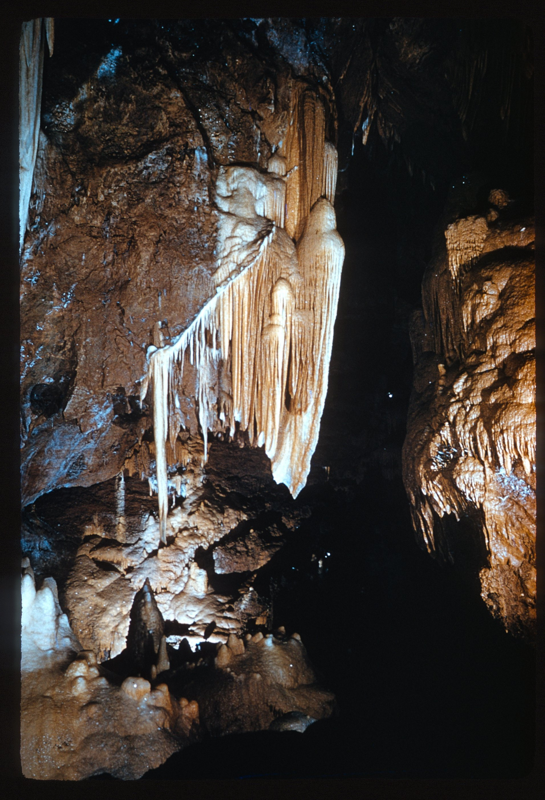
*ASF Joe N. Jennings slide catalogue, JNJ-S-1018-14, Box 1018. Catalogue description: Babriel's Wing - Temple of Baal Cave. [ASF record](https://st1.asflib.net/MEDIA/ASFJJSlidesCatalogue/Box%201018/JNJ-S-1018-14.html).*

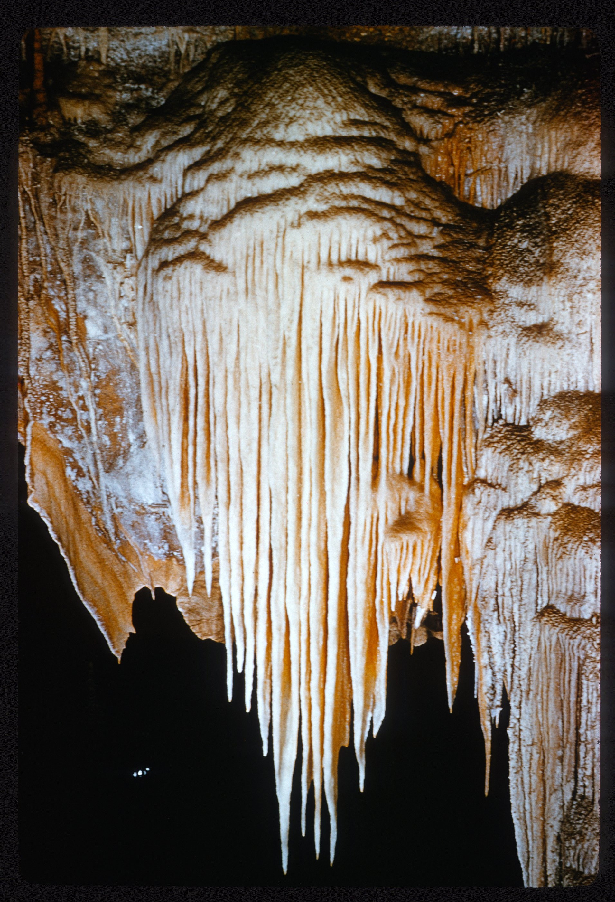
*ASF Joe N. Jennings slide catalogue, JNJ-S-1018-15, Box 1018. Catalogue description: The Indian Canopy - Orient Cave. [ASF record](https://st1.asflib.net/MEDIA/ASFJJSlidesCatalogue/Box%201018/JNJ-S-1018-15.html).*

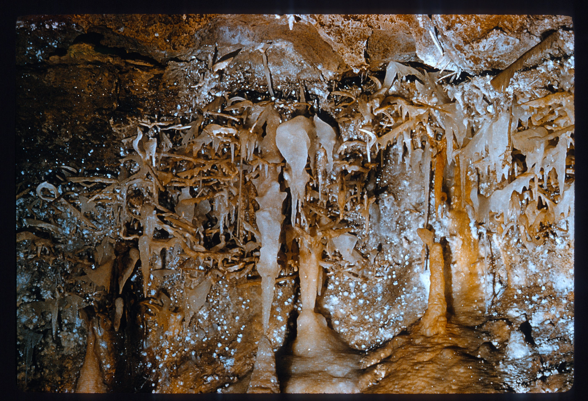
*ASF Joe N. Jennings slide catalogue, JNJ-S-1018-16, Box 1018. Catalogue description: Mystery Formations - Orient Cave. [ASF record](https://st1.asflib.net/MEDIA/ASFJJSlidesCatalogue/Box%201018/JNJ-S-1018-16.html).*

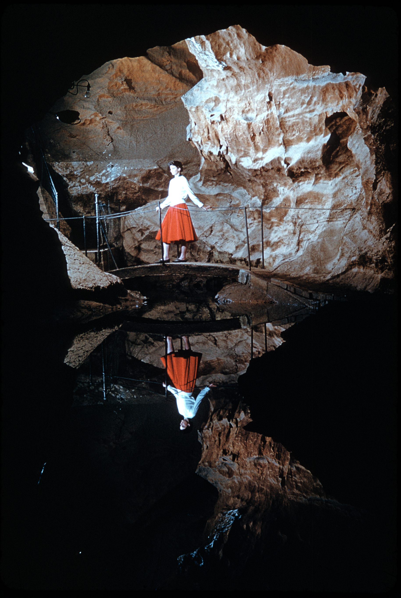
*ASF Joe N. Jennings slide catalogue, JNJ-S-1018-17, Box 1018. Catalogue description: Reflections - Underground River - Junction and River and Skeleton Caves. [ASF record](https://st1.asflib.net/MEDIA/ASFJJSlidesCatalogue/Box%201018/JNJ-S-1018-17.html).*

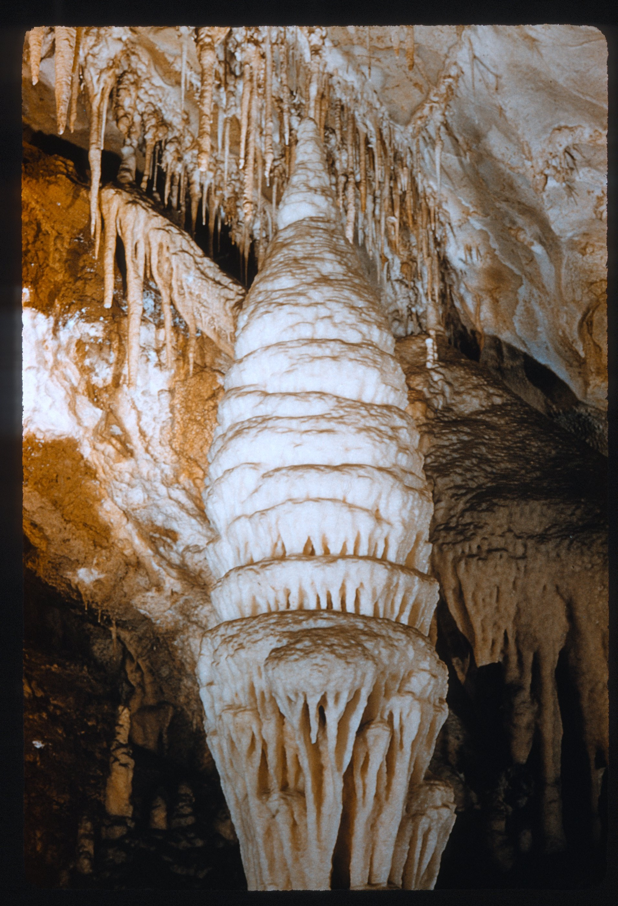
*ASF Joe N. Jennings slide catalogue, JNJ-S-1018-18, Box 1018. Catalogue description: The Minaret - River Cave. [ASF record](https://st1.asflib.net/MEDIA/ASFJJSlidesCatalogue/Box%201018/JNJ-S-1018-18.html).*

<!-- ASF slide images: end -->

# References

- [National Parks NSW](https://www.nationalparks.nsw.gov.au/things-to-do/guided-tours/jenolan-caves-guided-tours)
