# Additional Notes

Junction Cave was officially 'discovered' in 1897 and opened to the public in 1906. The cave was completely refurbished for its centenary in 1997, yet the unique formations of stalactites and stalagmites you’ll see here have been created over millions of years. Junction Cave is renowned for its rich colours, spectacular shawls and flowstones. The Junction has 350 steps.

Visiting Junction Cave is just a short walk, yet one that will amaze you.  Enter this spectacular underground world and surround yourself with the rich colours, spectacular shawls and flowstones of this beautiful show cave.

# Source notes

<!-- ASF slide images: start -->
## ASF slide images

Images are from the ASF Joe N. Jennings slide catalogue. Each caption preserves the catalogue description and links to its source record.

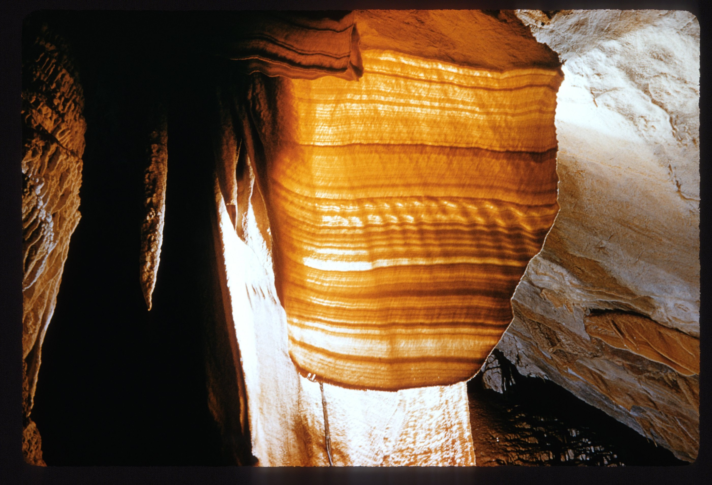
*ASF Joe N. Jennings slide catalogue, JNJ-S-1025-14, Box 1025. Catalogue description: Chalker's Blankey. [ASF record](https://st1.asflib.net/MEDIA/ASFJJSlidesCatalogue/Box%201025/JNJ-S-1025-14.html).*

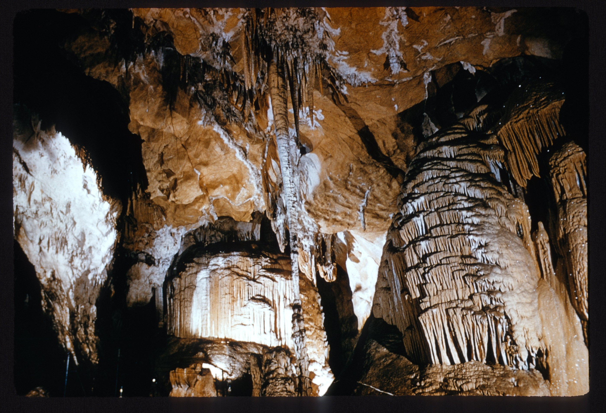
*ASF Joe N. Jennings slide catalogue, JNJ-S-1025-15, Box 1025. Catalogue description: The Junction Chamber. [ASF record](https://st1.asflib.net/MEDIA/ASFJJSlidesCatalogue/Box%201025/JNJ-S-1025-15.html).*

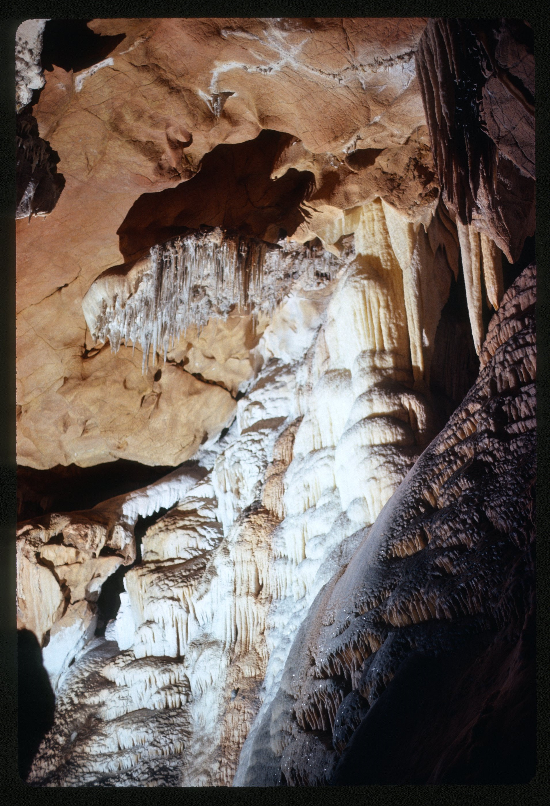
*ASF Joe N. Jennings slide catalogue, JNJ-S-1025-16, Box 1025. Catalogue description: Formations. [ASF record](https://st1.asflib.net/MEDIA/ASFJJSlidesCatalogue/Box%201025/JNJ-S-1025-16.html).*

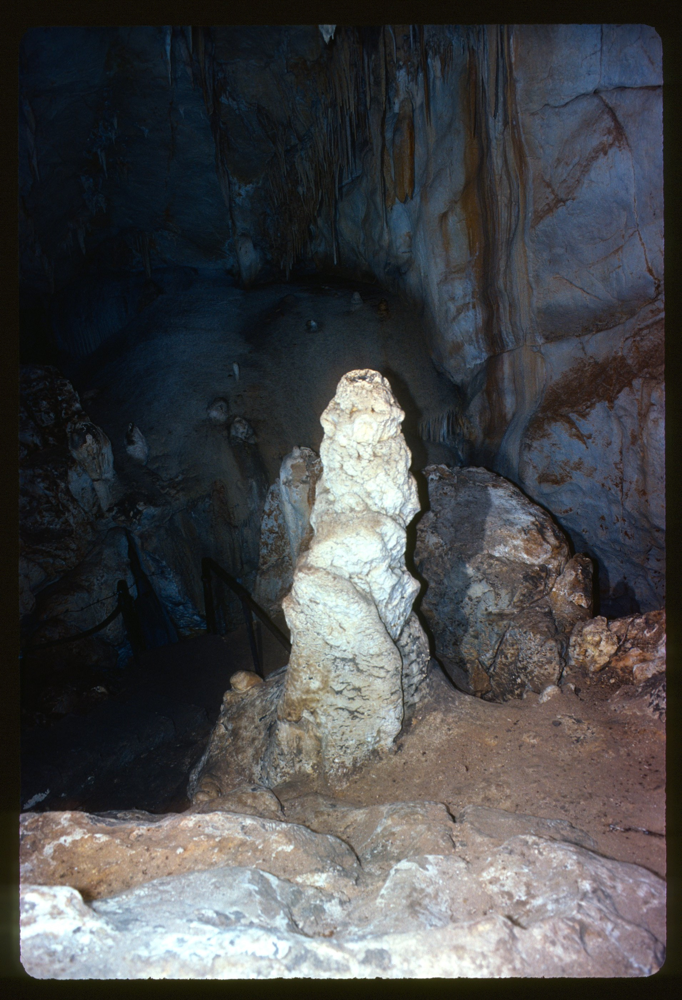
*ASF Joe N. Jennings slide catalogue, JNJ-S-1025-17, Box 1025. Catalogue description: Splash cup on stalagmite. [ASF record](https://st1.asflib.net/MEDIA/ASFJJSlidesCatalogue/Box%201025/JNJ-S-1025-17.html).*

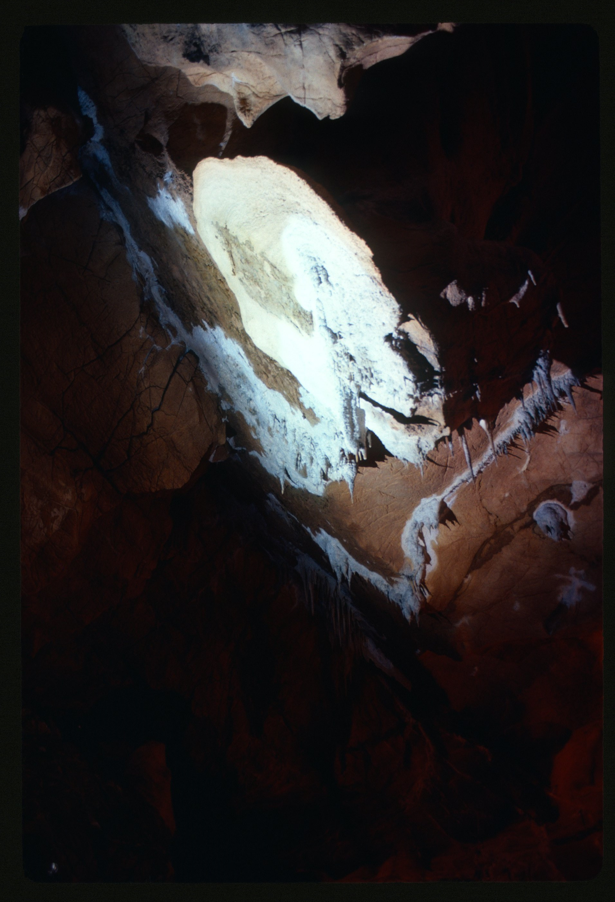
*ASF Joe N. Jennings slide catalogue, JNJ-S-1025-18, Box 1025. Catalogue description: Bedding plane. [ASF record](https://st1.asflib.net/MEDIA/ASFJJSlidesCatalogue/Box%201025/JNJ-S-1025-18.html).*

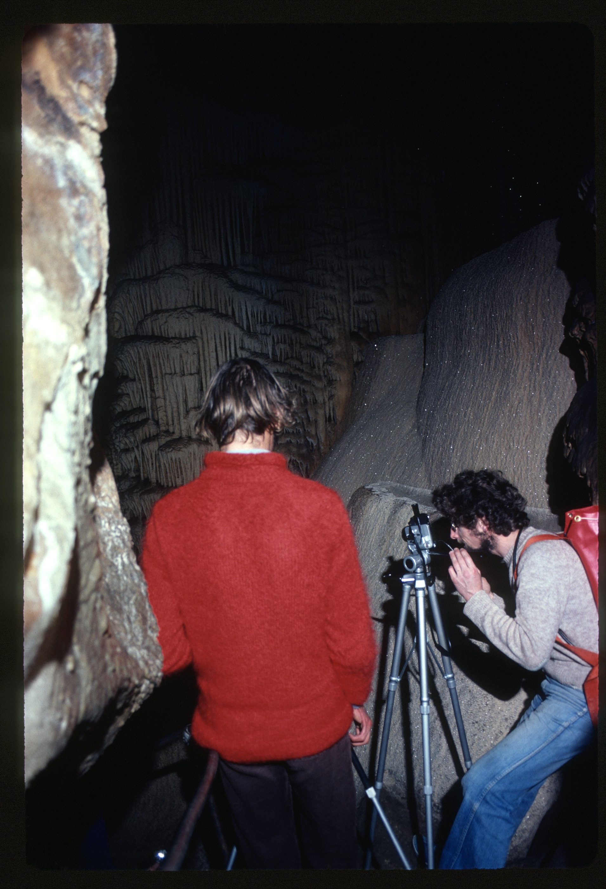
*ASF Joe N. Jennings slide catalogue, JNJ-S-1025-19, Box 1025. Catalogue description: Cave photography. [ASF record](https://st1.asflib.net/MEDIA/ASFJJSlidesCatalogue/Box%201025/JNJ-S-1025-19.html).*

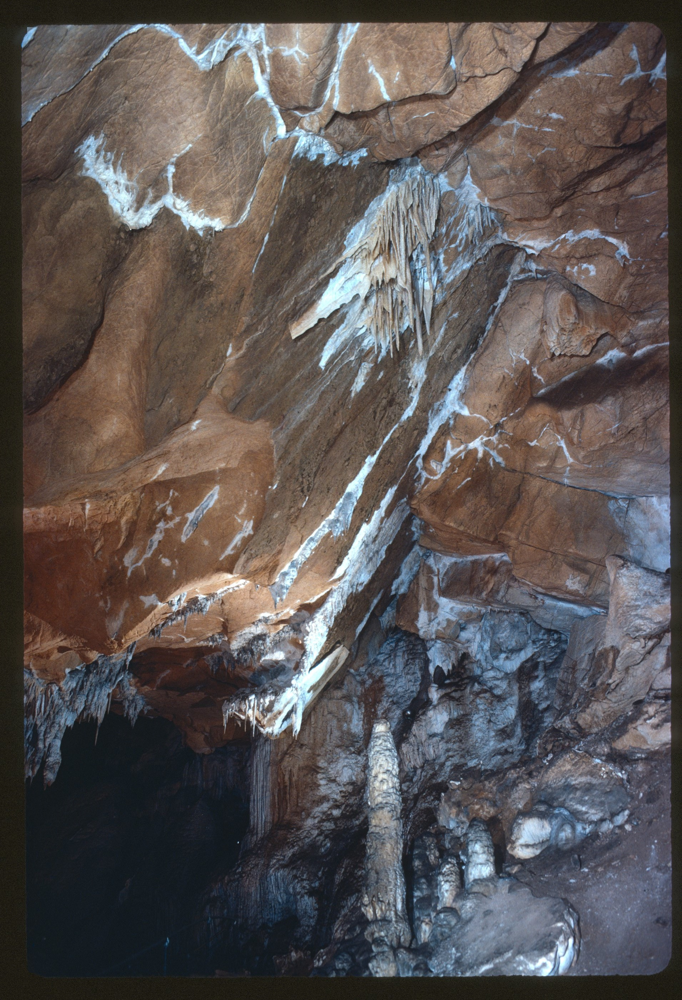
*ASF Joe N. Jennings slide catalogue, JNJ-S-1025-20, Box 1025. Catalogue description: ? Bedding plane. [ASF record](https://st1.asflib.net/MEDIA/ASFJJSlidesCatalogue/Box%201025/JNJ-S-1025-20.html).*

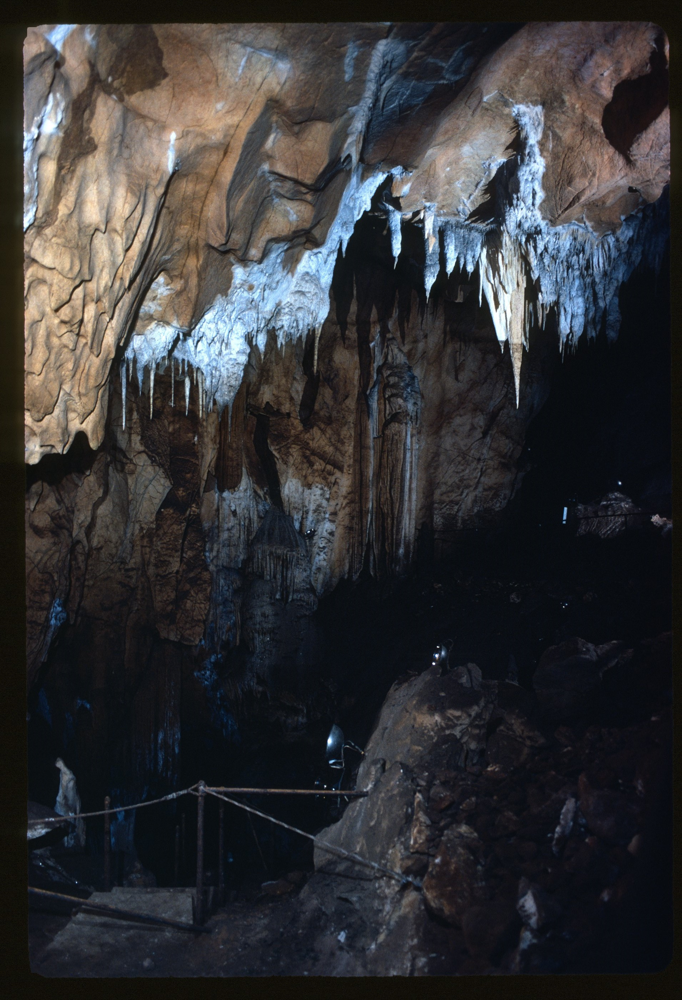
*ASF Joe N. Jennings slide catalogue, JNJ-S-1025-21, Box 1025. Catalogue description: Flood level on stalactite - River passage way below. [ASF record](https://st1.asflib.net/MEDIA/ASFJJSlidesCatalogue/Box%201025/JNJ-S-1025-21.html).*

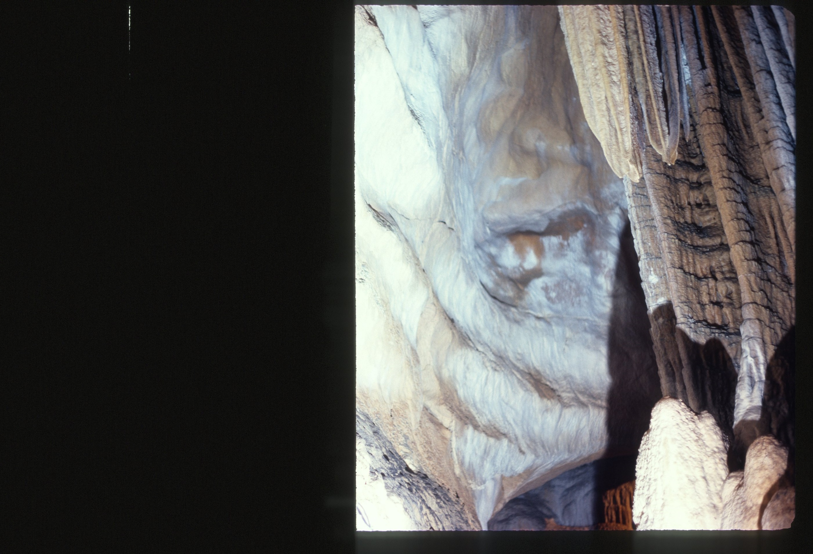
*ASF Joe N. Jennings slide catalogue, JNJ-S-1025-22, Box 1025. Catalogue description: Formation. [ASF record](https://st1.asflib.net/MEDIA/ASFJJSlidesCatalogue/Box%201025/JNJ-S-1025-22.html).*

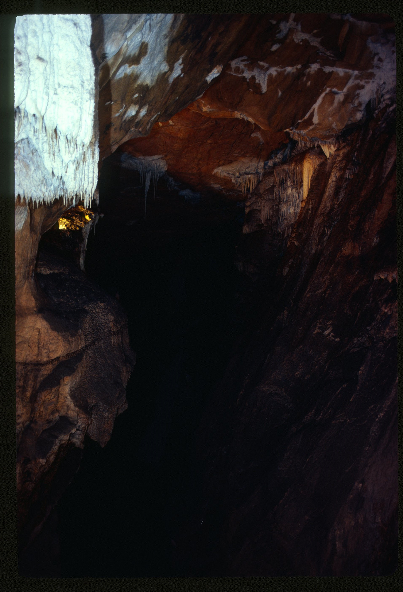
*ASF Joe N. Jennings slide catalogue, JNJ-S-1025-23, Box 1025. Catalogue description: Up river passage. [ASF record](https://st1.asflib.net/MEDIA/ASFJJSlidesCatalogue/Box%201025/JNJ-S-1025-23.html).*

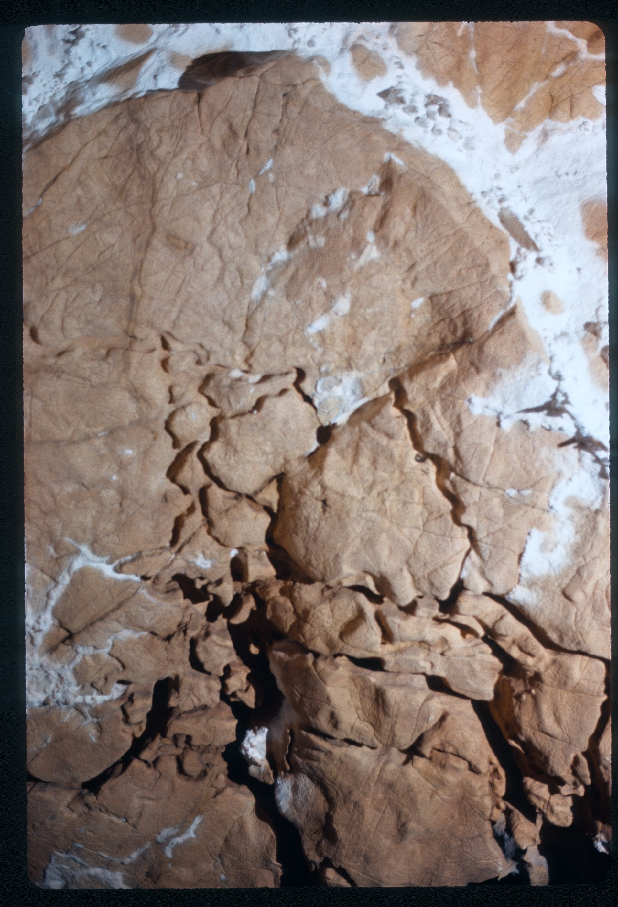
*ASF Joe N. Jennings slide catalogue, JNJ-S-1025-24, Box 1025. Catalogue description: Anastromosing half-tubes in roof. [ASF record](https://st1.asflib.net/MEDIA/ASFJJSlidesCatalogue/Box%201025/JNJ-S-1025-24.html).*

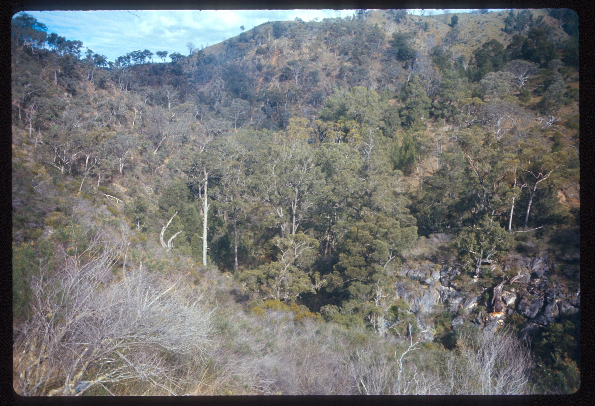
*ASF Joe N. Jennings slide catalogue, JNJ-S-1025-25, Box 1025. Catalogue description: Junction of Wombeyan and Mares Forest Creeks - From Junction Cave entrance. [ASF record](https://st1.asflib.net/MEDIA/ASFJJSlidesCatalogue/Box%201025/JNJ-S-1025-25.html).*

<!-- ASF slide images: end -->

# References

- [National Parks NSW](https://www.nationalparks.nsw.gov.au/things-to-do/show-caves/junction-cave)
