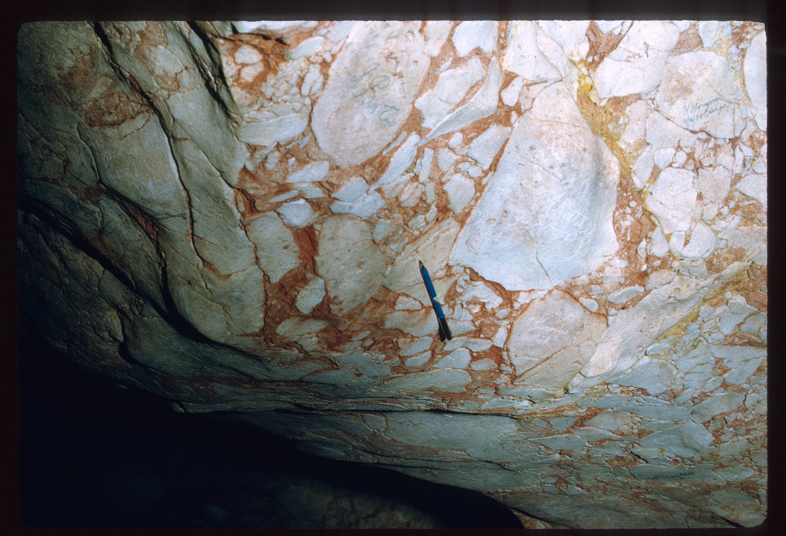
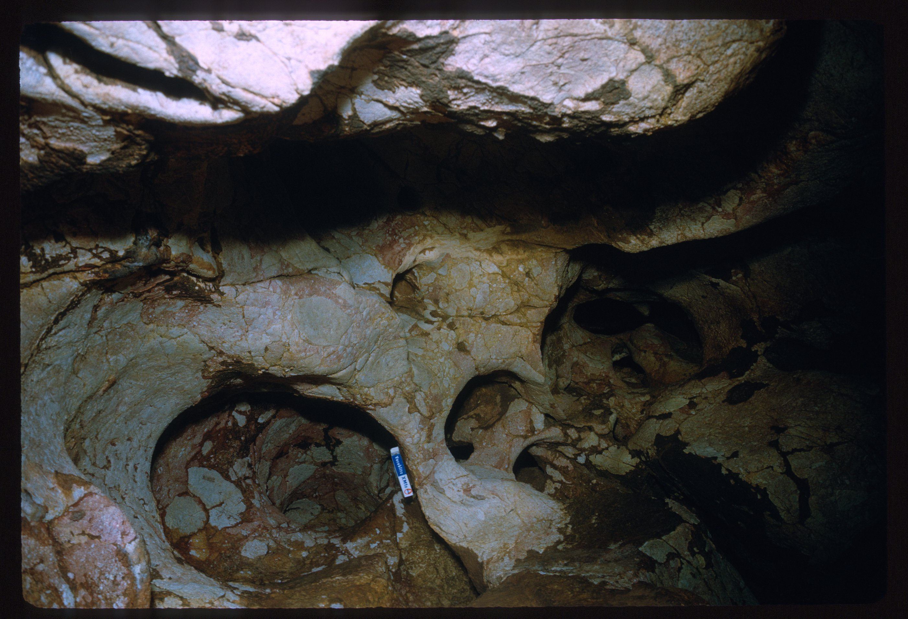

# About

Tunnel Cave closed May-October for bats
Borenore Karst Conservation Reserve features over 40 caves (wikipedia)

# Additional Notes

Tunnel Cave - a long, dark passage, about 110 metres (360 ft) long, which emerges from the base of a large hill. The sink hole is about 30 metres (98 ft) higher than the entrance at the bottom of the hill.[4] The Tunnel Cave is closed from May to October each year so that a colony of Eastern bent-winged bats, which hibernate there, are left undisturbed.[5]

# Source notes

## ASF slide images

Images are from the ASF Joe N. Jennings slide catalogue. Each caption preserves the catalogue description and links to its source record.

*ASF Joe N. Jennings slide catalogue, JNJ-S-1017-10, Box 1017. Catalogue description: Little caves (Tunnel Cave) - Breccia (bedrock) in roof. [ASF record](https://st1.asflib.net/MEDIA/ASFJJSlidesCatalogue/Box%201017/JNJ-S-1017-10.html).*

*ASF Joe N. Jennings slide catalogue, JNJ-S-1017-11, Box 1017. Catalogue description: Little caves (Tunnel Cave) - Spongework. [ASF record](https://st1.asflib.net/MEDIA/ASFJJSlidesCatalogue/Box%201017/JNJ-S-1017-11.html).*

<!-- ASF slide images: end -->

# References

- [Wikipedia](https://en.wikipedia.org/wiki/Borenore_Caves)
