# Additional Notes

Let yourself be taken into a mystical underworld on a guided tour through Wollondilly Cave. It is the longest and most varied cave in the [Wombeyan Caves](Wombeyan%20Caves.md) network and stretches across an incredible five levels.

The cave walls will come alive before your eyes, sparkling throughout the five major chambers. It’s remarkable to think that the pathways through the cave were created by free-flowing streams and that the cave has been undergoing transformations for millions of years. Don’t forget to use the flash on your camera to capture the fascinating cave formations like stalactites and stalagmites you’ll see along the way

# Source notes

## ASF slide images

Images are from the ASF Joe N. Jennings slide catalogue. Each caption preserves the catalogue description and links to its source record.

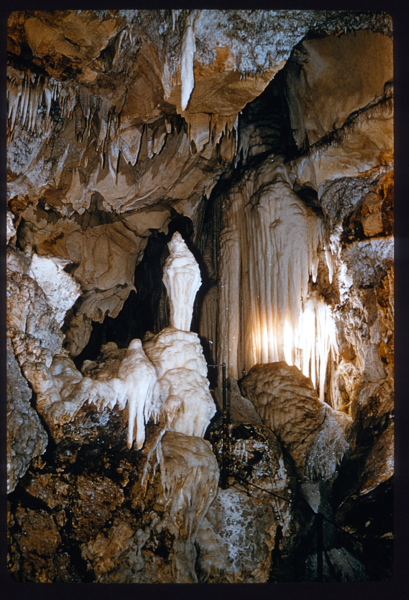
*ASF Joe N. Jennings slide catalogue, JNJ-S-1022-01, Box 1022. Catalogue description: Lot's Wife. [ASF record](https://st1.asflib.net/MEDIA/ASFJJSlidesCatalogue/Box%201022/JNJ-S-1022-01.html).*

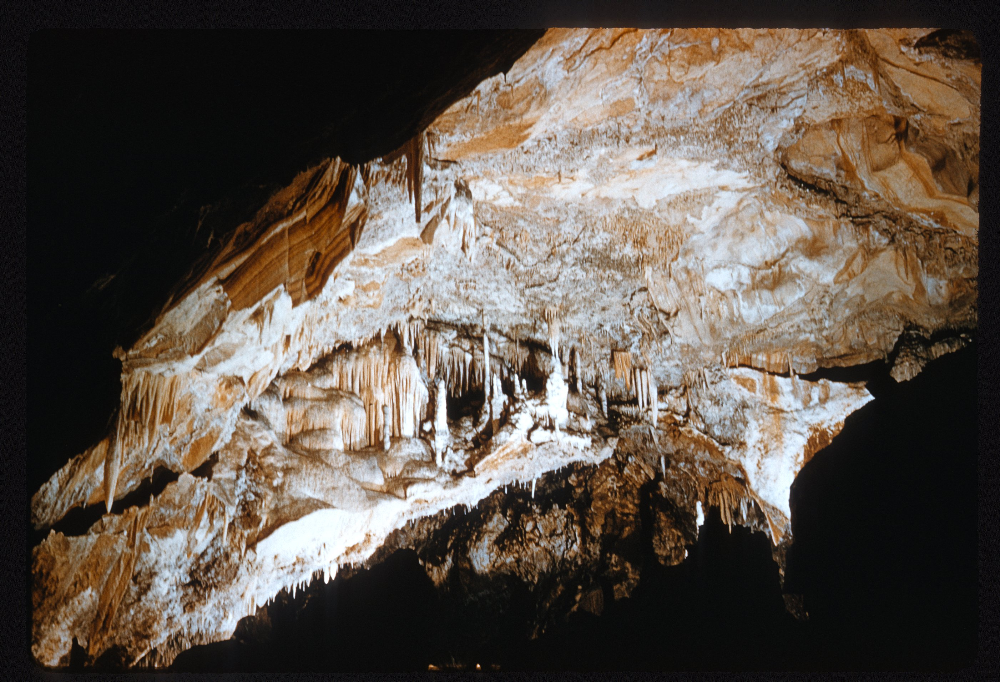
*ASF Joe N. Jennings slide catalogue, JNJ-S-1022-02, Box 1022. Catalogue description: Home of the Fairies. [ASF record](https://st1.asflib.net/MEDIA/ASFJJSlidesCatalogue/Box%201022/JNJ-S-1022-02.html).*

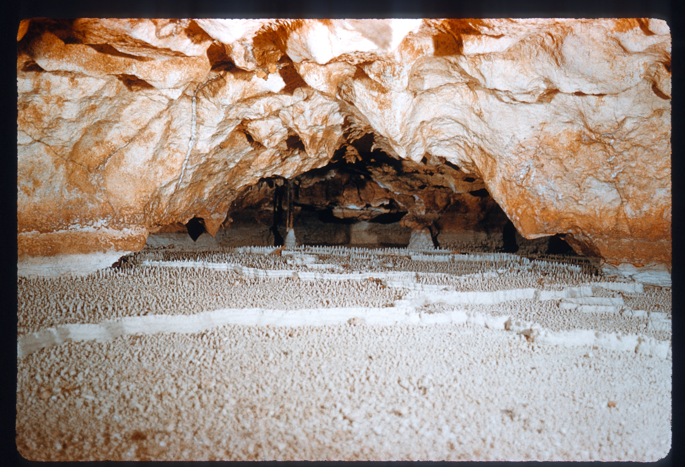
*ASF Joe N. Jennings slide catalogue, JNJ-S-1022-03, Box 1022. Catalogue description: The Paddy Fields. [ASF record](https://st1.asflib.net/MEDIA/ASFJJSlidesCatalogue/Box%201022/JNJ-S-1022-03.html).*

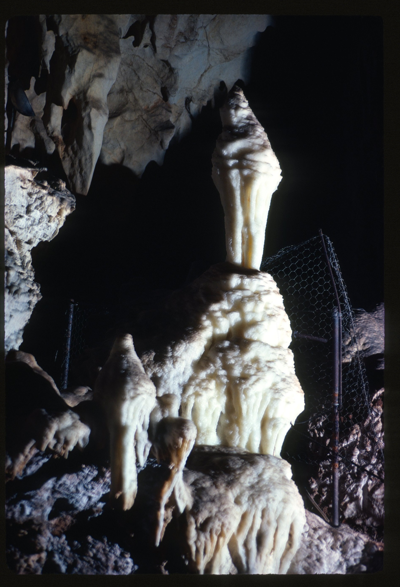
*ASF Joe N. Jennings slide catalogue, JNJ-S-1022-05, Box 1022. Catalogue description: Lot's Wife and Cockatoo. [ASF record](https://st1.asflib.net/MEDIA/ASFJJSlidesCatalogue/Box%201022/JNJ-S-1022-05.html).*

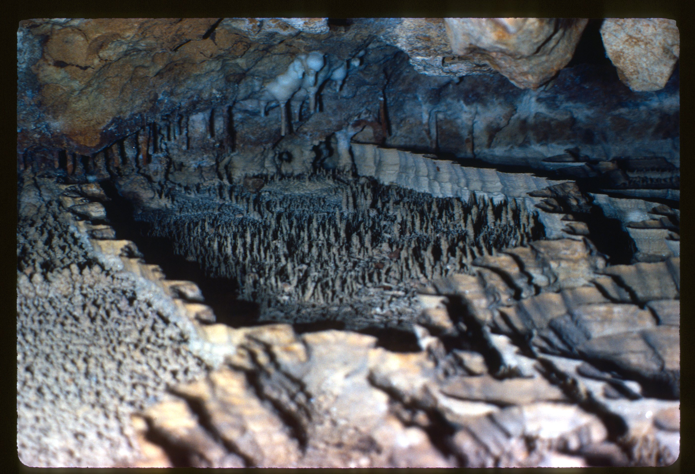
*ASF Joe N. Jennings slide catalogue, JNJ-S-1022-06, Box 1022. Catalogue description: Fortifications - Pine Forrest. [ASF record](https://st1.asflib.net/MEDIA/ASFJJSlidesCatalogue/Box%201022/JNJ-S-1022-06.html).*

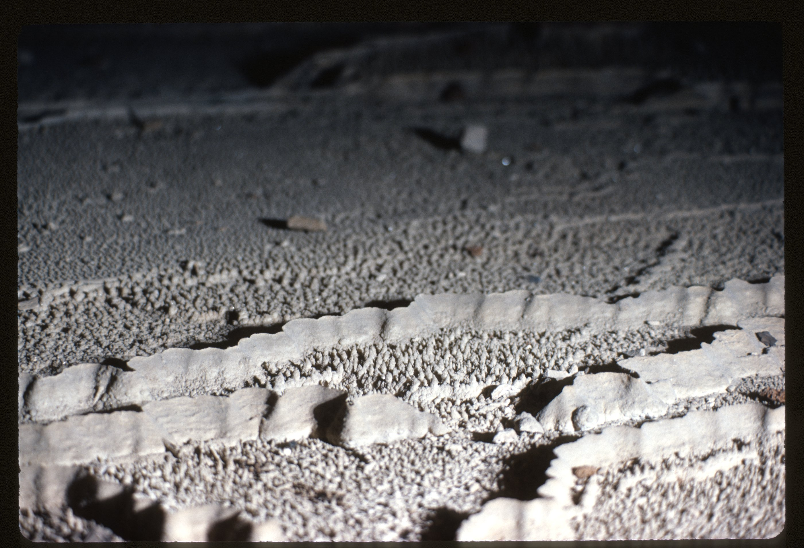
*ASF Joe N. Jennings slide catalogue, JNJ-S-1022-07, Box 1022. Catalogue description: Fortifications. [ASF record](https://st1.asflib.net/MEDIA/ASFJJSlidesCatalogue/Box%201022/JNJ-S-1022-07.html).*

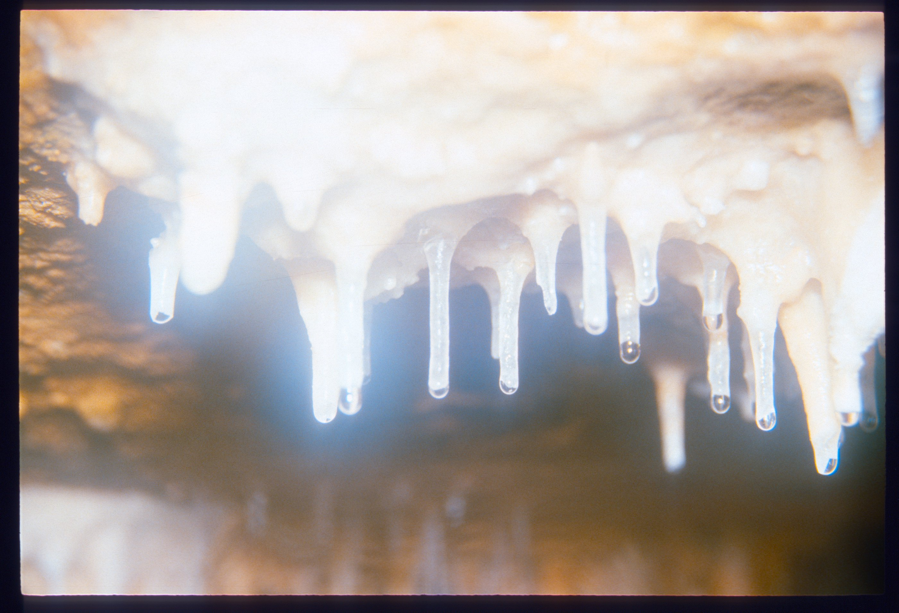
*ASF Joe N. Jennings slide catalogue, JNJ-S-1022-08, Box 1022. Catalogue description: Straws - Mulwaree Visit. [ASF record](https://st1.asflib.net/MEDIA/ASFJJSlidesCatalogue/Box%201022/JNJ-S-1022-08.html).*

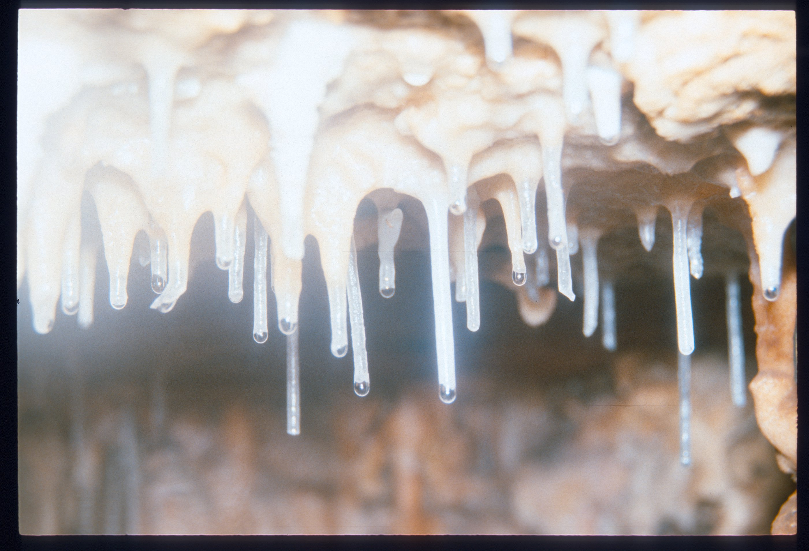
*ASF Joe N. Jennings slide catalogue, JNJ-S-1022-09, Box 1022. Catalogue description: Straws. [ASF record](https://st1.asflib.net/MEDIA/ASFJJSlidesCatalogue/Box%201022/JNJ-S-1022-09.html).*

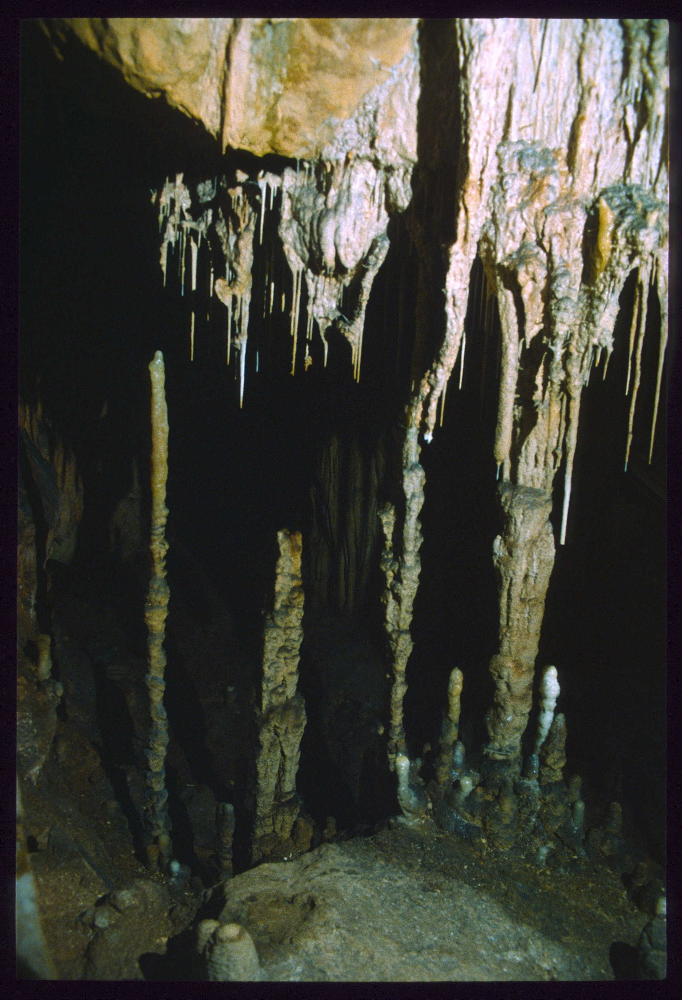
*ASF Joe N. Jennings slide catalogue, JNJ-S-1022-10, Box 1022. Catalogue description: Formations - Mulwaree Visit. [ASF record](https://st1.asflib.net/MEDIA/ASFJJSlidesCatalogue/Box%201022/JNJ-S-1022-10.html).*

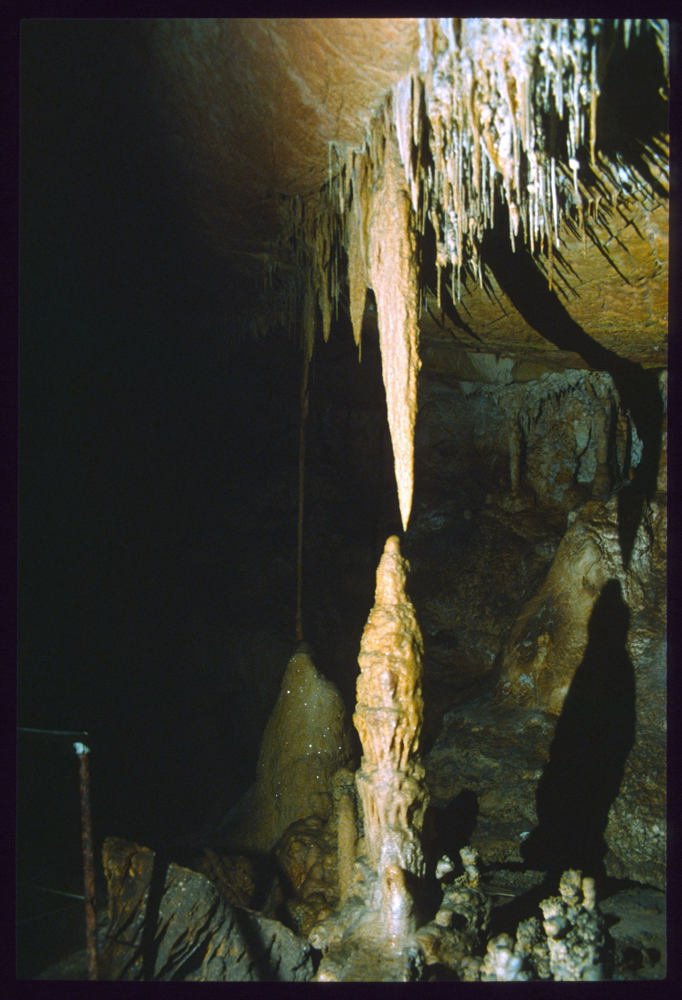
*ASF Joe N. Jennings slide catalogue, JNJ-S-1022-11, Box 1022. Catalogue description: Formations. [ASF record](https://st1.asflib.net/MEDIA/ASFJJSlidesCatalogue/Box%201022/JNJ-S-1022-11.html).*

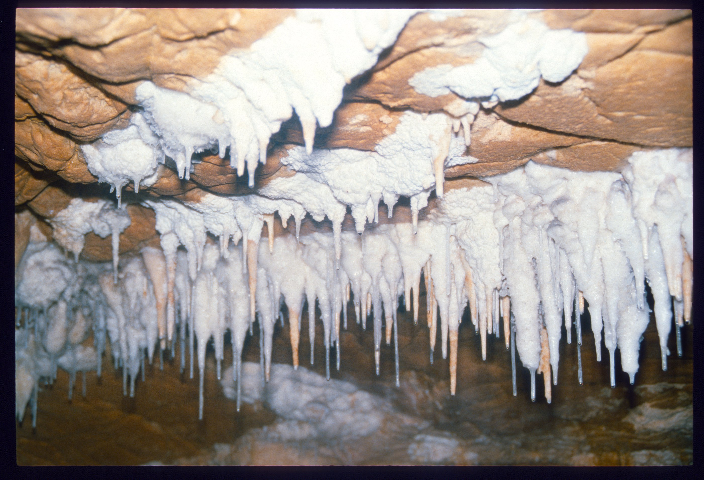
*ASF Joe N. Jennings slide catalogue, JNJ-S-1022-12, Box 1022. Catalogue description: Formations. [ASF record](https://st1.asflib.net/MEDIA/ASFJJSlidesCatalogue/Box%201022/JNJ-S-1022-12.html).*

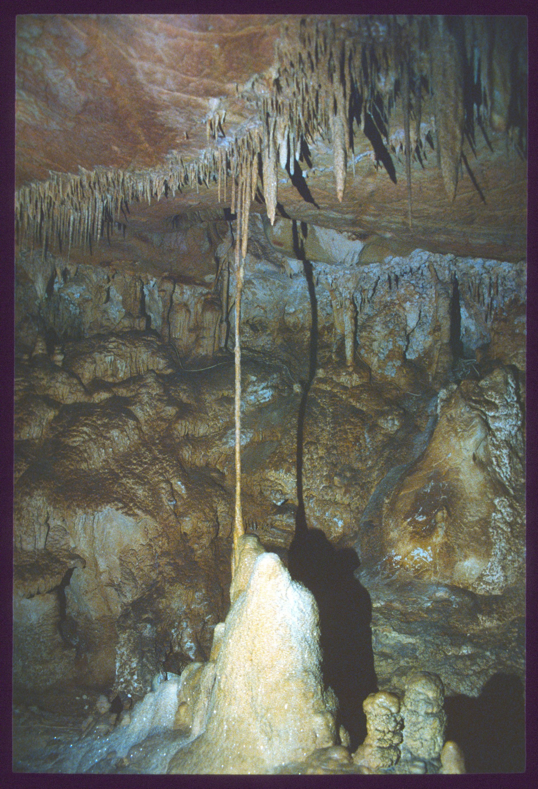
*ASF Joe N. Jennings slide catalogue, JNJ-S-1022-13, Box 1022. Catalogue description: Formations. [ASF record](https://st1.asflib.net/MEDIA/ASFJJSlidesCatalogue/Box%201022/JNJ-S-1022-13.html).*

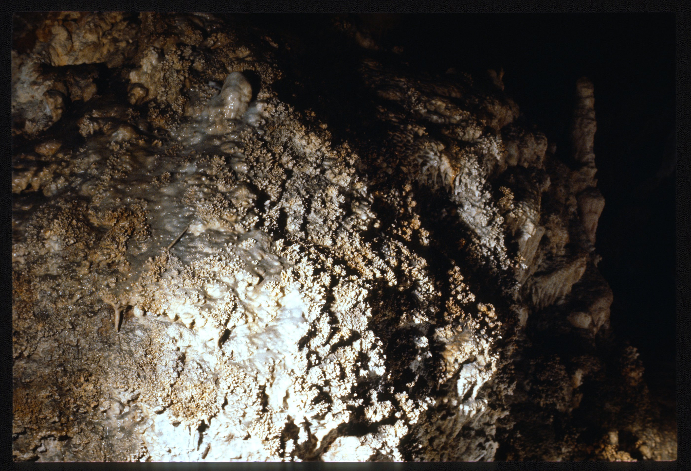
*ASF Joe N. Jennings slide catalogue, JNJ-S-1022-14, Box 1022. Catalogue description: Cave Coral. [ASF record](https://st1.asflib.net/MEDIA/ASFJJSlidesCatalogue/Box%201022/JNJ-S-1022-14.html).*

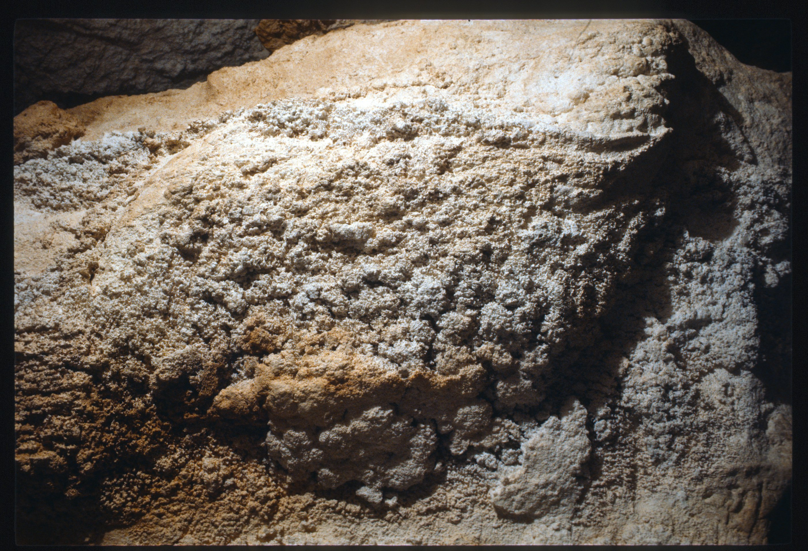
*ASF Joe N. Jennings slide catalogue, JNJ-S-1022-15, Box 1022. Catalogue description: Pustules. [ASF record](https://st1.asflib.net/MEDIA/ASFJJSlidesCatalogue/Box%201022/JNJ-S-1022-15.html).*

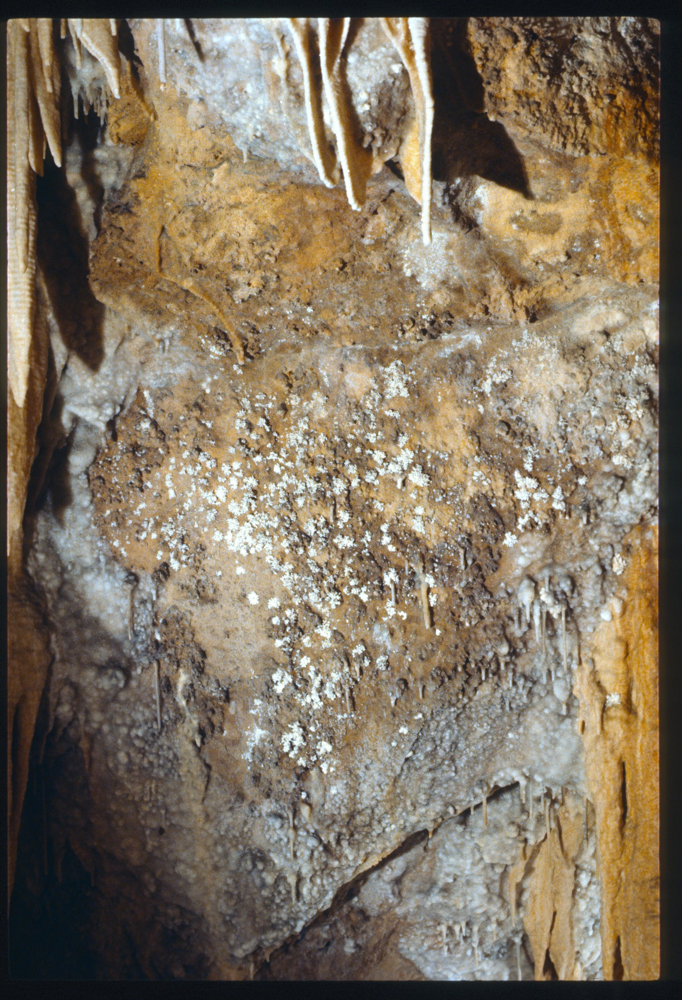
*ASF Joe N. Jennings slide catalogue, JNJ-S-1022-16, Box 1022. Catalogue description: Pustules. [ASF record](https://st1.asflib.net/MEDIA/ASFJJSlidesCatalogue/Box%201022/JNJ-S-1022-16.html).*

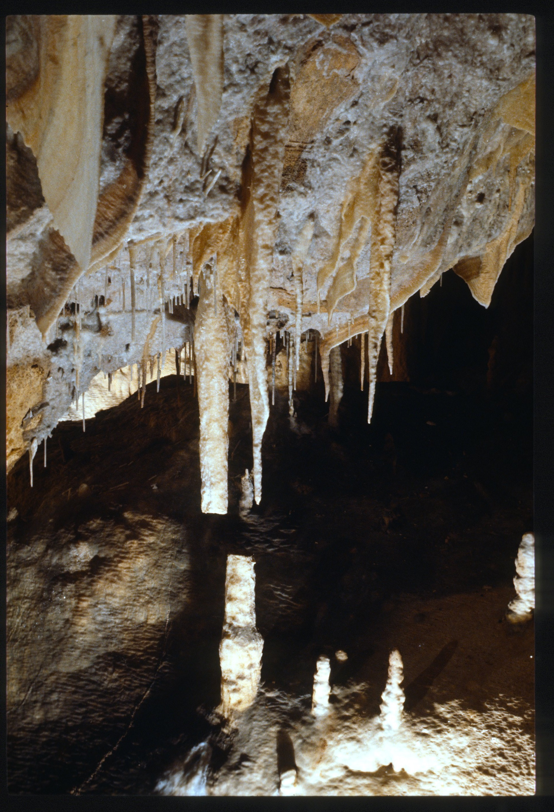
*ASF Joe N. Jennings slide catalogue, JNJ-S-1022-17, Box 1022. Catalogue description: Fractured Column. [ASF record](https://st1.asflib.net/MEDIA/ASFJJSlidesCatalogue/Box%201022/JNJ-S-1022-17.html).*

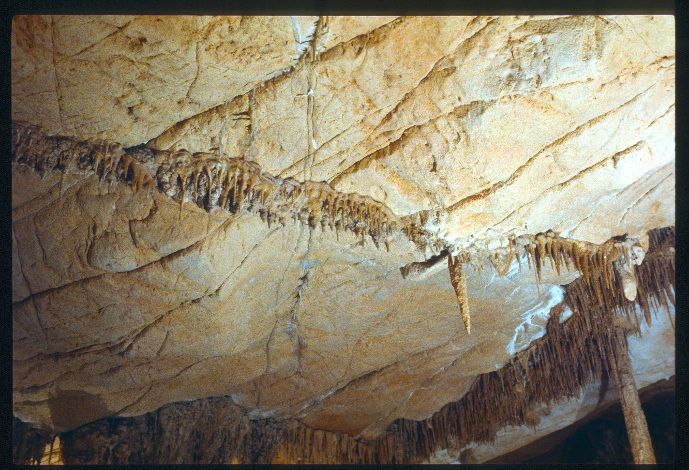
*ASF Joe N. Jennings slide catalogue, JNJ-S-1022-18, Box 1022. Catalogue description: Stalactities along joint. [ASF record](https://st1.asflib.net/MEDIA/ASFJJSlidesCatalogue/Box%201022/JNJ-S-1022-18.html).*

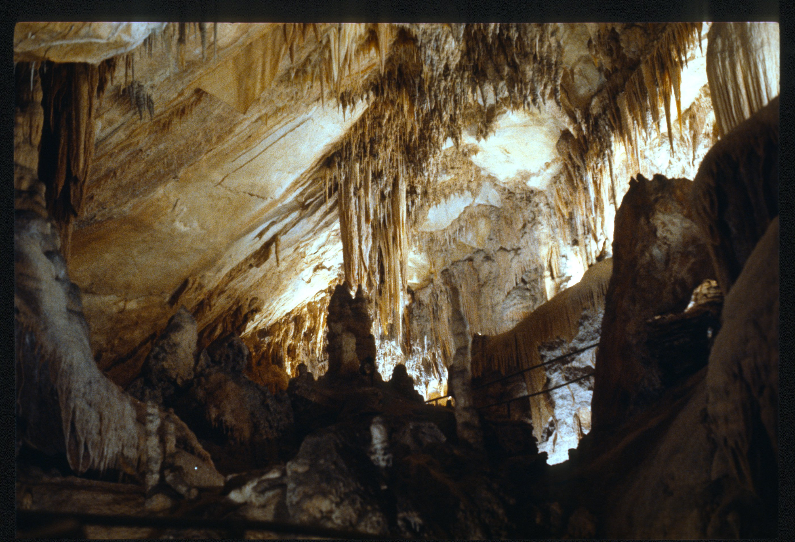
*ASF Joe N. Jennings slide catalogue, JNJ-S-1022-19, Box 1022. Catalogue description: ? Wall in bedding plane. [ASF record](https://st1.asflib.net/MEDIA/ASFJJSlidesCatalogue/Box%201022/JNJ-S-1022-19.html).*

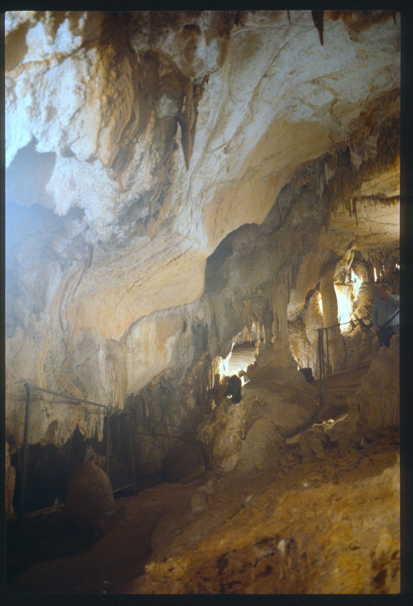
*ASF Joe N. Jennings slide catalogue, JNJ-S-1022-20, Box 1022. Catalogue description: Meander in-cuts. [ASF record](https://st1.asflib.net/MEDIA/ASFJJSlidesCatalogue/Box%201022/JNJ-S-1022-20.html).*

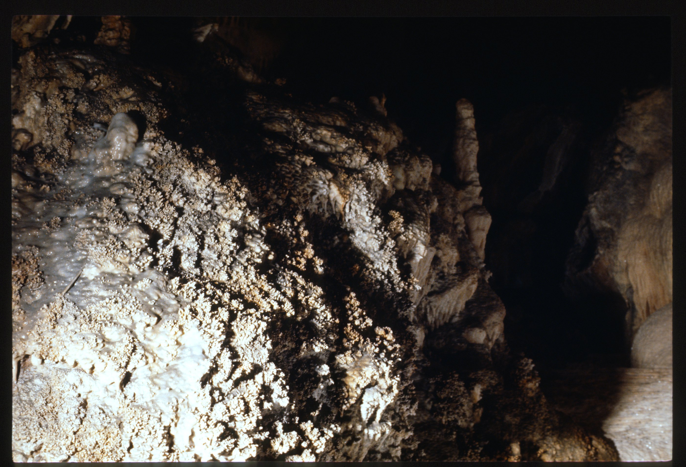
*ASF Joe N. Jennings slide catalogue, JNJ-S-1022-21, Box 1022. Catalogue description: Cave coral. [ASF record](https://st1.asflib.net/MEDIA/ASFJJSlidesCatalogue/Box%201022/JNJ-S-1022-21.html).*

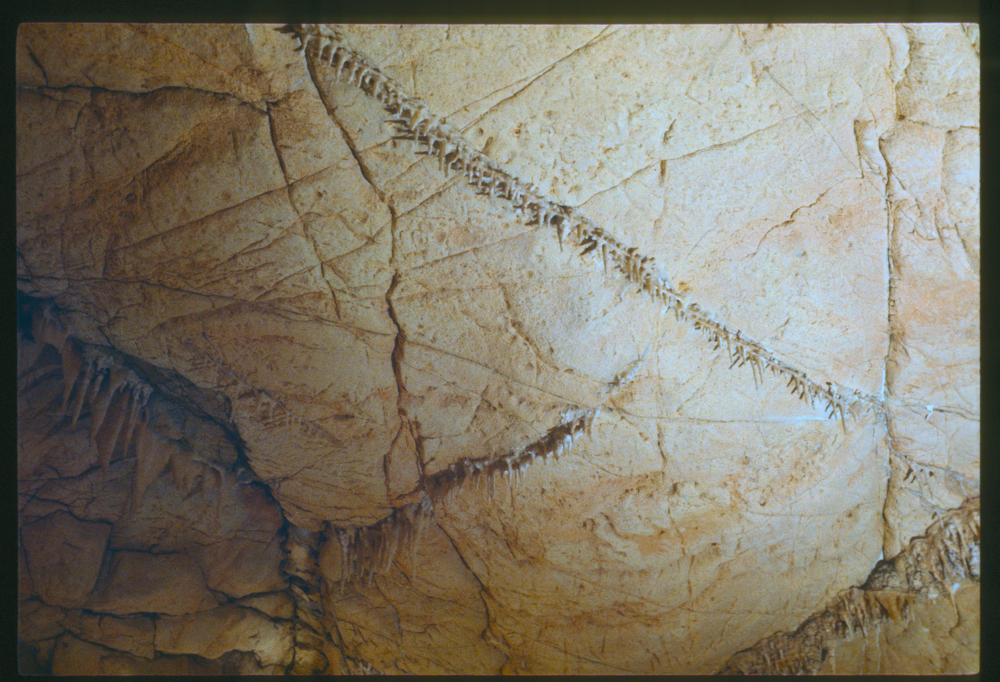
*ASF Joe N. Jennings slide catalogue, JNJ-S-1022-22, Box 1022. Catalogue description: Stalactities along joint. [ASF record](https://st1.asflib.net/MEDIA/ASFJJSlidesCatalogue/Box%201022/JNJ-S-1022-22.html).*

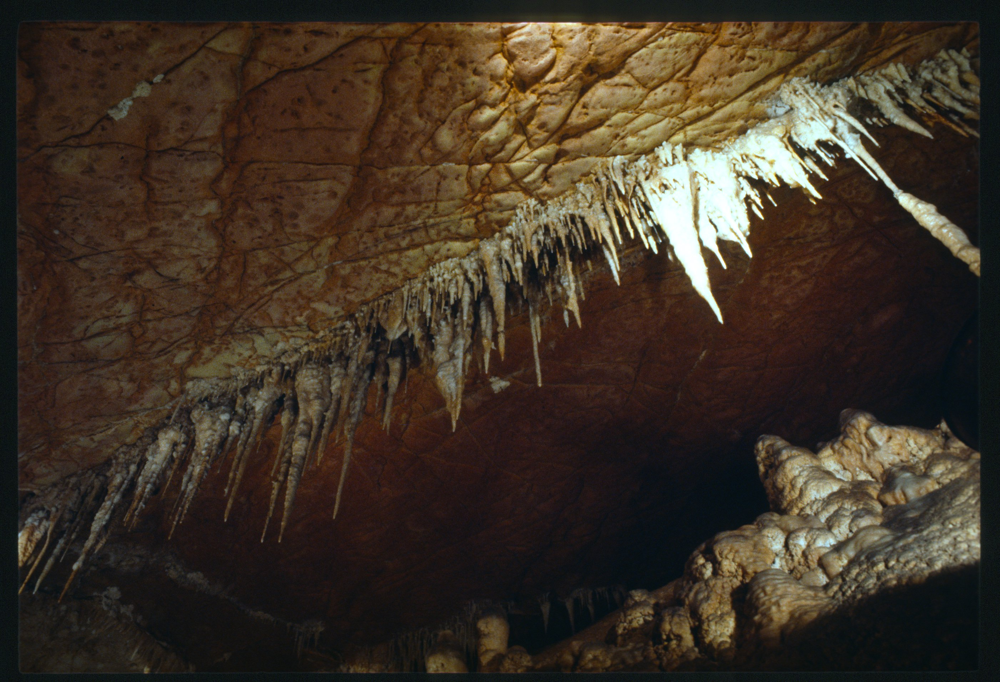
*ASF Joe N. Jennings slide catalogue, JNJ-S-1022-23, Box 1022. Catalogue description: Stalactities along joint. [ASF record](https://st1.asflib.net/MEDIA/ASFJJSlidesCatalogue/Box%201022/JNJ-S-1022-23.html).*

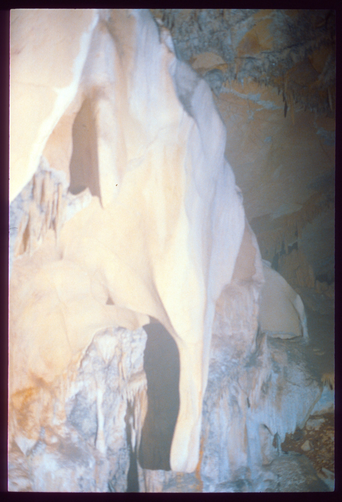
*ASF Joe N. Jennings slide catalogue, JNJ-S-1022-24, Box 1022. Catalogue description: Rock pendant. [ASF record](https://st1.asflib.net/MEDIA/ASFJJSlidesCatalogue/Box%201022/JNJ-S-1022-24.html).*

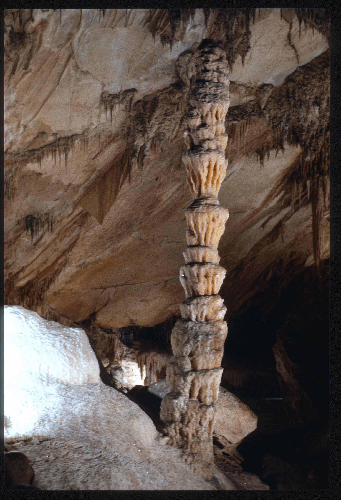
*ASF Joe N. Jennings slide catalogue, JNJ-S-1022-25, Box 1022. Catalogue description: Tiered stalagmite. [ASF record](https://st1.asflib.net/MEDIA/ASFJJSlidesCatalogue/Box%201022/JNJ-S-1022-25.html).*

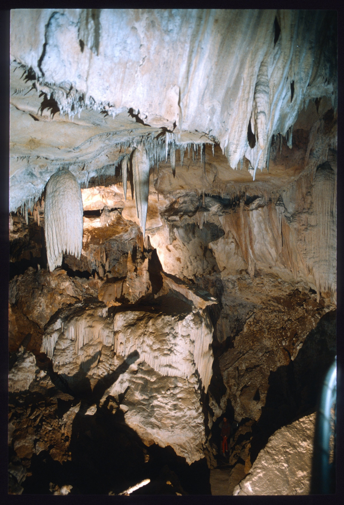
*ASF Joe N. Jennings slide catalogue, JNJ-S-1022-26, Box 1022. Catalogue description: Formations. [ASF record](https://st1.asflib.net/MEDIA/ASFJJSlidesCatalogue/Box%201022/JNJ-S-1022-26.html).*

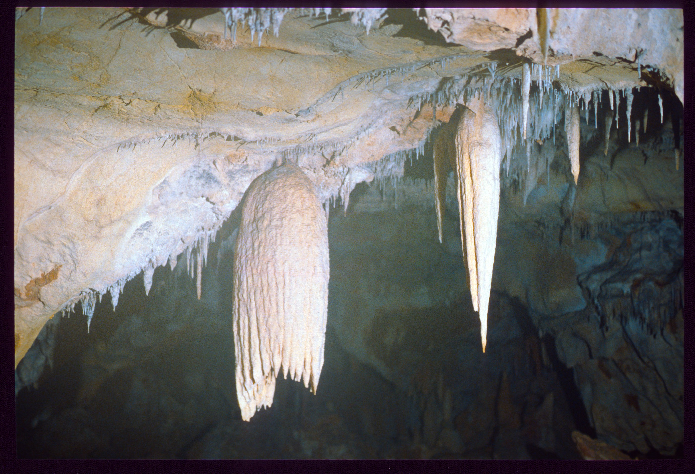
*ASF Joe N. Jennings slide catalogue, JNJ-S-1022-27, Box 1022. Catalogue description: Formations. [ASF record](https://st1.asflib.net/MEDIA/ASFJJSlidesCatalogue/Box%201022/JNJ-S-1022-27.html).*

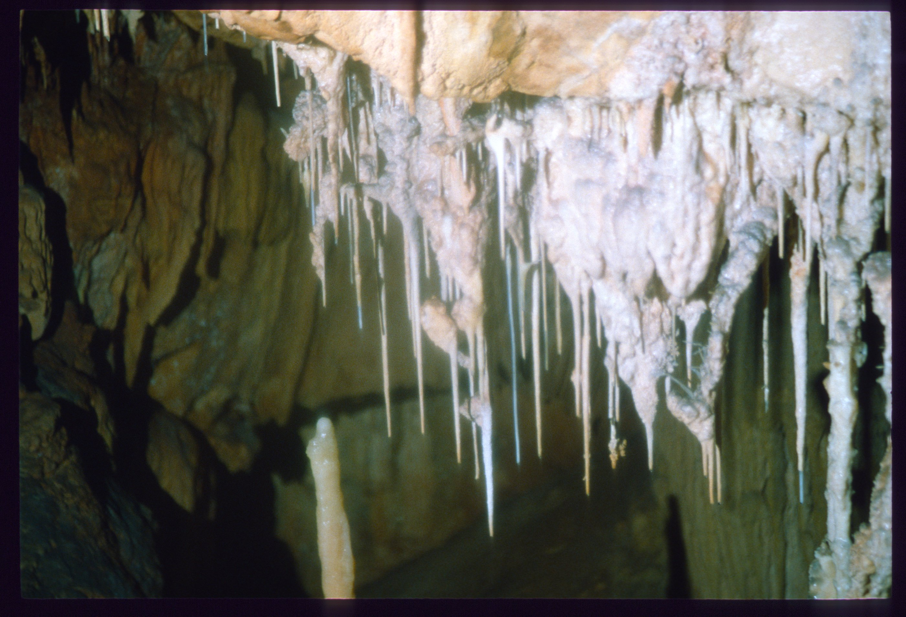
*ASF Joe N. Jennings slide catalogue, JNJ-S-1022-28, Box 1022. Catalogue description: Mulwaree visit. [ASF record](https://st1.asflib.net/MEDIA/ASFJJSlidesCatalogue/Box%201022/JNJ-S-1022-28.html).*

<!-- ASF slide images: end -->

# References

- [National Parks NSW](https://www.nationalparks.nsw.gov.au/things-to-do/show-caves/wollondilly-cave)
