# Additional Notes

Repository - hand sketches and survey data
- **Vimeo:** https://vimeo.com/122740018

# Source notes

<!-- ASF slide images: start -->
## ASF slide images

Images are from the ASF Joe N. Jennings slide catalogue. Each caption preserves the catalogue description and links to its source record.

### Basin Cave

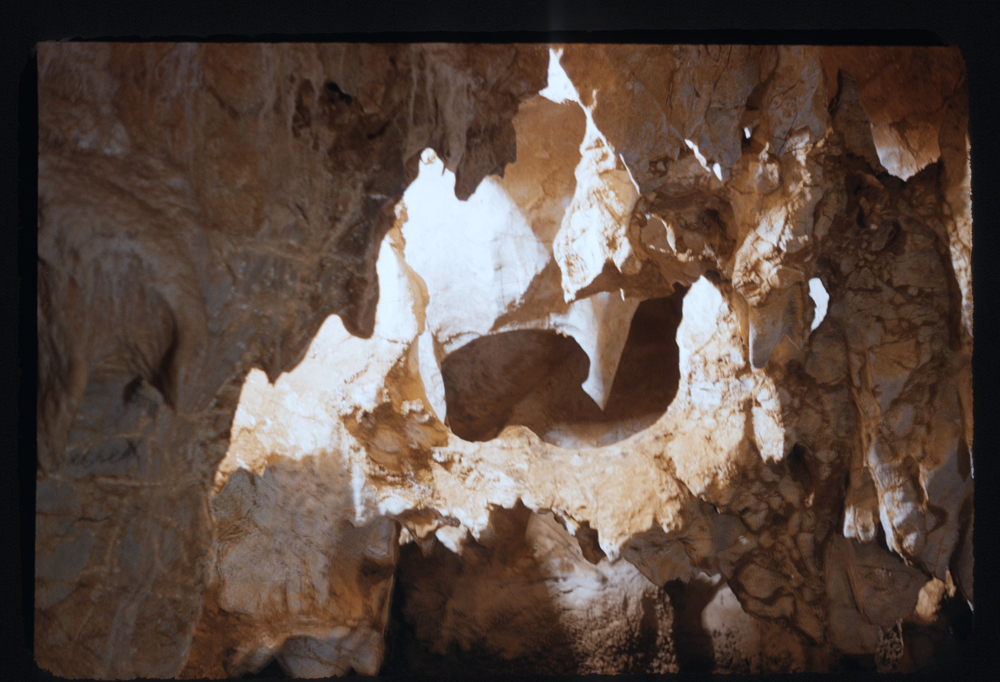
*ASF Joe N. Jennings slide catalogue, JNJ-S-1021-01, Box 1021. Catalogue description: Spongework. [ASF record](https://st1.asflib.net/MEDIA/ASFJJSlidesCatalogue/Box%201021/JNJ-S-1021-01.html).*

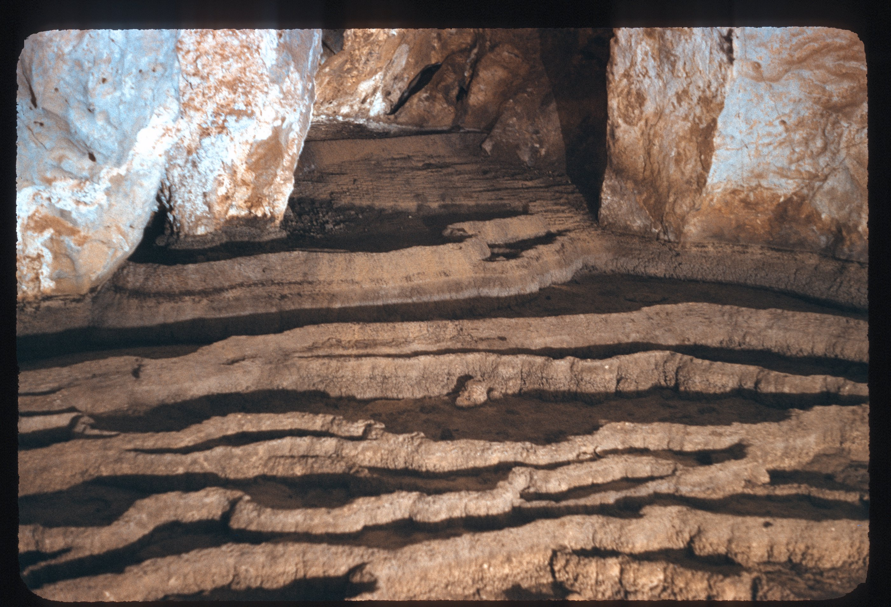
*ASF Joe N. Jennings slide catalogue, JNJ-S-1021-02, Box 1021. Catalogue description: Muddy 'gnome' in CT12. [ASF record](https://st1.asflib.net/MEDIA/ASFJJSlidesCatalogue/Box%201021/JNJ-S-1021-02.html).*

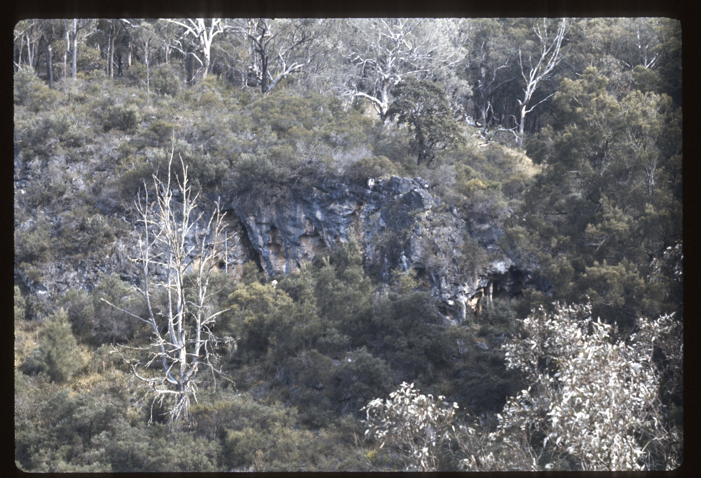
*ASF Joe N. Jennings slide catalogue, JNJ-S-1021-03, Box 1021. Catalogue description: Cave high in wall above Basin Cave - Mares Forrest Creek. [ASF record](https://st1.asflib.net/MEDIA/ASFJJSlidesCatalogue/Box%201021/JNJ-S-1021-03.html).*

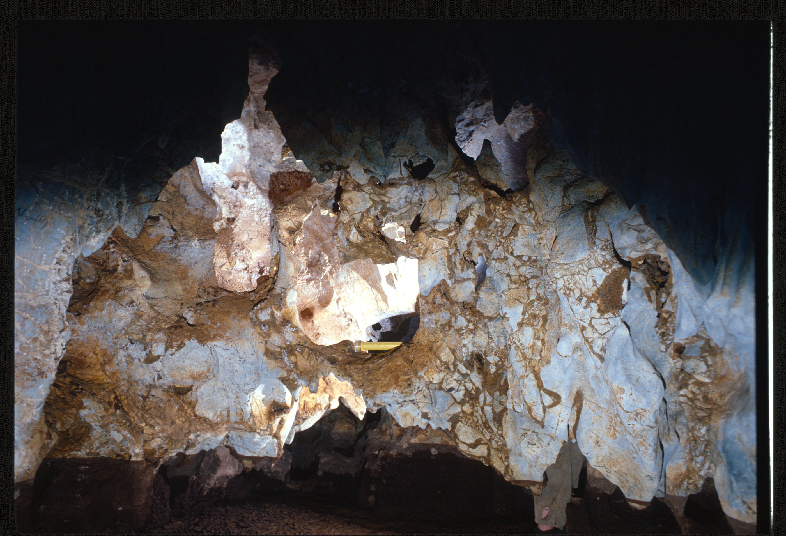
*ASF Joe N. Jennings slide catalogue, JNJ-S-1021-04, Box 1021. Catalogue description: Phreatic spongework. [ASF record](https://st1.asflib.net/MEDIA/ASFJJSlidesCatalogue/Box%201021/JNJ-S-1021-04.html).*

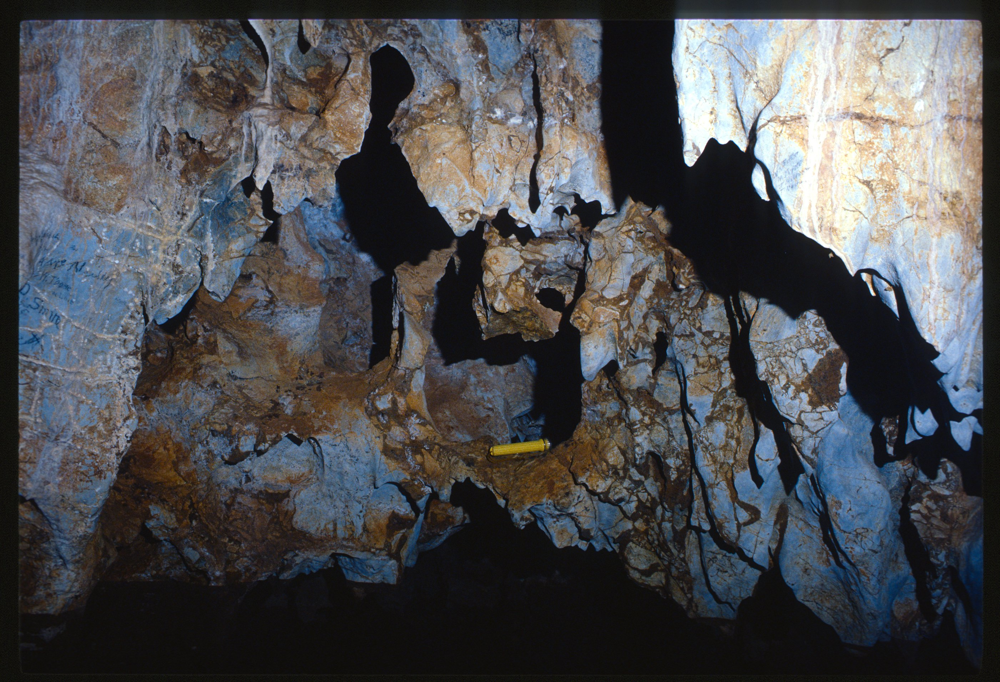
*ASF Joe N. Jennings slide catalogue, JNJ-S-1021-05, Box 1021. Catalogue description: Phreatic spongework. [ASF record](https://st1.asflib.net/MEDIA/ASFJJSlidesCatalogue/Box%201021/JNJ-S-1021-05.html).*

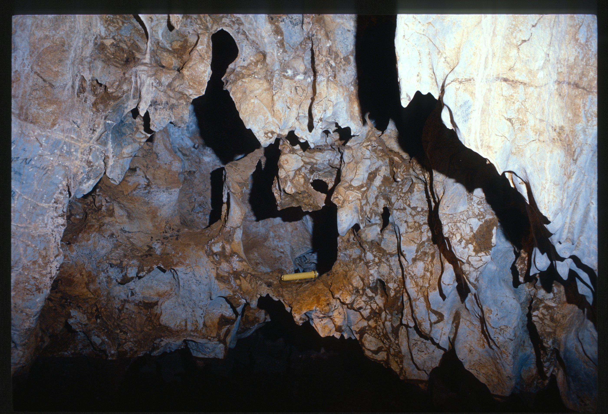
*ASF Joe N. Jennings slide catalogue, JNJ-S-1021-06, Box 1021. Catalogue description: Phreatic spongework. [ASF record](https://st1.asflib.net/MEDIA/ASFJJSlidesCatalogue/Box%201021/JNJ-S-1021-06.html).*

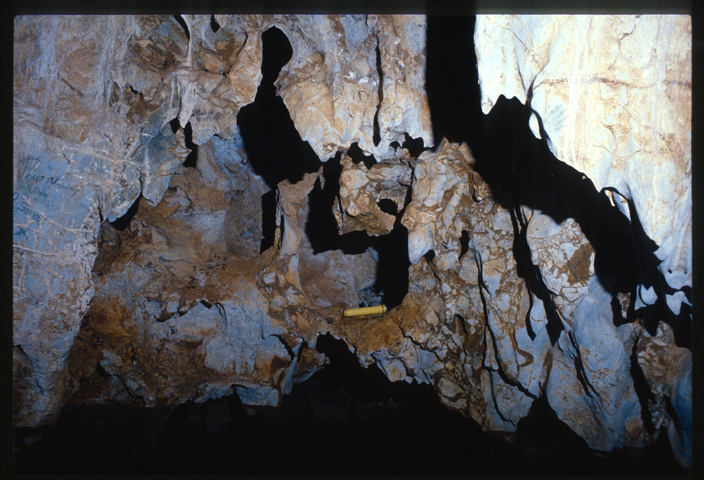
*ASF Joe N. Jennings slide catalogue, JNJ-S-1021-07, Box 1021. Catalogue description: Phreatic spongework. [ASF record](https://st1.asflib.net/MEDIA/ASFJJSlidesCatalogue/Box%201021/JNJ-S-1021-07.html).*

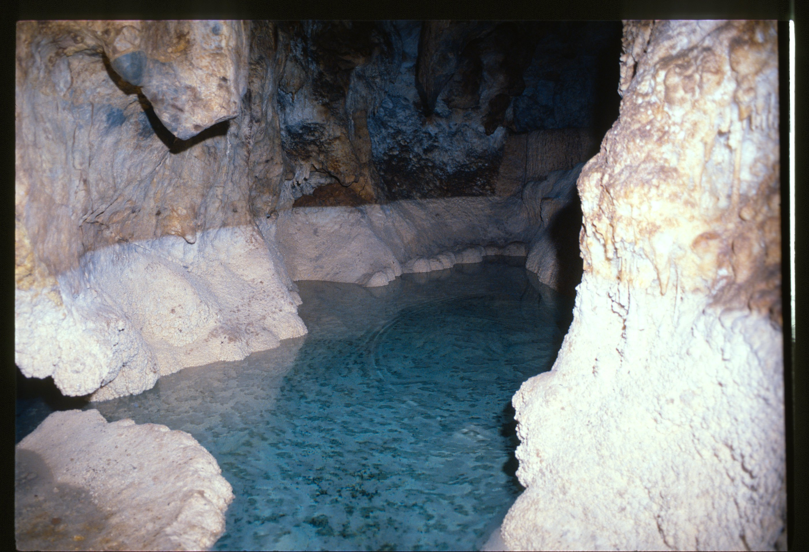
*ASF Joe N. Jennings slide catalogue, JNJ-S-1021-08, Box 1021. Catalogue description: Basins in Basin Cave. [ASF record](https://st1.asflib.net/MEDIA/ASFJJSlidesCatalogue/Box%201021/JNJ-S-1021-08.html).*

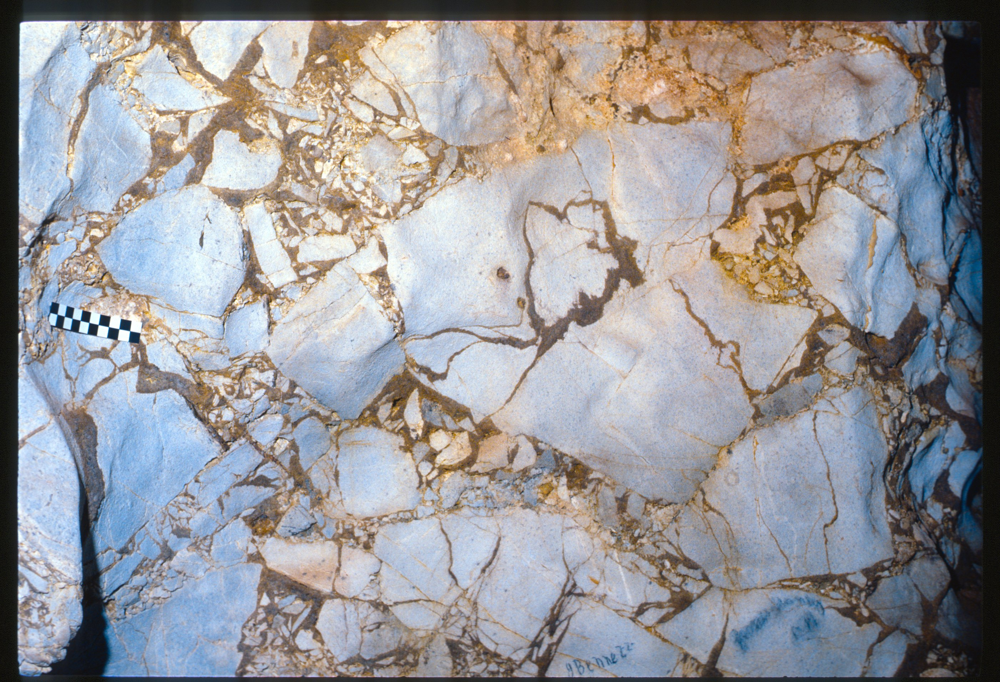
*ASF Joe N. Jennings slide catalogue, JNJ-S-1021-09, Box 1021. Catalogue description: Breccia. [ASF record](https://st1.asflib.net/MEDIA/ASFJJSlidesCatalogue/Box%201021/JNJ-S-1021-09.html).*

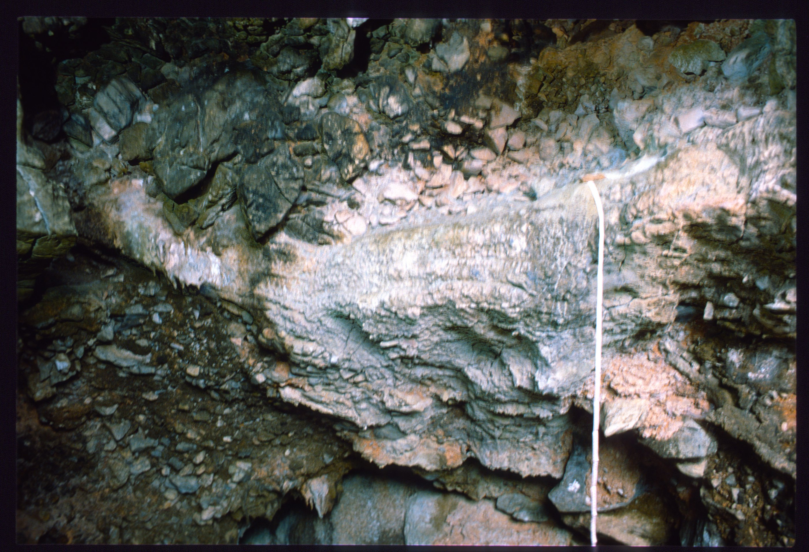
*ASF Joe N. Jennings slide catalogue, JNJ-S-1021-10, Box 1021. Catalogue description: Interbedded flowstone in Qu breccia - Basin cave lower entrance. [ASF record](https://st1.asflib.net/MEDIA/ASFJJSlidesCatalogue/Box%201021/JNJ-S-1021-10.html).*

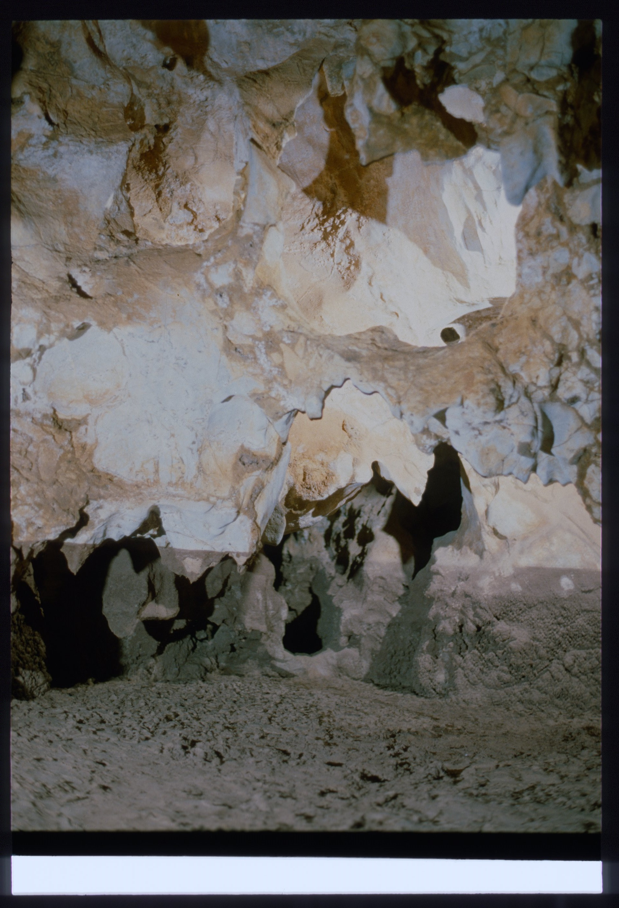
*ASF Joe N. Jennings slide catalogue, JNJ-S-1021-11, Box 1021. Catalogue description: ? Phreatic cheese. [ASF record](https://st1.asflib.net/MEDIA/ASFJJSlidesCatalogue/Box%201021/JNJ-S-1021-11.html).*

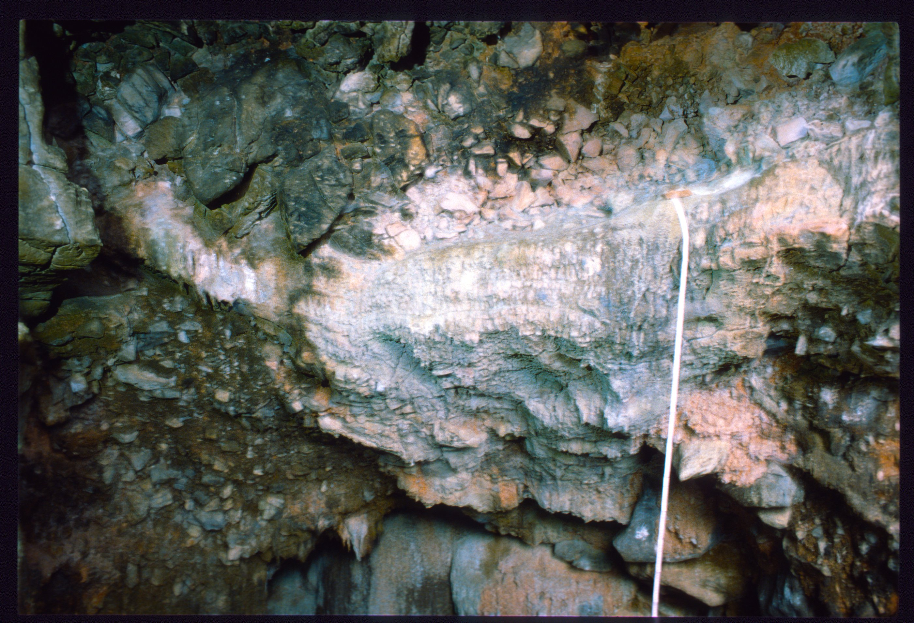
*ASF Joe N. Jennings slide catalogue, JNJ-S-1021-12, Box 1021. Catalogue description: Interbedded flowstone in Qu breccia - Basin cave lower entrance. [ASF record](https://st1.asflib.net/MEDIA/ASFJJSlidesCatalogue/Box%201021/JNJ-S-1021-12.html).*

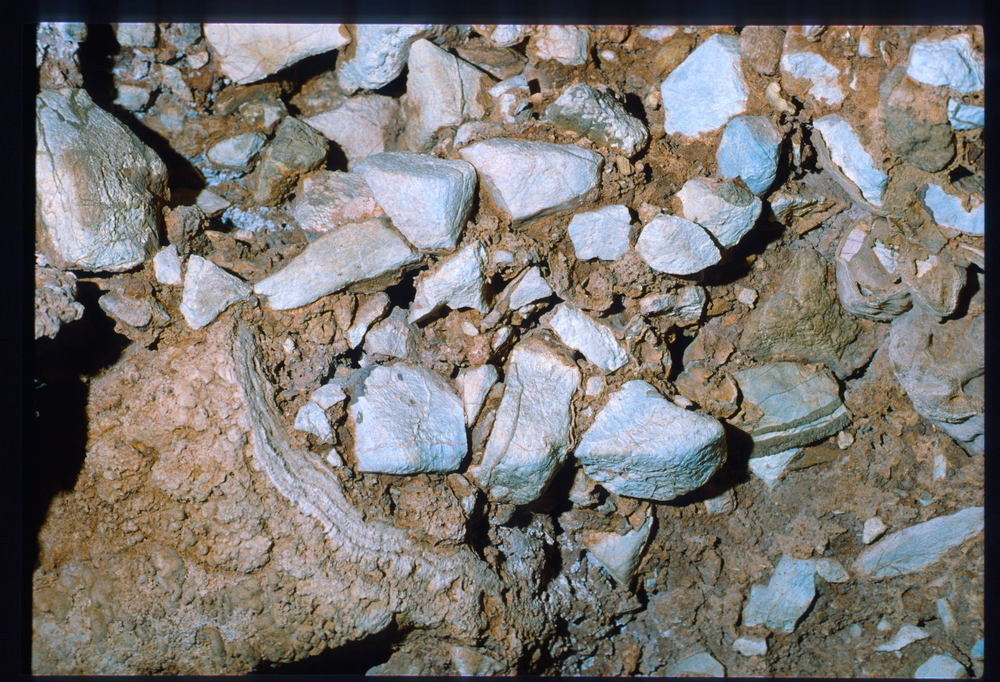
*ASF Joe N. Jennings slide catalogue, JNJ-S-1021-13, Box 1021. Catalogue description: Interbedded flowstone in Qu breccia - Basin cave lower entrance. [ASF record](https://st1.asflib.net/MEDIA/ASFJJSlidesCatalogue/Box%201021/JNJ-S-1021-13.html).*

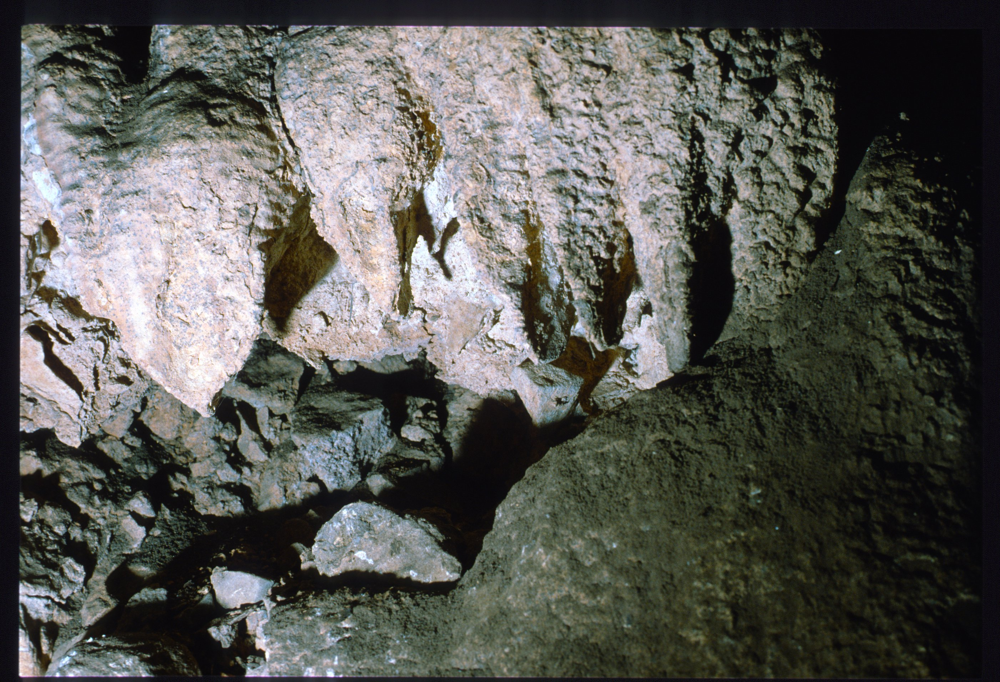
*ASF Joe N. Jennings slide catalogue, JNJ-S-1021-14, Box 1021. Catalogue description: Qv. Breccia under flowstone in A. B of A+B - Basin cave lower entrance. [ASF record](https://st1.asflib.net/MEDIA/ASFJJSlidesCatalogue/Box%201021/JNJ-S-1021-14.html).*

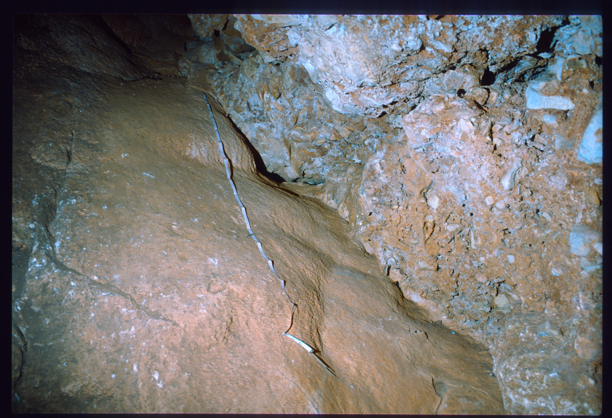
*ASF Joe N. Jennings slide catalogue, JNJ-S-1021-15, Box 1021. Catalogue description: Flowstone under Qv. Breccia A of A+B - Basin cave lower entrance. [ASF record](https://st1.asflib.net/MEDIA/ASFJJSlidesCatalogue/Box%201021/JNJ-S-1021-15.html).*

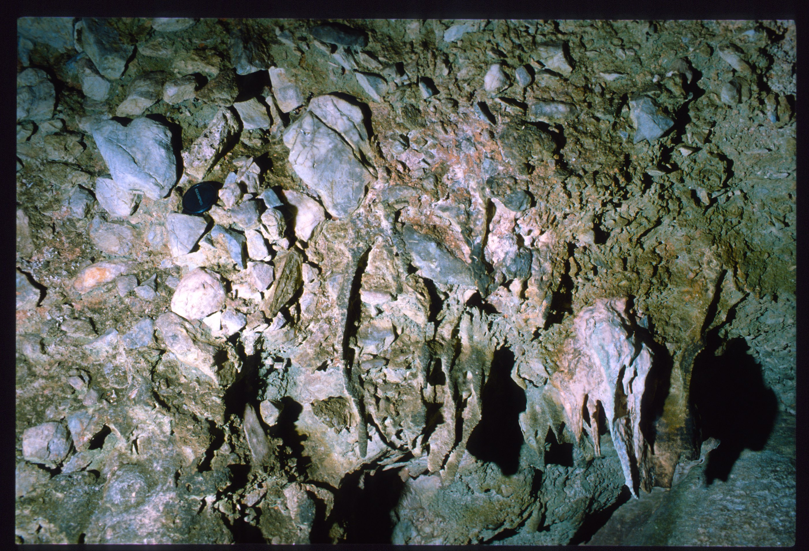
*ASF Joe N. Jennings slide catalogue, JNJ-S-1021-16, Box 1021. Catalogue description: Dripstone over Qv. Breccia - Basin cave lower entrance. [ASF record](https://st1.asflib.net/MEDIA/ASFJJSlidesCatalogue/Box%201021/JNJ-S-1021-16.html).*

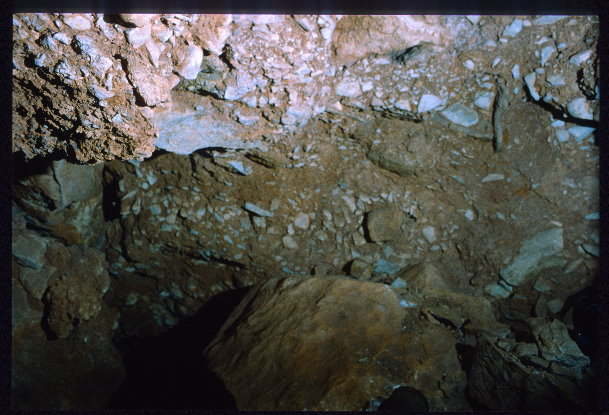
*ASF Joe N. Jennings slide catalogue, JNJ-S-1021-17, Box 1021. Catalogue description: Qv. Breccia 10m down - Looking down - Basin cave lower entrance. [ASF record](https://st1.asflib.net/MEDIA/ASFJJSlidesCatalogue/Box%201021/JNJ-S-1021-17.html).*

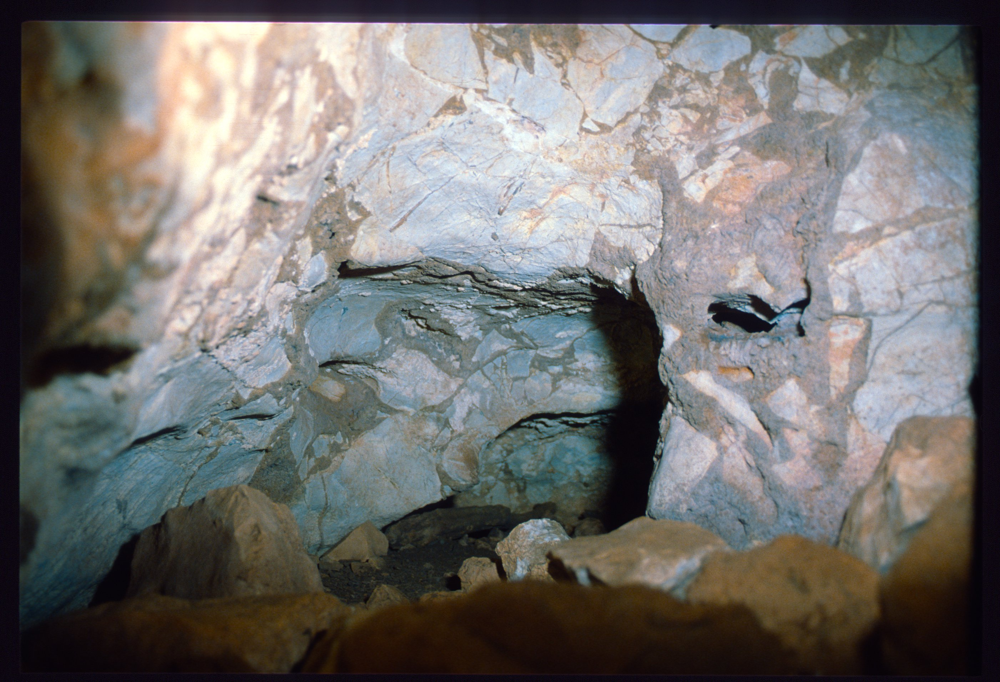
*ASF Joe N. Jennings slide catalogue, JNJ-S-1021-18, Box 1021. Catalogue description: Solution tube in bedrock breccia - Basin cave lower entrance. [ASF record](https://st1.asflib.net/MEDIA/ASFJJSlidesCatalogue/Box%201021/JNJ-S-1021-18.html).*

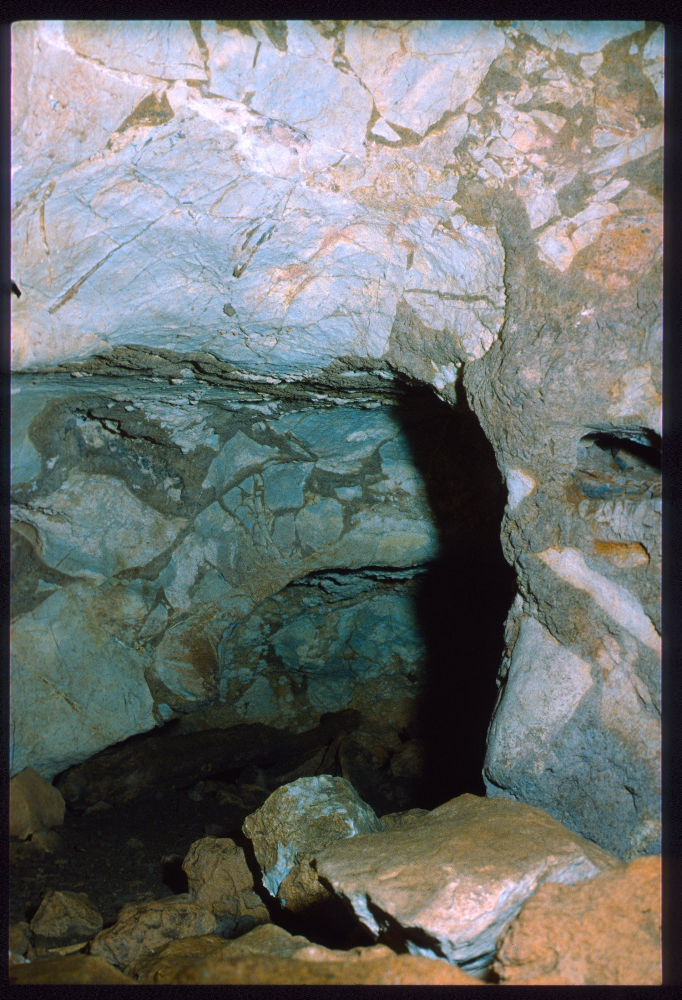
*ASF Joe N. Jennings slide catalogue, JNJ-S-1021-19, Box 1021. Catalogue description: Solution tube in bedrock breccia - Basin cave lower entrance. [ASF record](https://st1.asflib.net/MEDIA/ASFJJSlidesCatalogue/Box%201021/JNJ-S-1021-19.html).*

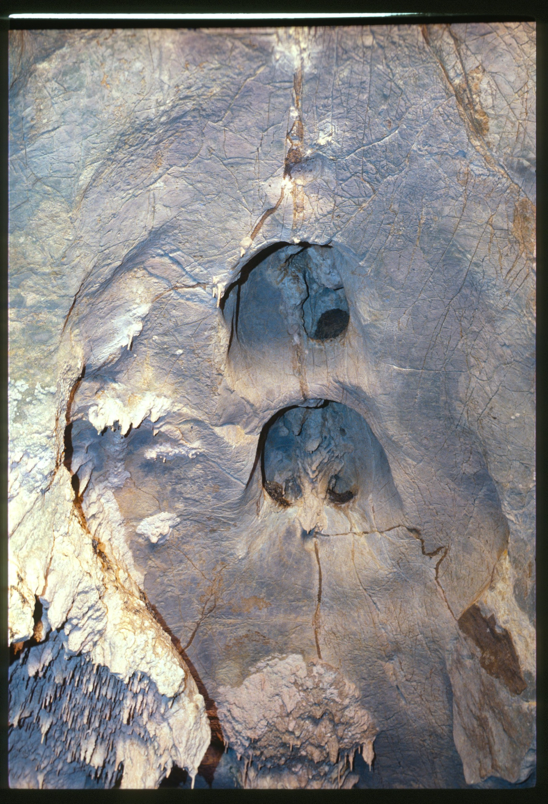
*ASF Joe N. Jennings slide catalogue, JNJ-S-1021-20, Box 1021. Catalogue description: Bell holes in solution roof. [ASF record](https://st1.asflib.net/MEDIA/ASFJJSlidesCatalogue/Box%201021/JNJ-S-1021-20.html).*

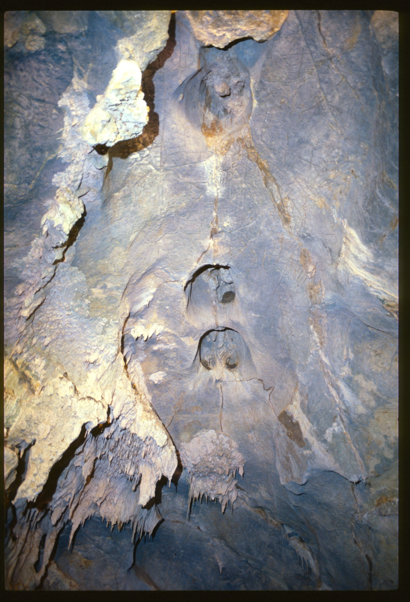
*ASF Joe N. Jennings slide catalogue, JNJ-S-1021-21, Box 1021. Catalogue description: Bell holes in solution roof. [ASF record](https://st1.asflib.net/MEDIA/ASFJJSlidesCatalogue/Box%201021/JNJ-S-1021-21.html).*

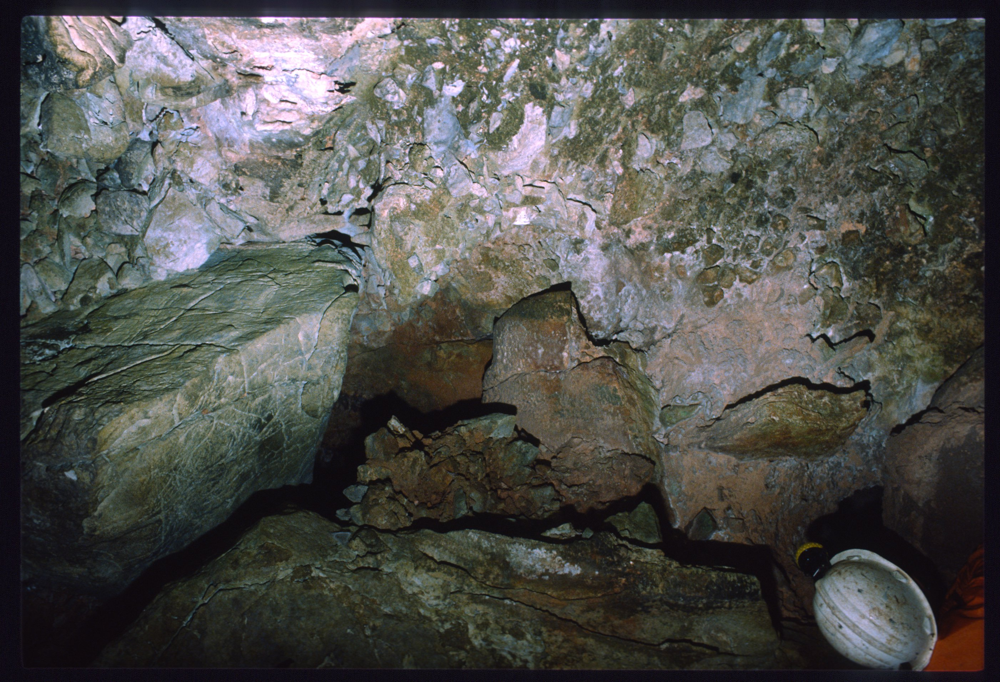
*ASF Joe N. Jennings slide catalogue, JNJ-S-1021-22, Box 1021. Catalogue description: Qv. Breccia with flowstone inc. - Basin cave lower entrance. [ASF record](https://st1.asflib.net/MEDIA/ASFJJSlidesCatalogue/Box%201021/JNJ-S-1021-22.html).*

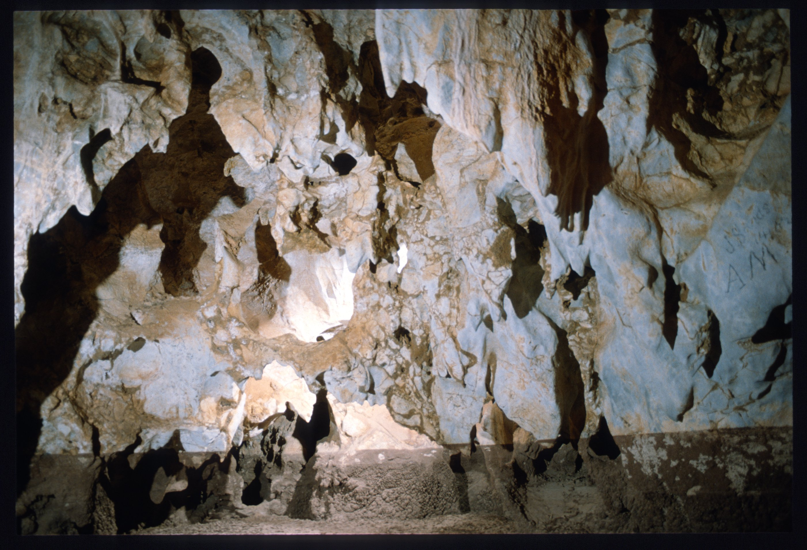
*ASF Joe N. Jennings slide catalogue, JNJ-S-1021-23, Box 1021. Catalogue description: Nothephreatic 'gorgongola'. [ASF record](https://st1.asflib.net/MEDIA/ASFJJSlidesCatalogue/Box%201021/JNJ-S-1021-23.html).*

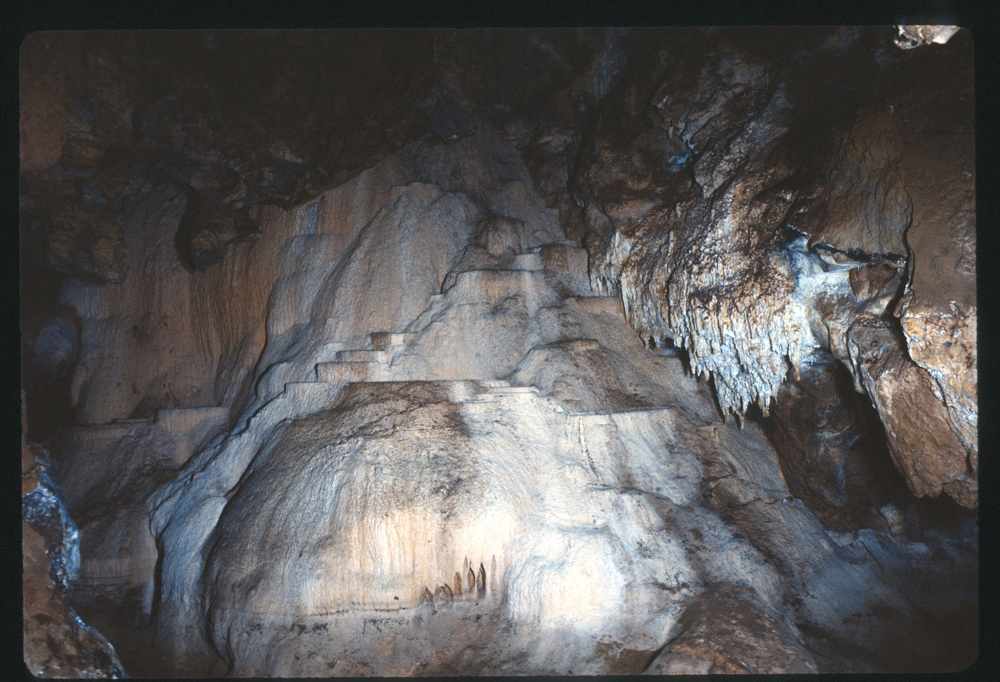
*ASF Joe N. Jennings slide catalogue, JNJ-S-1021-24, Box 1021. Catalogue description: The basins. [ASF record](https://st1.asflib.net/MEDIA/ASFJJSlidesCatalogue/Box%201021/JNJ-S-1021-24.html).*

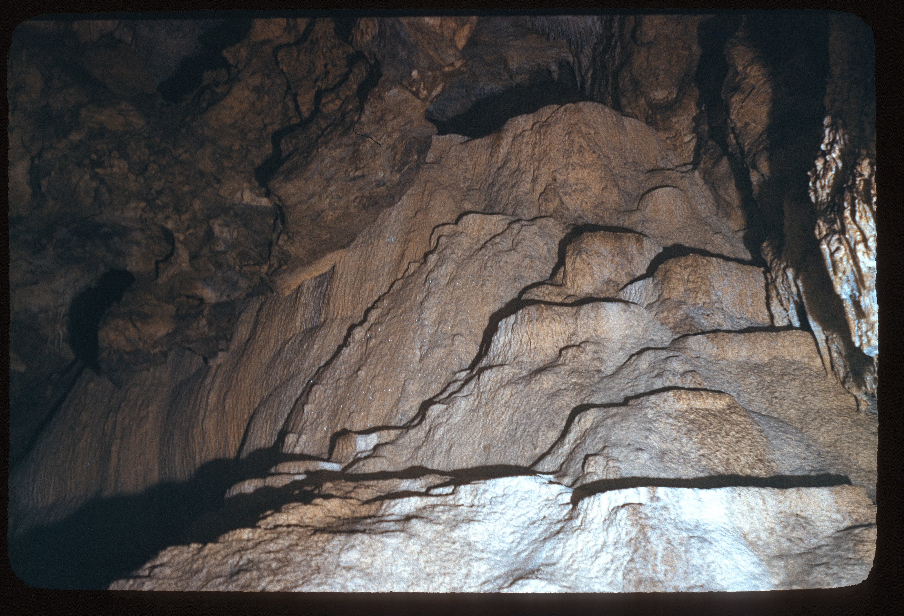
*ASF Joe N. Jennings slide catalogue, JNJ-S-1021-25, Box 1021. Catalogue description: The basins. [ASF record](https://st1.asflib.net/MEDIA/ASFJJSlidesCatalogue/Box%201021/JNJ-S-1021-25.html).*

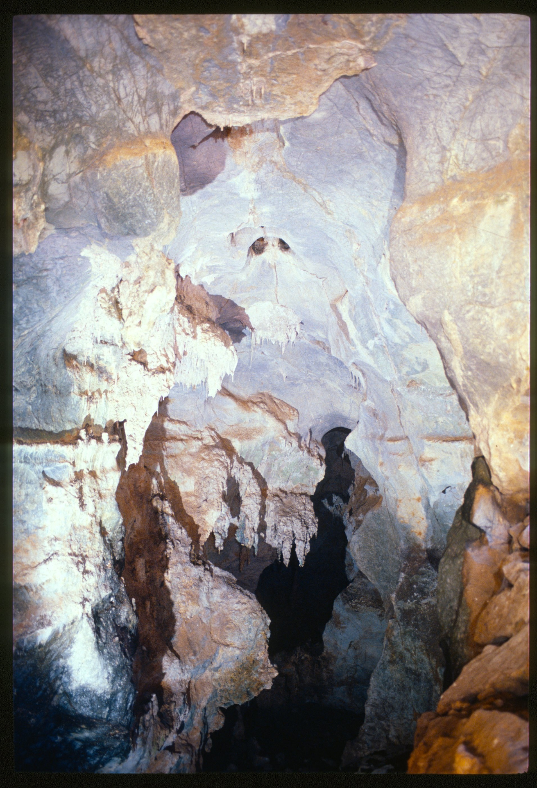
*ASF Joe N. Jennings slide catalogue, JNJ-S-1021-35, Box 1021. Catalogue description: Entrance chamber of Basin Cave. [ASF record](https://st1.asflib.net/MEDIA/ASFJJSlidesCatalogue/Box%201021/JNJ-S-1021-35.html).*

### Wombeyan area

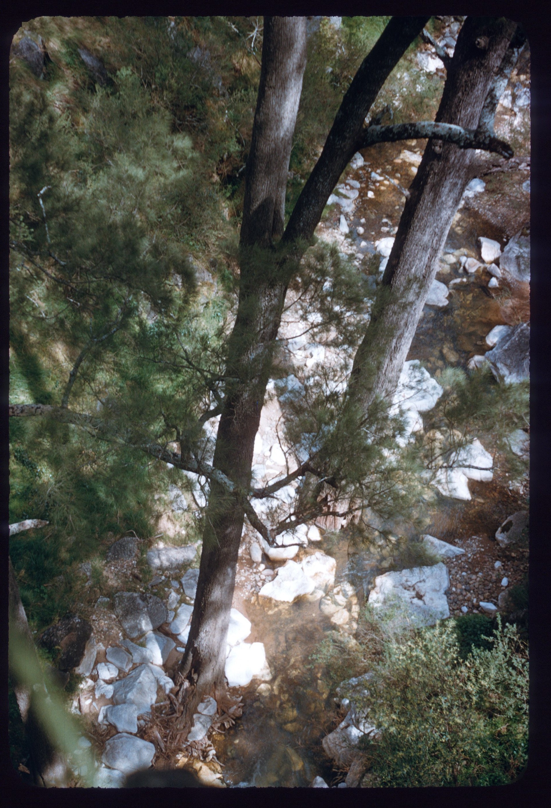
*ASF Joe N. Jennings slide catalogue, JNJ-S-1021-26, Box 1021. Catalogue description: River she-oaks in Wombeyan Creek lower gorge. [ASF record](https://st1.asflib.net/MEDIA/ASFJJSlidesCatalogue/Box%201021/JNJ-S-1021-26.html).*

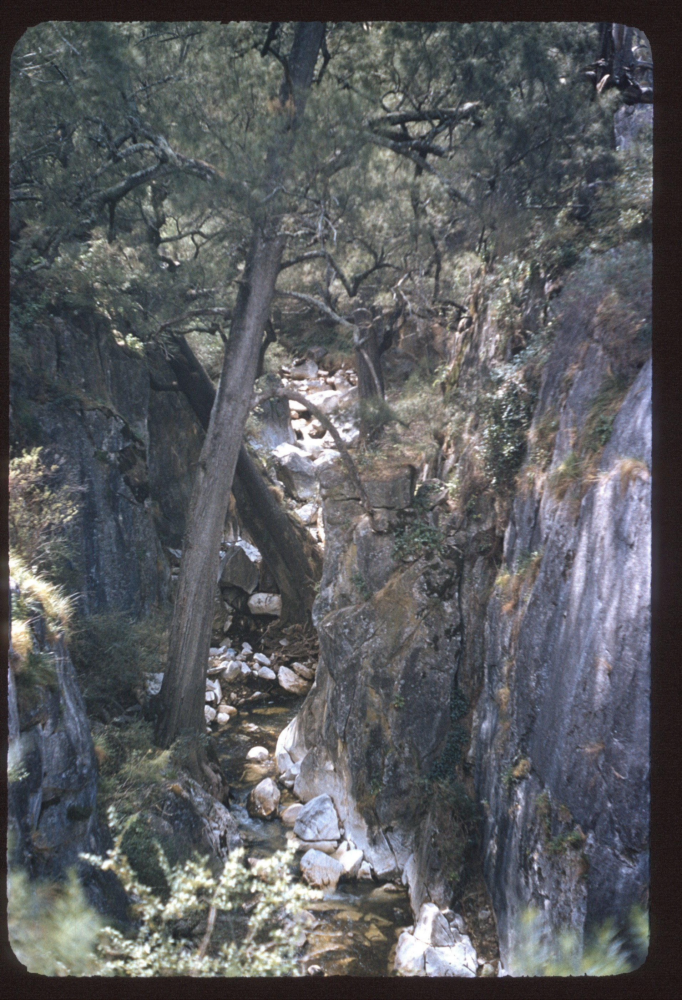
*ASF Joe N. Jennings slide catalogue, JNJ-S-1021-27, Box 1021. Catalogue description: Wombeyan Creek lower gorge. [ASF record](https://st1.asflib.net/MEDIA/ASFJJSlidesCatalogue/Box%201021/JNJ-S-1021-27.html).*

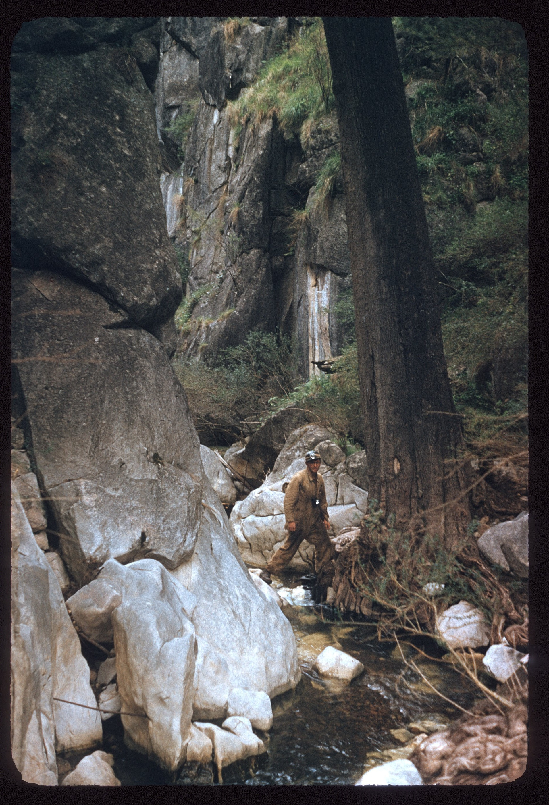
*ASF Joe N. Jennings slide catalogue, JNJ-S-1021-28, Box 1021. Catalogue description: Gorge below Creek Cave - Wombeyan Creek. [ASF record](https://st1.asflib.net/MEDIA/ASFJJSlidesCatalogue/Box%201021/JNJ-S-1021-28.html).*

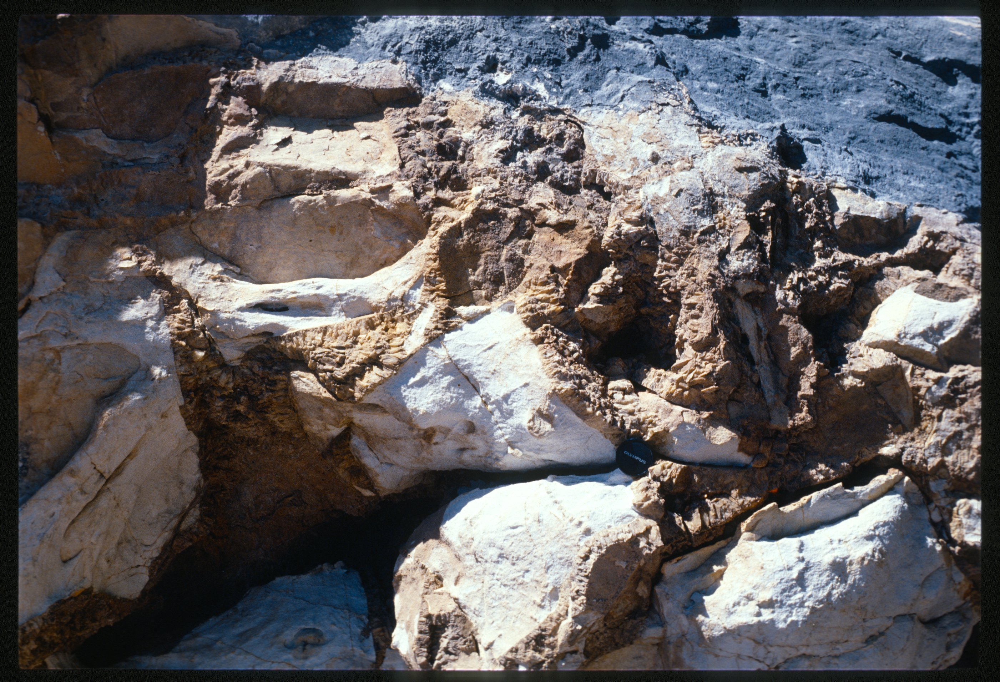
*ASF Joe N. Jennings slide catalogue, JNJ-S-1021-33, Box 1021. Catalogue description: Mendicant Cave - Crystal matrix in breccia. [ASF record](https://st1.asflib.net/MEDIA/ASFJJSlidesCatalogue/Box%201021/JNJ-S-1021-33.html).*

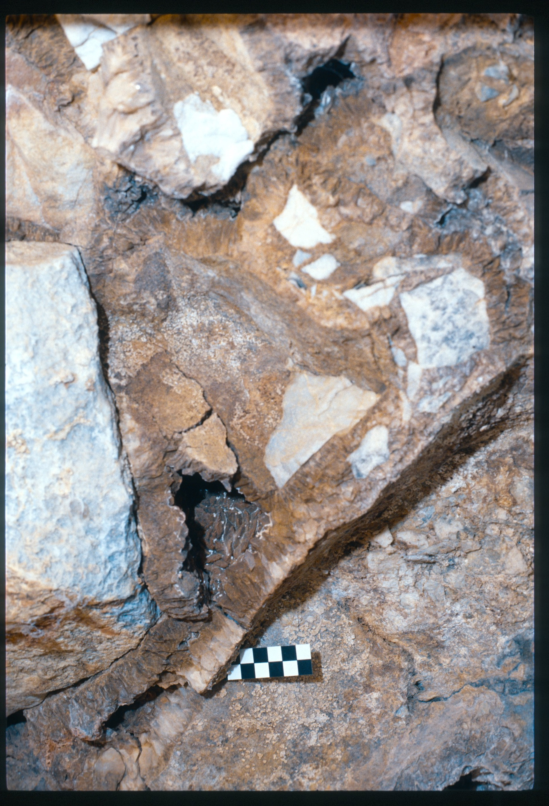
*ASF Joe N. Jennings slide catalogue, JNJ-S-1021-34, Box 1021. Catalogue description: Mendicant Cave - Breccia with crystal matrix and ve?. [ASF record](https://st1.asflib.net/MEDIA/ASFJJSlidesCatalogue/Box%201021/JNJ-S-1021-34.html).*

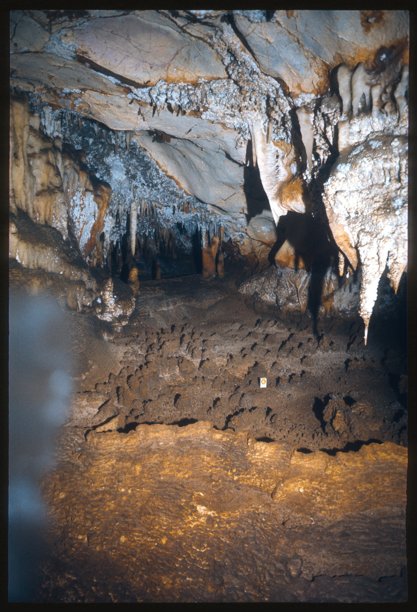
*ASF Joe N. Jennings slide catalogue, JNJ-S-1022-33, Box 1022. Catalogue description: Formations. [ASF record](https://st1.asflib.net/MEDIA/ASFJJSlidesCatalogue/Box%201022/JNJ-S-1022-33.html).*

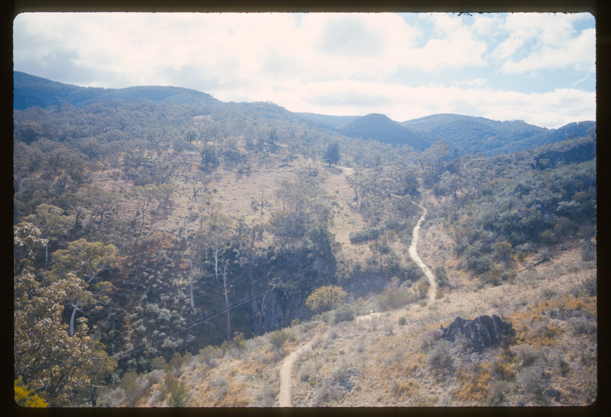
*ASF Joe N. Jennings slide catalogue, JNJ-S-1023-01, Box 1023. Catalogue description: Creek cave exit - Looking upstream - Saddle above Victoria Arch. [ASF record](https://st1.asflib.net/MEDIA/ASFJJSlidesCatalogue/Box%201023/JNJ-S-1023-01.html).*

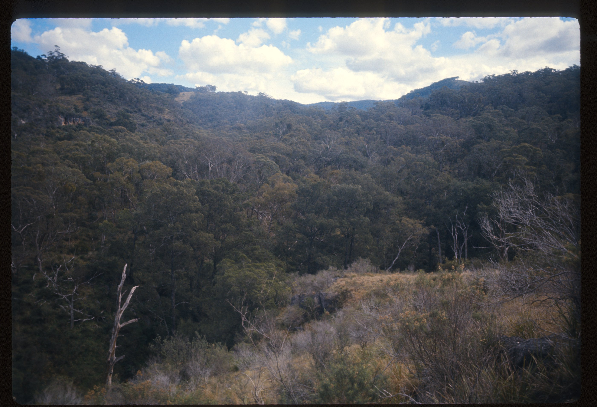
*ASF Joe N. Jennings slide catalogue, JNJ-S-1023-02, Box 1023. Catalogue description: Valley in valley of Wombeyan Creek below Creek Cave. [ASF record](https://st1.asflib.net/MEDIA/ASFJJSlidesCatalogue/Box%201023/JNJ-S-1023-02.html).*

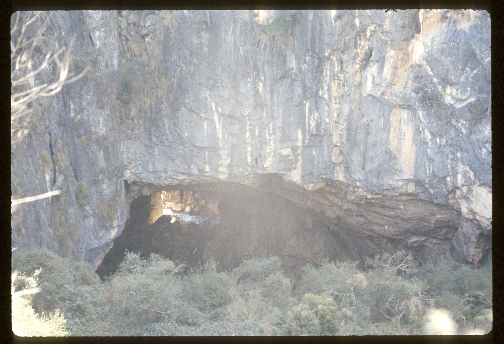
*ASF Joe N. Jennings slide catalogue, JNJ-S-1023-03, Box 1023. Catalogue description: Back of Victoria Arch. [ASF record](https://st1.asflib.net/MEDIA/ASFJJSlidesCatalogue/Box%201023/JNJ-S-1023-03.html).*

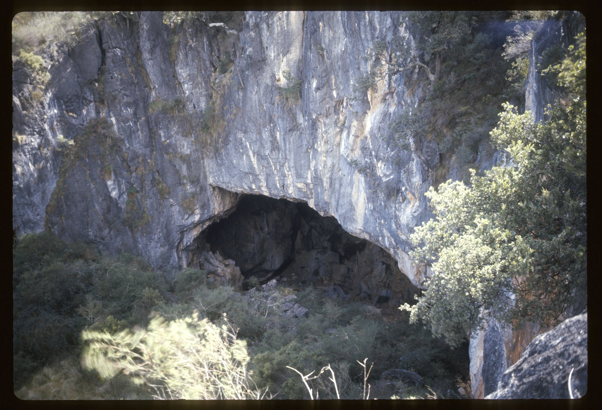
*ASF Joe N. Jennings slide catalogue, JNJ-S-1023-04, Box 1023. Catalogue description: Back of Victoria Arch. [ASF record](https://st1.asflib.net/MEDIA/ASFJJSlidesCatalogue/Box%201023/JNJ-S-1023-04.html).*

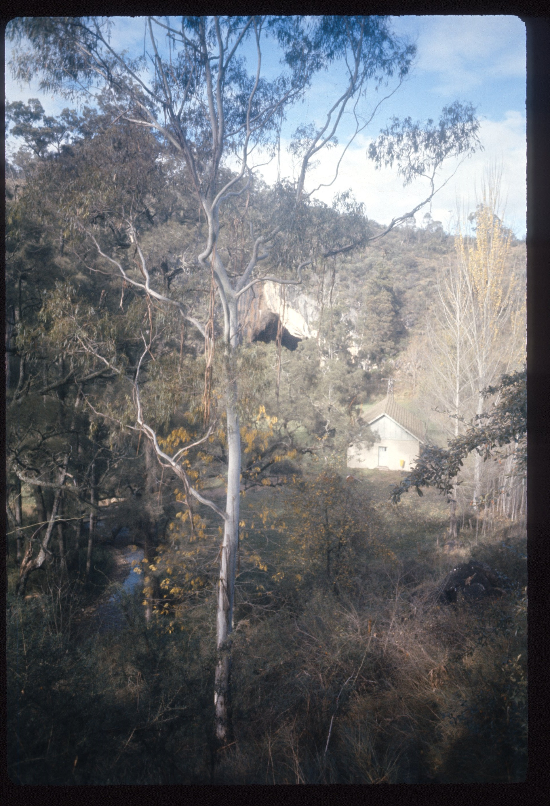
*ASF Joe N. Jennings slide catalogue, JNJ-S-1023-05, Box 1023. Catalogue description: Wombeyan Creek and Victoria Arch. [ASF record](https://st1.asflib.net/MEDIA/ASFJJSlidesCatalogue/Box%201023/JNJ-S-1023-05.html).*

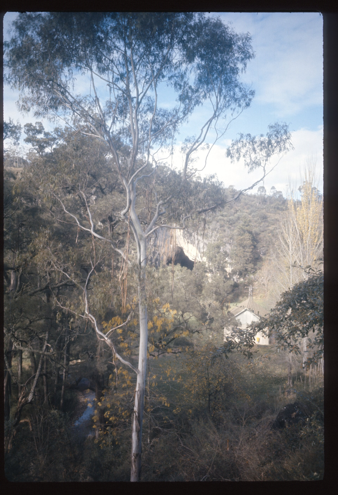
*ASF Joe N. Jennings slide catalogue, JNJ-S-1023-06, Box 1023. Catalogue description: Wombeyan Creek and Victoria Arch. [ASF record](https://st1.asflib.net/MEDIA/ASFJJSlidesCatalogue/Box%201023/JNJ-S-1023-06.html).*

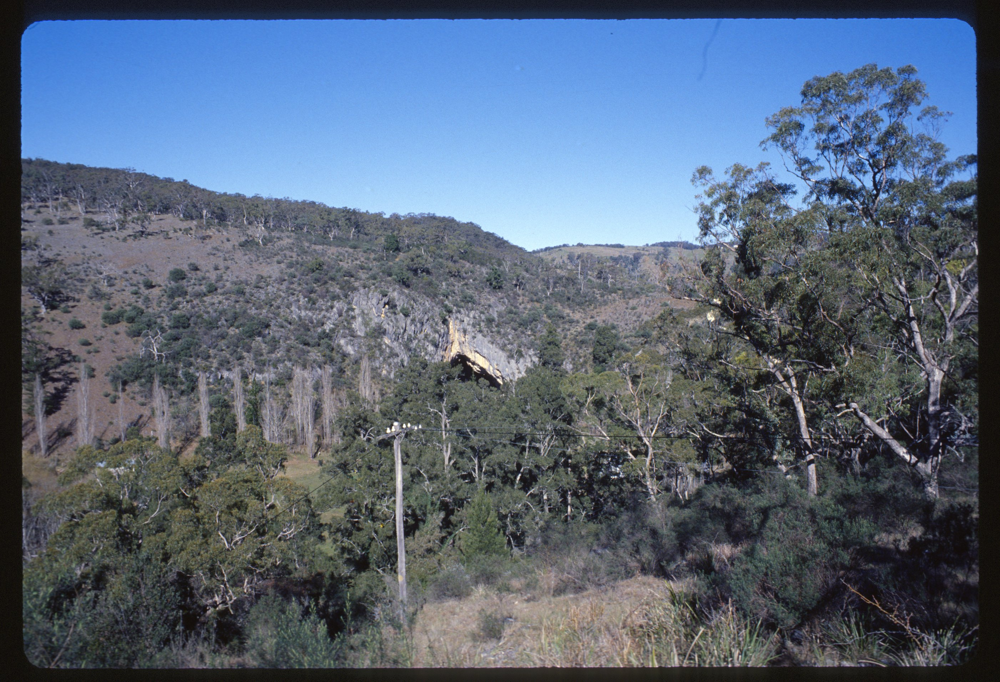
*ASF Joe N. Jennings slide catalogue, JNJ-S-1023-07, Box 1023. Catalogue description: Blind valley of Wombeyan Creek with Victoria Arch. [ASF record](https://st1.asflib.net/MEDIA/ASFJJSlidesCatalogue/Box%201023/JNJ-S-1023-07.html).*

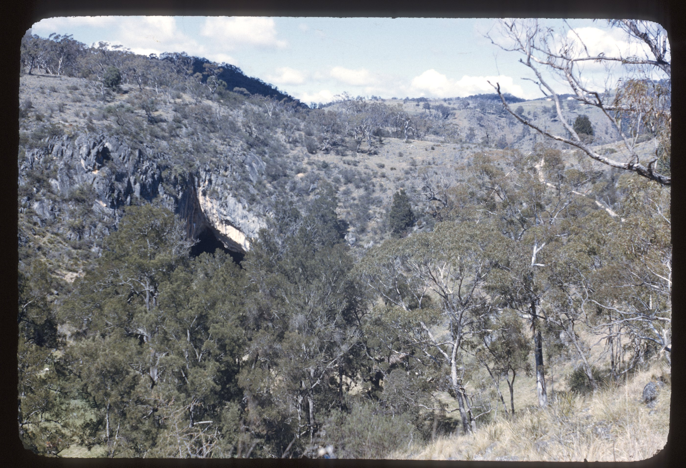
*ASF Joe N. Jennings slide catalogue, JNJ-S-1023-08, Box 1023. Catalogue description: Blind valley. [ASF record](https://st1.asflib.net/MEDIA/ASFJJSlidesCatalogue/Box%201023/JNJ-S-1023-08.html).*

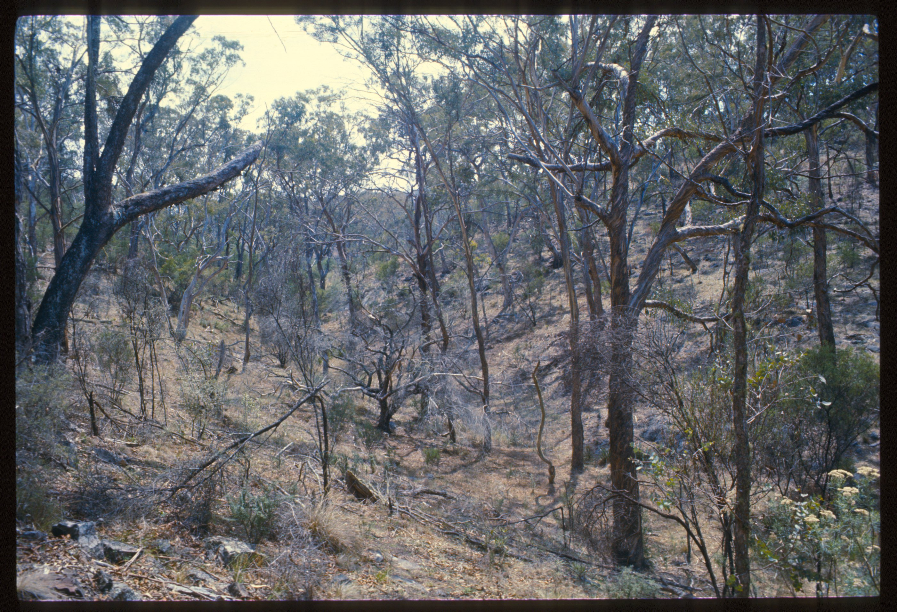
*ASF Joe N. Jennings slide catalogue, JNJ-S-1023-09, Box 1023. Catalogue description: Dry valley - Bottom end of Oakey Range Creek. [ASF record](https://st1.asflib.net/MEDIA/ASFJJSlidesCatalogue/Box%201023/JNJ-S-1023-09.html).*

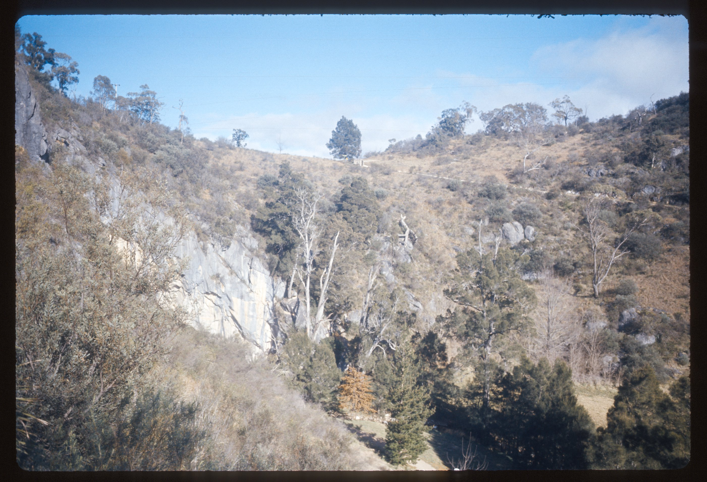
*ASF Joe N. Jennings slide catalogue, JNJ-S-1023-10, Box 1023. Catalogue description: Arch end of Wombeyan Creek blind valley. [ASF record](https://st1.asflib.net/MEDIA/ASFJJSlidesCatalogue/Box%201023/JNJ-S-1023-10.html).*

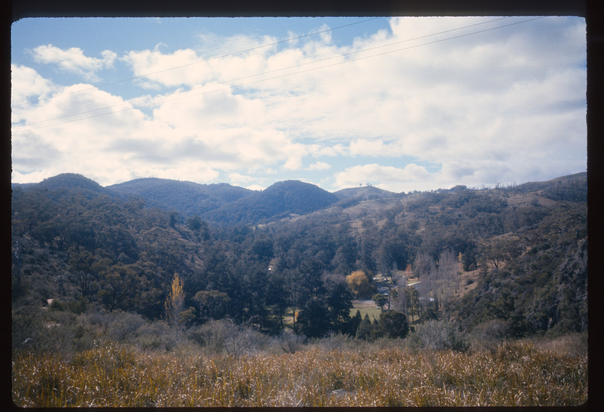
*ASF Joe N. Jennings slide catalogue, JNJ-S-1023-11, Box 1023. Catalogue description: Blind valley of Wombeyan Creek looking upstream (North) - From saddle above Victoria Arch. [ASF record](https://st1.asflib.net/MEDIA/ASFJJSlidesCatalogue/Box%201023/JNJ-S-1023-11.html).*

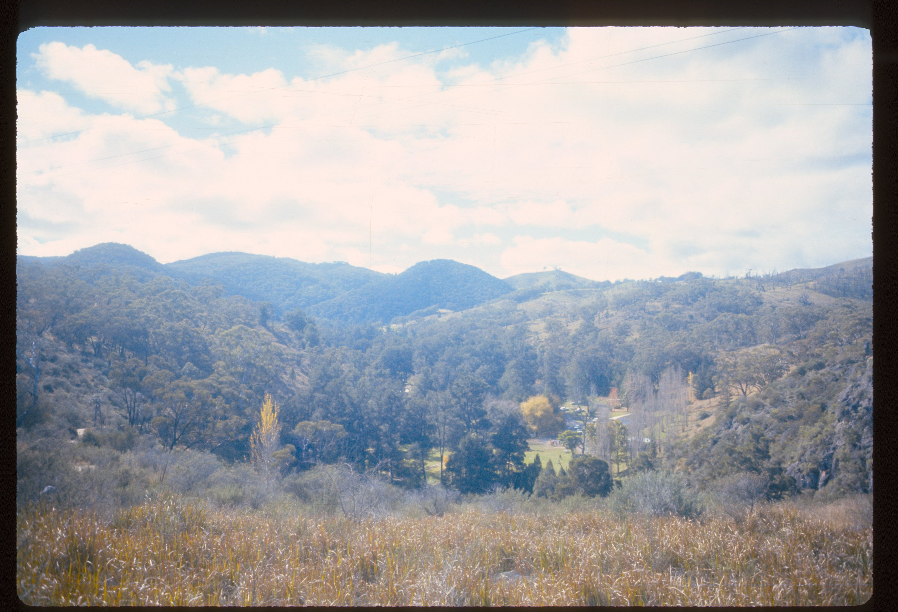
*ASF Joe N. Jennings slide catalogue, JNJ-S-1023-12, Box 1023. Catalogue description: Blind valley of Wombeyan Creek looking upstream (North) - From saddle above Victoria Arch. [ASF record](https://st1.asflib.net/MEDIA/ASFJJSlidesCatalogue/Box%201023/JNJ-S-1023-12.html).*

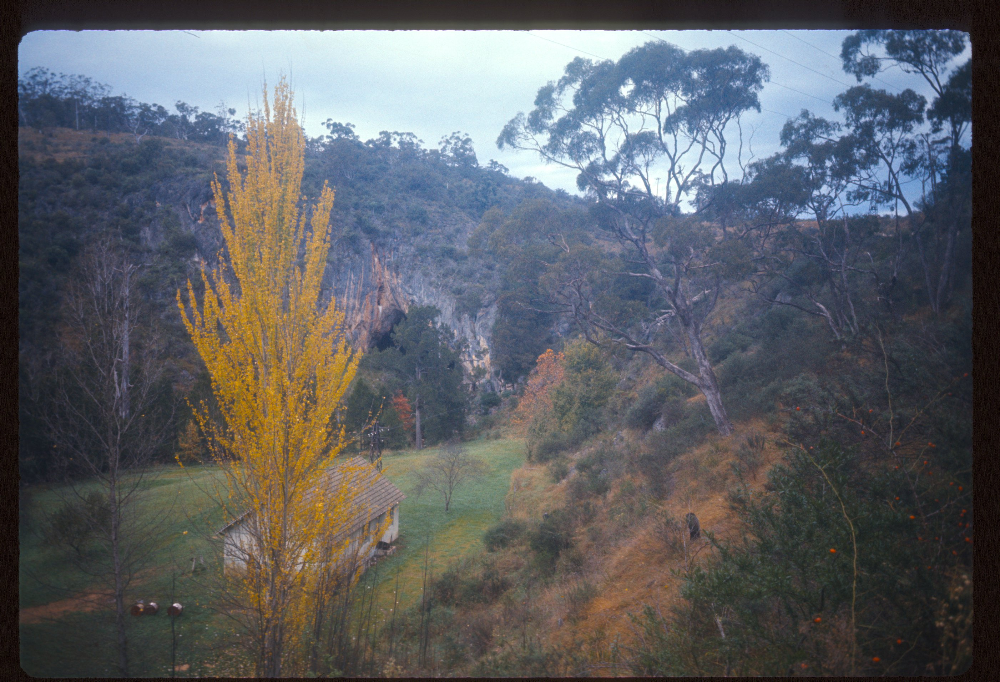
*ASF Joe N. Jennings slide catalogue, JNJ-S-1023-13, Box 1023. Catalogue description: Blind valley and Victoria Arch. [ASF record](https://st1.asflib.net/MEDIA/ASFJJSlidesCatalogue/Box%201023/JNJ-S-1023-13.html).*

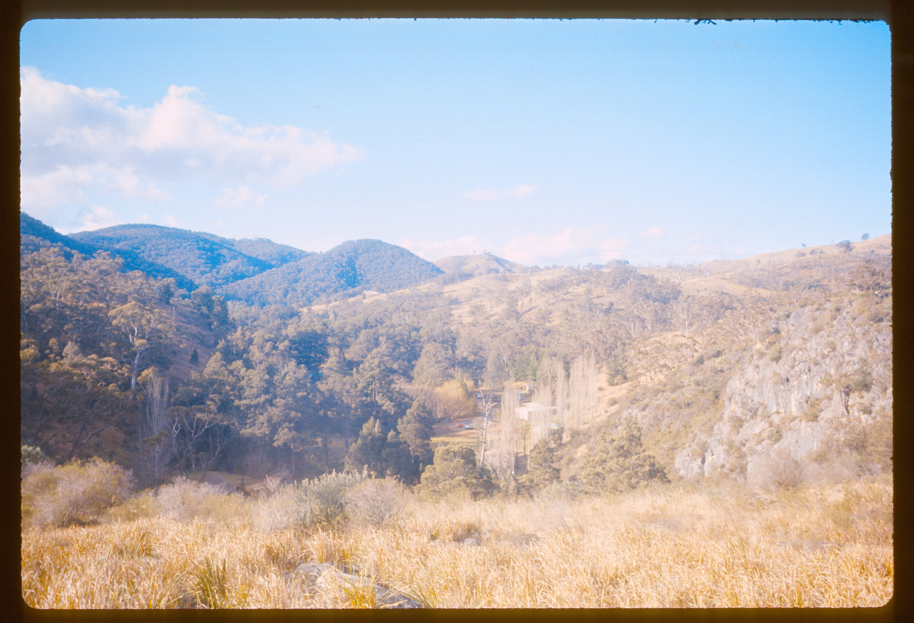
*ASF Joe N. Jennings slide catalogue, JNJ-S-1023-14, Box 1023. Catalogue description: Wombeyan Creek blind valley - Looking upstream from saddle above Victoria Arch. [ASF record](https://st1.asflib.net/MEDIA/ASFJJSlidesCatalogue/Box%201023/JNJ-S-1023-14.html).*

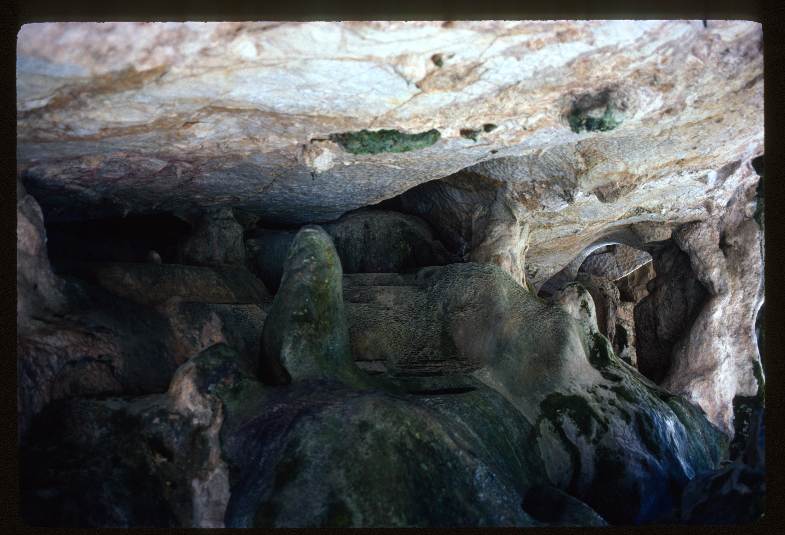
*ASF Joe N. Jennings slide catalogue, JNJ-S-1023-15, Box 1023. Catalogue description: Speleothems in meander cave liable to flood in Mare's Forest Creek Cave. [ASF record](https://st1.asflib.net/MEDIA/ASFJJSlidesCatalogue/Box%201023/JNJ-S-1023-15.html).*

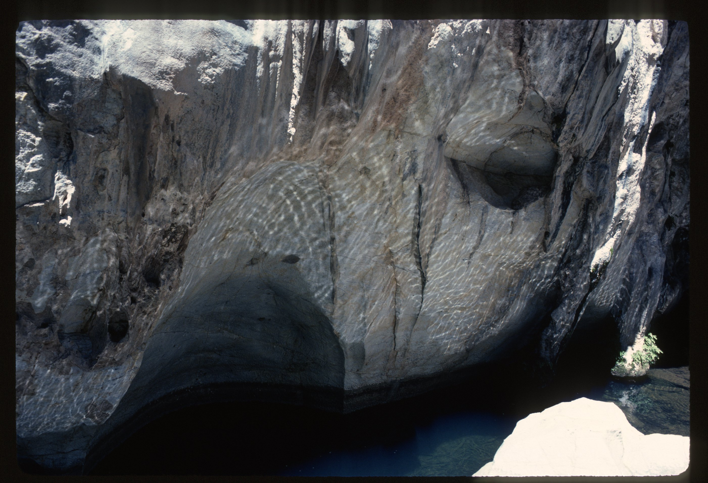
*ASF Joe N. Jennings slide catalogue, JNJ-S-1023-16, Box 1023. Catalogue description: Meander niche - Mares Forest Creek gorge. [ASF record](https://st1.asflib.net/MEDIA/ASFJJSlidesCatalogue/Box%201023/JNJ-S-1023-16.html).*

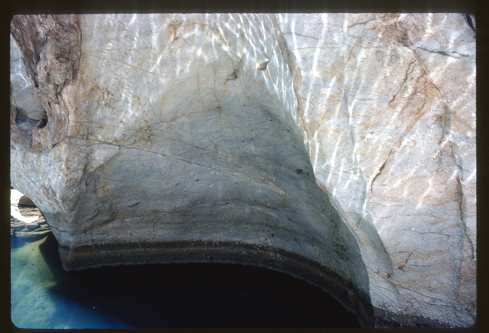
*ASF Joe N. Jennings slide catalogue, JNJ-S-1023-17, Box 1023. Catalogue description: Meander niche - Mares Forest Creek gorge. [ASF record](https://st1.asflib.net/MEDIA/ASFJJSlidesCatalogue/Box%201023/JNJ-S-1023-17.html).*

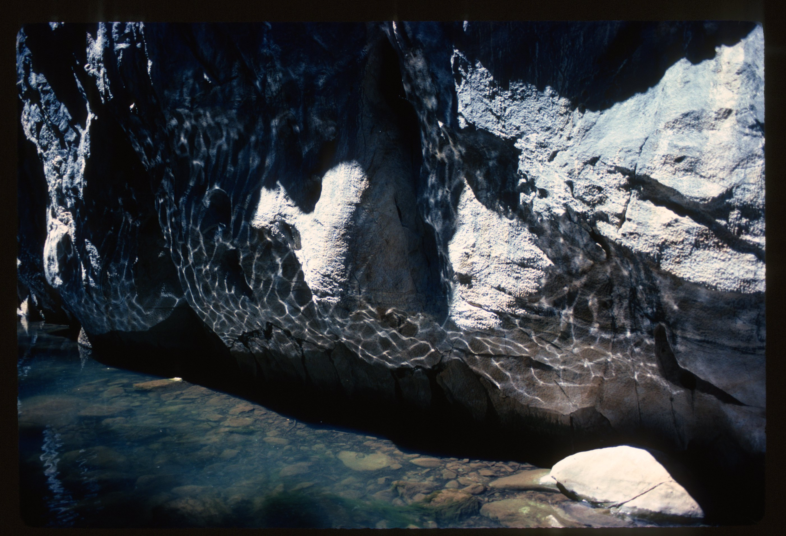
*ASF Joe N. Jennings slide catalogue, JNJ-S-1023-18, Box 1023. Catalogue description: Lateral undercutting of gorge wall - Mares Forest Creek. [ASF record](https://st1.asflib.net/MEDIA/ASFJJSlidesCatalogue/Box%201023/JNJ-S-1023-18.html).*

*ASF Joe N. Jennings slide catalogue, JNJ-S-1023-19, Box 1023. Catalogue description: Abrasion hollows in gorge wall - Mares Forest Creek. [ASF record](https://st1.asflib.net/MEDIA/ASFJJSlidesCatalogue/Box%201023/JNJ-S-1023-19.html).*

*ASF Joe N. Jennings slide catalogue, JNJ-S-1023-20, Box 1023. Catalogue description: Swirlhole hollow - Mares Forest Creek gorge. [ASF record](https://st1.asflib.net/MEDIA/ASFJJSlidesCatalogue/Box%201023/JNJ-S-1023-20.html).*

*ASF Joe N. Jennings slide catalogue, JNJ-S-1023-21, Box 1023. Catalogue description: Swirlhole hollow - Mares Forest Creek gorge. [ASF record](https://st1.asflib.net/MEDIA/ASFJJSlidesCatalogue/Box%201023/JNJ-S-1023-21.html).*

*ASF Joe N. Jennings slide catalogue, JNJ-S-1023-22, Box 1023. Catalogue description: Mares Forest Creek gorge. [ASF record](https://st1.asflib.net/MEDIA/ASFJJSlidesCatalogue/Box%201023/JNJ-S-1023-22.html).*

*ASF Joe N. Jennings slide catalogue, JNJ-S-1023-23, Box 1023. Catalogue description: Cave in Mares Forest Creek gorge. [ASF record](https://st1.asflib.net/MEDIA/ASFJJSlidesCatalogue/Box%201023/JNJ-S-1023-23.html).*

*ASF Joe N. Jennings slide catalogue, JNJ-S-1023-24, Box 1023. Catalogue description: Mares Forest Creek gorge. [ASF record](https://st1.asflib.net/MEDIA/ASFJJSlidesCatalogue/Box%201023/JNJ-S-1023-24.html).*

*ASF Joe N. Jennings slide catalogue, JNJ-S-1023-25, Box 1023. Catalogue description: Decorated gorge wall - Mares Forest Creek gorge. [ASF record](https://st1.asflib.net/MEDIA/ASFJJSlidesCatalogue/Box%201023/JNJ-S-1023-25.html).*

*ASF Joe N. Jennings slide catalogue, JNJ-S-1023-26, Box 1023. Catalogue description: Mares Forest Creek gorge. [ASF record](https://st1.asflib.net/MEDIA/ASFJJSlidesCatalogue/Box%201023/JNJ-S-1023-26.html).*

*ASF Joe N. Jennings slide catalogue, JNJ-S-1023-27, Box 1023. Catalogue description: Spring from Ru? Cave - Mares Forest Creek. [ASF record](https://st1.asflib.net/MEDIA/ASFJJSlidesCatalogue/Box%201023/JNJ-S-1023-27.html).*

*ASF Joe N. Jennings slide catalogue, JNJ-S-1023-28, Box 1023. Catalogue description: Marble near sewer - Mares Forest Creek. [ASF record](https://st1.asflib.net/MEDIA/ASFJJSlidesCatalogue/Box%201023/JNJ-S-1023-28.html).*

*ASF Joe N. Jennings slide catalogue, JNJ-S-1023-29, Box 1023. Catalogue description: Scourkollen in Mares Forest Creek gorge wall. [ASF record](https://st1.asflib.net/MEDIA/ASFJJSlidesCatalogue/Box%201023/JNJ-S-1023-29.html).*

*ASF Joe N. Jennings slide catalogue, JNJ-S-1023-30, Box 1023. Catalogue description: Mares Forest Creek gorge from Tinted Cave. [ASF record](https://st1.asflib.net/MEDIA/ASFJJSlidesCatalogue/Box%201023/JNJ-S-1023-30.html).*

*ASF Joe N. Jennings slide catalogue, JNJ-S-1023-31, Box 1023. Catalogue description: Mares Forest Creek gorge from hill above Bullio Cave. [ASF record](https://st1.asflib.net/MEDIA/ASFJJSlidesCatalogue/Box%201023/JNJ-S-1023-31.html).*

*ASF Joe N. Jennings slide catalogue, JNJ-S-1024-01, Box 1024. Catalogue description: Embroyotic A-Tent on ridge from ML4 quarry. [ASF record](https://st1.asflib.net/MEDIA/ASFJJSlidesCatalogue/Box%201024/JNJ-S-1024-01.html).*

*ASF Joe N. Jennings slide catalogue, JNJ-S-1024-02, Box 1024. Catalogue description: A-Tent rock formation. [ASF record](https://st1.asflib.net/MEDIA/ASFJJSlidesCatalogue/Box%201024/JNJ-S-1024-02.html).*

*ASF Joe N. Jennings slide catalogue, JNJ-S-1024-03, Box 1024. Catalogue description: A-Tent rock formation. [ASF record](https://st1.asflib.net/MEDIA/ASFJJSlidesCatalogue/Box%201024/JNJ-S-1024-03.html).*

*ASF Joe N. Jennings slide catalogue, JNJ-S-1024-04, Box 1024. Catalogue description: "Granite" weathering of limestone on ridge from quarry ML4. [ASF record](https://st1.asflib.net/MEDIA/ASFJJSlidesCatalogue/Box%201024/JNJ-S-1024-04.html).*

*ASF Joe N. Jennings slide catalogue, JNJ-S-1024-05, Box 1024. Catalogue description: A-Tent rock formation. [ASF record](https://st1.asflib.net/MEDIA/ASFJJSlidesCatalogue/Box%201024/JNJ-S-1024-05.html).*

*ASF Joe N. Jennings slide catalogue, JNJ-S-1024-06, Box 1024. Catalogue description: Embroyotic A-Tent on ridge from ML4 quarry - Vertically down. [ASF record](https://st1.asflib.net/MEDIA/ASFJJSlidesCatalogue/Box%201024/JNJ-S-1024-06.html).*

*ASF Joe N. Jennings slide catalogue, JNJ-S-1024-07, Box 1024. Catalogue description: Wombeyan Creek gorge below Creek Cave - 5 erosional phases (see JNS-S-1024-07A). [ASF record](https://st1.asflib.net/MEDIA/ASFJJSlidesCatalogue/Box%201024/JNJ-S-1024-07.html).*

*ASF Joe N. Jennings slide catalogue, JNJ-S-1024-07A, Box 1024. Catalogue description: Wombeyan Creek gorge below Creek Cave - 5 erosional phases (see JNS-S-1024-07). [ASF record](https://st1.asflib.net/MEDIA/ASFJJSlidesCatalogue/Box%201024/JNJ-S-1024-07A.html).*

*ASF Joe N. Jennings slide catalogue, JNJ-S-1024-08, Box 1024. Catalogue description: "Granite" weathering of limestone on ridge from quarry ML4. [ASF record](https://st1.asflib.net/MEDIA/ASFJJSlidesCatalogue/Box%201024/JNJ-S-1024-08.html).*

*ASF Joe N. Jennings slide catalogue, JNJ-S-1024-09, Box 1024. Catalogue description: Kurrajong tree through limestone. [ASF record](https://st1.asflib.net/MEDIA/ASFJJSlidesCatalogue/Box%201024/JNJ-S-1024-09.html).*

*ASF Joe N. Jennings slide catalogue, JNJ-S-1024-10, Box 1024. Catalogue description: Kurrajong tree lifting limestone rock. [ASF record](https://st1.asflib.net/MEDIA/ASFJJSlidesCatalogue/Box%201024/JNJ-S-1024-10.html).*

*ASF Joe N. Jennings slide catalogue, JNJ-S-1024-11, Box 1024. Catalogue description: Rounded weathering exfoliation - Coarse marble. [ASF record](https://st1.asflib.net/MEDIA/ASFJJSlidesCatalogue/Box%201024/JNJ-S-1024-11.html).*

*ASF Joe N. Jennings slide catalogue, JNJ-S-1024-12, Box 1024. Catalogue description: Rounded weathering exfoliation - Coarse marble. [ASF record](https://st1.asflib.net/MEDIA/ASFJJSlidesCatalogue/Box%201024/JNJ-S-1024-12.html).*

*ASF Joe N. Jennings slide catalogue, JNJ-S-1024-13, Box 1024. Catalogue description: Rounded relief soil erosion - Gap Creek. [ASF record](https://st1.asflib.net/MEDIA/ASFJJSlidesCatalogue/Box%201024/JNJ-S-1024-13.html).*

*ASF Joe N. Jennings slide catalogue, JNJ-S-1024-14, Box 1024. Catalogue description: Subsoil pocketing - Gap Creek. [ASF record](https://st1.asflib.net/MEDIA/ASFJJSlidesCatalogue/Box%201024/JNJ-S-1024-14.html).*

*ASF Joe N. Jennings slide catalogue, JNJ-S-1024-15, Box 1024. Catalogue description: Soil erosion grikes etc - Gap Creek. [ASF record](https://st1.asflib.net/MEDIA/ASFJJSlidesCatalogue/Box%201024/JNJ-S-1024-15.html).*

*ASF Joe N. Jennings slide catalogue, JNJ-S-1024-16, Box 1024. Catalogue description: Rundkarren exposed - Gap Creek. [ASF record](https://st1.asflib.net/MEDIA/ASFJJSlidesCatalogue/Box%201024/JNJ-S-1024-16.html).*

*ASF Joe N. Jennings slide catalogue, JNJ-S-1024-17, Box 1024. Catalogue description: Soil nodules calcareous - Gap Creek. [ASF record](https://st1.asflib.net/MEDIA/ASFJJSlidesCatalogue/Box%201024/JNJ-S-1024-17.html).*

*ASF Joe N. Jennings slide catalogue, JNJ-S-1024-18, Box 1024. Catalogue description: Rain pitting - Gap Creek. [ASF record](https://st1.asflib.net/MEDIA/ASFJJSlidesCatalogue/Box%201024/JNJ-S-1024-18.html).*

*ASF Joe N. Jennings slide catalogue, JNJ-S-1024-19, Box 1024. Catalogue description: Calcite precipitation near start of Taralga Road. [ASF record](https://st1.asflib.net/MEDIA/ASFJJSlidesCatalogue/Box%201024/JNJ-S-1024-19.html).*

*ASF Joe N. Jennings slide catalogue, JNJ-S-1024-20, Box 1024. Catalogue description: Rounded weathering exfoliation - Coarse marble. [ASF record](https://st1.asflib.net/MEDIA/ASFJJSlidesCatalogue/Box%201024/JNJ-S-1024-20.html).*

*ASF Joe N. Jennings slide catalogue, JNJ-S-1024-21, Box 1024. Catalogue description: Soil erosion - Gap Creek. [ASF record](https://st1.asflib.net/MEDIA/ASFJJSlidesCatalogue/Box%201024/JNJ-S-1024-21.html).*

*ASF Joe N. Jennings slide catalogue, JNJ-S-1024-22, Box 1024. Catalogue description: Soil erosion - Gap Creek. [ASF record](https://st1.asflib.net/MEDIA/ASFJJSlidesCatalogue/Box%201024/JNJ-S-1024-22.html).*

*ASF Joe N. Jennings slide catalogue, JNJ-S-1024-23, Box 1024. Catalogue description: Rounded weathering of marble. [ASF record](https://st1.asflib.net/MEDIA/ASFJJSlidesCatalogue/Box%201024/JNJ-S-1024-23.html).*

*ASF Joe N. Jennings slide catalogue, JNJ-S-1024-24, Box 1024. Catalogue description: Solution flutes near start of Taralga Road. [ASF record](https://st1.asflib.net/MEDIA/ASFJJSlidesCatalogue/Box%201024/JNJ-S-1024-24.html).*

*ASF Joe N. Jennings slide catalogue, JNJ-S-1024-25, Box 1024. Catalogue description: Calcite precipitation near start of Taralga Road. [ASF record](https://st1.asflib.net/MEDIA/ASFJJSlidesCatalogue/Box%201024/JNJ-S-1024-25.html).*

*ASF Joe N. Jennings slide catalogue, JNJ-S-1024-26, Box 1024. Catalogue description: Solution flutes near start of Taralga Road. [ASF record](https://st1.asflib.net/MEDIA/ASFJJSlidesCatalogue/Box%201024/JNJ-S-1024-26.html).*

*ASF Joe N. Jennings slide catalogue, JNJ-S-1024-27, Box 1024. Catalogue description: Cavenous weathering - Gap Creek. [ASF record](https://st1.asflib.net/MEDIA/ASFJJSlidesCatalogue/Box%201024/JNJ-S-1024-27.html).*

*ASF Joe N. Jennings slide catalogue, JNJ-S-1024-28, Box 1024. Catalogue description: Pitting exfolation spa?. [ASF record](https://st1.asflib.net/MEDIA/ASFJJSlidesCatalogue/Box%201024/JNJ-S-1024-28.html).*

*ASF Joe N. Jennings slide catalogue, JNJ-S-1024-29, Box 1024. Catalogue description: Calcite grain soil. [ASF record](https://st1.asflib.net/MEDIA/ASFJJSlidesCatalogue/Box%201024/JNJ-S-1024-29.html).*

*ASF Joe N. Jennings slide catalogue, JNJ-S-1024-30, Box 1024. Catalogue description: "Granite" weathering of limestone on ridge from quarry ML4. [ASF record](https://st1.asflib.net/MEDIA/ASFJJSlidesCatalogue/Box%201024/JNJ-S-1024-30.html).*

*ASF Joe N. Jennings slide catalogue, JNJ-S-1024-31, Box 1024. Catalogue description: Marble weathering. [ASF record](https://st1.asflib.net/MEDIA/ASFJJSlidesCatalogue/Box%201024/JNJ-S-1024-31.html).*

*ASF Joe N. Jennings slide catalogue, JNJ-S-1024-32, Box 1024. Catalogue description: Rounded relief on marble - Gap Creek. [ASF record](https://st1.asflib.net/MEDIA/ASFJJSlidesCatalogue/Box%201024/JNJ-S-1024-32.html).*

*ASF Joe N. Jennings slide catalogue, JNJ-S-1024-33, Box 1024. Catalogue description: A-Tent rock formation. [ASF record](https://st1.asflib.net/MEDIA/ASFJJSlidesCatalogue/Box%201024/JNJ-S-1024-33.html).*

*ASF Joe N. Jennings slide catalogue, JNJ-S-1024-34, Box 1024. Catalogue description: Rounded topo on marble. [ASF record](https://st1.asflib.net/MEDIA/ASFJJSlidesCatalogue/Box%201024/JNJ-S-1024-34.html).*

*ASF Joe N. Jennings slide catalogue, JNJ-S-1024-35, Box 1024. Catalogue description: Stratified slope deposits - Hockey Gully. [ASF record](https://st1.asflib.net/MEDIA/ASFJJSlidesCatalogue/Box%201024/JNJ-S-1024-35.html).*

*ASF Joe N. Jennings slide catalogue, JNJ-S-1024-36, Box 1024. Catalogue description: Stratified slope deposits - Hockey Gully. [ASF record](https://st1.asflib.net/MEDIA/ASFJJSlidesCatalogue/Box%201024/JNJ-S-1024-36.html).*

*ASF Joe N. Jennings slide catalogue, JNJ-S-1024-37, Box 1024. Catalogue description: Stratified slope deposits - Hockey Gully. [ASF record](https://st1.asflib.net/MEDIA/ASFJJSlidesCatalogue/Box%201024/JNJ-S-1024-37.html).*

*ASF Joe N. Jennings slide catalogue, JNJ-S-1024-38, Box 1024. Catalogue description: Stratified slope deposits - Hockey Gully. [ASF record](https://st1.asflib.net/MEDIA/ASFJJSlidesCatalogue/Box%201024/JNJ-S-1024-38.html).*

*ASF Joe N. Jennings slide catalogue, JNJ-S-1024-39, Box 1024. Catalogue description: Stratified slope deposits - Hockey Gully. [ASF record](https://st1.asflib.net/MEDIA/ASFJJSlidesCatalogue/Box%201024/JNJ-S-1024-39.html).*

*ASF Joe N. Jennings slide catalogue, JNJ-S-1026-01, Box 1026. Catalogue description: Soils erosion and subsequent corrosion - Gap Creek. [ASF record](https://st1.asflib.net/MEDIA/ASFJJSlidesCatalogue/Box%201026/JNJ-S-1026-01.html).*

*ASF Joe N. Jennings slide catalogue, JNJ-S-1026-04, Box 1026. Catalogue description: Doline at contact by Oakey Range Creek. [ASF record](https://st1.asflib.net/MEDIA/ASFJJSlidesCatalogue/Box%201026/JNJ-S-1026-04.html).*

*ASF Joe N. Jennings slide catalogue, JNJ-S-1028-01, Box 1028. Catalogue description: Intermediate and high levels. [ASF record](https://st1.asflib.net/MEDIA/ASFJJSlidesCatalogue/Box%201028/JNJ-S-1028-01.html).*

*ASF Joe N. Jennings slide catalogue, JNJ-S-1028-02, Box 1028. Catalogue description: Rounded relief - Gap Creek. [ASF record](https://st1.asflib.net/MEDIA/ASFJJSlidesCatalogue/Box%201028/JNJ-S-1028-02.html).*

*ASF Joe N. Jennings slide catalogue, JNJ-S-1028-03, Box 1028. Catalogue description: Abandoned high level meander channel - Mares Forest Creek. [ASF record](https://st1.asflib.net/MEDIA/ASFJJSlidesCatalogue/Box%201028/JNJ-S-1028-03.html).*

*ASF Joe N. Jennings slide catalogue, JNJ-S-1028-04, Box 1028. Catalogue description: Abandoned high level meander channel - Mares Forest Creek. [ASF record](https://st1.asflib.net/MEDIA/ASFJJSlidesCatalogue/Box%201028/JNJ-S-1028-04.html).*

*ASF Joe N. Jennings slide catalogue, JNJ-S-1028-05, Box 1028. Catalogue description: High level meander and cave - Mares Forest Creek. [ASF record](https://st1.asflib.net/MEDIA/ASFJJSlidesCatalogue/Box%201028/JNJ-S-1028-05.html).*

*ASF Joe N. Jennings slide catalogue, JNJ-S-1028-06, Box 1028. Catalogue description: High level meander and cave - Mares Forest Creek. [ASF record](https://st1.asflib.net/MEDIA/ASFJJSlidesCatalogue/Box%201028/JNJ-S-1028-06.html).*

*ASF Joe N. Jennings slide catalogue, JNJ-S-1028-07, Box 1028. Catalogue description: High level meander and cave - Mares Forest Creek. [ASF record](https://st1.asflib.net/MEDIA/ASFJJSlidesCatalogue/Box%201028/JNJ-S-1028-07.html).*

*ASF Joe N. Jennings slide catalogue, JNJ-S-1028-08, Box 1028. Catalogue description: Intermediate and high levels - From above Sigma Cave. [ASF record](https://st1.asflib.net/MEDIA/ASFJJSlidesCatalogue/Box%201028/JNJ-S-1028-08.html).*

*ASF Joe N. Jennings slide catalogue, JNJ-S-1028-09, Box 1028. Catalogue description: Intermediate and high levels - From above Sigma Cave. [ASF record](https://st1.asflib.net/MEDIA/ASFJJSlidesCatalogue/Box%201028/JNJ-S-1028-09.html).*

*ASF Joe N. Jennings slide catalogue, JNJ-S-1028-10, Box 1028. Catalogue description: Intermediate and high levels - From above Sigma Cave. [ASF record](https://st1.asflib.net/MEDIA/ASFJJSlidesCatalogue/Box%201028/JNJ-S-1028-10.html).*

*ASF Joe N. Jennings slide catalogue, JNJ-S-1028-11, Box 1028. Catalogue description: Wombeyan basin from Cameron's Corner - Pan right. [ASF record](https://st1.asflib.net/MEDIA/ASFJJSlidesCatalogue/Box%201028/JNJ-S-1028-11.html).*

*ASF Joe N. Jennings slide catalogue, JNJ-S-1028-12, Box 1028. Catalogue description: Wombeyan basin from Cameron's Corner - Pan left. [ASF record](https://st1.asflib.net/MEDIA/ASFJJSlidesCatalogue/Box%201028/JNJ-S-1028-12.html).*

*ASF Joe N. Jennings slide catalogue, JNJ-S-1028-13, Box 1028. Catalogue description: High level abandoned meander - Mares Forest Creek gorge. [ASF record](https://st1.asflib.net/MEDIA/ASFJJSlidesCatalogue/Box%201028/JNJ-S-1028-13.html).*

*ASF Joe N. Jennings slide catalogue, JNJ-S-1028-14, Box 1028. Catalogue description: Echidna digging in ant hill. [ASF record](https://st1.asflib.net/MEDIA/ASFJJSlidesCatalogue/Box%201028/JNJ-S-1028-14.html).*

*ASF Joe N. Jennings slide catalogue, JNJ-S-1028-15, Box 1028. Catalogue description: Two erosion levels plateau and intermediate - New Cave Hill (C. Stiff) in middle. [ASF record](https://st1.asflib.net/MEDIA/ASFJJSlidesCatalogue/Box%201028/JNJ-S-1028-15.html).*

*ASF Joe N. Jennings slide catalogue, JNJ-S-1028-16, Box 1028. Catalogue description: Phipps intermediate level - Wombeyan from quarry area (Steetleys). [ASF record](https://st1.asflib.net/MEDIA/ASFJJSlidesCatalogue/Box%201028/JNJ-S-1028-16.html).*

*ASF Joe N. Jennings slide catalogue, JNJ-S-1028-17, Box 1028. Catalogue description: Mares Forest Creek gorge start level contains limestone and plateau above - From hill above Bullio - Queens Gap behind. [ASF record](https://st1.asflib.net/MEDIA/ASFJJSlidesCatalogue/Box%201028/JNJ-S-1028-17.html).*

*ASF Joe N. Jennings slide catalogue, JNJ-S-1028-18, Box 1028. Catalogue description: Phipps intermediate level - Wombeyan from quarry area (Steetleys). [ASF record](https://st1.asflib.net/MEDIA/ASFJJSlidesCatalogue/Box%201028/JNJ-S-1028-18.html).*

*ASF Joe N. Jennings slide catalogue, JNJ-S-1028-19, Box 1028. Catalogue description: Wombeyan marble - x-nicols. [ASF record](https://st1.asflib.net/MEDIA/ASFJJSlidesCatalogue/Box%201028/JNJ-S-1028-19.html).*

*ASF Joe N. Jennings slide catalogue, JNJ-S-1028-20, Box 1028. Catalogue description: Larger quarry Steetleys - Gap Creek. [ASF record](https://st1.asflib.net/MEDIA/ASFJJSlidesCatalogue/Box%201028/JNJ-S-1028-20.html).*

*ASF Joe N. Jennings slide catalogue, JNJ-S-1028-21, Box 1028. Catalogue description: Steetley's main quarry - soil dig. [ASF record](https://st1.asflib.net/MEDIA/ASFJJSlidesCatalogue/Box%201028/JNJ-S-1028-21.html).*

*ASF Joe N. Jennings slide catalogue, JNJ-S-1028-22, Box 1028. Catalogue description: ML3 Quarry marble waiting to go. [ASF record](https://st1.asflib.net/MEDIA/ASFJJSlidesCatalogue/Box%201028/JNJ-S-1028-22.html).*

*ASF Joe N. Jennings slide catalogue, JNJ-S-1028-23, Box 1028. Catalogue description: ML3 small marble quarry. [ASF record](https://st1.asflib.net/MEDIA/ASFJJSlidesCatalogue/Box%201028/JNJ-S-1028-23.html).*

*ASF Joe N. Jennings slide catalogue, JNJ-S-1028-24, Box 1028. Catalogue description: Solution features exposed in quarry - Colluvium behind. [ASF record](https://st1.asflib.net/MEDIA/ASFJJSlidesCatalogue/Box%201028/JNJ-S-1028-24.html).*

*ASF Joe N. Jennings slide catalogue, JNJ-S-1028-25, Box 1028. Catalogue description: ML3 Wombeyan quarry - Earth fill of solution widened joint. [ASF record](https://st1.asflib.net/MEDIA/ASFJJSlidesCatalogue/Box%201028/JNJ-S-1028-25.html).*

*ASF Joe N. Jennings slide catalogue, JNJ-S-1028-26, Box 1028. Catalogue description: ML3 quarry - Solution widening of joints - Blast effects. [ASF record](https://st1.asflib.net/MEDIA/ASFJJSlidesCatalogue/Box%201028/JNJ-S-1028-26.html).*

*ASF Joe N. Jennings slide catalogue, JNJ-S-1028-27, Box 1028. Catalogue description: Marble breccia in Wombeyan Creek gorge - Below Grants Cave. [ASF record](https://st1.asflib.net/MEDIA/ASFJJSlidesCatalogue/Box%201028/JNJ-S-1028-27.html).*

*ASF Joe N. Jennings slide catalogue, JNJ-S-1028-28, Box 1028. Catalogue description: Decorations filled grike cavities - Steetley's quarry - Gap Creek quarry. [ASF record](https://st1.asflib.net/MEDIA/ASFJJSlidesCatalogue/Box%201028/JNJ-S-1028-28.html).*

*ASF Joe N. Jennings slide catalogue, JNJ-S-1028-29, Box 1028. Catalogue description: Gutter 15+ meters - Steetley's main quarry - Gap Creek quarry. [ASF record](https://st1.asflib.net/MEDIA/ASFJJSlidesCatalogue/Box%201028/JNJ-S-1028-29.html).*

*ASF Joe N. Jennings slide catalogue, JNJ-S-1028-30, Box 1028. Catalogue description: Subsoil solution surfaces - H? Gully quarry. [ASF record](https://st1.asflib.net/MEDIA/ASFJJSlidesCatalogue/Box%201028/JNJ-S-1028-30.html).*

*ASF Joe N. Jennings slide catalogue, JNJ-S-1028-31, Box 1028. Catalogue description: Soil deep down joints - ML4 quarry. [ASF record](https://st1.asflib.net/MEDIA/ASFJJSlidesCatalogue/Box%201028/JNJ-S-1028-31.html).*

*ASF Joe N. Jennings slide catalogue, JNJ-S-1028-32, Box 1028. Catalogue description: Big solution face in joint - Gap Creek quarry Steetleys. [ASF record](https://st1.asflib.net/MEDIA/ASFJJSlidesCatalogue/Box%201028/JNJ-S-1028-32.html).*

*ASF Joe N. Jennings slide catalogue, JNJ-S-1028-33, Box 1028. Catalogue description: Joint fills - ML4 quarry. [ASF record](https://st1.asflib.net/MEDIA/ASFJJSlidesCatalogue/Box%201028/JNJ-S-1028-33.html).*

*ASF Joe N. Jennings slide catalogue, JNJ-S-1028-34, Box 1028. Catalogue description: Joint fills - ML4 quarry. [ASF record](https://st1.asflib.net/MEDIA/ASFJJSlidesCatalogue/Box%201028/JNJ-S-1028-34.html).*

*ASF Joe N. Jennings slide catalogue, JNJ-S-1028-35, Box 1028. Catalogue description: Intrusive breccia - ML4 quarry. [ASF record](https://st1.asflib.net/MEDIA/ASFJJSlidesCatalogue/Box%201028/JNJ-S-1028-35.html).*

*ASF Joe N. Jennings slide catalogue, JNJ-S-1028-36, Box 1028. Catalogue description: Wire quarrying - Deep solution surface down joint. [ASF record](https://st1.asflib.net/MEDIA/ASFJJSlidesCatalogue/Box%201028/JNJ-S-1028-36.html).*

*ASF Joe N. Jennings slide catalogue, JNJ-S-1028-37, Box 1028. Catalogue description: Soil and ? In joint ? - ML4 quarry. [ASF record](https://st1.asflib.net/MEDIA/ASFJJSlidesCatalogue/Box%201028/JNJ-S-1028-37.html).*

*ASF Joe N. Jennings slide catalogue, JNJ-S-1029-13, Box 1029. Catalogue description: Elephant's Foot - Mares Forest Creek gorge. [ASF record](https://st1.asflib.net/MEDIA/ASFJJSlidesCatalogue/Box%201029/JNJ-S-1029-13.html).*

*ASF Joe N. Jennings slide catalogue, JNJ-S-1029-14, Box 1029. Catalogue description: Elephant's Foot - Mares Forest Creek gorge. [ASF record](https://st1.asflib.net/MEDIA/ASFJJSlidesCatalogue/Box%201029/JNJ-S-1029-14.html).*

*ASF Joe N. Jennings slide catalogue, JNJ-S-1029-15, Box 1029. Catalogue description: Elephant's Foot - Mares Forest Creek gorge. [ASF record](https://st1.asflib.net/MEDIA/ASFJJSlidesCatalogue/Box%201029/JNJ-S-1029-15.html).*

*ASF Joe N. Jennings slide catalogue, JNJ-S-1029-16, Box 1029. Catalogue description: Elephant's Foot - Mares Forest Creek gorge. [ASF record](https://st1.asflib.net/MEDIA/ASFJJSlidesCatalogue/Box%201029/JNJ-S-1029-16.html).*

*ASF Joe N. Jennings slide catalogue, JNJ-S-1029-17, Box 1029. Catalogue description: Elephant's Foot - Mares Forest Creek gorge. [ASF record](https://st1.asflib.net/MEDIA/ASFJJSlidesCatalogue/Box%201029/JNJ-S-1029-17.html).*

*ASF Joe N. Jennings slide catalogue, JNJ-S-1029-18, Box 1029. Catalogue description: Flowstone cone - Mares Forest Creek gorge. [ASF record](https://st1.asflib.net/MEDIA/ASFJJSlidesCatalogue/Box%201029/JNJ-S-1029-18.html).*

### W85

*ASF Joe N. Jennings slide catalogue, JNJ-S-1021-29, Box 1021. Catalogue description: W85 cave. [ASF record](https://st1.asflib.net/MEDIA/ASFJJSlidesCatalogue/Box%201021/JNJ-S-1021-29.html).*

### W91

*ASF Joe N. Jennings slide catalogue, JNJ-S-1021-30, Box 1021. Catalogue description: W91 Spring - Conduit spring - Wombeyan Creek. [ASF record](https://st1.asflib.net/MEDIA/ASFJJSlidesCatalogue/Box%201021/JNJ-S-1021-30.html).*

### Mendicant

*ASF Joe N. Jennings slide catalogue, JNJ-S-1021-31, Box 1021. Catalogue description: Mendicant Cave. [ASF record](https://st1.asflib.net/MEDIA/ASFJJSlidesCatalogue/Box%201021/JNJ-S-1021-31.html).*

*ASF Joe N. Jennings slide catalogue, JNJ-S-1021-32, Box 1021. Catalogue description: Mendicant Cave - Animal polish of rocks. [ASF record](https://st1.asflib.net/MEDIA/ASFJJSlidesCatalogue/Box%201021/JNJ-S-1021-32.html).*

### Sigma Cave

*ASF Joe N. Jennings slide catalogue, JNJ-S-1022-29, Box 1022. Catalogue description: Stals along joints - Fll and stalagmites. [ASF record](https://st1.asflib.net/MEDIA/ASFJJSlidesCatalogue/Box%201022/JNJ-S-1022-29.html).*

*ASF Joe N. Jennings slide catalogue, JNJ-S-1022-30, Box 1022. Catalogue description: Fill and solution roof. [ASF record](https://st1.asflib.net/MEDIA/ASFJJSlidesCatalogue/Box%201022/JNJ-S-1022-30.html).*

*ASF Joe N. Jennings slide catalogue, JNJ-S-1022-31, Box 1022. Catalogue description: Stalagmite. [ASF record](https://st1.asflib.net/MEDIA/ASFJJSlidesCatalogue/Box%201022/JNJ-S-1022-31.html).*

*ASF Joe N. Jennings slide catalogue, JNJ-S-1022-32, Box 1022. Catalogue description: Formations. [ASF record](https://st1.asflib.net/MEDIA/ASFJJSlidesCatalogue/Box%201022/JNJ-S-1022-32.html).*

### Figtree Cave

*ASF Joe N. Jennings slide catalogue, JNJ-S-1025-01, Box 1025. Catalogue description: Opera House - Flat roof above shaft with gravel ? Etc. [ASF record](https://st1.asflib.net/MEDIA/ASFJJSlidesCatalogue/Box%201025/JNJ-S-1025-01.html).*

*ASF Joe N. Jennings slide catalogue, JNJ-S-1025-02, Box 1025. Catalogue description: Rock pendants. [ASF record](https://st1.asflib.net/MEDIA/ASFJJSlidesCatalogue/Box%201025/JNJ-S-1025-02.html).*

*ASF Joe N. Jennings slide catalogue, JNJ-S-1025-03, Box 1025. Catalogue description: Opera House. [ASF record](https://st1.asflib.net/MEDIA/ASFJJSlidesCatalogue/Box%201025/JNJ-S-1025-03.html).*

*ASF Joe N. Jennings slide catalogue, JNJ-S-1025-04, Box 1025. Catalogue description: Opera House - Flat solution roof - Roof canyon - ? Karren. [ASF record](https://st1.asflib.net/MEDIA/ASFJJSlidesCatalogue/Box%201025/JNJ-S-1025-04.html).*

*ASF Joe N. Jennings slide catalogue, JNJ-S-1025-05, Box 1025. Catalogue description: Opera House - Rift in wall. [ASF record](https://st1.asflib.net/MEDIA/ASFJJSlidesCatalogue/Box%201025/JNJ-S-1025-05.html).*

*ASF Joe N. Jennings slide catalogue, JNJ-S-1025-06, Box 1025. Catalogue description: Shawls. [ASF record](https://st1.asflib.net/MEDIA/ASFJJSlidesCatalogue/Box%201025/JNJ-S-1025-06.html).*

*ASF Joe N. Jennings slide catalogue, JNJ-S-1025-07, Box 1025. Catalogue description: Roof of Opera House. [ASF record](https://st1.asflib.net/MEDIA/ASFJJSlidesCatalogue/Box%201025/JNJ-S-1025-07.html).*

*ASF Joe N. Jennings slide catalogue, JNJ-S-1025-08, Box 1025. Catalogue description: Opera House. [ASF record](https://st1.asflib.net/MEDIA/ASFJJSlidesCatalogue/Box%201025/JNJ-S-1025-08.html).*

*ASF Joe N. Jennings slide catalogue, JNJ-S-1025-09, Box 1025. Catalogue description: Joint rift. [ASF record](https://st1.asflib.net/MEDIA/ASFJJSlidesCatalogue/Box%201025/JNJ-S-1025-09.html).*

*ASF Joe N. Jennings slide catalogue, JNJ-S-1025-10, Box 1025. Catalogue description: Opera House roof. [ASF record](https://st1.asflib.net/MEDIA/ASFJJSlidesCatalogue/Box%201025/JNJ-S-1025-10.html).*

*ASF Joe N. Jennings slide catalogue, JNJ-S-1025-11, Box 1025. Catalogue description: Flat solution roof and canyon in roof. [ASF record](https://st1.asflib.net/MEDIA/ASFJJSlidesCatalogue/Box%201025/JNJ-S-1025-11.html).*

*ASF Joe N. Jennings slide catalogue, JNJ-S-1025-12, Box 1025. Catalogue description: Anastromoses. [ASF record](https://st1.asflib.net/MEDIA/ASFJJSlidesCatalogue/Box%201025/JNJ-S-1025-12.html).*

*ASF Joe N. Jennings slide catalogue, JNJ-S-1025-13, Box 1025. Catalogue description: Anastromoses. [ASF record](https://st1.asflib.net/MEDIA/ASFJJSlidesCatalogue/Box%201025/JNJ-S-1025-13.html).*

### Bouverie Cave

*ASF Joe N. Jennings slide catalogue, JNJ-S-1026-02, Box 1026. Catalogue description: Shattered rockface in first chamber. [ASF record](https://st1.asflib.net/MEDIA/ASFJJSlidesCatalogue/Box%201026/JNJ-S-1026-02.html).*

### Dyke Cave

*ASF Joe N. Jennings slide catalogue, JNJ-S-1026-03, Box 1026. Catalogue description: Shallow doline - Doline in outlier with Dyke Cave. [ASF record](https://st1.asflib.net/MEDIA/ASFJJSlidesCatalogue/Box%201026/JNJ-S-1026-03.html).*

*ASF Joe N. Jennings slide catalogue, JNJ-S-1026-05, Box 1026. Catalogue description: Shallow doline near Quarry Rd and Talraga Rd junction - Doline in outlier with Dyke Cave. [ASF record](https://st1.asflib.net/MEDIA/ASFJJSlidesCatalogue/Box%201026/JNJ-S-1026-05.html).*

### Victoria Arch

*ASF Joe N. Jennings slide catalogue, JNJ-S-1026-06, Box 1026. Catalogue description: Successive channel incuts and scallops. [ASF record](https://st1.asflib.net/MEDIA/ASFJJSlidesCatalogue/Box%201026/JNJ-S-1026-06.html).*

### Creek Cave

*ASF Joe N. Jennings slide catalogue, JNJ-S-1026-07, Box 1026. Catalogue description: Canyon Creek Cave. [ASF record](https://st1.asflib.net/MEDIA/ASFJJSlidesCatalogue/Box%201026/JNJ-S-1026-07.html).*

*ASF Joe N. Jennings slide catalogue, JNJ-S-1026-08, Box 1026. Catalogue description: Broken curtains. [ASF record](https://st1.asflib.net/MEDIA/ASFJJSlidesCatalogue/Box%201026/JNJ-S-1026-08.html).*

*ASF Joe N. Jennings slide catalogue, JNJ-S-1026-09, Box 1026. Catalogue description: Canyon Creek Cave. [ASF record](https://st1.asflib.net/MEDIA/ASFJJSlidesCatalogue/Box%201026/JNJ-S-1026-09.html).*

*ASF Joe N. Jennings slide catalogue, JNJ-S-1026-10, Box 1026. Catalogue description: Timber in canyon. [ASF record](https://st1.asflib.net/MEDIA/ASFJJSlidesCatalogue/Box%201026/JNJ-S-1026-10.html).*

*ASF Joe N. Jennings slide catalogue, JNJ-S-1026-11, Box 1026. Catalogue description: Canyon floor. [ASF record](https://st1.asflib.net/MEDIA/ASFJJSlidesCatalogue/Box%201026/JNJ-S-1026-11.html).*

*ASF Joe N. Jennings slide catalogue, JNJ-S-1026-12, Box 1026. Catalogue description: Marble Way. [ASF record](https://st1.asflib.net/MEDIA/ASFJJSlidesCatalogue/Box%201026/JNJ-S-1026-12.html).*

*ASF Joe N. Jennings slide catalogue, JNJ-S-1026-13, Box 1026. Catalogue description: Marble Way. [ASF record](https://st1.asflib.net/MEDIA/ASFJJSlidesCatalogue/Box%201026/JNJ-S-1026-13.html).*

*ASF Joe N. Jennings slide catalogue, JNJ-S-1026-14, Box 1026. Catalogue description: Formation. [ASF record](https://st1.asflib.net/MEDIA/ASFJJSlidesCatalogue/Box%201026/JNJ-S-1026-14.html).*

*ASF Joe N. Jennings slide catalogue, JNJ-S-1026-15, Box 1026. Catalogue description: Marble Way. [ASF record](https://st1.asflib.net/MEDIA/ASFJJSlidesCatalogue/Box%201026/JNJ-S-1026-15.html).*

### Grants Cave

*ASF Joe N. Jennings slide catalogue, JNJ-S-1026-16, Box 1026. Catalogue description: Phreatic tube blocked by cemented fine gravel - Pendant - Gravel of false roof - In and out cave opposite Grants Cave. [ASF record](https://st1.asflib.net/MEDIA/ASFJJSlidesCatalogue/Box%201026/JNJ-S-1026-16.html).*

*ASF Joe N. Jennings slide catalogue, JNJ-S-1026-17, Box 1026. Catalogue description: False floor in and out cave oposite Grants Cave. [ASF record](https://st1.asflib.net/MEDIA/ASFJJSlidesCatalogue/Box%201026/JNJ-S-1026-17.html).*

*ASF Joe N. Jennings slide catalogue, JNJ-S-1026-18, Box 1026. Catalogue description: Boulders stuck to false floor - In and out cave opposite Grants Cave. [ASF record](https://st1.asflib.net/MEDIA/ASFJJSlidesCatalogue/Box%201026/JNJ-S-1026-18.html).*

*ASF Joe N. Jennings slide catalogue, JNJ-S-1026-19, Box 1026. Catalogue description: Phreatic tube blocked by cemented fine gravel - Pendant - Gravel of false roof - In and out cave opposite Grants Cave - Pendants above cobbles in false roof / floor. [ASF record](https://st1.asflib.net/MEDIA/ASFJJSlidesCatalogue/Box%201026/JNJ-S-1026-19.html).*

*ASF Joe N. Jennings slide catalogue, JNJ-S-1026-20, Box 1026. Catalogue description: Bolders stuck to false floor - Pendants in rock wall - In and out cave opposite Grants cave. [ASF record](https://st1.asflib.net/MEDIA/ASFJJSlidesCatalogue/Box%201026/JNJ-S-1026-20.html).*

*ASF Joe N. Jennings slide catalogue, JNJ-S-1026-21, Box 1026. Catalogue description: Stream "spring" - Grants cave - Boiling sand - leucoplor bag. [ASF record](https://st1.asflib.net/MEDIA/ASFJJSlidesCatalogue/Box%201026/JNJ-S-1026-21.html).*

*ASF Joe N. Jennings slide catalogue, JNJ-S-1026-22, Box 1026. Catalogue description: Flood levels in sand. [ASF record](https://st1.asflib.net/MEDIA/ASFJJSlidesCatalogue/Box%201026/JNJ-S-1026-22.html).*

*ASF Joe N. Jennings slide catalogue, JNJ-S-1026-23, Box 1026. Catalogue description: Joint fissures dissolved after meander channel. [ASF record](https://st1.asflib.net/MEDIA/ASFJJSlidesCatalogue/Box%201026/JNJ-S-1026-23.html).*

*ASF Joe N. Jennings slide catalogue, JNJ-S-1026-24, Box 1026. Catalogue description: Meander and scallops looking outstream - Channel incuts. [ASF record](https://st1.asflib.net/MEDIA/ASFJJSlidesCatalogue/Box%201026/JNJ-S-1026-24.html).*

*ASF Joe N. Jennings slide catalogue, JNJ-S-1026-25, Box 1026. Catalogue description: Shallow oxbow - Channel invert. [ASF record](https://st1.asflib.net/MEDIA/ASFJJSlidesCatalogue/Box%201026/JNJ-S-1026-25.html).*

*ASF Joe N. Jennings slide catalogue, JNJ-S-1026-26, Box 1026. Catalogue description: Shallow oxbow - Channel incut - Scallops. [ASF record](https://st1.asflib.net/MEDIA/ASFJJSlidesCatalogue/Box%201026/JNJ-S-1026-26.html).*

*ASF Joe N. Jennings slide catalogue, JNJ-S-1026-27, Box 1026. Catalogue description: Scallops looking downstream. [ASF record](https://st1.asflib.net/MEDIA/ASFJJSlidesCatalogue/Box%201026/JNJ-S-1026-27.html).*

### Glass Cave

*ASF Joe N. Jennings slide catalogue, JNJ-S-1027-01, Box 1027. Catalogue description: Cave coral. [ASF record](https://st1.asflib.net/MEDIA/ASFJJSlidesCatalogue/Box%201027/JNJ-S-1027-01.html).*

*ASF Joe N. Jennings slide catalogue, JNJ-S-1027-02, Box 1027. Catalogue description: Stream passage uphill. [ASF record](https://st1.asflib.net/MEDIA/ASFJJSlidesCatalogue/Box%201027/JNJ-S-1027-02.html).*

*ASF Joe N. Jennings slide catalogue, JNJ-S-1027-03, Box 1027. Catalogue description: False floor. [ASF record](https://st1.asflib.net/MEDIA/ASFJJSlidesCatalogue/Box%201027/JNJ-S-1027-03.html).*

*ASF Joe N. Jennings slide catalogue, JNJ-S-1027-04, Box 1027. Catalogue description: Broken helictites. [ASF record](https://st1.asflib.net/MEDIA/ASFJJSlidesCatalogue/Box%201027/JNJ-S-1027-04.html).*

*ASF Joe N. Jennings slide catalogue, JNJ-S-1027-05, Box 1027. Catalogue description: "Popcorn" or cave coral. [ASF record](https://st1.asflib.net/MEDIA/ASFJJSlidesCatalogue/Box%201027/JNJ-S-1027-05.html).*

*ASF Joe N. Jennings slide catalogue, JNJ-S-1027-06, Box 1027. Catalogue description: Rock pendants. [ASF record](https://st1.asflib.net/MEDIA/ASFJJSlidesCatalogue/Box%201027/JNJ-S-1027-06.html).*

*ASF Joe N. Jennings slide catalogue, JNJ-S-1027-07, Box 1027. Catalogue description: Flat solution roof. [ASF record](https://st1.asflib.net/MEDIA/ASFJJSlidesCatalogue/Box%201027/JNJ-S-1027-07.html).*

*ASF Joe N. Jennings slide catalogue, JNJ-S-1027-08, Box 1027. Catalogue description: Dome. [ASF record](https://st1.asflib.net/MEDIA/ASFJJSlidesCatalogue/Box%201027/JNJ-S-1027-08.html).*

*ASF Joe N. Jennings slide catalogue, JNJ-S-1027-09, Box 1027. Catalogue description: Passage with fill. [ASF record](https://st1.asflib.net/MEDIA/ASFJJSlidesCatalogue/Box%201027/JNJ-S-1027-09.html).*

*ASF Joe N. Jennings slide catalogue, JNJ-S-1027-10, Box 1027. Catalogue description: Broken helictites. [ASF record](https://st1.asflib.net/MEDIA/ASFJJSlidesCatalogue/Box%201027/JNJ-S-1027-10.html).*

*ASF Joe N. Jennings slide catalogue, JNJ-S-1027-11, Box 1027. Catalogue description: Flat solution roof. [ASF record](https://st1.asflib.net/MEDIA/ASFJJSlidesCatalogue/Box%201027/JNJ-S-1027-11.html).*

*ASF Joe N. Jennings slide catalogue, JNJ-S-1027-12, Box 1027. Catalogue description: Flat solution roof. [ASF record](https://st1.asflib.net/MEDIA/ASFJJSlidesCatalogue/Box%201027/JNJ-S-1027-12.html).*

*ASF Joe N. Jennings slide catalogue, JNJ-S-1027-13, Box 1027. Catalogue description: Dome. [ASF record](https://st1.asflib.net/MEDIA/ASFJJSlidesCatalogue/Box%201027/JNJ-S-1027-13.html).*

*ASF Joe N. Jennings slide catalogue, JNJ-S-1027-14, Box 1027. Catalogue description: Dome and solution half-pipe in flat roof. [ASF record](https://st1.asflib.net/MEDIA/ASFJJSlidesCatalogue/Box%201027/JNJ-S-1027-14.html).*

*ASF Joe N. Jennings slide catalogue, JNJ-S-1027-15, Box 1027. Catalogue description: Rock pendants. [ASF record](https://st1.asflib.net/MEDIA/ASFJJSlidesCatalogue/Box%201027/JNJ-S-1027-15.html).*

*ASF Joe N. Jennings slide catalogue, JNJ-S-1027-16, Box 1027. Catalogue description: Solution dome. [ASF record](https://st1.asflib.net/MEDIA/ASFJJSlidesCatalogue/Box%201027/JNJ-S-1027-16.html).*

*ASF Joe N. Jennings slide catalogue, JNJ-S-1027-17, Box 1027. Catalogue description: Phreatic tube. [ASF record](https://st1.asflib.net/MEDIA/ASFJJSlidesCatalogue/Box%201027/JNJ-S-1027-17.html).*

*ASF Joe N. Jennings slide catalogue, JNJ-S-1027-18, Box 1027. Catalogue description: Rock pendants. [ASF record](https://st1.asflib.net/MEDIA/ASFJJSlidesCatalogue/Box%201027/JNJ-S-1027-18.html).*

*ASF Joe N. Jennings slide catalogue, JNJ-S-1027-19, Box 1027. Catalogue description: Rock pendants. [ASF record](https://st1.asflib.net/MEDIA/ASFJJSlidesCatalogue/Box%201027/JNJ-S-1027-19.html).*

*ASF Joe N. Jennings slide catalogue, JNJ-S-1027-20, Box 1027. Catalogue description: Bat guano accumulating. [ASF record](https://st1.asflib.net/MEDIA/ASFJJSlidesCatalogue/Box%201027/JNJ-S-1027-20.html).*

### Bullio Cave

*ASF Joe N. Jennings slide catalogue, JNJ-S-1027-21, Box 1027. Catalogue description: Scalloping and incut liwest level above river. [ASF record](https://st1.asflib.net/MEDIA/ASFJJSlidesCatalogue/Box%201027/JNJ-S-1027-21.html).*

*ASF Joe N. Jennings slide catalogue, JNJ-S-1027-22, Box 1027. Catalogue description: Scallop patterns in and around wall cavity - Lower level - Signatures. [ASF record](https://st1.asflib.net/MEDIA/ASFJJSlidesCatalogue/Box%201027/JNJ-S-1027-22.html).*

*ASF Joe N. Jennings slide catalogue, JNJ-S-1027-23, Box 1027. Catalogue description: Neil Montgomrey in river in lowest level. [ASF record](https://st1.asflib.net/MEDIA/ASFJJSlidesCatalogue/Box%201027/JNJ-S-1027-23.html).*

*ASF Joe N. Jennings slide catalogue, JNJ-S-1027-24, Box 1027. Catalogue description: Julia Jame in entrance. [ASF record](https://st1.asflib.net/MEDIA/ASFJJSlidesCatalogue/Box%201027/JNJ-S-1027-24.html).*

*ASF Joe N. Jennings slide catalogue, JNJ-S-1027-25, Box 1027. Catalogue description: Rock pendants. [ASF record](https://st1.asflib.net/MEDIA/ASFJJSlidesCatalogue/Box%201027/JNJ-S-1027-25.html).*

*ASF Joe N. Jennings slide catalogue, JNJ-S-1027-26, Box 1027. Catalogue description: Solution tube with scallops in lowest level. [ASF record](https://st1.asflib.net/MEDIA/ASFJJSlidesCatalogue/Box%201027/JNJ-S-1027-26.html).*

*ASF Joe N. Jennings slide catalogue, JNJ-S-1027-27, Box 1027. Catalogue description: Manmillary stalactites. [ASF record](https://st1.asflib.net/MEDIA/ASFJJSlidesCatalogue/Box%201027/JNJ-S-1027-27.html).*

*ASF Joe N. Jennings slide catalogue, JNJ-S-1027-28, Box 1027. Catalogue description: Channel incut with scallops - Lowest level. [ASF record](https://st1.asflib.net/MEDIA/ASFJJSlidesCatalogue/Box%201027/JNJ-S-1027-28.html).*

*ASF Joe N. Jennings slide catalogue, JNJ-S-1027-29, Box 1027. Catalogue description: Lowest level - downstream view. [ASF record](https://st1.asflib.net/MEDIA/ASFJJSlidesCatalogue/Box%201027/JNJ-S-1027-29.html).*

*ASF Joe N. Jennings slide catalogue, JNJ-S-1027-30, Box 1027. Catalogue description: Dave and Neil and Jerry - Up the river. [ASF record](https://st1.asflib.net/MEDIA/ASFJJSlidesCatalogue/Box%201027/JNJ-S-1027-30.html).*

*ASF Joe N. Jennings slide catalogue, JNJ-S-1027-31, Box 1027. Catalogue description: Cave entrance. [ASF record](https://st1.asflib.net/MEDIA/ASFJJSlidesCatalogue/Box%201027/JNJ-S-1027-31.html).*

*ASF Joe N. Jennings slide catalogue, JNJ-S-1027-32, Box 1027. Catalogue description: Cave entrance. [ASF record](https://st1.asflib.net/MEDIA/ASFJJSlidesCatalogue/Box%201027/JNJ-S-1027-32.html).*

*ASF Joe N. Jennings slide catalogue, JNJ-S-1027-33, Box 1027. Catalogue description: Bullio cave sediments. [ASF record](https://st1.asflib.net/MEDIA/ASFJJSlidesCatalogue/Box%201027/JNJ-S-1027-33.html).*

### Tinted Cave

*ASF Joe N. Jennings slide catalogue, JNJ-S-1029-01, Box 1029. Catalogue description: Cavers (Julia James?) in cave. [ASF record](https://st1.asflib.net/MEDIA/ASFJJSlidesCatalogue/Box%201029/JNJ-S-1029-01.html).*

*ASF Joe N. Jennings slide catalogue, JNJ-S-1029-02, Box 1029. Catalogue description: Blue green algae on cave popcorn (coral). [ASF record](https://st1.asflib.net/MEDIA/ASFJJSlidesCatalogue/Box%201029/JNJ-S-1029-02.html).*

*ASF Joe N. Jennings slide catalogue, JNJ-S-1029-03, Box 1029. Catalogue description: Etching of lineaments in marble. [ASF record](https://st1.asflib.net/MEDIA/ASFJJSlidesCatalogue/Box%201029/JNJ-S-1029-03.html).*

*ASF Joe N. Jennings slide catalogue, JNJ-S-1029-04, Box 1029. Catalogue description: Arching of roof. [ASF record](https://st1.asflib.net/MEDIA/ASFJJSlidesCatalogue/Box%201029/JNJ-S-1029-04.html).*

*ASF Joe N. Jennings slide catalogue, JNJ-S-1029-05, Box 1029. Catalogue description: Flaking. [ASF record](https://st1.asflib.net/MEDIA/ASFJJSlidesCatalogue/Box%201029/JNJ-S-1029-05.html).*

*ASF Joe N. Jennings slide catalogue, JNJ-S-1029-06, Box 1029. Catalogue description: Tinted cave - Mares Forest Creek. [ASF record](https://st1.asflib.net/MEDIA/ASFJJSlidesCatalogue/Box%201029/JNJ-S-1029-06.html).*

*ASF Joe N. Jennings slide catalogue, JNJ-S-1029-07, Box 1029. Catalogue description: Internal exfoliation. [ASF record](https://st1.asflib.net/MEDIA/ASFJJSlidesCatalogue/Box%201029/JNJ-S-1029-07.html).*

*ASF Joe N. Jennings slide catalogue, JNJ-S-1029-08, Box 1029. Catalogue description: Internal exfoliation. [ASF record](https://st1.asflib.net/MEDIA/ASFJJSlidesCatalogue/Box%201029/JNJ-S-1029-08.html).*

*ASF Joe N. Jennings slide catalogue, JNJ-S-1029-09, Box 1029. Catalogue description: Rock wallaby shine (on rock). [ASF record](https://st1.asflib.net/MEDIA/ASFJJSlidesCatalogue/Box%201029/JNJ-S-1029-09.html).*

*ASF Joe N. Jennings slide catalogue, JNJ-S-1029-10, Box 1029. Catalogue description: Internal exfoliation. [ASF record](https://st1.asflib.net/MEDIA/ASFJJSlidesCatalogue/Box%201029/JNJ-S-1029-10.html).*

*ASF Joe N. Jennings slide catalogue, JNJ-S-1029-11, Box 1029. Catalogue description: Internal exfoliation. [ASF record](https://st1.asflib.net/MEDIA/ASFJJSlidesCatalogue/Box%201029/JNJ-S-1029-11.html).*

*ASF Joe N. Jennings slide catalogue, JNJ-S-1029-12, Box 1029. Catalogue description: Internal exfoliation. [ASF record](https://st1.asflib.net/MEDIA/ASFJJSlidesCatalogue/Box%201029/JNJ-S-1029-12.html).*

<!-- ASF slide images: end -->

## Links reviewed from Cave Data Ideas

- [Saved Facebook camping post](https://www.facebook.com/campingand4wddownunder/posts/pfbid02wZFPi74Kw3eWJmCGHxiNmDyZoNxj6ewkcq231YffEWZwFKdi77E5P94S7JcCSGUbl) (content not independently checked)

# References

- [Wikipedia](https://en.wikipedia.org/wiki/Wombeyan_Caves)
- [SUSS](https://suss.caves.org.au/cave/wombeyan/)
