# Additional Notes

- **NUCC:** https://nucc.caves.org.au/locations/yagby/

Contains list and links to specific caves in the area

# Source notes

<!-- ASF slide images: start -->
## ASF slide images

Images are from the ASF Joe N. Jennings slide catalogue. Each caption preserves the catalogue description and links to its source record.

### East Deep Creek

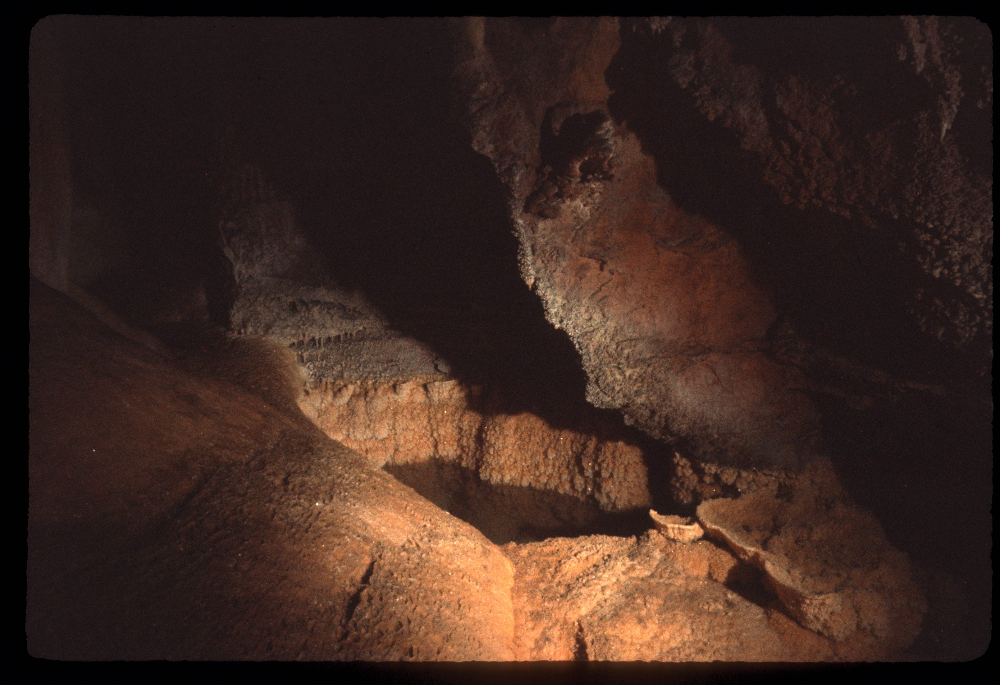
*ASF Joe N. Jennings slide catalogue, JNJ-S-00144, Box 42. Catalogue description: ? Pool East Deep Creek cave, Yarrangobilly. [ASF record](https://st1.asflib.net/MEDIA/ASFJJSlidesCatalogue/Box%2042/JNJ-S-00144.html).*

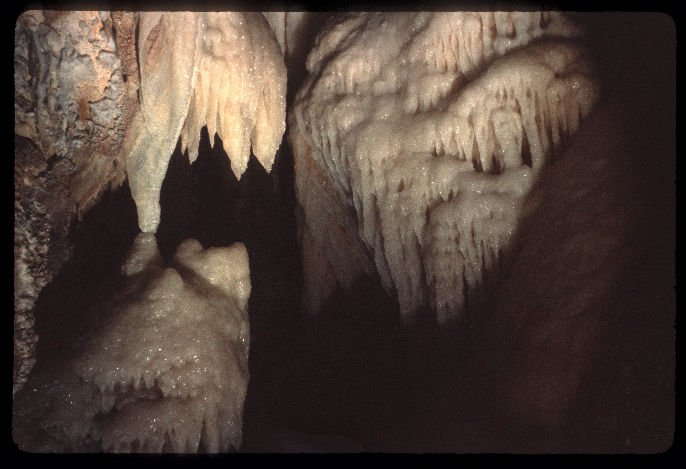
*ASF Joe N. Jennings slide catalogue, JNJ-S-00151, Box 42. Catalogue description: Curtains, East Deep Creek Cave, Yarrangobilly. [ASF record](https://st1.asflib.net/MEDIA/ASFJJSlidesCatalogue/Box%2042/JNJ-S-00151.html).*

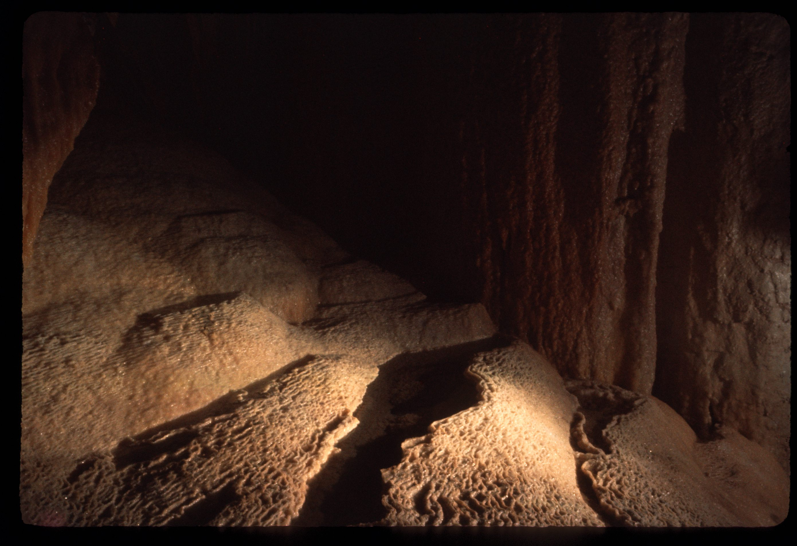
*ASF Joe N. Jennings slide catalogue, JNJ-S-00300, Box 47. Catalogue description: Gours and microgours in East Deep Creek Cave, Yarrangobilly. [ASF record](https://st1.asflib.net/MEDIA/ASFJJSlidesCatalogue/Box%2047/JNJ-S-00300.html).*

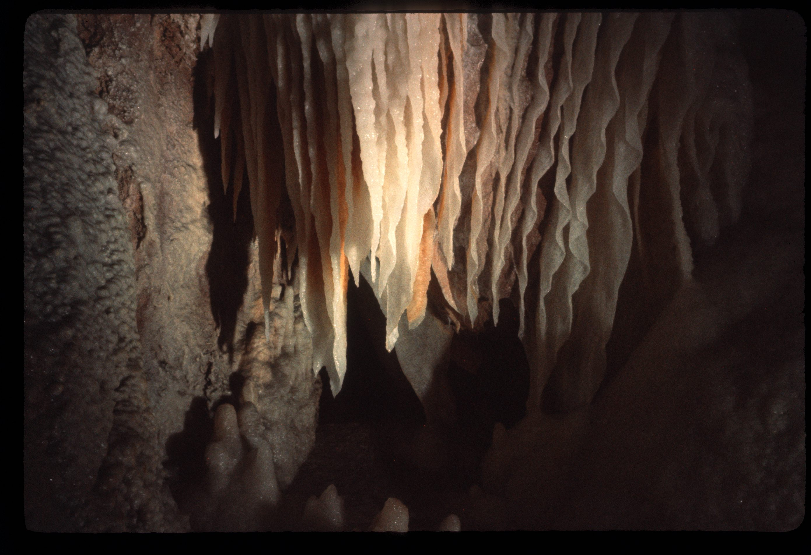
*ASF Joe N. Jennings slide catalogue, JNJ-S-00302, Box 47. Catalogue description: Draperies, East Deep Creek Cave, Yarrangobilly. [ASF record](https://st1.asflib.net/MEDIA/ASFJJSlidesCatalogue/Box%2047/JNJ-S-00302.html).*

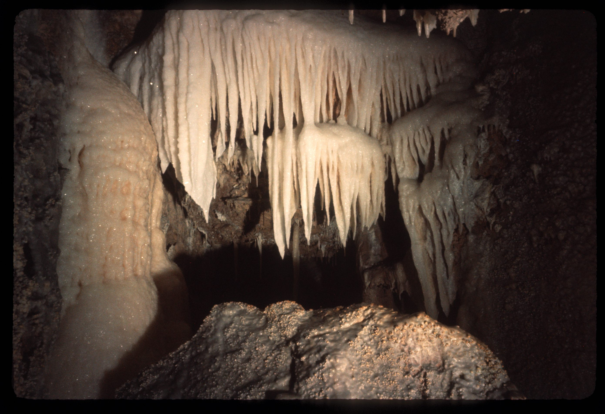
*ASF Joe N. Jennings slide catalogue, JNJ-S-00303, Box 47. Catalogue description: Canopies, East Deep Creek Cave, Yarrangobilly. [ASF record](https://st1.asflib.net/MEDIA/ASFJJSlidesCatalogue/Box%2047/JNJ-S-00303.html).*

### Janus Cave

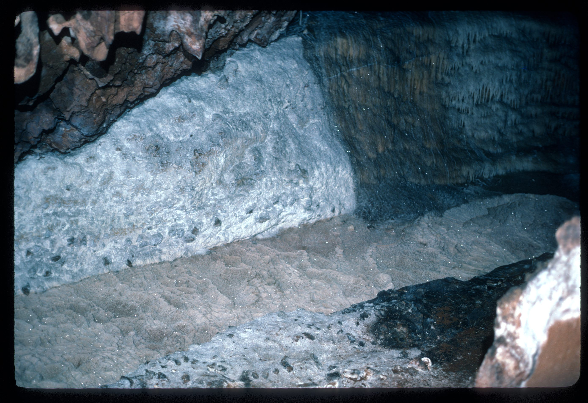
*ASF Joe N. Jennings slide catalogue, JNJ-S-00145, Box 42. Catalogue description: Frozen ?, Main Chamber, Janus Cave, Yarrongobilly. [ASF record](https://st1.asflib.net/MEDIA/ASFJJSlidesCatalogue/Box%2042/JNJ-S-00145.html).*

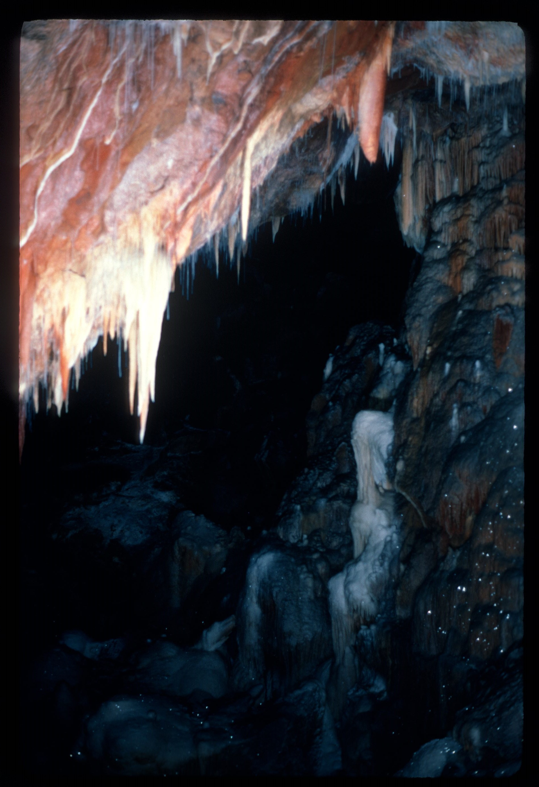
*ASF Joe N. Jennings slide catalogue, JNJ-S-00146, Box 42. Catalogue description: Main Chamber, Janus Cave, Yarrongobilly. [ASF record](https://st1.asflib.net/MEDIA/ASFJJSlidesCatalogue/Box%2042/JNJ-S-00146.html).*

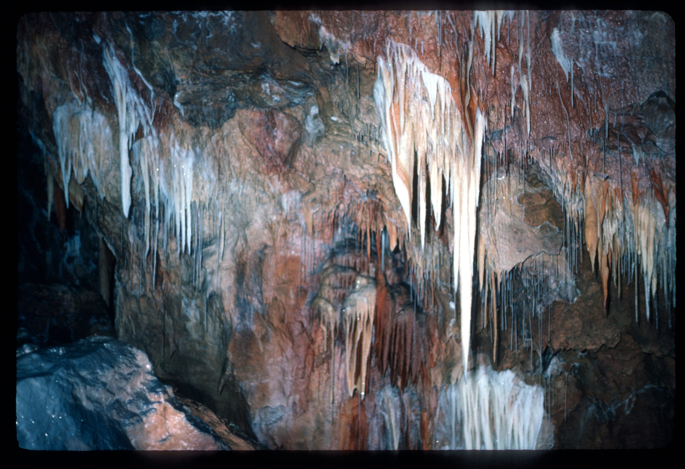
*ASF Joe N. Jennings slide catalogue, JNJ-S-00147, Box 42. Catalogue description: Main Chamber, Janus Cave, Yarrongobilly. [ASF record](https://st1.asflib.net/MEDIA/ASFJJSlidesCatalogue/Box%2042/JNJ-S-00147.html).*

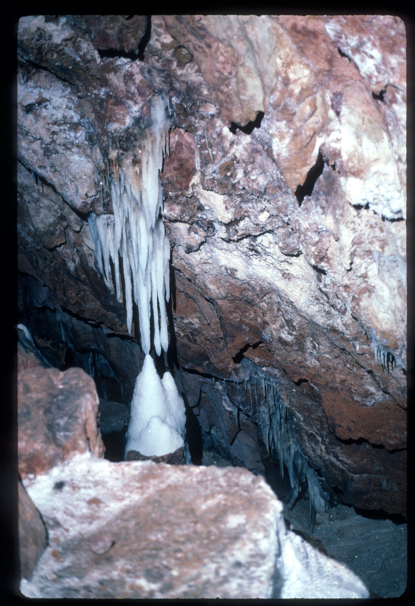
*ASF Joe N. Jennings slide catalogue, JNJ-S-00148, Box 42. Catalogue description: Main Chamber, Janus Cave, Yarrongobilly. [ASF record](https://st1.asflib.net/MEDIA/ASFJJSlidesCatalogue/Box%2042/JNJ-S-00148.html).*

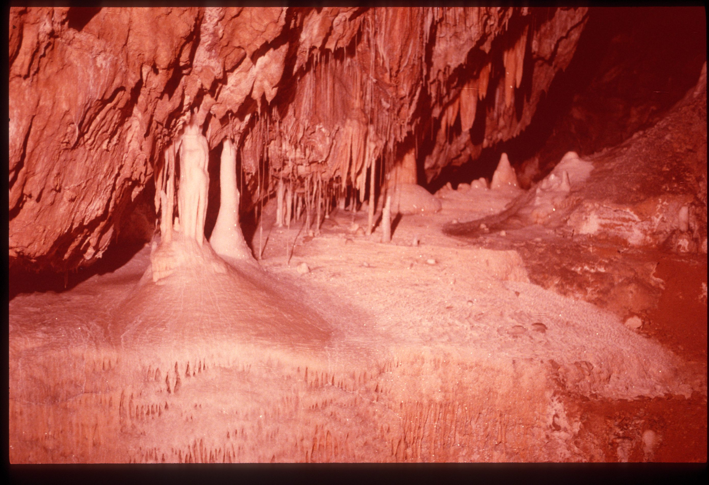
*ASF Joe N. Jennings slide catalogue, JNJ-S-00150, Box 42. Catalogue description: Janus Cave (main chamber?), Yarrangobilly, September 1983. [ASF record](https://st1.asflib.net/MEDIA/ASFJJSlidesCatalogue/Box%2042/JNJ-S-00150.html).*

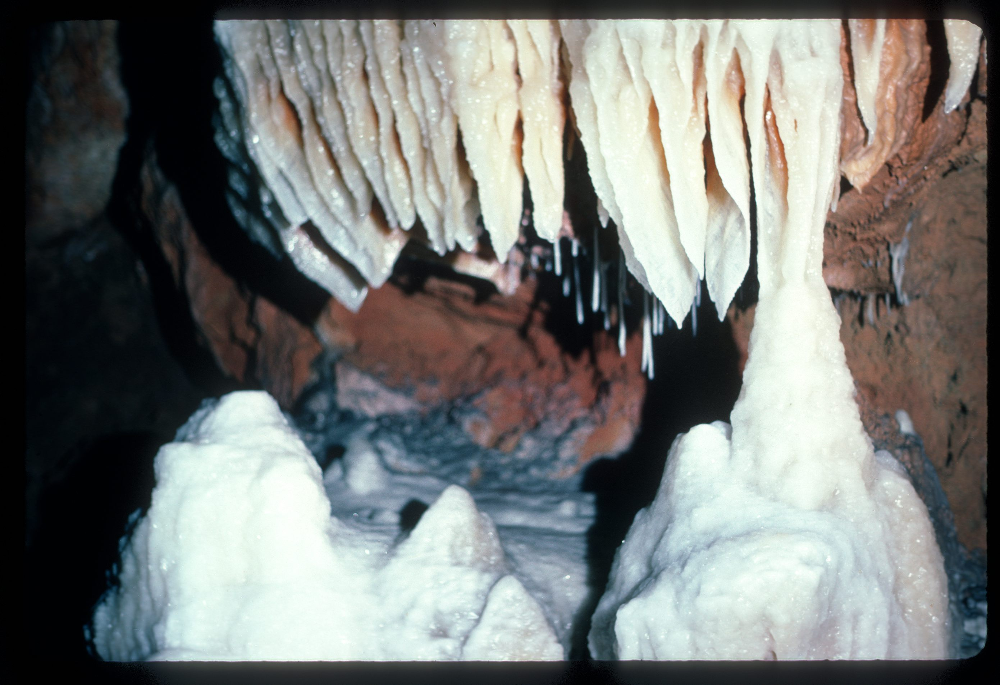
*ASF Joe N. Jennings slide catalogue, JNJ-S-00295, Box 47. Catalogue description: Main chamber, Janus Cave, Yarrongobilly. [ASF record](https://st1.asflib.net/MEDIA/ASFJJSlidesCatalogue/Box%2047/JNJ-S-00295.html).*

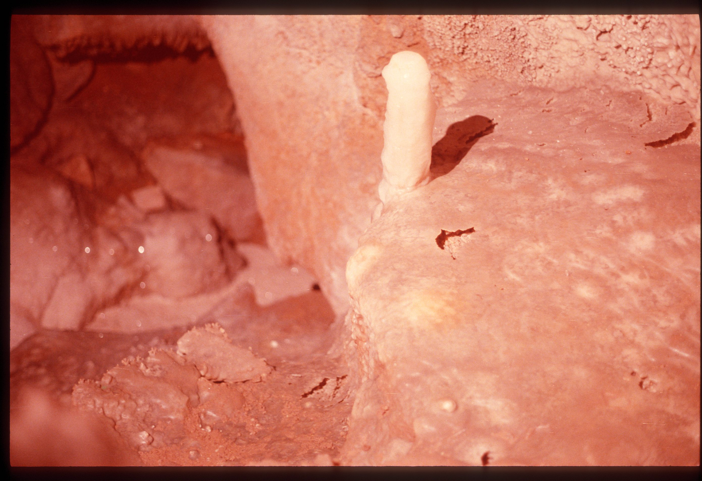
*ASF Joe N. Jennings slide catalogue, JNJ-S-00296, Box 47. Catalogue description: Stalagmite on shelf, Janus Cave, Yarrangobilly, Jan 1983. [ASF record](https://st1.asflib.net/MEDIA/ASFJJSlidesCatalogue/Box%2047/JNJ-S-00296.html).*

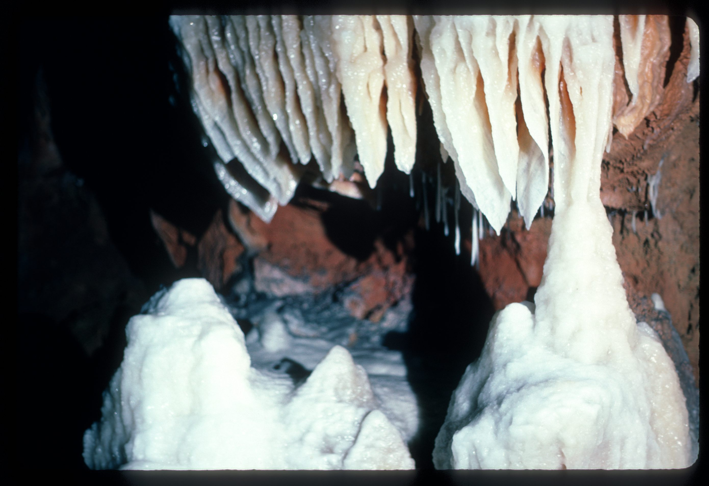
*ASF Joe N. Jennings slide catalogue, JNJ-S-00304, Box 47. Catalogue description: Main Cave, Janus Cave, Yarrangobilly. [ASF record](https://st1.asflib.net/MEDIA/ASFJJSlidesCatalogue/Box%2047/JNJ-S-00304.html).*

### Yarrangobilly area

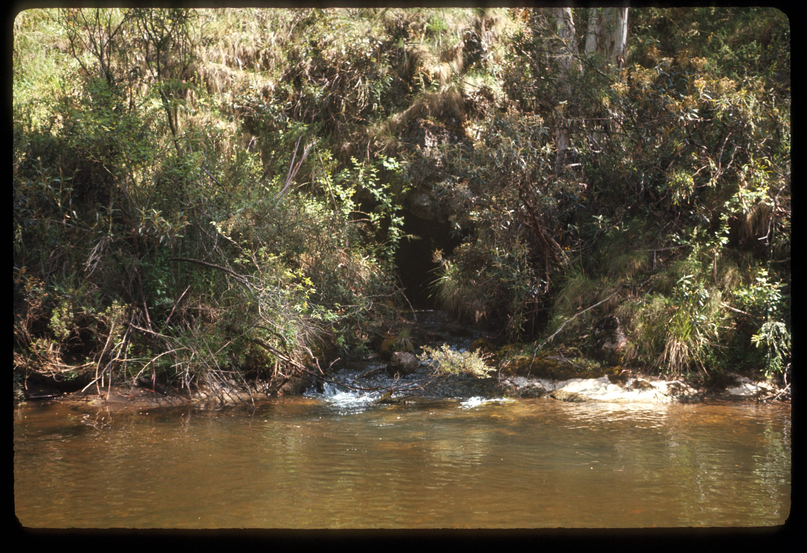
*ASF Joe N. Jennings slide catalogue, JNJ-S-00149, Box 42. Catalogue description: Y46 outflow cave just upstream of Natural Bridge, left bank of Yarrongobilly River. [ASF record](https://st1.asflib.net/MEDIA/ASFJJSlidesCatalogue/Box%2042/JNJ-S-00149.html).*

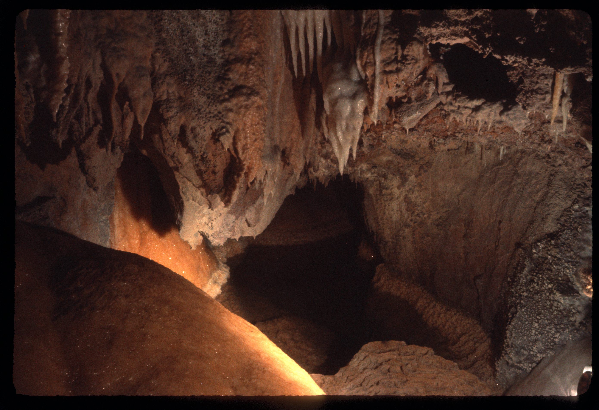
*ASF Joe N. Jennings slide catalogue, JNJ-S-00305, Box 47. Catalogue description: Crystal Pools, East Deep Creek Cave, Yarrangobilly. [ASF record](https://st1.asflib.net/MEDIA/ASFJJSlidesCatalogue/Box%2047/JNJ-S-00305.html).*

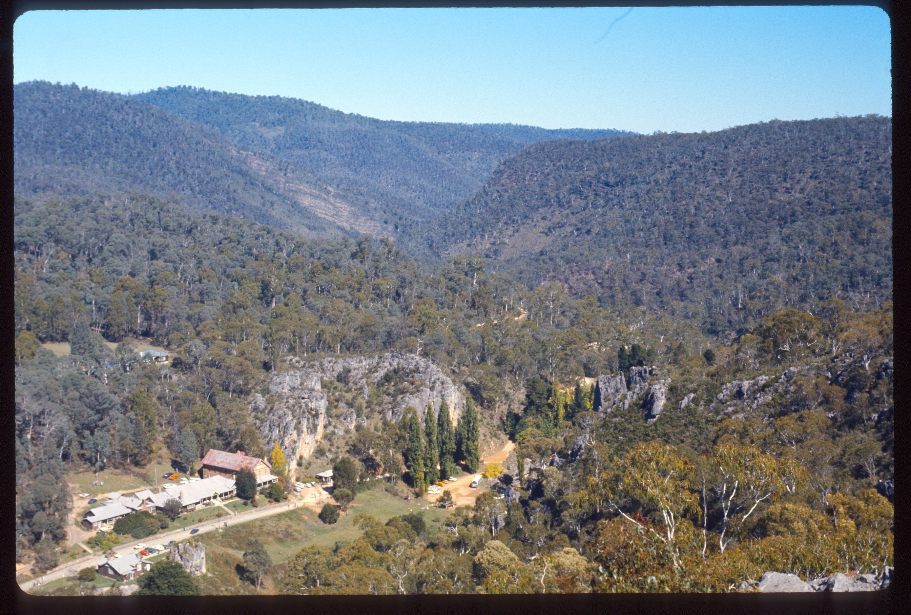
*ASF Joe N. Jennings slide catalogue, JNJ-S-1012-01, Box 1012. Catalogue description: Yarrangobilly caves - Blind valley. [ASF record](https://st1.asflib.net/MEDIA/ASFJJSlidesCatalogue/Box%201012/JNJ-S-1012-01.html).*

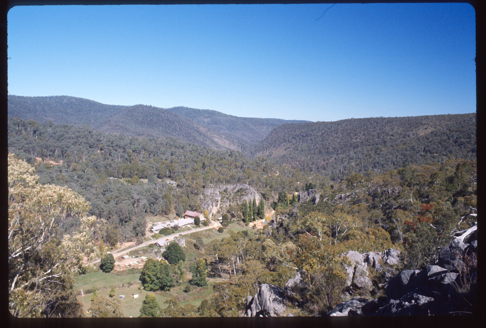
*ASF Joe N. Jennings slide catalogue, JNJ-S-1012-02, Box 1012. Catalogue description: Yarrangobilly caves - Blind valley. [ASF record](https://st1.asflib.net/MEDIA/ASFJJSlidesCatalogue/Box%201012/JNJ-S-1012-02.html).*

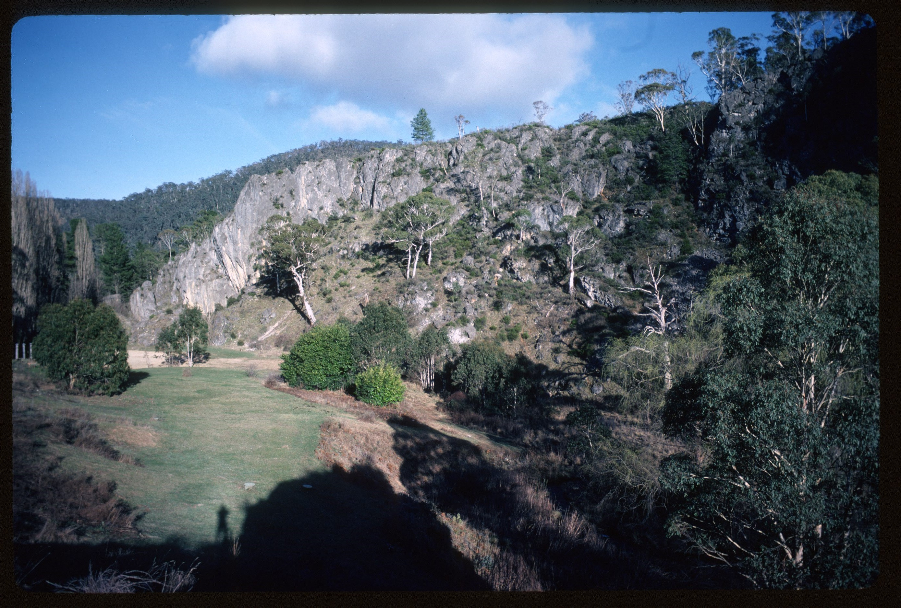
*ASF Joe N. Jennings slide catalogue, JNJ-S-1012-03, Box 1012. Catalogue description: Yarrangobilly caves - Rules Creek blind valley. [ASF record](https://st1.asflib.net/MEDIA/ASFJJSlidesCatalogue/Box%201012/JNJ-S-1012-03.html).*

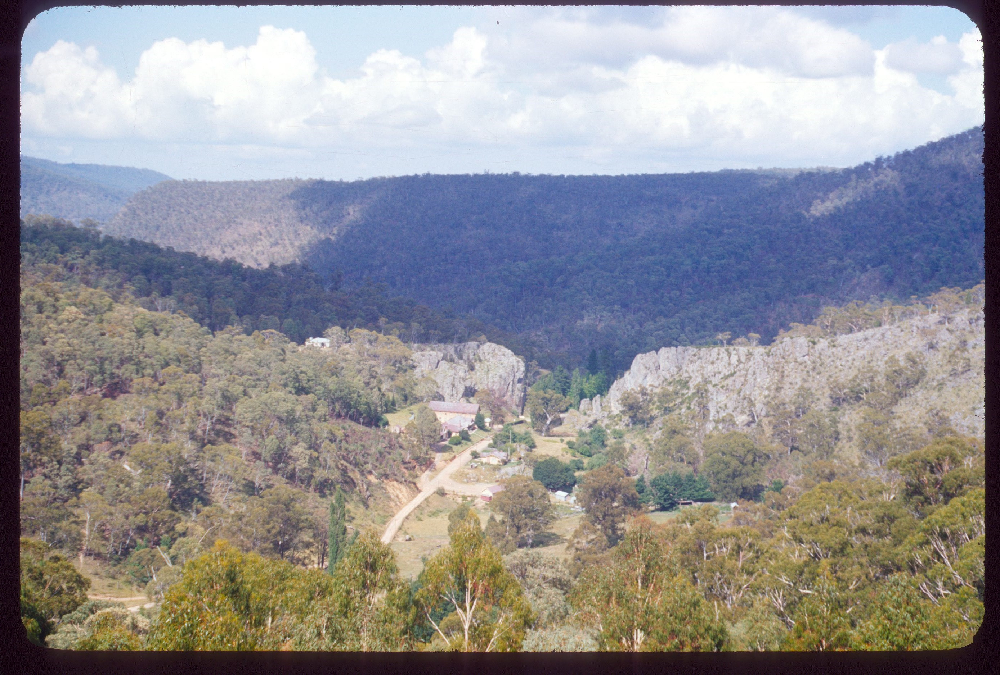
*ASF Joe N. Jennings slide catalogue, JNJ-S-1012-04, Box 1012. Catalogue description: Yarrangobilly caves - Hotel valley. [ASF record](https://st1.asflib.net/MEDIA/ASFJJSlidesCatalogue/Box%201012/JNJ-S-1012-04.html).*

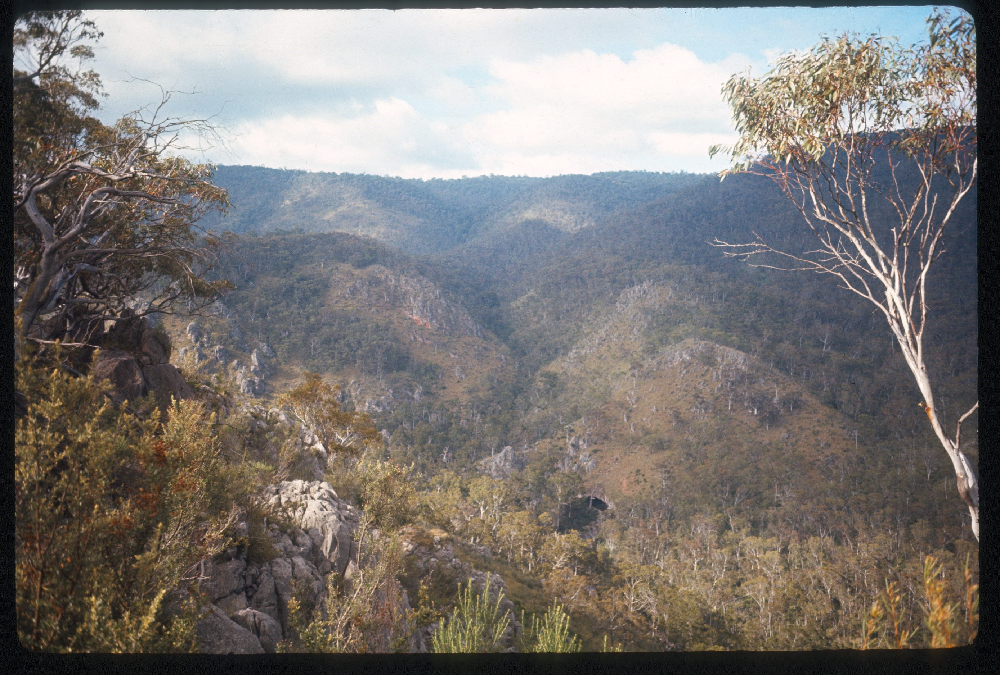
*ASF Joe N. Jennings slide catalogue, JNJ-S-1012-05, Box 1012. Catalogue description: Yarrangobilly River valley and a few spurs above Natural Bridge - Right bank Tri?. [ASF record](https://st1.asflib.net/MEDIA/ASFJJSlidesCatalogue/Box%201012/JNJ-S-1012-05.html).*

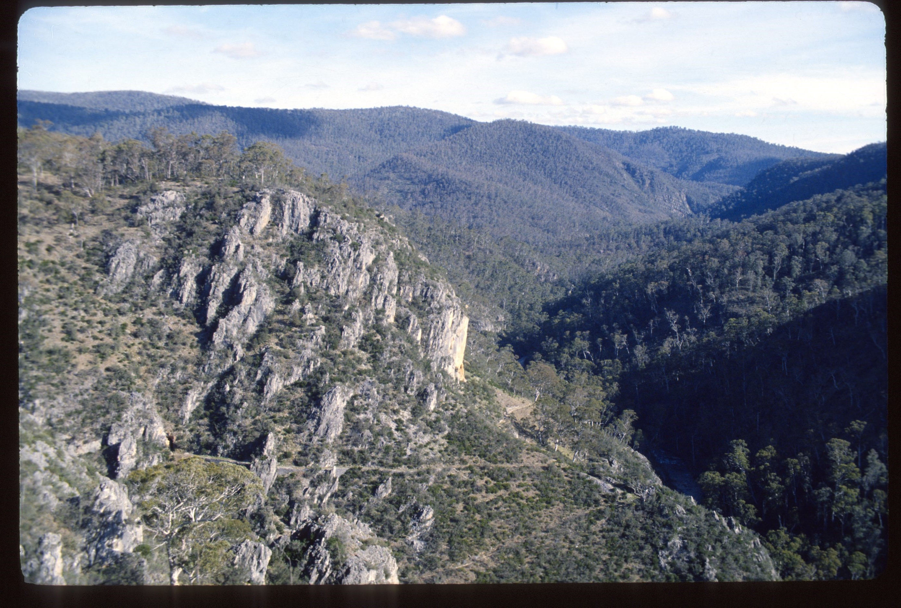
*ASF Joe N. Jennings slide catalogue, JNJ-S-1012-06, Box 1012. Catalogue description: From plateau on -ve side - Harrie Wood GGE - Adrian Davey. [ASF record](https://st1.asflib.net/MEDIA/ASFJJSlidesCatalogue/Box%201012/JNJ-S-1012-06.html).*

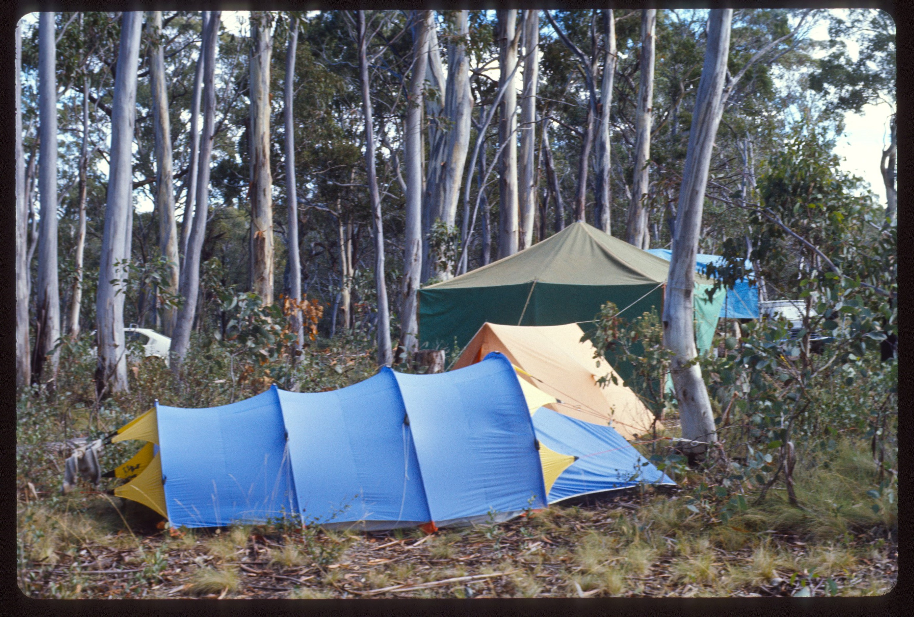
*ASF Joe N. Jennings slide catalogue, JNJ-S-1012-07, Box 1012. Catalogue description: Camp explosives hut.. [ASF record](https://st1.asflib.net/MEDIA/ASFJJSlidesCatalogue/Box%201012/JNJ-S-1012-07.html).*

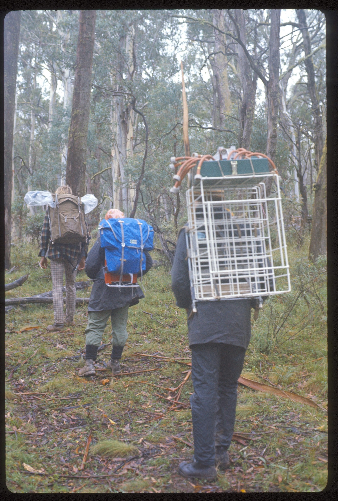
*ASF Joe N. Jennings slide catalogue, JNJ-S-1012-08, Box 1012. Catalogue description: Gear carry to Y46. [ASF record](https://st1.asflib.net/MEDIA/ASFJJSlidesCatalogue/Box%201012/JNJ-S-1012-08.html).*

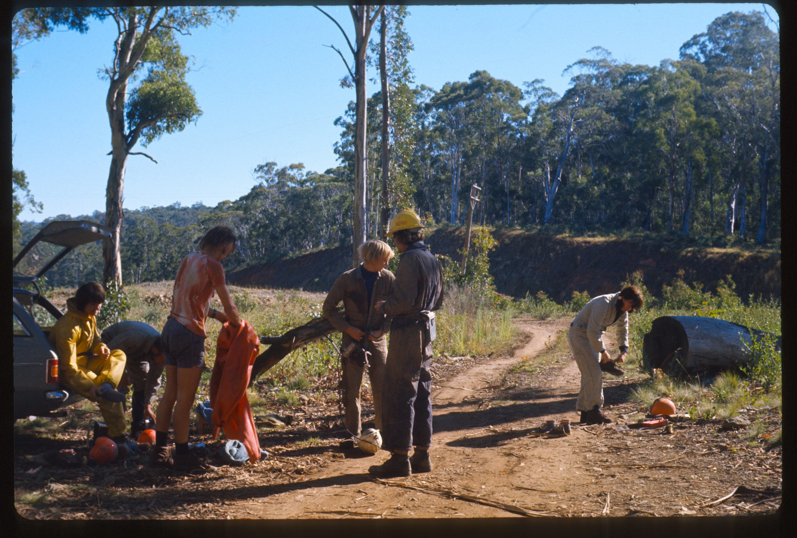
*ASF Joe N. Jennings slide catalogue, JNJ-S-1012-09, Box 1012. Catalogue description: Getting caving gear on. [ASF record](https://st1.asflib.net/MEDIA/ASFJJSlidesCatalogue/Box%201012/JNJ-S-1012-09.html).*

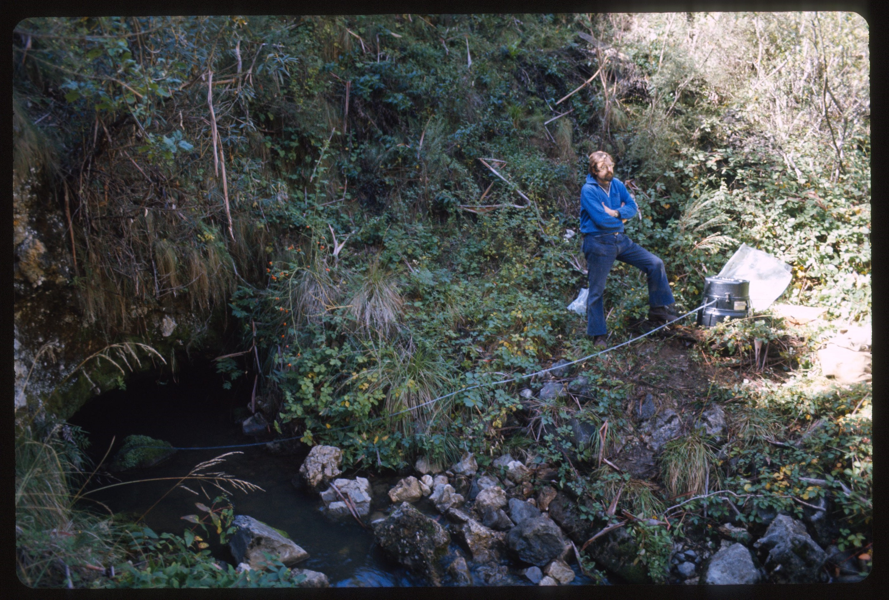
*ASF Joe N. Jennings slide catalogue, JNJ-S-1012-10, Box 1012. Catalogue description: Y44 ISCO. [ASF record](https://st1.asflib.net/MEDIA/ASFJJSlidesCatalogue/Box%201012/JNJ-S-1012-10.html).*

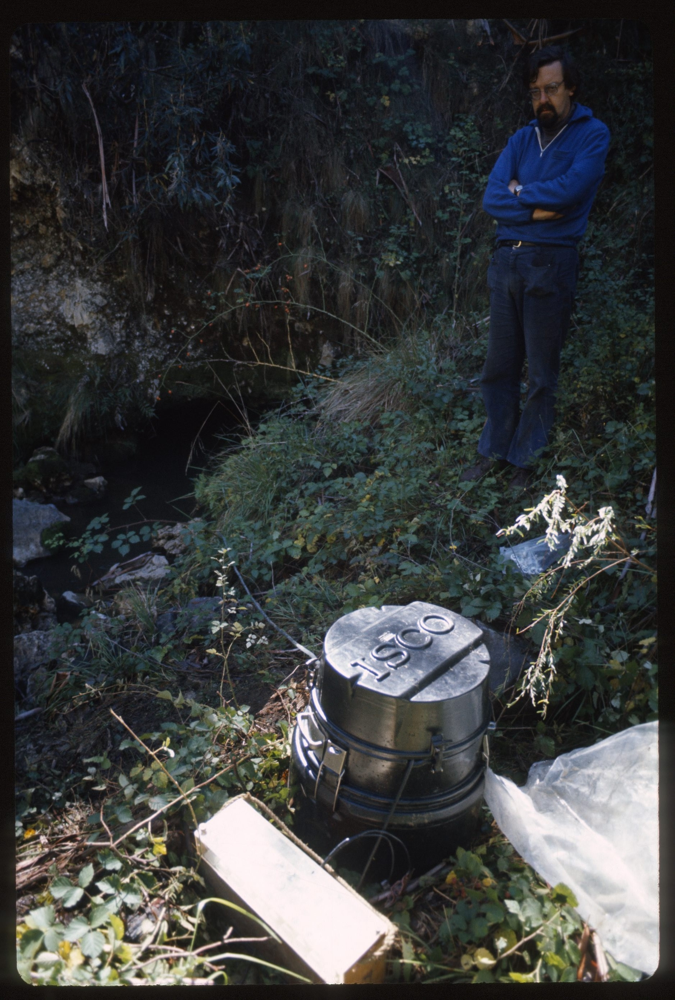
*ASF Joe N. Jennings slide catalogue, JNJ-S-1012-11, Box 1012. Catalogue description: Y44 ISCO - Dingle - Federation cave. [ASF record](https://st1.asflib.net/MEDIA/ASFJJSlidesCatalogue/Box%201012/JNJ-S-1012-11.html).*

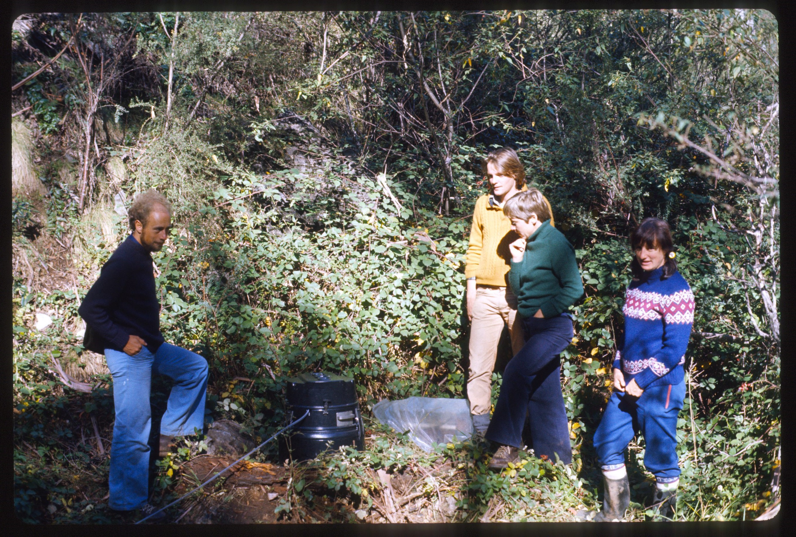
*ASF Joe N. Jennings slide catalogue, JNJ-S-1012-12, Box 1012. Catalogue description: Y44 ISCO - Peter (standing) - Gordon Taylor - Des (standing) - Julia James. [ASF record](https://st1.asflib.net/MEDIA/ASFJJSlidesCatalogue/Box%201012/JNJ-S-1012-12.html).*

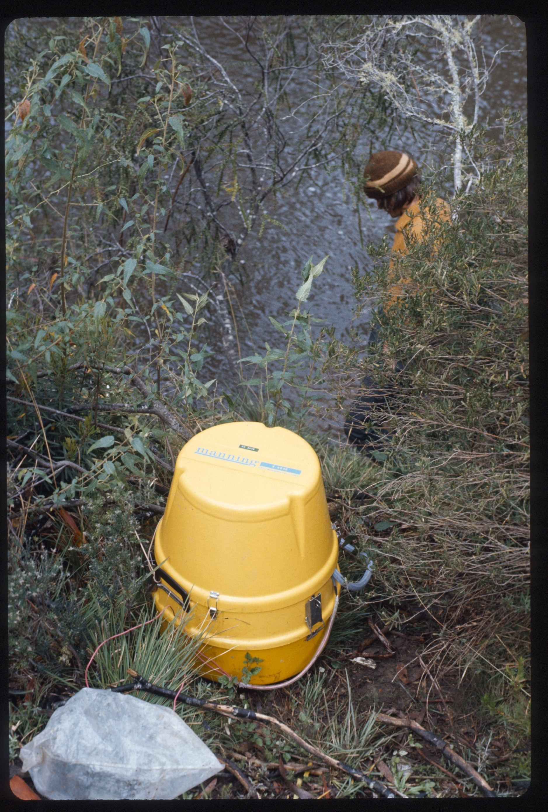
*ASF Joe N. Jennings slide catalogue, JNJ-S-1012-13, Box 1012. Catalogue description: Manning' at Yarrangobilly. [ASF record](https://st1.asflib.net/MEDIA/ASFJJSlidesCatalogue/Box%201012/JNJ-S-1012-13.html).*

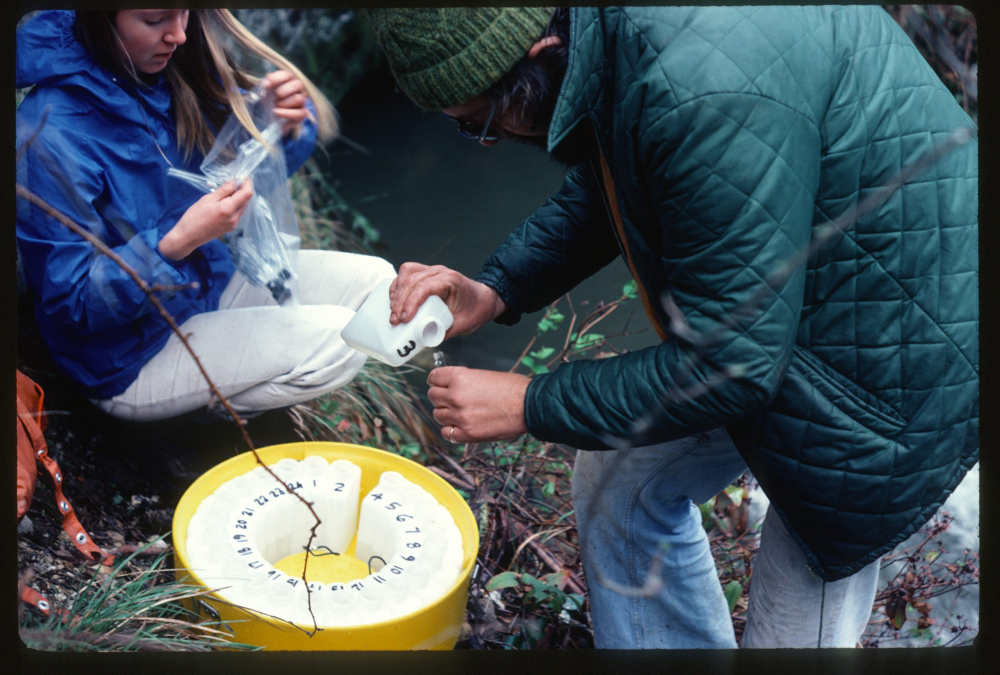
*ASF Joe N. Jennings slide catalogue, JNJ-S-1012-14, Box 1012. Catalogue description: Dingle and Sarah sampling with 'Manning' at Y44. [ASF record](https://st1.asflib.net/MEDIA/ASFJJSlidesCatalogue/Box%201012/JNJ-S-1012-14.html).*

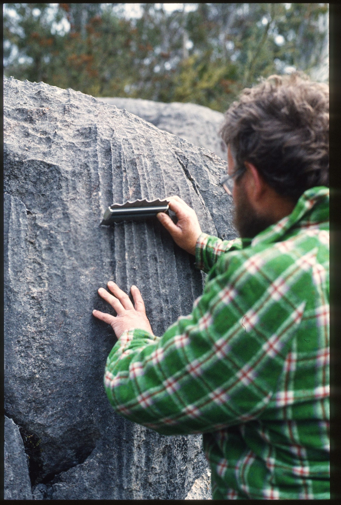
*ASF Joe N. Jennings slide catalogue, JNJ-S-1012-15, Box 1012. Catalogue description: Carpenters profile guage on flutes at Yarrangobilly. [ASF record](https://st1.asflib.net/MEDIA/ASFJJSlidesCatalogue/Box%201012/JNJ-S-1012-15.html).*

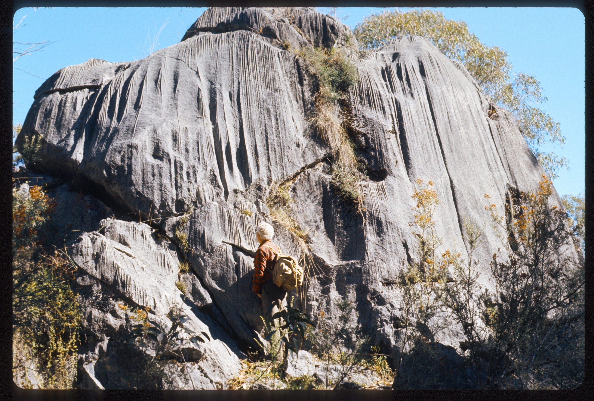
*ASF Joe N. Jennings slide catalogue, JNJ-S-1012-16, Box 1012. Catalogue description: Flutes - Yarrangobilly near East Deep creek. [ASF record](https://st1.asflib.net/MEDIA/ASFJJSlidesCatalogue/Box%201012/JNJ-S-1012-16.html).*

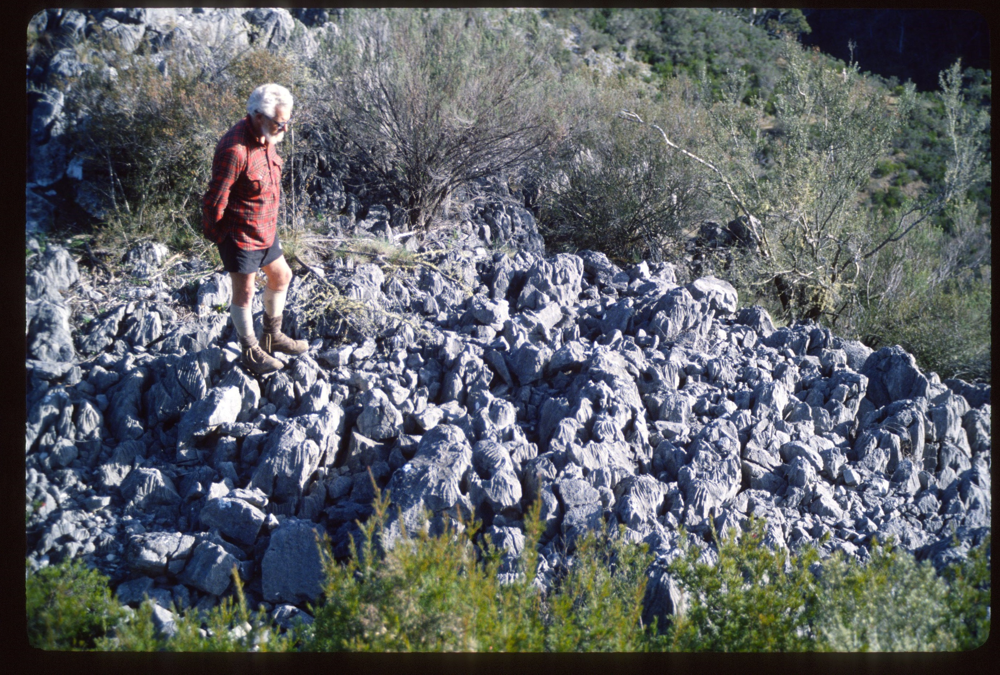
*ASF Joe N. Jennings slide catalogue, JNJ-S-1012-17, Box 1012. Catalogue description: In Harrie Wood Gorge - Adrian Davey. [ASF record](https://st1.asflib.net/MEDIA/ASFJJSlidesCatalogue/Box%201012/JNJ-S-1012-17.html).*

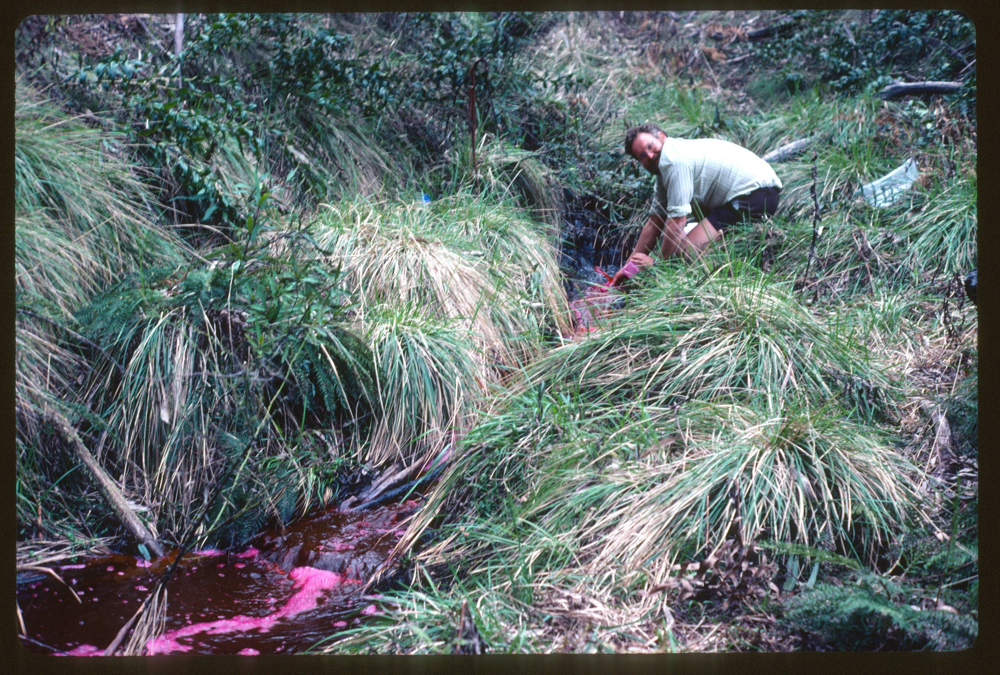
*ASF Joe N. Jennings slide catalogue, JNJ-S-1012-18, Box 1012. Catalogue description: Rhod WT in Eagles Nest creek - Andy Spate. [ASF record](https://st1.asflib.net/MEDIA/ASFJJSlidesCatalogue/Box%201012/JNJ-S-1012-18.html).*

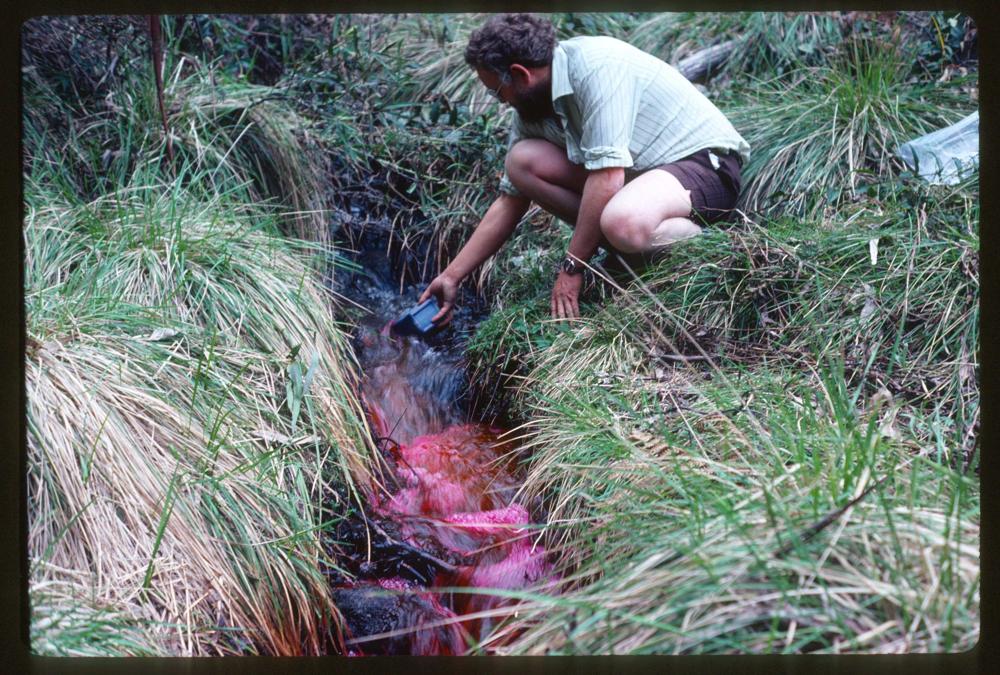
*ASF Joe N. Jennings slide catalogue, JNJ-S-1012-19, Box 1012. Catalogue description: Andy Spate putting Rhod WT into Eagle Nest creek. [ASF record](https://st1.asflib.net/MEDIA/ASFJJSlidesCatalogue/Box%201012/JNJ-S-1012-19.html).*

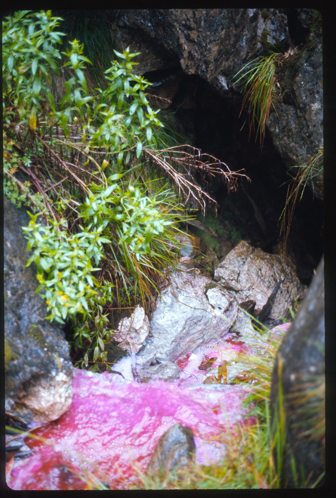
*ASF Joe N. Jennings slide catalogue, JNJ-S-1012-20, Box 1012. Catalogue description: East Deep Creek cave. [ASF record](https://st1.asflib.net/MEDIA/ASFJJSlidesCatalogue/Box%201012/JNJ-S-1012-20.html).*

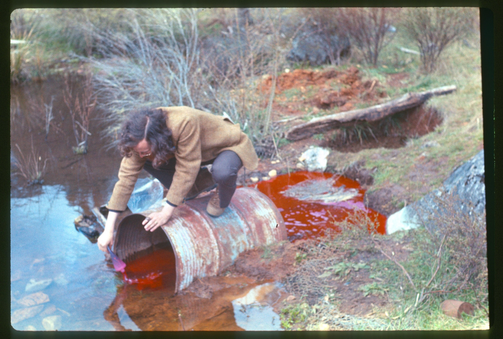
*ASF Joe N. Jennings slide catalogue, JNJ-S-1012-21, Box 1012. Catalogue description: Charlie outs Rhod WT into Leak in the Creek. [ASF record](https://st1.asflib.net/MEDIA/ASFJJSlidesCatalogue/Box%201012/JNJ-S-1012-21.html).*

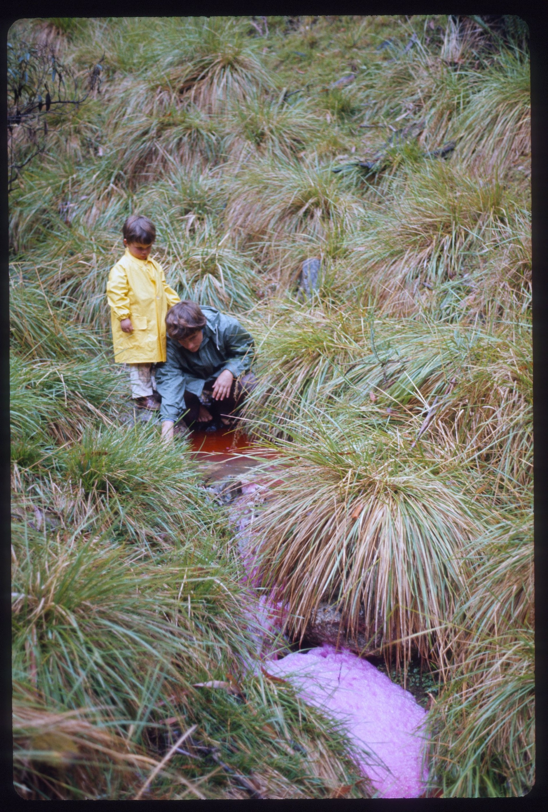
*ASF Joe N. Jennings slide catalogue, JNJ-S-1012-22, Box 1012. Catalogue description: Rhodamine into East Deep Creek with Chris and Jan Spate. [ASF record](https://st1.asflib.net/MEDIA/ASFJJSlidesCatalogue/Box%201012/JNJ-S-1012-22.html).*

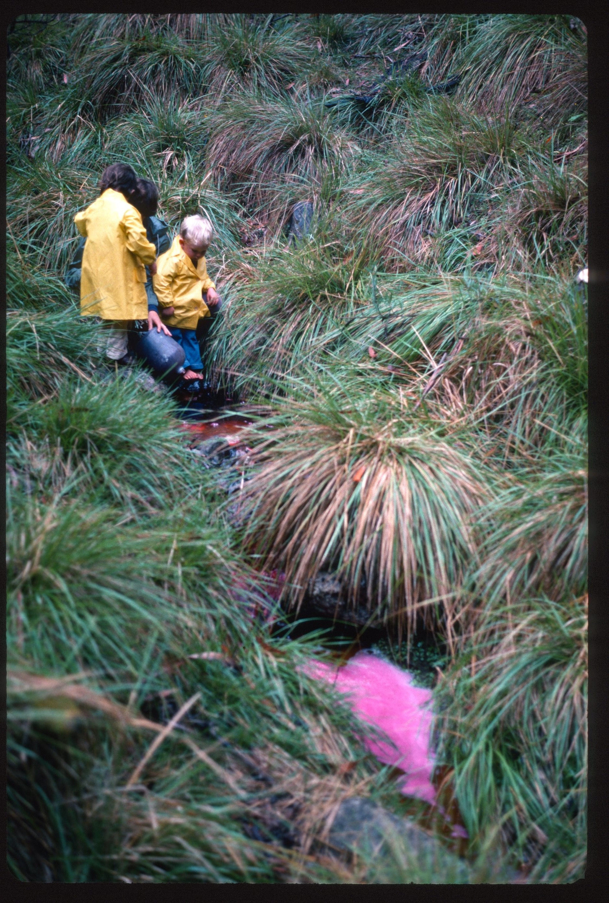
*ASF Joe N. Jennings slide catalogue, JNJ-S-1012-23, Box 1012. Catalogue description: Rhodamine into East Deep Creek. [ASF record](https://st1.asflib.net/MEDIA/ASFJJSlidesCatalogue/Box%201012/JNJ-S-1012-23.html).*

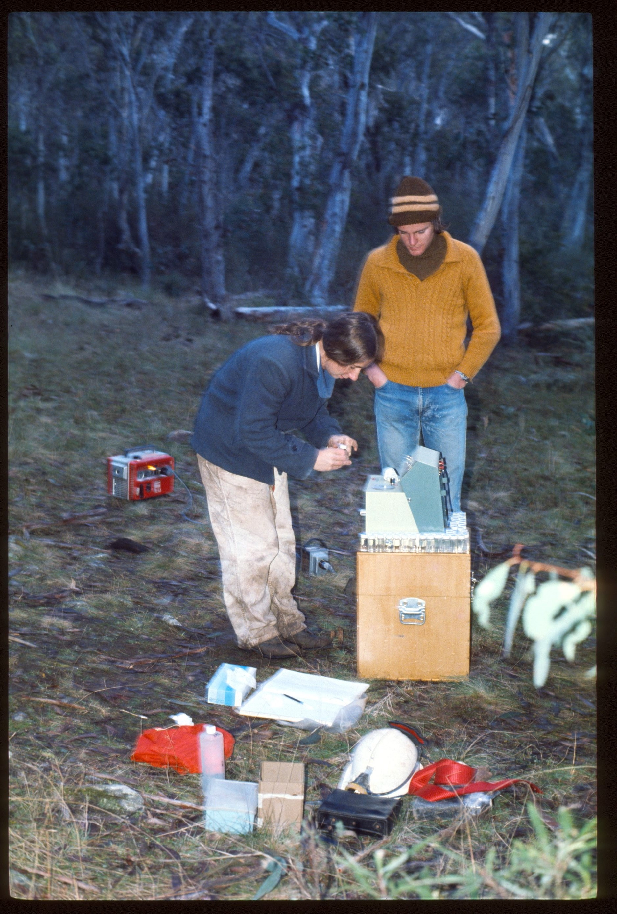
*ASF Joe N. Jennings slide catalogue, JNJ-S-1012-24, Box 1012. Catalogue description: Fluorimeter in action - Deep creek Yarrangobilly - Gordon Taylor - Marjorie Coggan. [ASF record](https://st1.asflib.net/MEDIA/ASFJJSlidesCatalogue/Box%201012/JNJ-S-1012-24.html).*

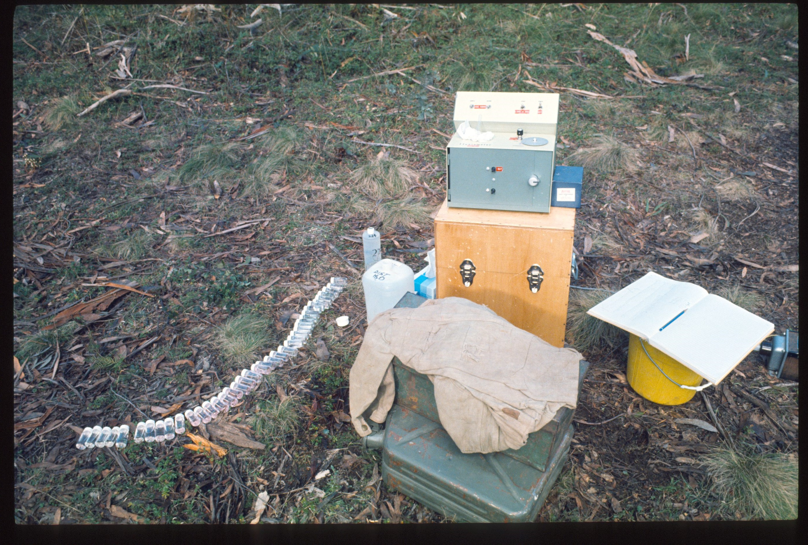
*ASF Joe N. Jennings slide catalogue, JNJ-S-1012-25, Box 1012. Catalogue description: Eagles Nest Creek - Dye dispersion gauging. [ASF record](https://st1.asflib.net/MEDIA/ASFJJSlidesCatalogue/Box%201012/JNJ-S-1012-25.html).*

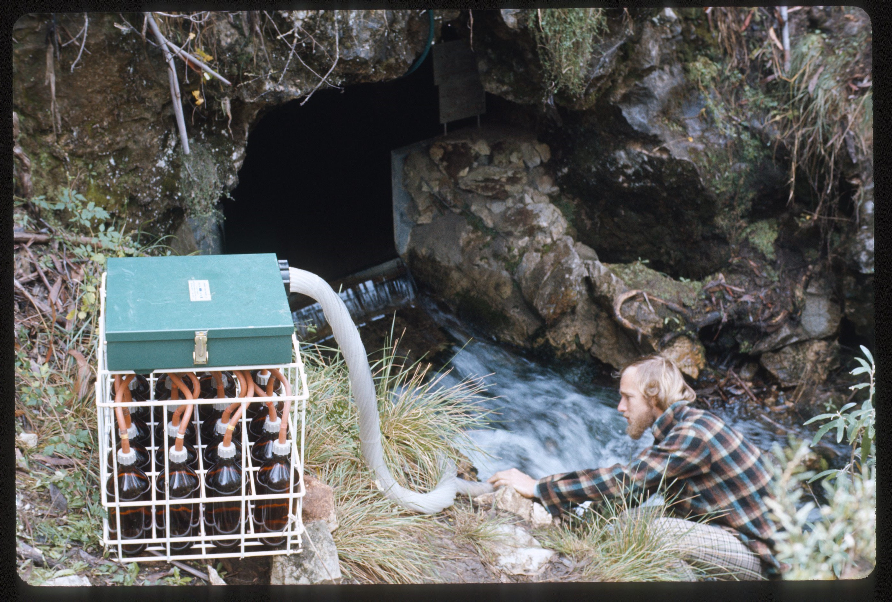
*ASF Joe N. Jennings slide catalogue, JNJ-S-1012-26, Box 1012. Catalogue description: ? At Y46 - Bob Dunn. [ASF record](https://st1.asflib.net/MEDIA/ASFJJSlidesCatalogue/Box%201012/JNJ-S-1012-26.html).*

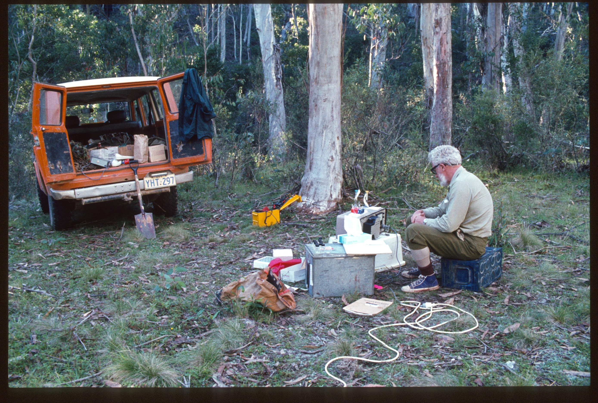
*ASF Joe N. Jennings slide catalogue, JNJ-S-1012-27, Box 1012. Catalogue description: Fluorimeter in action - Deep creek Yarrangobilly - Adrian Davey. [ASF record](https://st1.asflib.net/MEDIA/ASFJJSlidesCatalogue/Box%201012/JNJ-S-1012-27.html).*

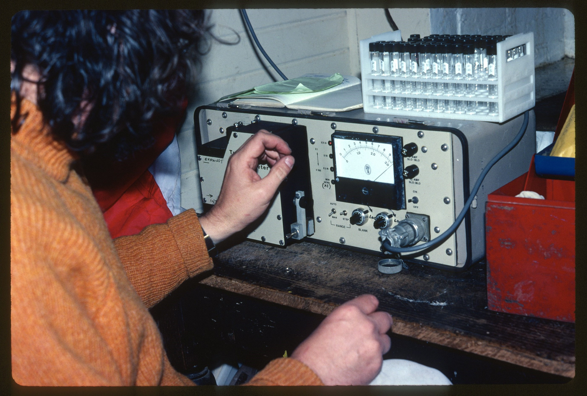
*ASF Joe N. Jennings slide catalogue, JNJ-S-1012-28, Box 1012. Catalogue description: Tunier flouorimeter Mk 2 - ? Yarrangobilly Centre. [ASF record](https://st1.asflib.net/MEDIA/ASFJJSlidesCatalogue/Box%201012/JNJ-S-1012-28.html).*

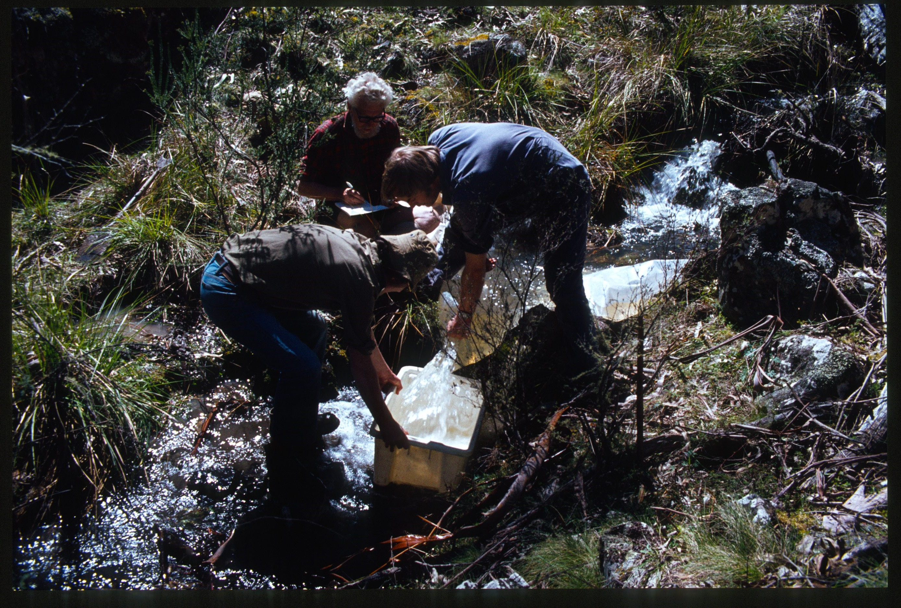
*ASF Joe N. Jennings slide catalogue, JNJ-S-1012-29, Box 1012. Catalogue description: Gauging Traverse Creek - Adrian Davey. [ASF record](https://st1.asflib.net/MEDIA/ASFJJSlidesCatalogue/Box%201012/JNJ-S-1012-29.html).*

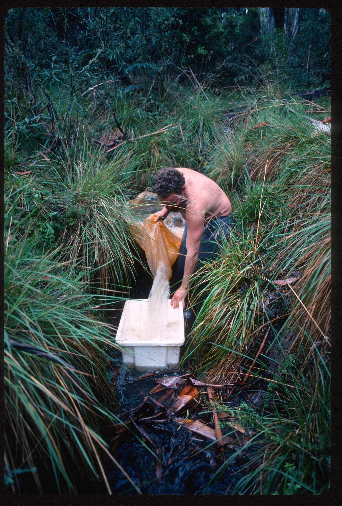
*ASF Joe N. Jennings slide catalogue, JNJ-S-1012-30, Box 1012. Catalogue description: Andy Spate guaging - Eagles Nest Creek. [ASF record](https://st1.asflib.net/MEDIA/ASFJJSlidesCatalogue/Box%201012/JNJ-S-1012-30.html).*

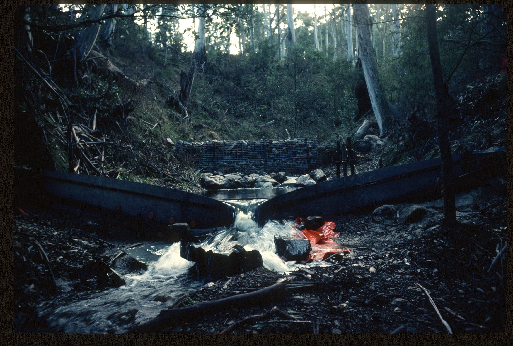
*ASF Joe N. Jennings slide catalogue, JNJ-S-1012-31, Box 1012. Catalogue description: Inehenge ??. [ASF record](https://st1.asflib.net/MEDIA/ASFJJSlidesCatalogue/Box%201012/JNJ-S-1012-31.html).*

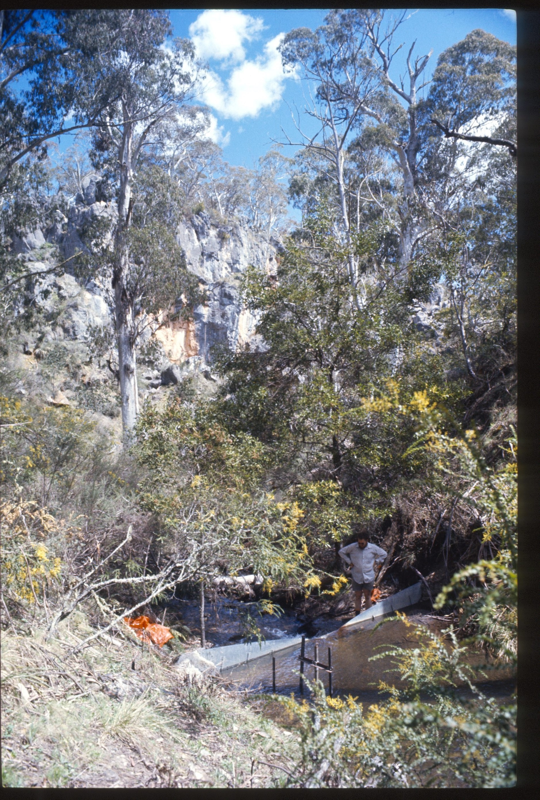
*ASF Joe N. Jennings slide catalogue, JNJ-S-1012-32, Box 1012. Catalogue description: Yarrangobilly - Parabolic weir - Deep Creek - Blind valley. [ASF record](https://st1.asflib.net/MEDIA/ASFJJSlidesCatalogue/Box%201012/JNJ-S-1012-32.html).*

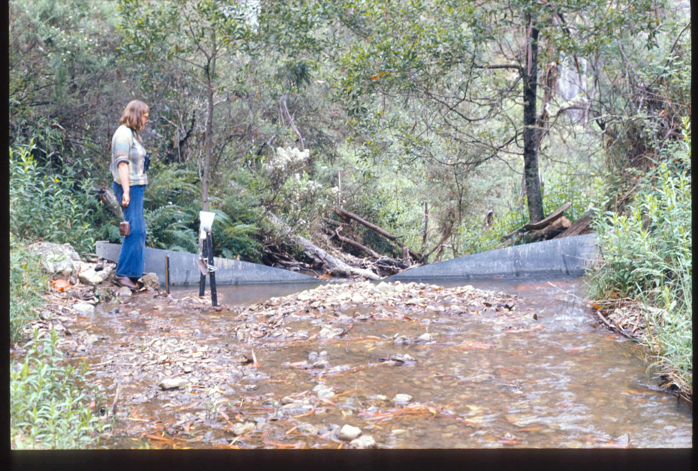
*ASF Joe N. Jennings slide catalogue, JNJ-S-1012-33, Box 1012. Catalogue description: Yarrangobilly - Deep Creek weir full of gravel. [ASF record](https://st1.asflib.net/MEDIA/ASFJJSlidesCatalogue/Box%201012/JNJ-S-1012-33.html).*

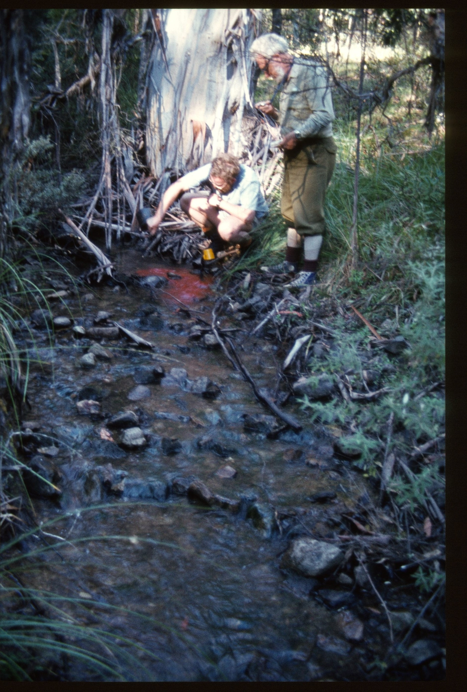
*ASF Joe N. Jennings slide catalogue, JNJ-S-1012-34, Box 1012. Catalogue description: Yarrangobilly - Dye gauging Deep Creek - Adrian Davey. [ASF record](https://st1.asflib.net/MEDIA/ASFJJSlidesCatalogue/Box%201012/JNJ-S-1012-34.html).*

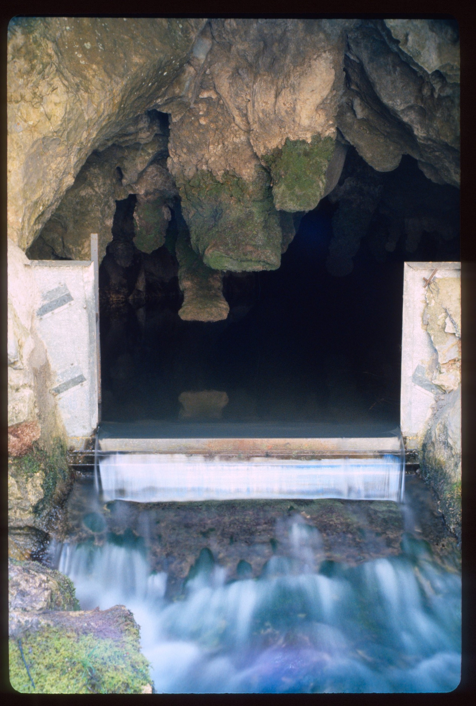
*ASF Joe N. Jennings slide catalogue, JNJ-S-1012-35, Box 1012. Catalogue description: Y46 - Adrian Davey. [ASF record](https://st1.asflib.net/MEDIA/ASFJJSlidesCatalogue/Box%201012/JNJ-S-1012-35.html).*

*ASF Joe N. Jennings slide catalogue, JNJ-S-1012-36, Box 1012. Catalogue description: Y46 weir finished - Neil Anderson and Jun Quilford. [ASF record](https://st1.asflib.net/MEDIA/ASFJJSlidesCatalogue/Box%201012/JNJ-S-1012-36.html).*

*ASF Joe N. Jennings slide catalogue, JNJ-S-1012-37, Box 1012. Catalogue description: Yarrangobilly -Y46 nets. [ASF record](https://st1.asflib.net/MEDIA/ASFJJSlidesCatalogue/Box%201012/JNJ-S-1012-37.html).*

*ASF Joe N. Jennings slide catalogue, JNJ-S-1012-38, Box 1012. Catalogue description: Yarrangobilly - Rules Creek streamsink. [ASF record](https://st1.asflib.net/MEDIA/ASFJJSlidesCatalogue/Box%201012/JNJ-S-1012-38.html).*

*ASF Joe N. Jennings slide catalogue, JNJ-S-1012-39, Box 1012. Catalogue description: Y6 weir - 1 litre RWT - Adrian Davey. [ASF record](https://st1.asflib.net/MEDIA/ASFJJSlidesCatalogue/Box%201012/JNJ-S-1012-39.html).*

*ASF Joe N. Jennings slide catalogue, JNJ-S-1012-40, Box 1012. Catalogue description: Joe N Jennings at Y46 with +ve RWT connections from Y6 - Adrian Davey. [ASF record](https://st1.asflib.net/MEDIA/ASFJJSlidesCatalogue/Box%201012/JNJ-S-1012-40.html).*

*ASF Joe N. Jennings slide catalogue, JNJ-S-1012-41, Box 1012. Catalogue description: Neil Hickson - Paul Dyson - Julia James. [ASF record](https://st1.asflib.net/MEDIA/ASFJJSlidesCatalogue/Box%201012/JNJ-S-1012-41.html).*

*ASF Joe N. Jennings slide catalogue, JNJ-S-1012-42, Box 1012. Catalogue description: Yarrangobilly - Kaven and J. Dan near East Deep Creek. [ASF record](https://st1.asflib.net/MEDIA/ASFJJSlidesCatalogue/Box%201012/JNJ-S-1012-42.html).*

*ASF Joe N. Jennings slide catalogue, JNJ-S-1012-43, Box 1012. Catalogue description: Alan Warild. [ASF record](https://st1.asflib.net/MEDIA/ASFJJSlidesCatalogue/Box%201012/JNJ-S-1012-43.html).*

*ASF Joe N. Jennings slide catalogue, JNJ-S-1012-44, Box 1012. Catalogue description: Gordon Taylor. [ASF record](https://st1.asflib.net/MEDIA/ASFJJSlidesCatalogue/Box%201012/JNJ-S-1012-44.html).*

*ASF Joe N. Jennings slide catalogue, JNJ-S-1012-45, Box 1012. Catalogue description: "Dingle" - Dave Ingle-Smith. [ASF record](https://st1.asflib.net/MEDIA/ASFJJSlidesCatalogue/Box%201012/JNJ-S-1012-45.html).*

*ASF Joe N. Jennings slide catalogue, JNJ-S-1013-01, Box 1013. Catalogue description: Valley with snow. [ASF record](https://st1.asflib.net/MEDIA/ASFJJSlidesCatalogue/Box%201013/JNJ-S-1013-01.html).*

*ASF Joe N. Jennings slide catalogue, JNJ-S-1013-02, Box 1013. Catalogue description: Valley with snow. [ASF record](https://st1.asflib.net/MEDIA/ASFJJSlidesCatalogue/Box%201013/JNJ-S-1013-02.html).*

*ASF Joe N. Jennings slide catalogue, JNJ-S-1013-03, Box 1013. Catalogue description: Valley with snow. [ASF record](https://st1.asflib.net/MEDIA/ASFJJSlidesCatalogue/Box%201013/JNJ-S-1013-03.html).*

*ASF Joe N. Jennings slide catalogue, JNJ-S-1013-04, Box 1013. Catalogue description: Valley with snow. [ASF record](https://st1.asflib.net/MEDIA/ASFJJSlidesCatalogue/Box%201013/JNJ-S-1013-04.html).*

*ASF Joe N. Jennings slide catalogue, JNJ-S-1013-05, Box 1013. Catalogue description: Valley with snow. [ASF record](https://st1.asflib.net/MEDIA/ASFJJSlidesCatalogue/Box%201013/JNJ-S-1013-05.html).*

*ASF Joe N. Jennings slide catalogue, JNJ-S-1013-06, Box 1013. Catalogue description: Valley with snow. [ASF record](https://st1.asflib.net/MEDIA/ASFJJSlidesCatalogue/Box%201013/JNJ-S-1013-06.html).*

*ASF Joe N. Jennings slide catalogue, JNJ-S-1013-07, Box 1013. Catalogue description: Valley with snow. [ASF record](https://st1.asflib.net/MEDIA/ASFJJSlidesCatalogue/Box%201013/JNJ-S-1013-07.html).*

*ASF Joe N. Jennings slide catalogue, JNJ-S-1013-08, Box 1013. Catalogue description: Yarrangobilly with snow. [ASF record](https://st1.asflib.net/MEDIA/ASFJJSlidesCatalogue/Box%201013/JNJ-S-1013-08.html).*

*ASF Joe N. Jennings slide catalogue, JNJ-S-1013-09, Box 1013. Catalogue description: Yarrangobilly with snow. [ASF record](https://st1.asflib.net/MEDIA/ASFJJSlidesCatalogue/Box%201013/JNJ-S-1013-09.html).*

*ASF Joe N. Jennings slide catalogue, JNJ-S-1013-10, Box 1013. Catalogue description: Cave entrance with snow. [ASF record](https://st1.asflib.net/MEDIA/ASFJJSlidesCatalogue/Box%201013/JNJ-S-1013-10.html).*

*ASF Joe N. Jennings slide catalogue, JNJ-S-1013-11, Box 1013. Catalogue description: Cave entrance with snow. [ASF record](https://st1.asflib.net/MEDIA/ASFJJSlidesCatalogue/Box%201013/JNJ-S-1013-11.html).*

*ASF Joe N. Jennings slide catalogue, JNJ-S-1013-12, Box 1013. Catalogue description: Cave entrance with snow. [ASF record](https://st1.asflib.net/MEDIA/ASFJJSlidesCatalogue/Box%201013/JNJ-S-1013-12.html).*

*ASF Joe N. Jennings slide catalogue, JNJ-S-1013-13, Box 1013. Catalogue description: Cave entrance with snow. [ASF record](https://st1.asflib.net/MEDIA/ASFJJSlidesCatalogue/Box%201013/JNJ-S-1013-13.html).*

*ASF Joe N. Jennings slide catalogue, JNJ-S-1013-14, Box 1013. Catalogue description: Cave entrance with snow. [ASF record](https://st1.asflib.net/MEDIA/ASFJJSlidesCatalogue/Box%201013/JNJ-S-1013-14.html).*

*ASF Joe N. Jennings slide catalogue, JNJ-S-1013-15, Box 1013. Catalogue description: Cave entrance with snow. [ASF record](https://st1.asflib.net/MEDIA/ASFJJSlidesCatalogue/Box%201013/JNJ-S-1013-15.html).*

*ASF Joe N. Jennings slide catalogue, JNJ-S-1013-16, Box 1013. Catalogue description: Cave formations. [ASF record](https://st1.asflib.net/MEDIA/ASFJJSlidesCatalogue/Box%201013/JNJ-S-1013-16.html).*

*ASF Joe N. Jennings slide catalogue, JNJ-S-1013-17, Box 1013. Catalogue description: Cave formations. [ASF record](https://st1.asflib.net/MEDIA/ASFJJSlidesCatalogue/Box%201013/JNJ-S-1013-17.html).*

*ASF Joe N. Jennings slide catalogue, JNJ-S-1013-18, Box 1013. Catalogue description: Split flowstone. [ASF record](https://st1.asflib.net/MEDIA/ASFJJSlidesCatalogue/Box%201013/JNJ-S-1013-18.html).*

*ASF Joe N. Jennings slide catalogue, JNJ-S-1013-19, Box 1013. Catalogue description: Split flowstone. [ASF record](https://st1.asflib.net/MEDIA/ASFJJSlidesCatalogue/Box%201013/JNJ-S-1013-19.html).*

*ASF Joe N. Jennings slide catalogue, JNJ-S-1013-20, Box 1013. Catalogue description: Formation growing off water gutter. [ASF record](https://st1.asflib.net/MEDIA/ASFJJSlidesCatalogue/Box%201013/JNJ-S-1013-20.html).*

*ASF Joe N. Jennings slide catalogue, JNJ-S-1013-21, Box 1013. Catalogue description: Cave formations. [ASF record](https://st1.asflib.net/MEDIA/ASFJJSlidesCatalogue/Box%201013/JNJ-S-1013-21.html).*

*ASF Joe N. Jennings slide catalogue, JNJ-S-1013-22, Box 1013. Catalogue description: Cave formations. [ASF record](https://st1.asflib.net/MEDIA/ASFJJSlidesCatalogue/Box%201013/JNJ-S-1013-22.html).*

*ASF Joe N. Jennings slide catalogue, JNJ-S-1013-23, Box 1013. Catalogue description: Cave formations. [ASF record](https://st1.asflib.net/MEDIA/ASFJJSlidesCatalogue/Box%201013/JNJ-S-1013-23.html).*

*ASF Joe N. Jennings slide catalogue, JNJ-S-1013-24, Box 1013. Catalogue description: Cave formations. [ASF record](https://st1.asflib.net/MEDIA/ASFJJSlidesCatalogue/Box%201013/JNJ-S-1013-24.html).*

*ASF Joe N. Jennings slide catalogue, JNJ-S-1013-25, Box 1013. Catalogue description: Cave formations. [ASF record](https://st1.asflib.net/MEDIA/ASFJJSlidesCatalogue/Box%201013/JNJ-S-1013-25.html).*

*ASF Joe N. Jennings slide catalogue, JNJ-S-1013-26, Box 1013. Catalogue description: Cave formations. [ASF record](https://st1.asflib.net/MEDIA/ASFJJSlidesCatalogue/Box%201013/JNJ-S-1013-26.html).*

*ASF Joe N. Jennings slide catalogue, JNJ-S-1013-27, Box 1013. Catalogue description: Cave formations. [ASF record](https://st1.asflib.net/MEDIA/ASFJJSlidesCatalogue/Box%201013/JNJ-S-1013-27.html).*

*ASF Joe N. Jennings slide catalogue, JNJ-S-1013-28, Box 1013. Catalogue description: Cave formations. [ASF record](https://st1.asflib.net/MEDIA/ASFJJSlidesCatalogue/Box%201013/JNJ-S-1013-28.html).*

*ASF Joe N. Jennings slide catalogue, JNJ-S-1013-29, Box 1013. Catalogue description: Jilla cave - Andy Spate. [ASF record](https://st1.asflib.net/MEDIA/ASFJJSlidesCatalogue/Box%201013/JNJ-S-1013-29.html).*

*ASF Joe N. Jennings slide catalogue, JNJ-S-1013-30, Box 1013. Catalogue description: Yarrangobilly - The Eyrie. [ASF record](https://st1.asflib.net/MEDIA/ASFJJSlidesCatalogue/Box%201013/JNJ-S-1013-30.html).*

*ASF Joe N. Jennings slide catalogue, JNJ-S-1013-31, Box 1013. Catalogue description: Formation. [ASF record](https://st1.asflib.net/MEDIA/ASFJJSlidesCatalogue/Box%201013/JNJ-S-1013-31.html).*

*ASF Joe N. Jennings slide catalogue, JNJ-S-1013-32, Box 1013. Catalogue description: Formation. [ASF record](https://st1.asflib.net/MEDIA/ASFJJSlidesCatalogue/Box%201013/JNJ-S-1013-32.html).*

*ASF Joe N. Jennings slide catalogue, JNJ-S-1013-33, Box 1013. Catalogue description: Old tourist track infrastructure. [ASF record](https://st1.asflib.net/MEDIA/ASFJJSlidesCatalogue/Box%201013/JNJ-S-1013-33.html).*

*ASF Joe N. Jennings slide catalogue, JNJ-S-1014-01, Box 1014. Catalogue description: Weathering arch - Yarrangobilly - A. P. Spate. [ASF record](https://st1.asflib.net/MEDIA/ASFJJSlidesCatalogue/Box%201014/JNJ-S-1014-01.html).*

*ASF Joe N. Jennings slide catalogue, JNJ-S-1014-02, Box 1014. Catalogue description: Arch at Glory cave. [ASF record](https://st1.asflib.net/MEDIA/ASFJJSlidesCatalogue/Box%201014/JNJ-S-1014-02.html).*

*ASF Joe N. Jennings slide catalogue, JNJ-S-1014-03, Box 1014. Catalogue description: Roof window - South Glory cave. [ASF record](https://st1.asflib.net/MEDIA/ASFJJSlidesCatalogue/Box%201014/JNJ-S-1014-03.html).*

*ASF Joe N. Jennings slide catalogue, JNJ-S-1014-04, Box 1014. Catalogue description: The Glory caves. [ASF record](https://st1.asflib.net/MEDIA/ASFJJSlidesCatalogue/Box%201014/JNJ-S-1014-04.html).*

*ASF Joe N. Jennings slide catalogue, JNJ-S-1014-05, Box 1014. Catalogue description: North and South Glory caves. [ASF record](https://st1.asflib.net/MEDIA/ASFJJSlidesCatalogue/Box%201014/JNJ-S-1014-05.html).*

*ASF Joe N. Jennings slide catalogue, JNJ-S-1014-06, Box 1014. Catalogue description: Daylight hole - North and South Glory cave. [ASF record](https://st1.asflib.net/MEDIA/ASFJJSlidesCatalogue/Box%201014/JNJ-S-1014-06.html).*

*ASF Joe N. Jennings slide catalogue, JNJ-S-1014-07, Box 1014. Catalogue description: Formations in North Glory cave. [ASF record](https://st1.asflib.net/MEDIA/ASFJJSlidesCatalogue/Box%201014/JNJ-S-1014-07.html).*

*ASF Joe N. Jennings slide catalogue, JNJ-S-1014-08, Box 1014. Catalogue description: Roof pendants in North Glory cave. [ASF record](https://st1.asflib.net/MEDIA/ASFJJSlidesCatalogue/Box%201014/JNJ-S-1014-08.html).*

*ASF Joe N. Jennings slide catalogue, JNJ-S-1014-09, Box 1014. Catalogue description: 1/2 tube in roof of North Glory cave. [ASF record](https://st1.asflib.net/MEDIA/ASFJJSlidesCatalogue/Box%201014/JNJ-S-1014-09.html).*

*ASF Joe N. Jennings slide catalogue, JNJ-S-1014-10, Box 1014. Catalogue description: North Glory cave. [ASF record](https://st1.asflib.net/MEDIA/ASFJJSlidesCatalogue/Box%201014/JNJ-S-1014-10.html).*

*ASF Joe N. Jennings slide catalogue, JNJ-S-1014-11, Box 1014. Catalogue description: North Glory cave. [ASF record](https://st1.asflib.net/MEDIA/ASFJJSlidesCatalogue/Box%201014/JNJ-S-1014-11.html).*

*ASF Joe N. Jennings slide catalogue, JNJ-S-1014-12, Box 1014. Catalogue description: North Glory cave. [ASF record](https://st1.asflib.net/MEDIA/ASFJJSlidesCatalogue/Box%201014/JNJ-S-1014-12.html).*

*ASF Joe N. Jennings slide catalogue, JNJ-S-1014-13, Box 1014. Catalogue description: The Frozen Waterfall - The Glory Caverns. [ASF record](https://st1.asflib.net/MEDIA/ASFJJSlidesCatalogue/Box%201014/JNJ-S-1014-13.html).*

*ASF Joe N. Jennings slide catalogue, JNJ-S-1014-14, Box 1014. Catalogue description: South Glory cave. [ASF record](https://st1.asflib.net/MEDIA/ASFJJSlidesCatalogue/Box%201014/JNJ-S-1014-14.html).*

*ASF Joe N. Jennings slide catalogue, JNJ-S-1014-15, Box 1014. Catalogue description: Red stalagmite - South Glory cave. [ASF record](https://st1.asflib.net/MEDIA/ASFJJSlidesCatalogue/Box%201014/JNJ-S-1014-15.html).*

*ASF Joe N. Jennings slide catalogue, JNJ-S-1014-16, Box 1014. Catalogue description: Algal growth on decorations - South Glory cave. [ASF record](https://st1.asflib.net/MEDIA/ASFJJSlidesCatalogue/Box%201014/JNJ-S-1014-16.html).*

*ASF Joe N. Jennings slide catalogue, JNJ-S-1014-17, Box 1014. Catalogue description: South Glory cave. [ASF record](https://st1.asflib.net/MEDIA/ASFJJSlidesCatalogue/Box%201014/JNJ-S-1014-17.html).*

*ASF Joe N. Jennings slide catalogue, JNJ-S-1014-18, Box 1014. Catalogue description: Algal growth on decorations - South Glory cave. [ASF record](https://st1.asflib.net/MEDIA/ASFJJSlidesCatalogue/Box%201014/JNJ-S-1014-18.html).*

*ASF Joe N. Jennings slide catalogue, JNJ-S-1014-19, Box 1014. Catalogue description: Algal growth on decorations - South Glory cave. [ASF record](https://st1.asflib.net/MEDIA/ASFJJSlidesCatalogue/Box%201014/JNJ-S-1014-19.html).*

*ASF Joe N. Jennings slide catalogue, JNJ-S-1014-20, Box 1014. Catalogue description: South Glory cave. [ASF record](https://st1.asflib.net/MEDIA/ASFJJSlidesCatalogue/Box%201014/JNJ-S-1014-20.html).*

*ASF Joe N. Jennings slide catalogue, JNJ-S-1014-21, Box 1014. Catalogue description: Algal growth on stalagmite - South Glory cave. [ASF record](https://st1.asflib.net/MEDIA/ASFJJSlidesCatalogue/Box%201014/JNJ-S-1014-21.html).*

*ASF Joe N. Jennings slide catalogue, JNJ-S-1014-22, Box 1014. Catalogue description: Large chamber - South Glory cave. [ASF record](https://st1.asflib.net/MEDIA/ASFJJSlidesCatalogue/Box%201014/JNJ-S-1014-22.html).*

*ASF Joe N. Jennings slide catalogue, JNJ-S-1014-23, Box 1014. Catalogue description: South Glory cave. [ASF record](https://st1.asflib.net/MEDIA/ASFJJSlidesCatalogue/Box%201014/JNJ-S-1014-23.html).*

*ASF Joe N. Jennings slide catalogue, JNJ-S-1014-24, Box 1014. Catalogue description: South Glory cave. [ASF record](https://st1.asflib.net/MEDIA/ASFJJSlidesCatalogue/Box%201014/JNJ-S-1014-24.html).*

*ASF Joe N. Jennings slide catalogue, JNJ-S-1014-25, Box 1014. Catalogue description: Boss - South Glory cave. [ASF record](https://st1.asflib.net/MEDIA/ASFJJSlidesCatalogue/Box%201014/JNJ-S-1014-25.html).*

*ASF Joe N. Jennings slide catalogue, JNJ-S-1014-26, Box 1014. Catalogue description: Y44 cave. [ASF record](https://st1.asflib.net/MEDIA/ASFJJSlidesCatalogue/Box%201014/JNJ-S-1014-26.html).*

*ASF Joe N. Jennings slide catalogue, JNJ-S-1015-01, Box 1015. Catalogue description: The Bath of Venus - Jillabenan Cave. [ASF record](https://st1.asflib.net/MEDIA/ASFJJSlidesCatalogue/Box%201015/JNJ-S-1015-01.html).*

*ASF Joe N. Jennings slide catalogue, JNJ-S-1015-02, Box 1015. Catalogue description: Minerva's Temple - Jillabenan Cave. [ASF record](https://st1.asflib.net/MEDIA/ASFJJSlidesCatalogue/Box%201015/JNJ-S-1015-02.html).*

*ASF Joe N. Jennings slide catalogue, JNJ-S-1015-03, Box 1015. Catalogue description: Jersey cave formations. [ASF record](https://st1.asflib.net/MEDIA/ASFJJSlidesCatalogue/Box%201015/JNJ-S-1015-03.html).*

*ASF Joe N. Jennings slide catalogue, JNJ-S-1015-04, Box 1015. Catalogue description: Jersey cave formations. [ASF record](https://st1.asflib.net/MEDIA/ASFJJSlidesCatalogue/Box%201015/JNJ-S-1015-04.html).*

*ASF Joe N. Jennings slide catalogue, JNJ-S-1015-05, Box 1015. Catalogue description: Jersey cave formations. [ASF record](https://st1.asflib.net/MEDIA/ASFJJSlidesCatalogue/Box%201015/JNJ-S-1015-05.html).*

*ASF Joe N. Jennings slide catalogue, JNJ-S-1015-06, Box 1015. Catalogue description: Jersey cave formations. [ASF record](https://st1.asflib.net/MEDIA/ASFJJSlidesCatalogue/Box%201015/JNJ-S-1015-06.html).*

*ASF Joe N. Jennings slide catalogue, JNJ-S-1015-07, Box 1015. Catalogue description: Jersey cave formations. [ASF record](https://st1.asflib.net/MEDIA/ASFJJSlidesCatalogue/Box%201015/JNJ-S-1015-07.html).*

*ASF Joe N. Jennings slide catalogue, JNJ-S-1015-08, Box 1015. Catalogue description: Jersey cave formations. [ASF record](https://st1.asflib.net/MEDIA/ASFJJSlidesCatalogue/Box%201015/JNJ-S-1015-08.html).*

*ASF Joe N. Jennings slide catalogue, JNJ-S-1015-09, Box 1015. Catalogue description: Jersey cave formations. [ASF record](https://st1.asflib.net/MEDIA/ASFJJSlidesCatalogue/Box%201015/JNJ-S-1015-09.html).*

*ASF Joe N. Jennings slide catalogue, JNJ-S-1015-10, Box 1015. Catalogue description: Jersey cave formations. [ASF record](https://st1.asflib.net/MEDIA/ASFJJSlidesCatalogue/Box%201015/JNJ-S-1015-10.html).*

*ASF Joe N. Jennings slide catalogue, JNJ-S-1015-11, Box 1015. Catalogue description: Jersey cave formations. [ASF record](https://st1.asflib.net/MEDIA/ASFJJSlidesCatalogue/Box%201015/JNJ-S-1015-11.html).*

*ASF Joe N. Jennings slide catalogue, JNJ-S-1015-12, Box 1015. Catalogue description: Jersey cave formations. [ASF record](https://st1.asflib.net/MEDIA/ASFJJSlidesCatalogue/Box%201015/JNJ-S-1015-12.html).*

*ASF Joe N. Jennings slide catalogue, JNJ-S-1015-13, Box 1015. Catalogue description: Jersey cave formations. [ASF record](https://st1.asflib.net/MEDIA/ASFJJSlidesCatalogue/Box%201015/JNJ-S-1015-13.html).*

*ASF Joe N. Jennings slide catalogue, JNJ-S-1015-14, Box 1015. Catalogue description: Jersey cave Stalactites and Shawls. [ASF record](https://st1.asflib.net/MEDIA/ASFJJSlidesCatalogue/Box%201015/JNJ-S-1015-14.html).*

*ASF Joe N. Jennings slide catalogue, JNJ-S-1015-15, Box 1015. Catalogue description: Jersey cave - Naturally broken stalactite and regrowth. [ASF record](https://st1.asflib.net/MEDIA/ASFJJSlidesCatalogue/Box%201015/JNJ-S-1015-15.html).*

*ASF Joe N. Jennings slide catalogue, JNJ-S-1015-16, Box 1015. Catalogue description: Jersey cave - Heligmites - Some resolution. [ASF record](https://st1.asflib.net/MEDIA/ASFJJSlidesCatalogue/Box%201015/JNJ-S-1015-16.html).*

*ASF Joe N. Jennings slide catalogue, JNJ-S-1015-17, Box 1015. Catalogue description: Laminates seds. [ASF record](https://st1.asflib.net/MEDIA/ASFJJSlidesCatalogue/Box%201015/JNJ-S-1015-17.html).*

*ASF Joe N. Jennings slide catalogue, JNJ-S-1015-18, Box 1015. Catalogue description: Thin layer of laminated seds. [ASF record](https://st1.asflib.net/MEDIA/ASFJJSlidesCatalogue/Box%201015/JNJ-S-1015-18.html).*

*ASF Joe N. Jennings slide catalogue, JNJ-S-1015-19, Box 1015. Catalogue description: Laminated seds beneath flowstone. [ASF record](https://st1.asflib.net/MEDIA/ASFJJSlidesCatalogue/Box%201015/JNJ-S-1015-19.html).*

*ASF Joe N. Jennings slide catalogue, JNJ-S-1015-20, Box 1015. Catalogue description: Laminated seds. [ASF record](https://st1.asflib.net/MEDIA/ASFJJSlidesCatalogue/Box%201015/JNJ-S-1015-20.html).*

*ASF Joe N. Jennings slide catalogue, JNJ-S-1015-21, Box 1015. Catalogue description: Coral on stalagmites. [ASF record](https://st1.asflib.net/MEDIA/ASFJJSlidesCatalogue/Box%201015/JNJ-S-1015-21.html).*

*ASF Joe N. Jennings slide catalogue, JNJ-S-1015-22, Box 1015. Catalogue description: Laminated seds. [ASF record](https://st1.asflib.net/MEDIA/ASFJJSlidesCatalogue/Box%201015/JNJ-S-1015-22.html).*

*ASF Joe N. Jennings slide catalogue, JNJ-S-1015-23, Box 1015. Catalogue description: Flutes in shaft. [ASF record](https://st1.asflib.net/MEDIA/ASFJJSlidesCatalogue/Box%201015/JNJ-S-1015-23.html).*

*ASF Joe N. Jennings slide catalogue, JNJ-S-1015-24, Box 1015. Catalogue description: Roof decoration. [ASF record](https://st1.asflib.net/MEDIA/ASFJJSlidesCatalogue/Box%201015/JNJ-S-1015-24.html).*

*ASF Joe N. Jennings slide catalogue, JNJ-S-1015-25, Box 1015. Catalogue description: Flutes in shaft also calcite. [ASF record](https://st1.asflib.net/MEDIA/ASFJJSlidesCatalogue/Box%201015/JNJ-S-1015-25.html).*

*ASF Joe N. Jennings slide catalogue, JNJ-S-1015-26, Box 1015. Catalogue description: Coral on stalagmites and roof. [ASF record](https://st1.asflib.net/MEDIA/ASFJJSlidesCatalogue/Box%201015/JNJ-S-1015-26.html).*

*ASF Joe N. Jennings slide catalogue, JNJ-S-1015-27, Box 1015. Catalogue description: Calcited scallops. [ASF record](https://st1.asflib.net/MEDIA/ASFJJSlidesCatalogue/Box%201015/JNJ-S-1015-27.html).*

### Coppermine Cave

*ASF Joe N. Jennings slide catalogue, JNJ-S-00152, Box 42. Catalogue description: Amemometer in squeeze in Coppermine Cave, Yarrangobilly. N. Michie experiment. [ASF record](https://st1.asflib.net/MEDIA/ASFJJSlidesCatalogue/Box%2042/JNJ-S-00152.html).*

*ASF Joe N. Jennings slide catalogue, JNJ-S-00153, Box 42. Catalogue description: N. Michie anemometer in squeeze in Coppermine Cave, Yarangobilly. [ASF record](https://st1.asflib.net/MEDIA/ASFJJSlidesCatalogue/Box%2042/JNJ-S-00153.html).*

*ASF Joe N. Jennings slide catalogue, JNJ-S-00298, Box 47. Catalogue description: Coppermine Cave, Yarrangobilly. [ASF record](https://st1.asflib.net/MEDIA/ASFJJSlidesCatalogue/Box%2047/JNJ-S-00298.html).*

### Trickets Cave

*ASF Joe N. Jennings slide catalogue, JNJ-S-00294, Box 47. Catalogue description: Trickets Cave in Yarrangobilly gorge. [ASF record](https://st1.asflib.net/MEDIA/ASFJJSlidesCatalogue/Box%2047/JNJ-S-00294.html).*

*ASF Joe N. Jennings slide catalogue, JNJ-S-00299, Box 47. Catalogue description: Yarrangobilly river from Trickets Cave. [ASF record](https://st1.asflib.net/MEDIA/ASFJJSlidesCatalogue/Box%2047/JNJ-S-00299.html).*

### Y46

*ASF Joe N. Jennings slide catalogue, JNJ-S-00297, Box 47. Catalogue description: Y46, Staactites with algae, light ?. [ASF record](https://st1.asflib.net/MEDIA/ASFJJSlidesCatalogue/Box%2047/JNJ-S-00297.html).*

*ASF Joe N. Jennings slide catalogue, JNJ-S-00301, Box 47. Catalogue description: Y46, Yarrangobilly. [ASF record](https://st1.asflib.net/MEDIA/ASFJJSlidesCatalogue/Box%2047/JNJ-S-00301.html).*

### River cave

*ASF Joe N. Jennings slide catalogue, JNJ-S-1014-27, Box 1014. Catalogue description: Hohlen karren - River cave. [ASF record](https://st1.asflib.net/MEDIA/ASFJJSlidesCatalogue/Box%201014/JNJ-S-1014-27.html).*

*ASF Joe N. Jennings slide catalogue, JNJ-S-1014-28, Box 1014. Catalogue description: Young beds of ? ?. [ASF record](https://st1.asflib.net/MEDIA/ASFJJSlidesCatalogue/Box%201014/JNJ-S-1014-28.html).*

*ASF Joe N. Jennings slide catalogue, JNJ-S-1014-29, Box 1014. Catalogue description: Scallops - River cave. [ASF record](https://st1.asflib.net/MEDIA/ASFJJSlidesCatalogue/Box%201014/JNJ-S-1014-29.html).*

### Castle

*ASF Joe N. Jennings slide catalogue, JNJ-S-1015-28, Box 1015. Catalogue description: Stalactite on wire netting - Castle cave. [ASF record](https://st1.asflib.net/MEDIA/ASFJJSlidesCatalogue/Box%201015/JNJ-S-1015-28.html).*

*ASF Joe N. Jennings slide catalogue, JNJ-S-1015-29, Box 1015. Catalogue description: Stalagmite - Castle cave. [ASF record](https://st1.asflib.net/MEDIA/ASFJJSlidesCatalogue/Box%201015/JNJ-S-1015-29.html).*

*ASF Joe N. Jennings slide catalogue, JNJ-S-1015-30, Box 1015. Catalogue description: Stalagmite - Castle cave. [ASF record](https://st1.asflib.net/MEDIA/ASFJJSlidesCatalogue/Box%201015/JNJ-S-1015-30.html).*

*ASF Joe N. Jennings slide catalogue, JNJ-S-1015-31, Box 1015. Catalogue description: Coral on windward side of stalactites - Castle cave. [ASF record](https://st1.asflib.net/MEDIA/ASFJJSlidesCatalogue/Box%201015/JNJ-S-1015-31.html).*

*ASF Joe N. Jennings slide catalogue, JNJ-S-1015-32, Box 1015. Catalogue description: Helictites on stalactite - Castle cave. [ASF record](https://st1.asflib.net/MEDIA/ASFJJSlidesCatalogue/Box%201015/JNJ-S-1015-32.html).*

*ASF Joe N. Jennings slide catalogue, JNJ-S-1015-33, Box 1015. Catalogue description: Coral on windward side of stalactites - Castle cave. [ASF record](https://st1.asflib.net/MEDIA/ASFJJSlidesCatalogue/Box%201015/JNJ-S-1015-33.html).*

<!-- ASF slide images: end -->

# References

- [National Parks NSW](https://www.nationalparks.nsw.gov.au/visit-a-park/parks/yarrangobilly-area)
