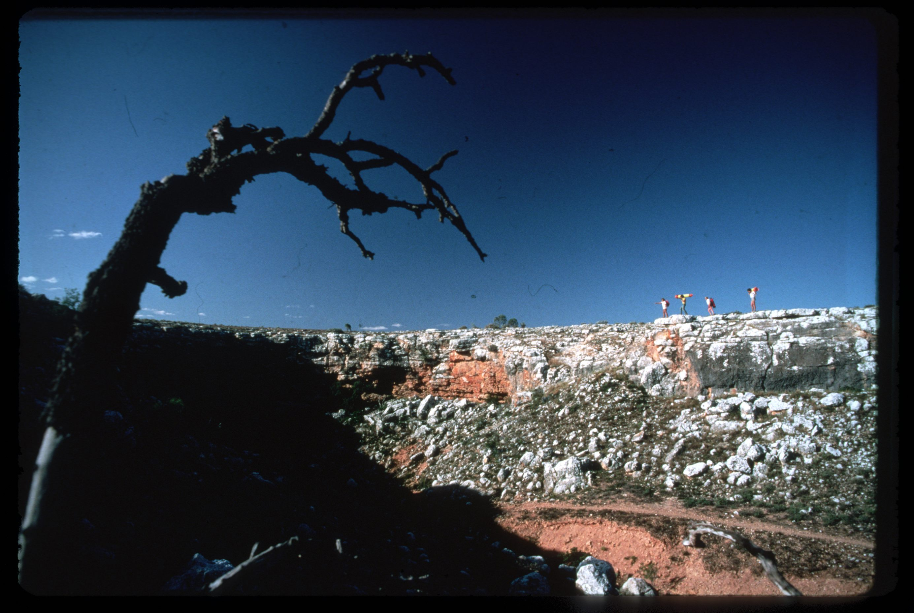
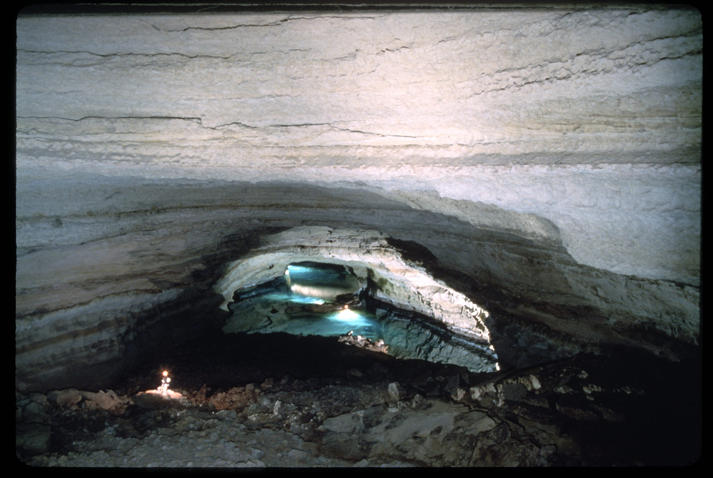
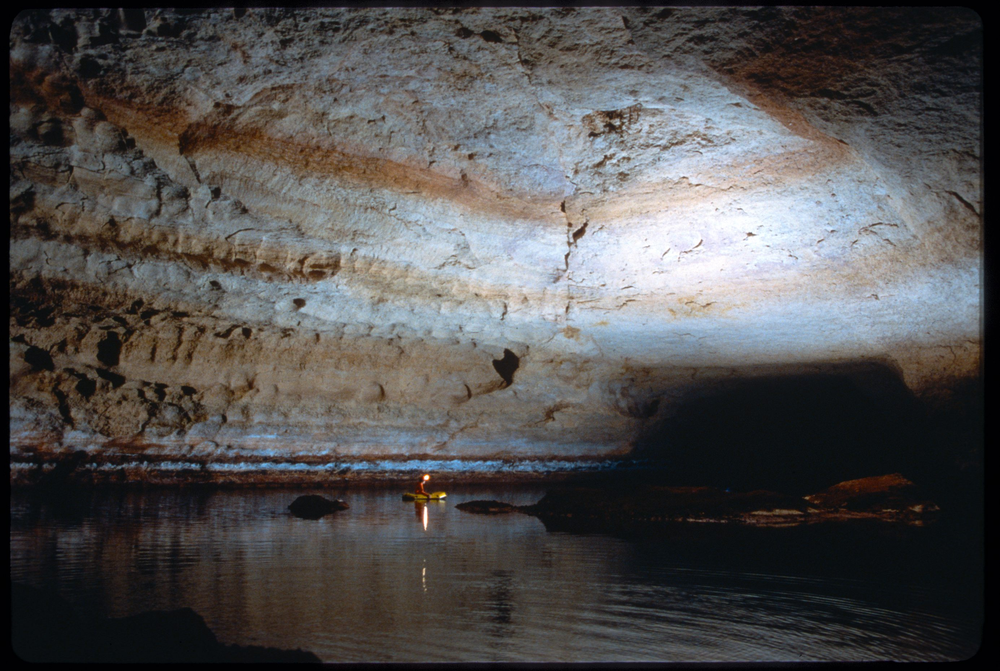
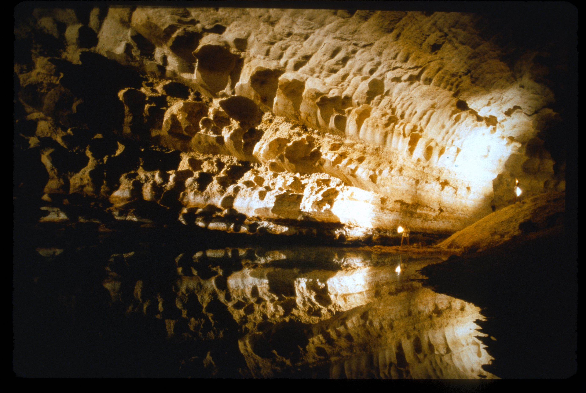
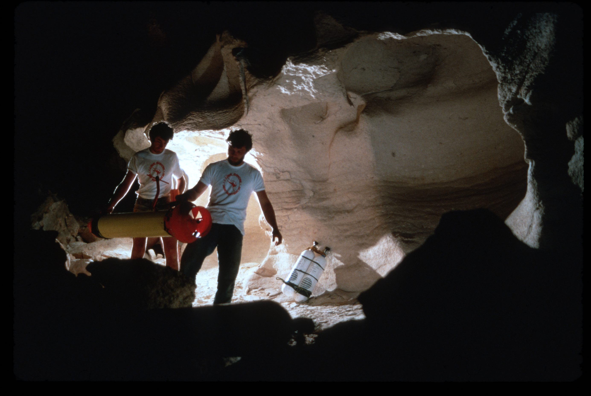
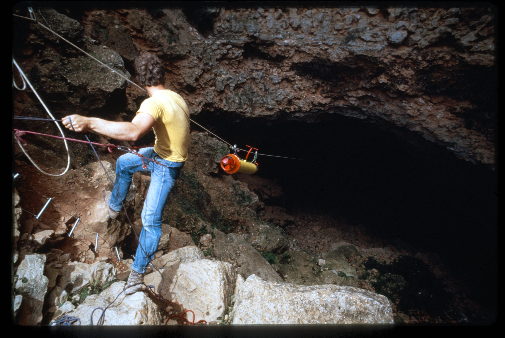
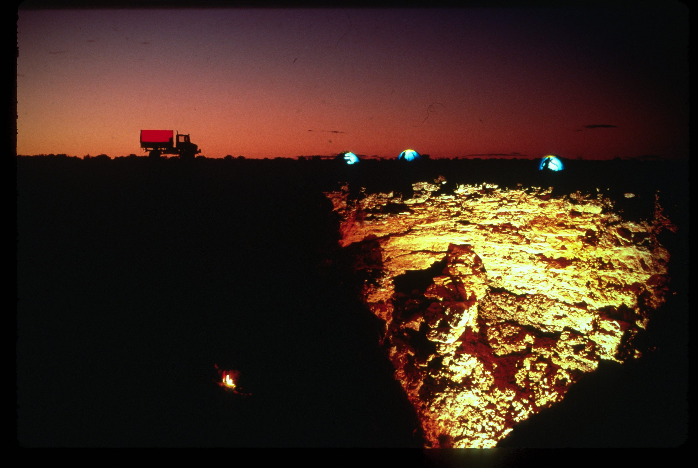
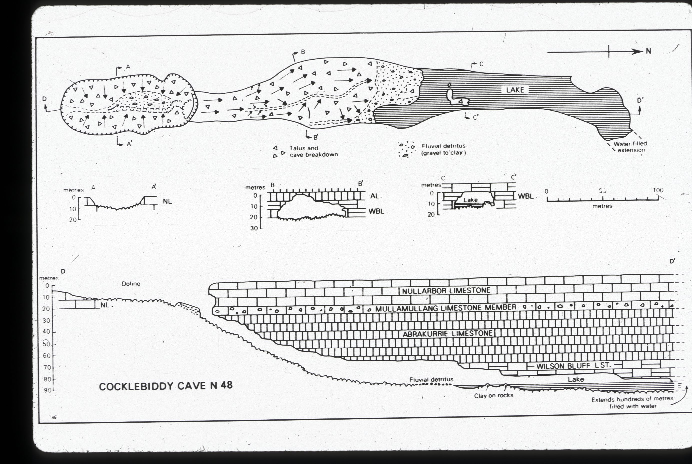

# From ASF

## About
Cocklebiddy Cave is over 6.5km long and is the longest single underwater passage in Australia. The entrance is in a degraded doline 120m long and a steep talus slope beneath overhang at the North end leads to large chamber 360 x 45 x 30m high with 180m long lake. The lake contains “mud islands”.

It is possible to snorkel the lake to look down at the first sump, the water can be muddy after rain.

The water in the cave has marked temperature layers (thermoclines) and the water level can fluctuate noticeably.

Under water, the first sump continues for 750m to the “First Rockpile”. Beyond the second sump, it is a further 2.5km to the rock pile “Toad Hall” where there is visitors slate. The cave continues in the third sump to becoming narrow joint controlled pages. 
## Access 
The cave is close to a vehicle track. It is possible to camp near the cave, but site is very exposed. A typical trip into the cave would take up to 2 hours. 
## Rigging 
A hand line or ladder may be required for the free climb at the end of the muddy rock pile leading into the entrance chamber. 
## Cave Diving 
There are fixed lines in the main passages, there are some short side passages in the first sump. The first sump has a reputation of being a bit dirty for the first few hundred metres especially after rain. A familiarisation trip into the cave would be typically to dive to the “First Rockpile” and have a look at the second sump. This is about 750m from the entrance.

It is possible use tripods to lower gear from the high side of the doline to reduce transporting of gear down the steep talus slope. Rigging to a vehicle is the best option for anchoring the tripod from this point. 
## Land use 
The cave is on Nuytsland Nature Reserve, and specific permission is required to visit the cave.

# About

### Cocklebiddy Cave: A Hidden Gem in the Nullarbor
Located in the vast expanse of the Nullarbor karst, the largest arid area of limestone in the world, lies a hidden gem known as the Cocklebiddy Cave. This cave is one of the hundreds that dot the Nullarbor landscape, but it stands out for its unique features and fascinating history.
### A Cave of Epic Proportions
The entrance to the Cocklebiddy Cave is a collapsed doline, a sinkhole created when the cave roof gave way. This collapse revealed a system of massive underground caverns and more than six kilometers of underwater passages. The cave system extensively penetrates an aquifer lying 90 meters below the Nullarbor Plain.

Within the cave, you can find vast limestone caverns, rockfalls, and saline subterranean lakes that extend for several hundred meters. However, access to the cave is not open to the public due to its delicate ecosystem and the potential dangers associated with cave exploration.
### A Site of World Records
Cocklebiddy Cave has gained international recognition as a site for one of the world’s largest cave systems. In August 1983, a French caving expedition set a world record by exploring the Cocklebiddy Cave to an unprecedented distance of 6.4 kilometers. This record was later broken in 1995 by an Australian named Christopher Brown, who bettered the 1983 record by a mere 20 meters.
### A Rich History
During World War II, Australian Army engineers attempted to tap water supplies from Cocklebiddy’s vast underground lakes. However, their attempts proved in vain as they discovered that a thin skin of fresh water overlay a much greater volume of highly saline lake waters.
### A Must-Visit for the Adventurous
While the Cocklebiddy Cave is a marvel of nature, caving in the area is recommended only for highly organized and experienced caving groups. For those who prefer to stay above ground, the area around the cave offers a wealth of information boards to read and a chance to observe the local wildlife.

In conclusion, the Cocklebiddy Cave is a testament to the wonders that lie beneath the surface of the Earth. Its vast underwater passages, rich history, and the records it holds make it a fascinating subject of study and a must-visit for any cave enthusiast.

# Maps

- N48-CEG30048
- N48-CEG1321
	- [6N48 - Cocklebiddy Part 1](../../Regions/Oceania/Australia/6N%20-%20Nullabor%20and%20Roe%20Plains/Maps/6N48%20-%20Cocklebiddy%20Part%201.jpg) (Payne)
	- [6N48 - Cocklebiddy Part 2](../../Regions/Oceania/Australia/6N%20-%20Nullabor%20and%20Roe%20Plains/Maps/6N48%20-%20Cocklebiddy%20Part%202.jpg) (Payne)
	- [6N48 - Cocklebiddy Part 3](../../Regions/Oceania/Australia/6N%20-%20Nullabor%20and%20Roe%20Plains/Maps/6N48%20-%20Cocklebiddy%20Part%203.jpg) (Payne)

# Source notes

* [Dive Addiction - Joseph Bicanic](https://www.diveaddiction.me/)
* [“Cocklebiddy - Alpine Style”](https://cdg.caves.org.au/CDG-Articles/Articles/S-EBERHARD-CocklebiddyAlpineStyle1998.pdf) (CCR & DPV)
- [Cocklebiddy - Drone Model - Top View](../../Assets/cf6360e0a1982673018f4550f3f18fcc048347cb3e520572370eaf94aa88b66b.jpg) (Richards)
- [Cocklebiddy - Drone Model - Side view](../../Assets/3d60fe14ff5d7bc2fd7dab8ddc2abdf0af96e8af460a14e51bd6e3d8bba0a717.jpg) (Richards)

# Images

- [6N48 - Cocklebiddy Cave - 2019-01-09 06.28.36 - 84b2c69c-c3fffd30](../../Assets/be6d654c31490dc83af000ed3cf300cf1538587f8774015a9e5dc4171d7660ab.jpg)
- [6N48 - Cocklebiddy Cave - 2019-01-09 06.48.53 - 400a365a-c3fffd30](../../Assets/74d839cb9df4a5987f1f5212cdb66af6c9d9f0fc94a2226cd89eff9646d93b66.jpg)
- [6N48 - Cocklebiddy Cave - 2019-01-09 06.52.17 - 6ab1fca4-c3fffd30](../../Assets/609a74e54b6a7a404ccfe8f8ce9ffe8b842e3bd13331bf4639cf36bd39f26405.jpg)
- [6N48 - Cocklebiddy Cave - 2019-01-09 06.52.55 - e52738b0-c3fffd30](../../Assets/72e8d0dc555d9edc8855f9982349a57233520852a8416e815d397107c44d828e.jpg)

<!-- ASF slide images: start -->
## ASF slide images

Images are from the ASF Joe N. Jennings slide catalogue. Each caption preserves the catalogue description and links to its source record.

*ASF Joe N. Jennings slide catalogue, JNJ-S-1010-01, Box 1010. Catalogue description: Cocklebiddy - Copyright by F. Le Guen. [ASF record](https://st1.asflib.net/MEDIA/ASFJJSlidesCatalogue/Box%201010/JNJ-S-1010-01.html).*

*ASF Joe N. Jennings slide catalogue, JNJ-S-1010-02, Box 1010. Catalogue description: Cocklebiddy - Copyright by F. Le Guen. [ASF record](https://st1.asflib.net/MEDIA/ASFJJSlidesCatalogue/Box%201010/JNJ-S-1010-02.html).*

*ASF Joe N. Jennings slide catalogue, JNJ-S-1010-03, Box 1010. Catalogue description: Cocklebiddy - Copyright by F. Le Guen. [ASF record](https://st1.asflib.net/MEDIA/ASFJJSlidesCatalogue/Box%201010/JNJ-S-1010-03.html).*

*ASF Joe N. Jennings slide catalogue, JNJ-S-1010-04, Box 1010. Catalogue description: Cocklebiddy Lake - Copyright by F. Le Guen. [ASF record](https://st1.asflib.net/MEDIA/ASFJJSlidesCatalogue/Box%201010/JNJ-S-1010-04.html).*

*ASF Joe N. Jennings slide catalogue, JNJ-S-1010-05, Box 1010. Catalogue description: Cocklebiddy - Copyright by F. Le Guen. [ASF record](https://st1.asflib.net/MEDIA/ASFJJSlidesCatalogue/Box%201010/JNJ-S-1010-05.html).*

*ASF Joe N. Jennings slide catalogue, JNJ-S-1010-06, Box 1010. Catalogue description: Cocklebiddy - Copyright by F. Le Guen. [ASF record](https://st1.asflib.net/MEDIA/ASFJJSlidesCatalogue/Box%201010/JNJ-S-1010-06.html).*

*ASF Joe N. Jennings slide catalogue, JNJ-S-1010-07, Box 1010. Catalogue description: Camp above Cocklebiddy - Copyright by F. Le Guen. [ASF record](https://st1.asflib.net/MEDIA/ASFJJSlidesCatalogue/Box%201010/JNJ-S-1010-07.html).*

*ASF Joe N. Jennings slide catalogue, JNJ-S-1011-05, Box 1011. Catalogue description: Map - N48 Cocklebiddy cave. [ASF record](https://st1.asflib.net/MEDIA/ASFJJSlidesCatalogue/Box%201011/JNJ-S-1011-05.html).*

<!-- ASF slide images: end -->

# References

- [4f9d80ff-8957-4585-9fcc-7ee072d9fc0e](https://www.youtube.com/watch?v=HG-yIyVxkc4)
- [67fcb056-a680-4090-bd64-f38216fed734](https://www.youtube.com/watch?v=mqWC7Jb0NuI)
