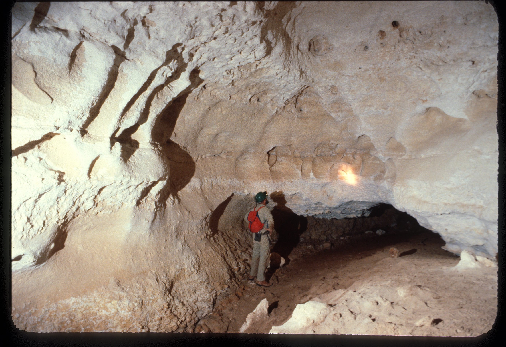
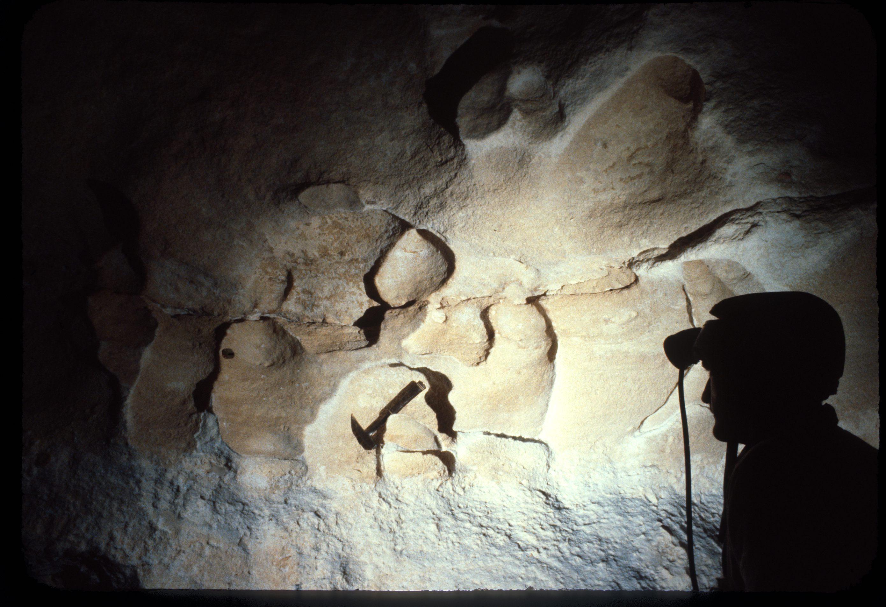
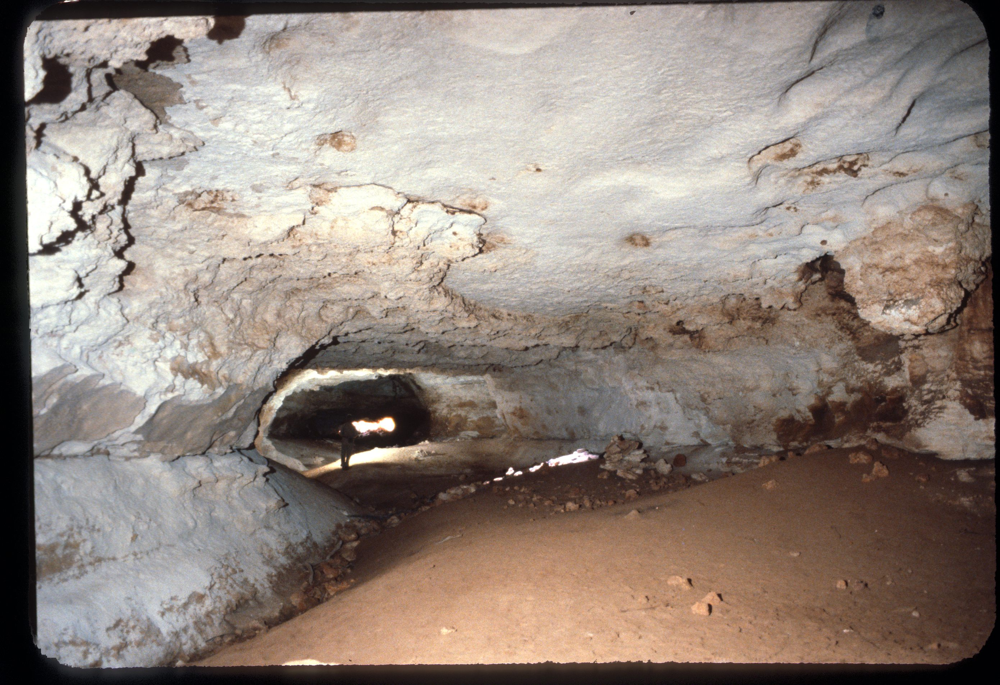

# About

access track is first left off road from madura road house

small enterence hole to left hand side of depression. large cave with solution tube hole to surface mid way into first chamber.

cave splits into two tunnels with soft sediment on floor getting smaller as you go through. tunnels go for a few hundred meters

ASF has a cave tracker in the left hand side of the tunnel around 150m into cave.

## To Do
Dry 
Photogrammetry

## About

Dry caving site

# Images

- [Madura Cave - 20250315_112739 - 04071568-81d18626](../../Assets/988f7639bae5b504e030d6f15f1533d74fa498c30e9488129f71779605e7555b.jpg)
- [Madura Cave - 4220-20105869 - de52acf0-81d18626](../../Assets/f5bb849d3e6691483298889de11710a140bd928f4bdf647517f02519cce46844.jpg)
- [Madura Cave - Drone facing North - 63fd556d-81d18626](../../Assets/b6ae3e602dcedbc8163f03475f5f4d1e26d70048bf5f7bd2179e919f5f75d309.jpg) — MW
- [Madura Cave - IMG_2085 - 1c20c8d8-81d18626](../../Assets/f8b7a319751cb6eee3f7da83413a6f703f7e88488f3a1d4b06b713044f69fe02.jpeg)
- [Madura Cave - IMG_2090 - 41fea801-81d18626](../../Assets/c7e3c1c2fd36e967ad583e975bf22f71696e5bed39ffeade64d16341d69edc8a.jpeg)
- [Madura Cave - IMG_2094 - 5f5d43c8-81d18626](../../Assets/5fd749a3c1666cabebc852ff6d3f9a1dd39853804d86878966f6d8148d73d022.jpeg)
- [Madura Cave - IMG_2095 - c2d04fe6-81d18626](../../Assets/2c01fdf231b7d818a99d24d5a710bc2177d9f1370179d3be48c090a3c1c7909a.jpeg)
- [Madura Cave - IMG_2097 - ef037fc7-81d18626](../../Assets/23d9f8ab95fdf6ac991ab40e30d25e5937594101819335ff1916484c3275114c.jpeg)

- [Madura Cave - Drone facing North - 63fd556d-81d18626](../../Assets/b6ae3e602dcedbc8163f03475f5f4d1e26d70048bf5f7bd2179e919f5f75d309.jpg)

<!-- ASF slide images: start -->
## ASF slide images

Images are from the ASF Joe N. Jennings slide catalogue. Each caption preserves the catalogue description and links to its source record.

*ASF Joe N. Jennings slide catalogue, JNJ-S-00063, Box 37. Catalogue description: Madura Cave - Apse at junction with Tafoni. [ASF record](https://st1.asflib.net/MEDIA/ASFJJSlidesCatalogue/Box%2037/JNJ-S-00063.html).*

*ASF Joe N. Jennings slide catalogue, JNJ-S-00071, Box 37. Catalogue description: Tafoni (rock formation) Madura Cave. [ASF record](https://st1.asflib.net/MEDIA/ASFJJSlidesCatalogue/Box%2037/JNJ-S-00071.html).*

*ASF Joe N. Jennings slide catalogue, JNJ-S-00072, Box 37. Catalogue description: Madura Cave first passage. [ASF record](https://st1.asflib.net/MEDIA/ASFJJSlidesCatalogue/Box%2037/JNJ-S-00072.html).*

<!-- ASF slide images: end -->
