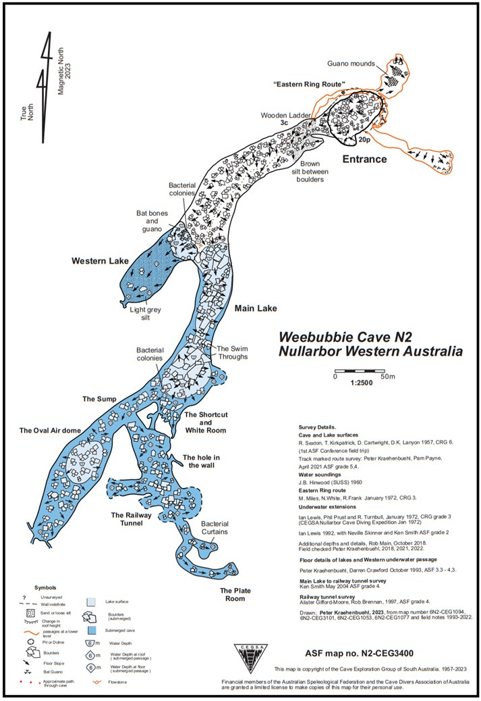
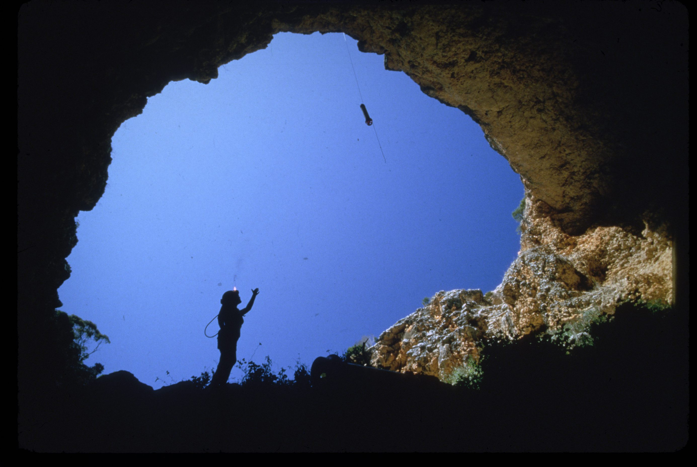
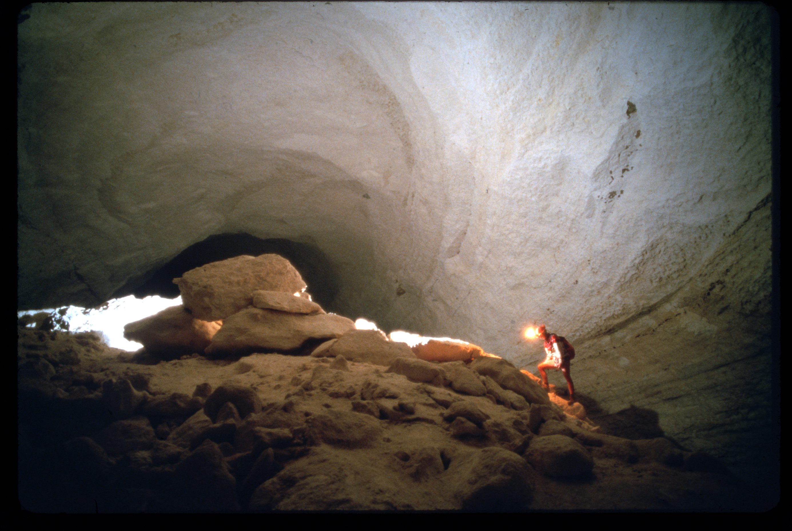
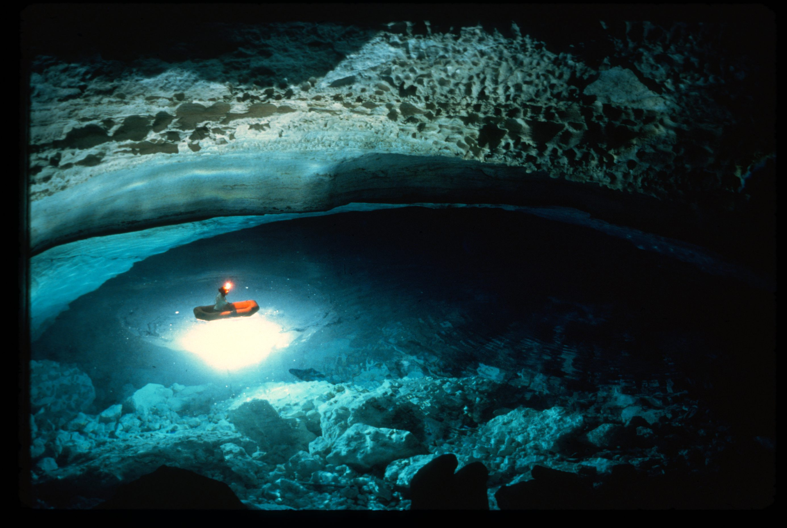
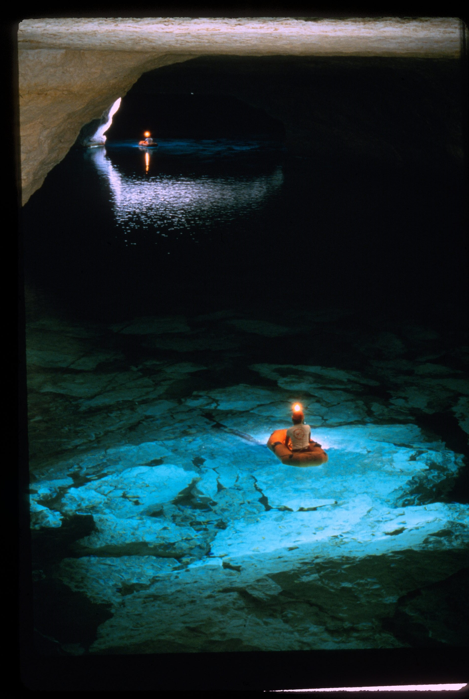
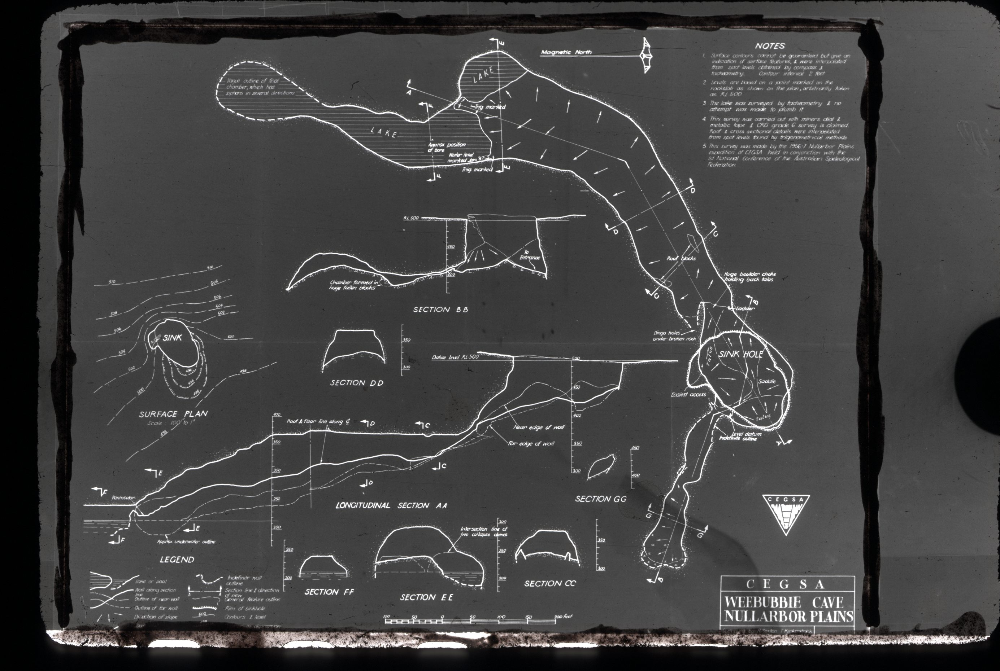
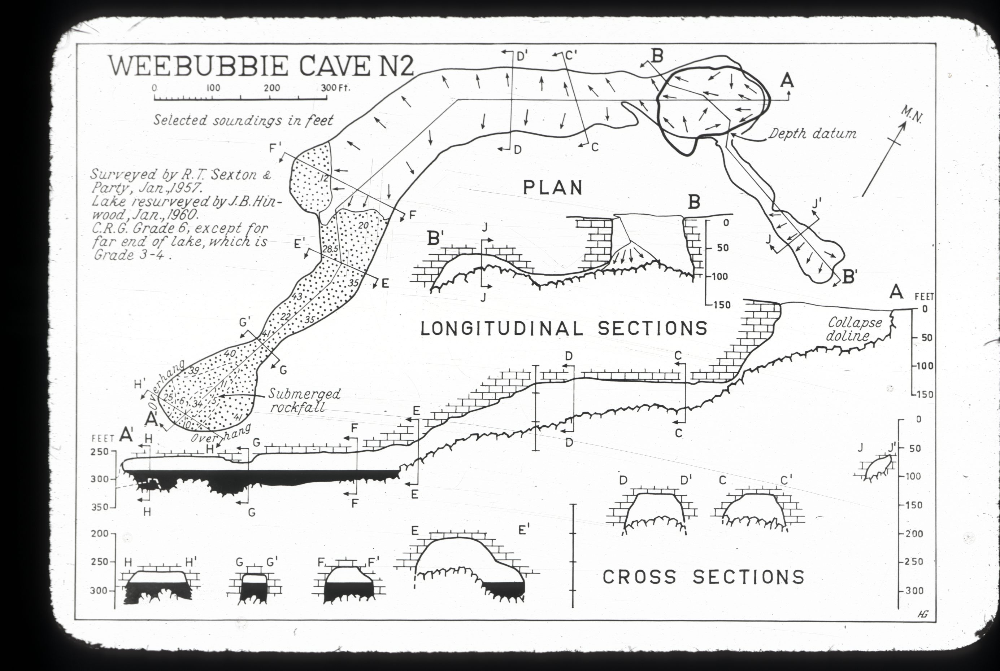

# About

Depth:       40+ metres (130+’)
Visibility:    30+ metres (100+’)
Water temperature:  17-19°C (63-66°F)

## About
Description: The entrance to Weebubbie Cave is a large doline 45m in diameter, with a boulder “saddle” at its base. A large main passage with a broken rock floor leads to two lakes at 84m below the surface. The route through the cave is track marked with reflective markers. The cave contains bats and bacterial colonies.

Most visitors spend time at the main lake which has water so clear it is easy to accidently step into the water at the lakes edge. The ridge between the two lakes is a convenient place to change if you are snorkelling the lake. With care, it is possible to see some bacterial colonies under boulders while snorkelling in the smaller, Western lake.

The cave continues at end of main lake to a large sump which leads to dome-shaped airspace 100m along the sump with more submerged passage beyond the air dome.

Before the air dome, the cave branches to the left along “the railway tunnel” which continues under water for about 300m to a depth of 42m. There are bacterial colonies in several places underwater, including curtains in the left hand end of the railway tunnel.

Closer to the entrance there are two passages from doline which have decoration and bats. The “Eastern ring route” has large guano mounds. These are not commonly visited.

## Access 
A typical trip to visit the cave takes four hours. Many groups take snorkelling equipment and water proof lights to snorkel the main lake, a wetsuit is usually needed as the water temperature is 18° C.

## Rigging 
The main access point, is on the North-Western side where the old fixed ladders were. A 20m ladder or SRT is required. A fixed wooden ladder is in place at the base of the doline.

It is also possible to abseil in from the point (Southern end) of the doline, which is 50m.

Rigging off a vehicle is the best option foranchors. Rigging of the 50m abseil is from trees set back from the edge.

## Cave Diving 
There are track markers showing the easiest route through the cave when carrying heavy gear. The lake is large and can suit larger sized diving parties. There is a limit of 10 visitors at a time to the cave.

There are fixed lines from the old bore pipe in the main lake, to the oval air dome and to the railway tunnel. There are two lines in the railway tunnel, the Southern line ends abruptly. There is a fixed line through the shortcut, with jumps marked on the main line. The fixed lines are in need of evision, as the two lines in the railway tunnel could cause confusion.

Many groups use tripods to lower gear from the Southern side of the doline, which can be secured to trees set back from the edge. This edge has a vertical drop of approximately 50m, to the boulders in the doline. 
## Land use 
The cave is on Crown Land, and specific permits required to visit the cave.

# Maps

N2-CEG1053

N2-CEG1094

N2-CEG1094

N2-CEG8104
N2-CEG3400

# Images

- [6N2 - Weebubbie Cave - n327-u1_0 - a4e9ba09-47e1d564](../../Assets/febc1ce215ec97fc3cc968f6c9ae9e765289e7b792fc637c1bb5c9d46795ab2f.jpg)
- [6N2 - Weebubbie Cave - WEEBUBBIE-CAVE-5 - d8e10eca-47e1d564](../../Assets/75bfa48b9904132e30cea907fcd07d078d4eb45228ec2a46f9bc8ab981014e78.jpg)
- [6N2 - Weebubbie Cave - WEEBUBBIE-CAVE-m - e74123d7-47e1d564](../../Assets/ef371d5e906dfb381c8872a1a57c531d975eb612a9f350da14cd858598f80fb0.png)

<!-- ASF slide images: start -->
## ASF slide images

Images are from the ASF Joe N. Jennings slide catalogue. Each caption preserves the catalogue description and links to its source record.

*ASF Joe N. Jennings slide catalogue, JNJ-S-1010-17, Box 1010. Catalogue description: Weebubbie cave - Copyright by F. Le Guen. [ASF record](https://st1.asflib.net/MEDIA/ASFJJSlidesCatalogue/Box%201010/JNJ-S-1010-17.html).*

*ASF Joe N. Jennings slide catalogue, JNJ-S-1010-18, Box 1010. Catalogue description: Weebubbie cave - Copyright by F. Le Guen. [ASF record](https://st1.asflib.net/MEDIA/ASFJJSlidesCatalogue/Box%201010/JNJ-S-1010-18.html).*

*ASF Joe N. Jennings slide catalogue, JNJ-S-1010-19, Box 1010. Catalogue description: Side lake in Weebubbie cave - Copyright by F. Le Guen. [ASF record](https://st1.asflib.net/MEDIA/ASFJJSlidesCatalogue/Box%201010/JNJ-S-1010-19.html).*

*ASF Joe N. Jennings slide catalogue, JNJ-S-1010-20, Box 1010. Catalogue description: Weebubbie cave - Copyright by F. Le Guen. [ASF record](https://st1.asflib.net/MEDIA/ASFJJSlidesCatalogue/Box%201010/JNJ-S-1010-20.html).*

*ASF Joe N. Jennings slide catalogue, JNJ-S-1011-04, Box 1011. Catalogue description: Map - Weebubbie cave. [ASF record](https://st1.asflib.net/MEDIA/ASFJJSlidesCatalogue/Box%201011/JNJ-S-1011-04.html).*

*ASF Joe N. Jennings slide catalogue, JNJ-S-1011-13, Box 1011. Catalogue description: Map - N2 Weebubbie cave. [ASF record](https://st1.asflib.net/MEDIA/ASFJJSlidesCatalogue/Box%201011/JNJ-S-1011-13.html).*

<!-- ASF slide images: end -->
