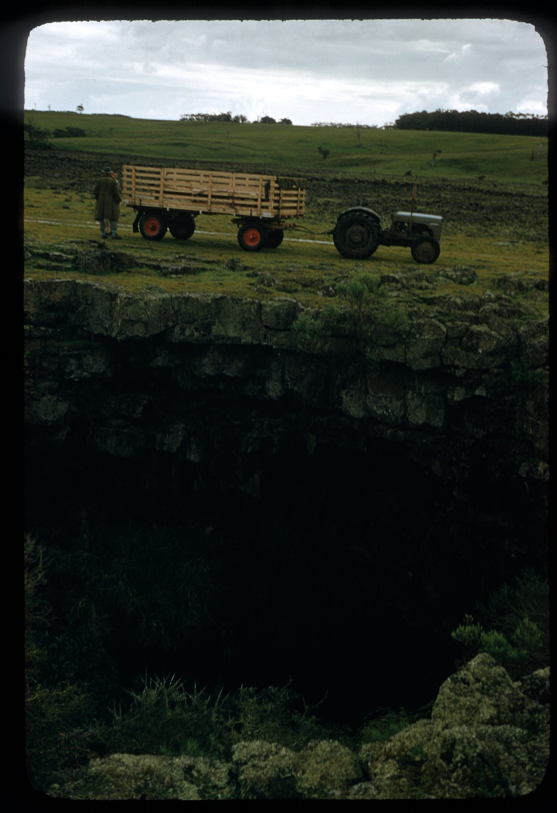
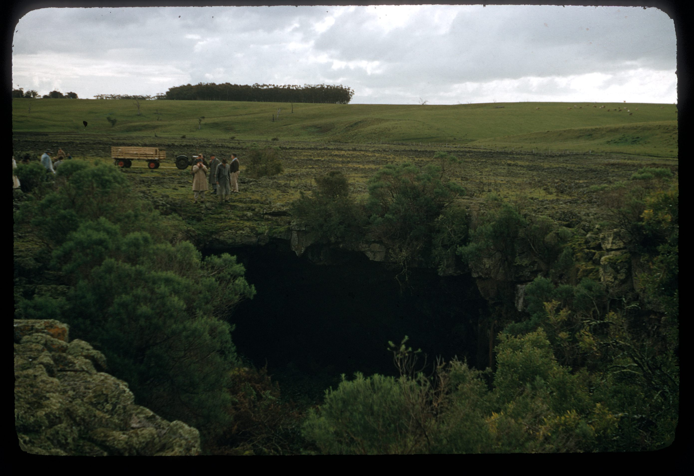
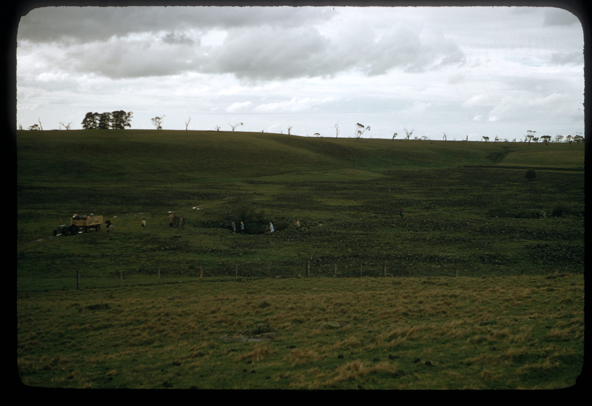
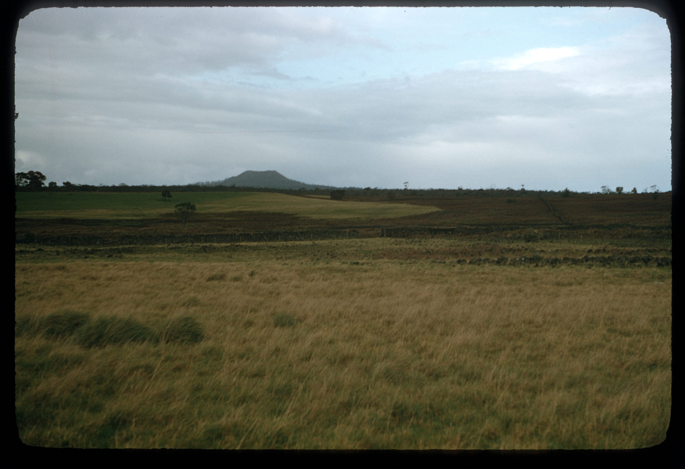
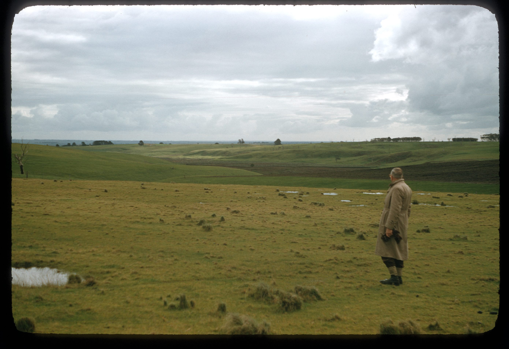
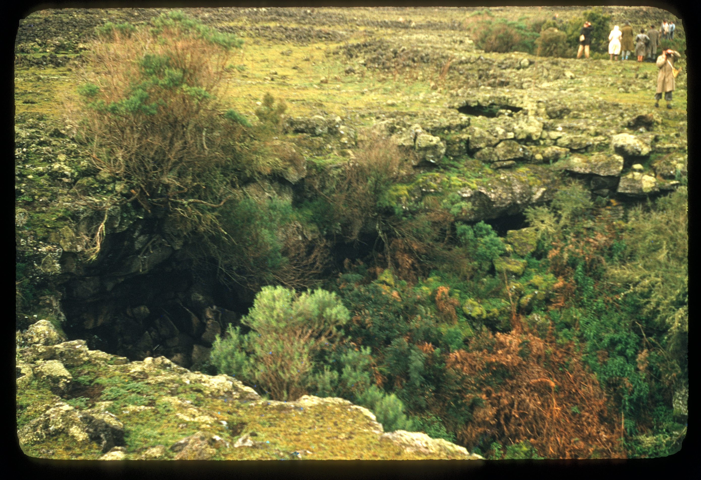

# Sub-regions

No records are included in this section of the prepared update.

# Caves

No records are included in this section of the prepared update.
## ASF slide images

Images are from the ASF Joe N. Jennings slide catalogue. Each caption preserves the catalogue description and links to its source record.

*ASF Joe N. Jennings slide catalogue, JNJ-S-00076, Box 38. Catalogue description: Lava cave, Byaduk. [ASF record](https://st1.asflib.net/MEDIA/ASFJJSlidesCatalogue/Box%2038/JNJ-S-00076.html).*

*ASF Joe N. Jennings slide catalogue, JNJ-S-00163, Box 42. Catalogue description: Lava cave, Byaduk. [ASF record](https://st1.asflib.net/MEDIA/ASFJJSlidesCatalogue/Box%2042/JNJ-S-00163.html).*

*ASF Joe N. Jennings slide catalogue, JNJ-S-00306, Box 48. Catalogue description: Lava caves in valley near Byaduk. [ASF record](https://st1.asflib.net/MEDIA/ASFJJSlidesCatalogue/Box%2048/JNJ-S-00306.html).*

*ASF Joe N. Jennings slide catalogue, JNJ-S-00307, Box 48. Catalogue description: Mount Napier and lava flow into Byaduk valley. [ASF record](https://st1.asflib.net/MEDIA/ASFJJSlidesCatalogue/Box%2048/JNJ-S-00307.html).*

*ASF Joe N. Jennings slide catalogue, JNJ-S-00308, Box 48. Catalogue description: Byaduk. [ASF record](https://st1.asflib.net/MEDIA/ASFJJSlidesCatalogue/Box%2048/JNJ-S-00308.html).*

*ASF Joe N. Jennings slide catalogue, JNJ-S-00309, Box 48. Catalogue description: Lava cave, Byaduk. [ASF record](https://st1.asflib.net/MEDIA/ASFJJSlidesCatalogue/Box%2048/JNJ-S-00309.html).*
