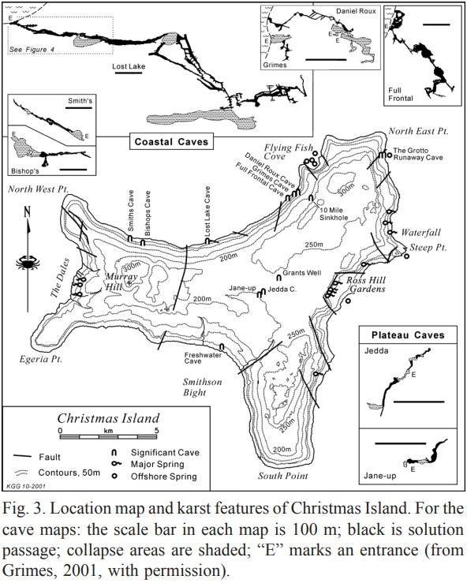

# Sub-regions

No records are included in this section of the prepared update.

# Caves

- [Daniel Roux Cave](../Christmas%20Island/Daniel%20Roux%20Cave.md)
- [Hosnies Spring Cave](../Christmas%20Island/Hosnies%20Spring%20Cave.md)
- [Lost Lake Cave](../Christmas%20Island/Lost%20Lake%20Cave.md)
- [Runaway Cave](../Christmas%20Island/Runaway%20Cave.md)
- [Whip Cave](../Christmas%20Island/Whip%20Cave.md)

# About

Go in dry season: **May to November**
- Red crab migration: Oct to December
- Whale Sharks: November to January
2 flights per week from Perth
Christmas Island local radio

# Cave Notes

[Whip Cave](../Christmas%20Island/Whip%20Cave.md)? [Runaway Cave](../Christmas%20Island/Runaway%20Cave.md)?

### The Dales
- **Location**: Western coast, near Hugh’s Dale Waterfall
- **Type**: Karst spring and stream system
- **Details**: Features spring-fed water emerging from the base of limestone cliffs. The area around _Hugh’s Dale_ and _Anderson Dale_ may be connected to subterranean water systems—possible **resurgence cave diving target**.
- **Exploration Status**: Surface features documented; no known underwater exploration.   
### Waterfall Cave / Runoff Sites (Unnamed)
- **Location**: North-west coast cliffs between _Martin Point_ and _Ethel Beach_
- **Type**: Sea caves and freshwater outflows
- **Details**: Rainfall channels sometimes discharge clear freshwater through cliffs, indicating potential connections to **karst drainage** systems that could be explored from the sea side via cave diving.
- **Exploration Status**: Not documented or surveyed for cave access, but satellite imagery shows several sea-level notches. 
### Dolly Beach & Greta Beach Karst System
- **Location**: South-east coast
- **Type**: Cliff-edge karst with marine influence
- **Details**: Both beaches are bordered by steep limestone with visible dissolution features. No documented caves, but the **geological setting is favourable for sea cave development**, possibly with partially submerged access.
- **Exploration Status**: No known surveys, but suitable for scouting.

# Maps

# Additional Notes

"The WASG Christmas Island Expedition 2018, supported by Curtin University and the Ecological Society of Western Australia, aimed to conduct an extensive stygofauna survey of Christmas Island’s subterranean ecosystems through the power of environmental DNA metabarcoding – a new genetic detection technology. Unlike many traditional surveying techniques, eDNA metabarcoding does not require direct contact with organisms and is therefore an ideal alternative method for locating elusive taxa and monitoring biodiversity in difficult-to-survey locations. As such, there is increasing interest in the use of eDNA metabarcoding as a complementary surveying tool in subterranean environments, such as cave systems. Christmas Island is one of Australia’s external territories located in the Indian Ocean and boasts extensive subterranean and submarine ecosystems that are understudied (Humphreys 2014), making it an ideal location to test the utility of eDNA metabarcoding for surveying stygofauna.

In assistance to Katrina West, a Curtin PhD student whose research focuses on the development of this technology, water and sediment samples were collected from 23 sites, including within caves and surface springs, across Christmas Island. These samples were then transported back to Curtin University, Perth to undergo further laboratory processing and determine, through the DNA present in the samples, what types of stygofauna inhabit these subterranean ecosystems. In addition, water parameters such as pH, temperature, conductivity, salinity, air saturation and dissolved oxygen were also measured on site, to determine if the community composition of stygofauna at various sites corresponds to these measures. The project aims to further develop and give prominence to the use of eDNA metabarcoding for subterranean surveying."
- PhD Thesis: https://curate.curtin.edu.au/articles/thesis/The_development_and_application_of_eDNA_metabarcoding_for_aquatic_biomonitoring_in_Australia_s_Indian_Ocean_region/31709806?file=62764618
	- Offline copy [Development and application of eDNA metabarcoding for aquatic biomonitoring in Australias Indian Ocean region (K West - 2020)](../../Assets/bade0bd0f5ad6b6be27db28e898decb31650832b3e61e5c11075926a421d2ddb.pdf)

# Source notes

Satellite Imagery & Karst Mapping
- **Geoscience Australia**: Offers detailed topographic and geological maps, including the 1:30,000 scale map that highlights karst features and cave locations. [ga.gov.au](https://www.ga.gov.au/static/christmas/metadata/30k_natmap_data.html?utm_source=chatgpt.com) 
- **NASA Worldview**: Provides high-resolution satellite imagery, allowing you to examine surface features and terrain. [ga.gov.au+5earth.google.com+5zoom.earth+5](https://earth.google.com/intl/en-US/?utm_source=chatgpt.com)
- **Zoom Earth**: Features daily updated satellite images, useful for observing current conditions and planning field activities. [zoom.earth+1worldview.earthdata.nasa.gov+1](https://zoom.earth/maps/satellite-hd/?utm_source=chatgpt.com)

- [Paper - Karst Features of Christmas Island - K. Grimes](../../Assets/3e625dc3e9f23fe8f4de35b858301975dbec2ec141b2e7edace3177d24ffa896.pdf) & [Online](https://helictite.caves.org.au/pdf1/37.2.Grimes.pdf?utm_source=chatgpt.com)

- ASF Library - Christmas Island
	- [Caves](http://st1.asflib.net/MEDIA/ASF-CD/ASF-M-00027/HRK/6CI/Photos/indexCIC.htm) 
	- [Surface Features](http://st1.asflib.net/MEDIA/ASF-CD/ASF-M-00027/HRK/6CI/Photos/indexCIK.htm)

Expeditions
- **2013 National Geographic Expedition**: [advanceddivermagazine.com](https://www.advanceddivermagazine.com/articles/christmasisland.html) (March 2013, with Wet mules)
- [CavesAustralia-227](../../Assets/ff23cd78e945dd2050e4221363e8764daaf1e91e062e04da563a104262d17306.pdf) (Feb-2024) pg 38
	- https://wasg.org.au/christmas-island-2023
- [CavesAustralia-208](../../Assets/cc3265dac5d3a07d24ffd4d2caf3c6c032b7335736cd88616d88df454d99b48f.pdf) (June-2019) pg 13 (eDNA sampling)
	- https://wasg.org.au/christmas-island-2018

- Christmas.net.au
- Divingchristmas.com

# References

- [Paper - The History of Christmas Island and the Management of it's Karst Features - P. Meek](../../Assets/0b547865cb72a8612b209bdc43a522876704b6533e1f8fdc33bf0a6d019e7917.pdf)
- [Paper - Geochronology and Paleoposition of Christmas Island](../../Assets/1fe54f07a9e65cf28b7c48dd392dab84c097c252be091becffeea221287daf37.pdf)
- [Geosciences Australia - Christmas Island](https://www.ga.gov.au/scientific-topics/national-location-information/dimensions/remote-offshore-territories/christmas-island)
- [Geosciences Australia - Christmas Island Topo Map](https://www.ga.gov.au/static/christmas/metadata/30k_natmap_data.html)
- [Geosciences Australia - Christmas Island GIS Data - AUSLIG](https://www.ga.gov.au/static/christmas/metadata/auslig.html)
- [Geosciences Australia - Christmas Island GIS Data - Vegetation](https://www.ga.gov.au/static/christmas/metadata/veg.html)
- [Geosciences Australia - Christmas Island GIS Data - Geology](https://www.ga.gov.au/static/christmas/metadata/geology.html)
- [Geosciences Australia - Geological Fault Lineations - Christmas Island](https://catalogue.data.wa.gov.au/dataset/geological-fault-lineations-christmas-island)
- [Wikipedia - Christmas Island](https://en.wikipedia.org/wiki/Christmas_Island)
- [Wikipedia - Geology of Christmas Island](https://en.wikipedia.org/wiki/Geology_of_Christmas_Island)
- [National Parks - Christmas Island - Geology](https://christmasislandnationalpark.gov.au/discover/nature/geology/)
- [Google Earth - Christmas Island Cave Locations](https://earth.google.com/web/@-10.43872967,105.68044457,307.50265127a,10011.55477241d,35y,0h,0t,0r/data=CgRCAggBMikKJwolCiExcTVoX1ZyVGVybEJFazZSYXVGeDRpZW5iMmN5VDFrWDkgAToDCgEwQgIIAEoICN-v09cGEAE?utm_source=gnp&utm_medium=email&utm_campaign=earth_day_2026&utm_content=&authuser=0)
