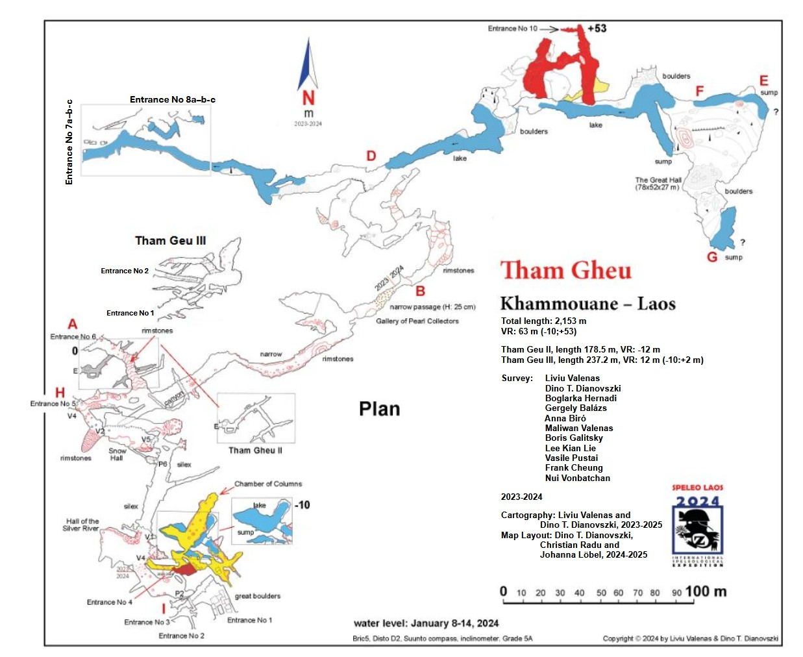

# Sub-regions

No records are included in this section of the prepared update.

# Caves

- [Nam Dôn cave system](../Laos/Nam%20D%C3%B4n%20cave%20system.md)
- [Tham Dan Makhia](../Laos/Tham%20Dan%20Makhia.md)
- [THAM NAM PHOU Cave](../Laos/THAM%20NAM%20PHOU%20Cave.md)
- [Unnamed - f4e04029](../Laos/Unnamed%20-%20f4e04029.md)

# About

Khammouane and Bolikhamxay Karst
- **Why:** Home to the vast Xe Bang Fai [River Cave](../Western%20Australia/River%20Cave.md) and dozens of other major karst systems.
- **Status:** Limited cave diving despite the presence of massive submerged river systems.
- **Potential:** Extension of dry expeditions; explore downstream sumps and hidden blue holes.
- **Best Season:** January to April.

# Cave Notes

- [Tham Gheu](https://www.facebook.com/groups/caversgroup/permalink/10161634526438639/)

# Trips

- [Liviu Valena](https://www.facebook.com/groups/2205123638/user/100008195562907/) - [Annual trips](https://www.facebook.com/groups/caversgroup/permalink/10160328662813639)
	- [2026 Expedition (Feb 16 - March 2)](https://www.facebook.com/groups/caversgroup/posts/10161121689093639/) - 990 euros/person, possible to extend to March 9
	- [THAM NAM PHOU Cave, Ban Tathot, Khammoaune,](https://www.facebook.com/groups/caversgroup/posts/10161060573258639/)
	- [Tham Tolepi](https://www.facebook.com/permalink.php?story_fbid=pfbid02jiGKMQ6YDvvaM8Xwc2NAi5hjcJxSpWDvfKV3rQhNrjFXZLwBaaDPu58T8VRCBgYWl&id=100008195562907)
---

# References

- [Instagram - Mikko Passi - Laos Expedition 2026](https://www.instagram.com/p/DVsYsSGEXGv/)
