# Sub-regions

No records are included in this section of the prepared update.

# Caves

- [Cocklebiddy Cave - 6N48](../Nullarbor%20High%20Plains/Cocklebiddy%20Cave%20-%206N48.md)
- [Madura Cave](../Nullarbor%20High%20Plains/Madura%20Cave.md)
- [Murra-El-Elevyn - 6N47](../Nullarbor%20High%20Plains/Murra-El-Elevyn%20-%206N47.md)
- [Pannikin Plains - 6N49](../Nullarbor%20High%20Plains/Pannikin%20Plains%20-%206N49.md)
- [Tommy Graham's Cave - 6N56](../Nullarbor%20High%20Plains/Tommy%20Graham%27s%20Cave%20-%206N56.md)
- [Weebubbie Cave - 6N2](../Nullarbor%20High%20Plains/Weebubbie%20Cave%20-%206N2.md)

# About

Do with Joseph Bicanic
Info From Joseph: [Murra - p1](../../Assets/ec87a8e6c9401ca908dbfdc5270b51cc880e76a4fab610fa206bf4b034d927b7.jpg), [Murra - p2](../../Assets/a3f3a71a31b918deb8818800b95e8bb63687b4b5becd654d40011a536e1d77d8.jpg) [Murra - p3](../../Assets/5cff60536514804077312b0e3c844032ebefe8f6c1212062eb4981b7f0687baf.jpg) [Murra - p4](../../Assets/c7480008bf6eb07ad152804b1b8fa214c7e3361794f999dc46c2908db72a6778.jpg) [Murra - p5](../../Assets/7b68ac13c90e431453c9013cc8b4098290c0b66facc58299471efb33b93874d1.jpg)

Invite Robyn, Mikko, Yoshi out to Roe/Cocklebiddy?
First Timer Trips: Weebubbie, Murra, Burnabbie, Tommy Graham's

# Sites

Basic Cave
Cave
Advanced Cave
- [Pannikin Plains - 6N49](../Nullarbor%20High%20Plains/Pannikin%20Plains%20-%206N49.md) - Req. CCR
- [Murra-El-Elevyn - 6N47](../Nullarbor%20High%20Plains/Murra-El-Elevyn%20-%206N47.md) - Leads to Push

# Other References

[Cave Diving Down Under - Nullarbor](https://www.cavediving.net.au/index.php/caves/?region=Nullarbor)

<!-- ASF slide images: start -->
## ASF slide images

Images are from the ASF Joe N. Jennings slide catalogue. Each caption preserves the catalogue description and links to its source record.

### 6 Mile Cave

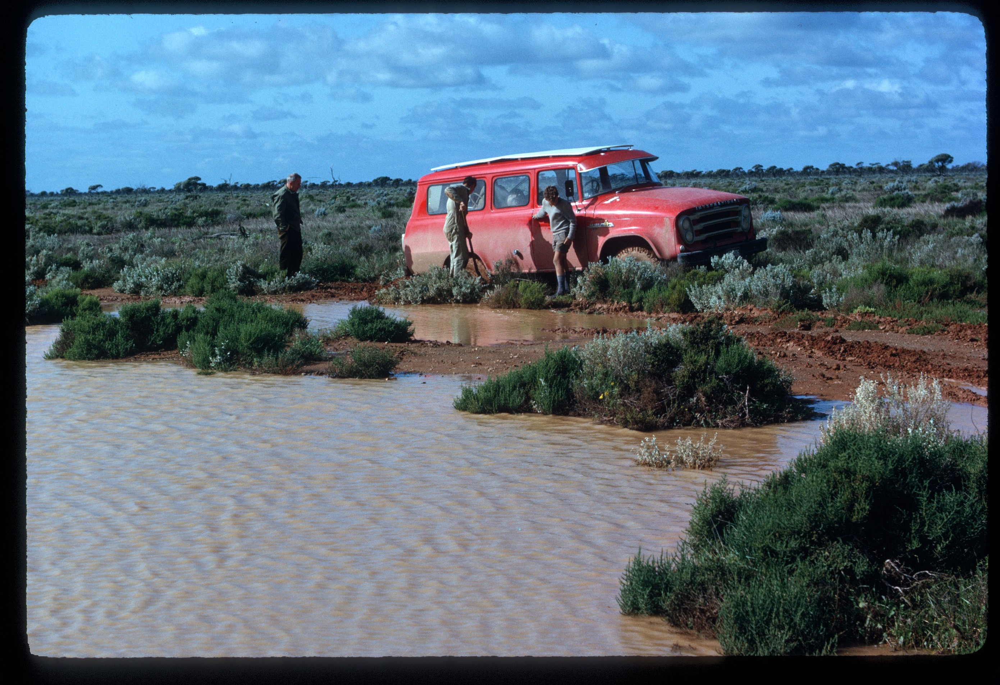
*ASF Joe N. Jennings slide catalogue, JNJ-S-00066, Box 37. Catalogue description: International truck bogged by 6 Mile Cave, Madura. [ASF record](https://st1.asflib.net/MEDIA/ASFJJSlidesCatalogue/Box%2037/JNJ-S-00066.html).*

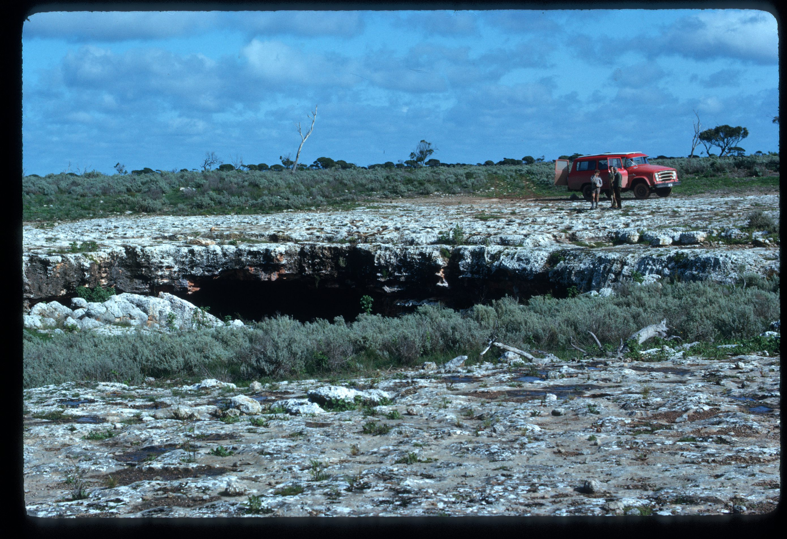
*ASF Joe N. Jennings slide catalogue, JNJ-S-00067, Box 37. Catalogue description: 6 Mile Cave, Madura, Roe Plain. [ASF record](https://st1.asflib.net/MEDIA/ASFJJSlidesCatalogue/Box%2037/JNJ-S-00067.html).*

### Kestrel No. 1 Cave

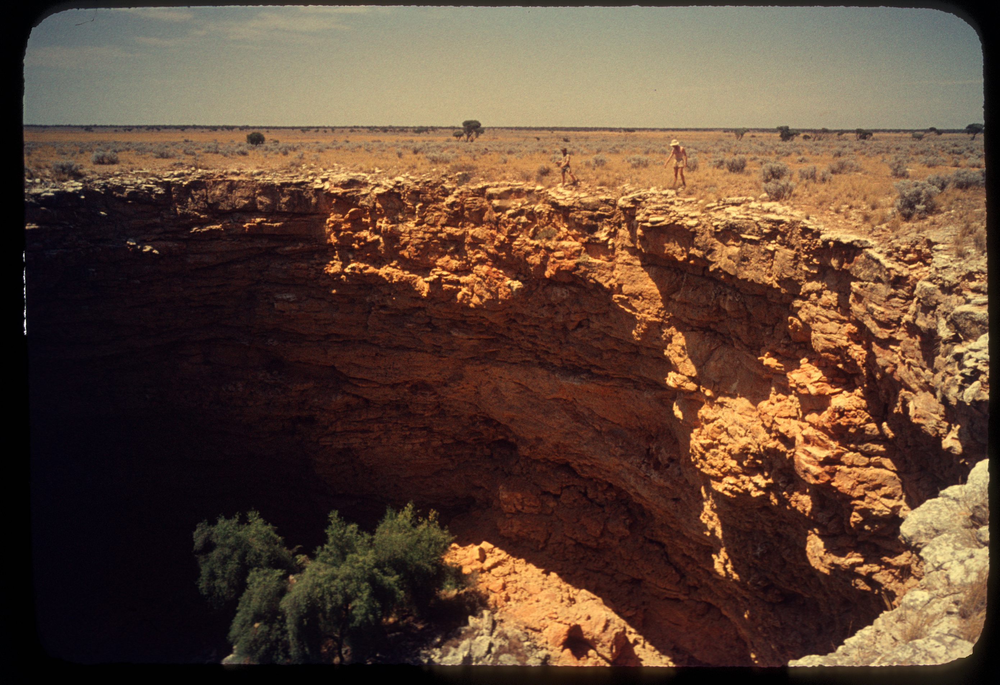
*ASF Joe N. Jennings slide catalogue, JNJ-S-00136, Box 41. Catalogue description: Kestrel No 1 Cavern Jan 1965. [ASF record](https://st1.asflib.net/MEDIA/ASFJJSlidesCatalogue/Box%2041/JNJ-S-00136.html).*

### Dogleg

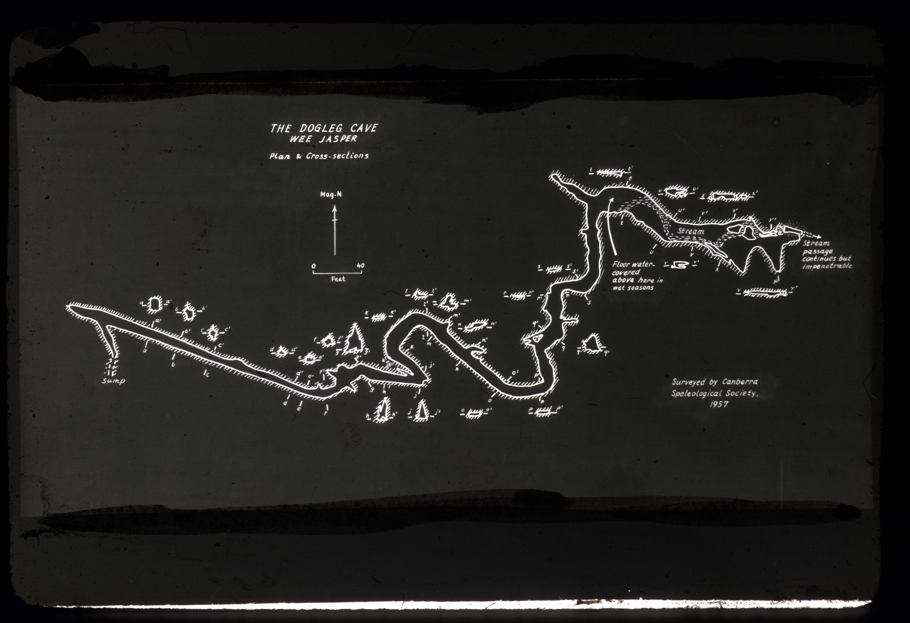
*ASF Joe N. Jennings slide catalogue, JNJ-S-00139, Box 42. Catalogue description: Plan Dogleg Cave Wee Jasper. [ASF record](https://st1.asflib.net/MEDIA/ASFJJSlidesCatalogue/Box%2042/JNJ-S-00139.html).*

### Kestral No 1

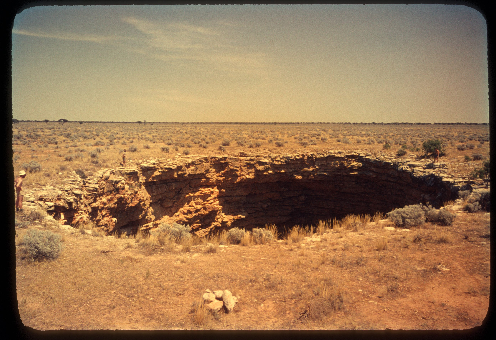
*ASF Joe N. Jennings slide catalogue, JNJ-S-00227, Box 44. Catalogue description: Kestral No 1 Cavern, Jan 1965. [ASF record](https://st1.asflib.net/MEDIA/ASFJJSlidesCatalogue/Box%2044/JNJ-S-00227.html).*

### Kestral No 2

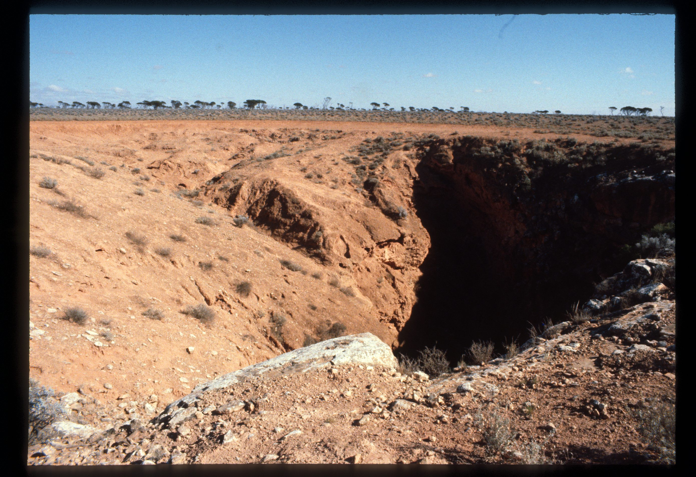
*ASF Joe N. Jennings slide catalogue, JNJ-S-00228, Box 44. Catalogue description: Kestral No 2 Cavern, Jan 1965. [ASF record](https://st1.asflib.net/MEDIA/ASFJJSlidesCatalogue/Box%2044/JNJ-S-00228.html).*

### Thylacine Hole

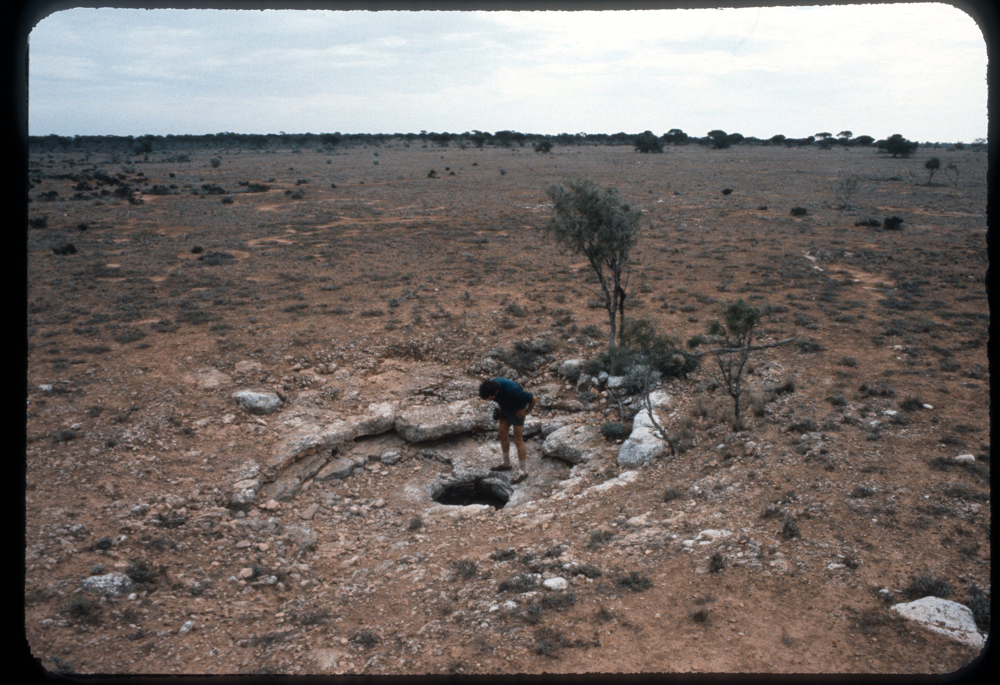
*ASF Joe N. Jennings slide catalogue, JNJ-S-1005-26, Box 1005. Catalogue description: Thylacine Hole -. [ASF record](https://st1.asflib.net/MEDIA/ASFJJSlidesCatalogue/Box%201005/JNJ-S-1005-26.html).*

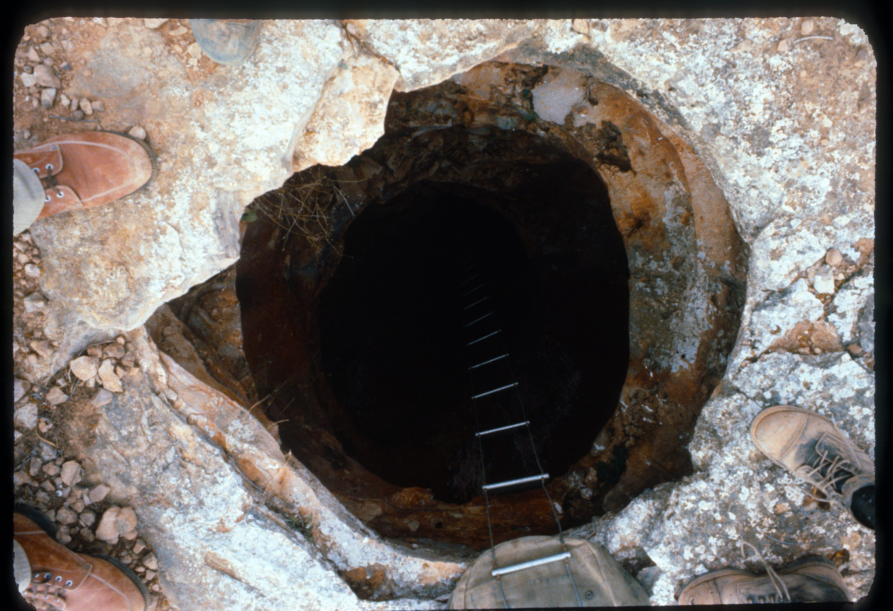
*ASF Joe N. Jennings slide catalogue, JNJ-S-1005-27, Box 1005. Catalogue description: Thylacine Hole -. [ASF record](https://st1.asflib.net/MEDIA/ASFJJSlidesCatalogue/Box%201005/JNJ-S-1005-27.html).*

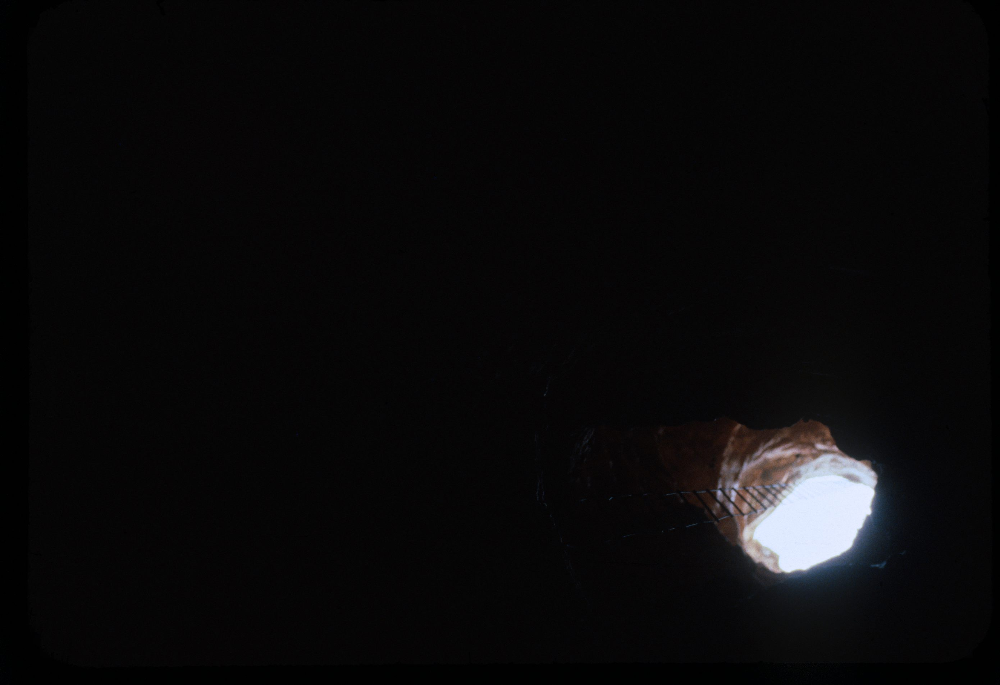
*ASF Joe N. Jennings slide catalogue, JNJ-S-1005-28, Box 1005. Catalogue description: Thylacine Hole -. [ASF record](https://st1.asflib.net/MEDIA/ASFJJSlidesCatalogue/Box%201005/JNJ-S-1005-28.html).*

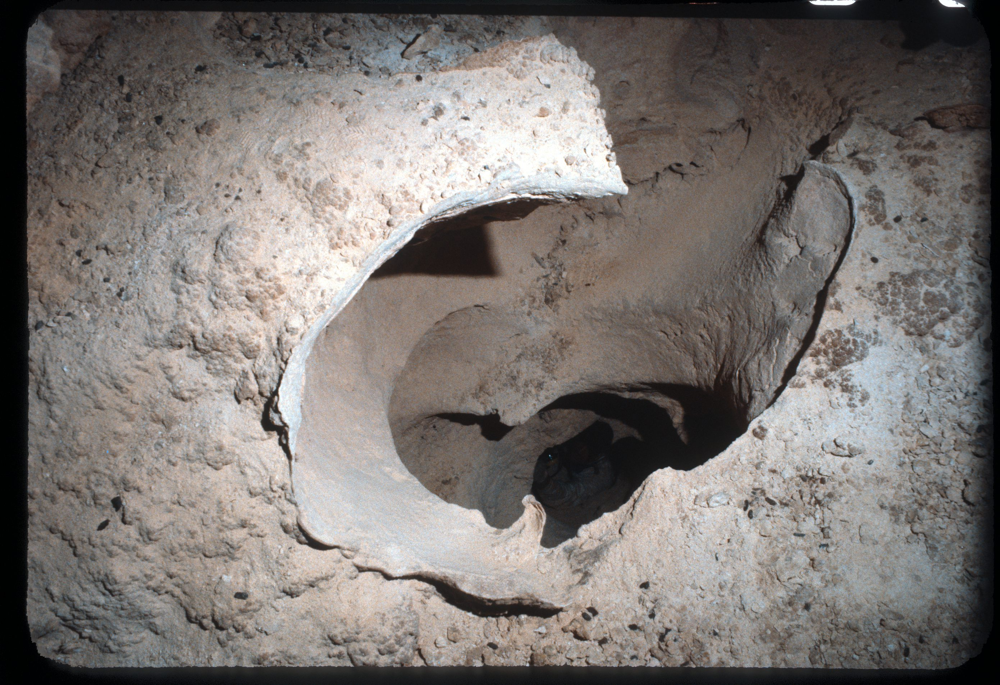
*ASF Joe N. Jennings slide catalogue, JNJ-S-1005-29, Box 1005. Catalogue description: Thylacine Hole - Crusted surface to tube. [ASF record](https://st1.asflib.net/MEDIA/ASFJJSlidesCatalogue/Box%201005/JNJ-S-1005-29.html).*

### Snake Pit

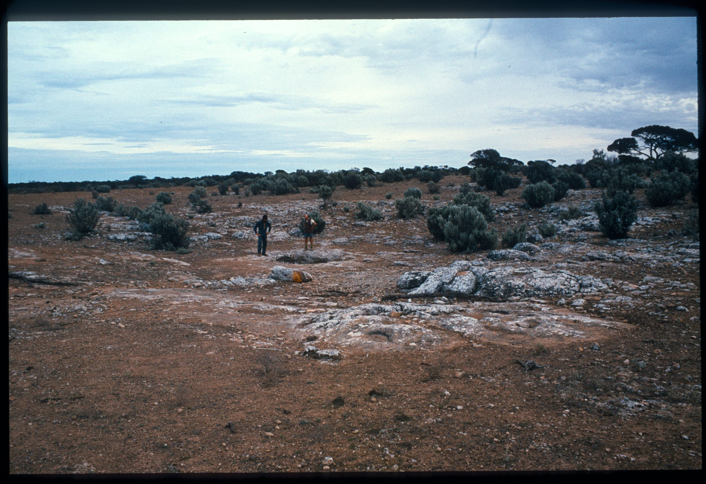
*ASF Joe N. Jennings slide catalogue, JNJ-S-1006-18, Box 1006. Catalogue description: Snake Pit - Doline. [ASF record](https://st1.asflib.net/MEDIA/ASFJJSlidesCatalogue/Box%201006/JNJ-S-1006-18.html).*

### Wigunda Gate

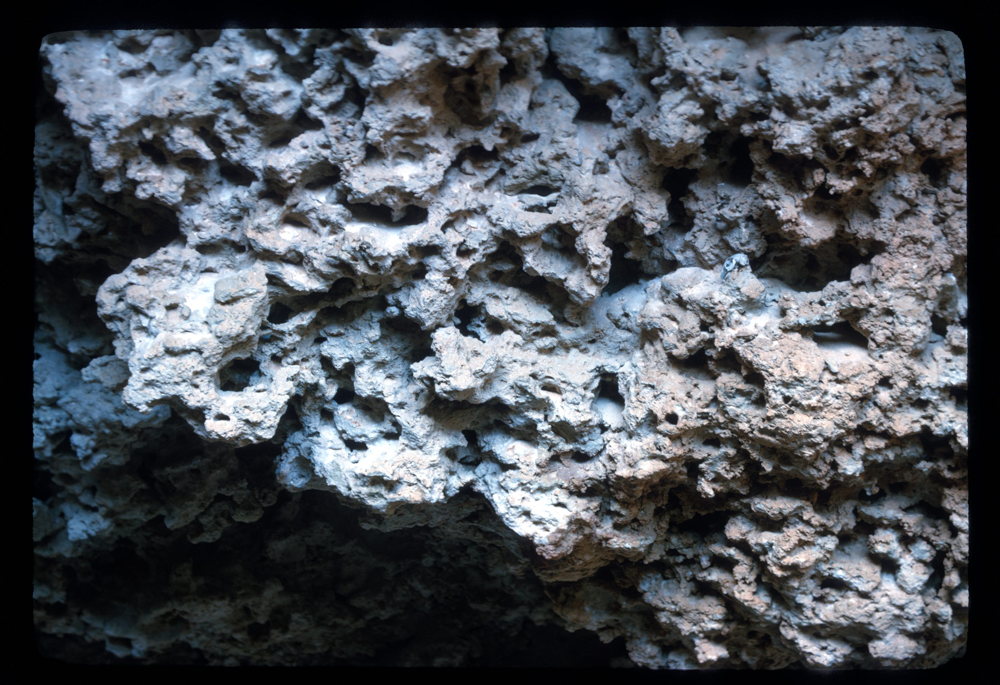
*ASF Joe N. Jennings slide catalogue, JNJ-S-1007-24, Box 1007. Catalogue description: Phreatic ? - Wigunda Gate Cave. [ASF record](https://st1.asflib.net/MEDIA/ASFJJSlidesCatalogue/Box%201007/JNJ-S-1007-24.html).*

### Disappointment

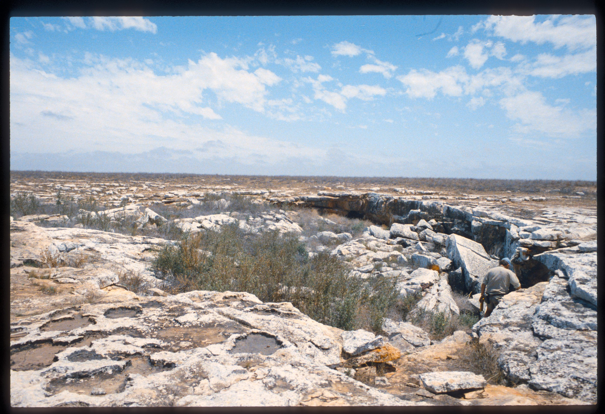
*ASF Joe N. Jennings slide catalogue, JNJ-S-1008-01, Box 1008. Catalogue description: Disappointment Cave doline. [ASF record](https://st1.asflib.net/MEDIA/ASFJJSlidesCatalogue/Box%201008/JNJ-S-1008-01.html).*

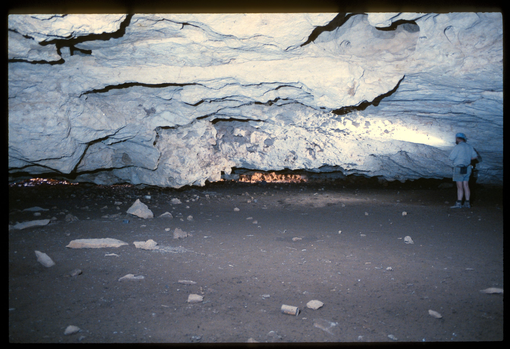
*ASF Joe N. Jennings slide catalogue, JNJ-S-1008-02, Box 1008. Catalogue description: Disappointment Cave. [ASF record](https://st1.asflib.net/MEDIA/ASFJJSlidesCatalogue/Box%201008/JNJ-S-1008-02.html).*

### Diprose No 1

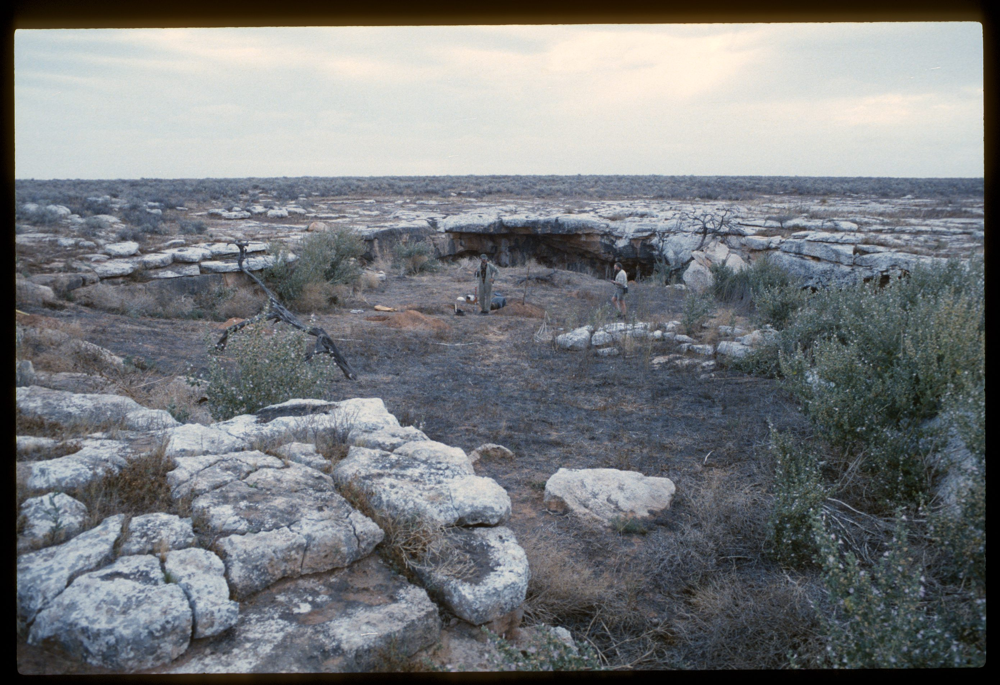
*ASF Joe N. Jennings slide catalogue, JNJ-S-1008-04, Box 1008. Catalogue description: N96 Diprose No 1. [ASF record](https://st1.asflib.net/MEDIA/ASFJJSlidesCatalogue/Box%201008/JNJ-S-1008-04.html).*

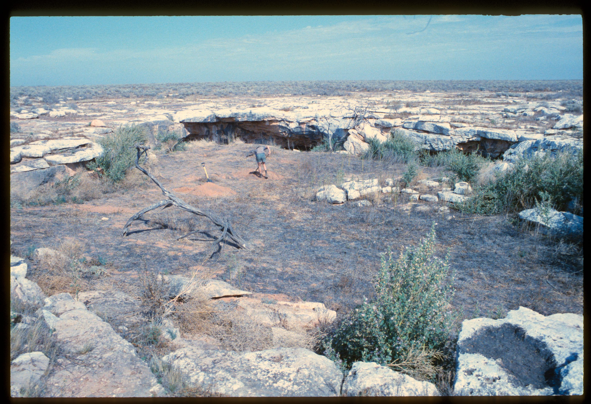
*ASF Joe N. Jennings slide catalogue, JNJ-S-1008-05, Box 1008. Catalogue description: N96 Diprose No 1. [ASF record](https://st1.asflib.net/MEDIA/ASFJJSlidesCatalogue/Box%201008/JNJ-S-1008-05.html).*

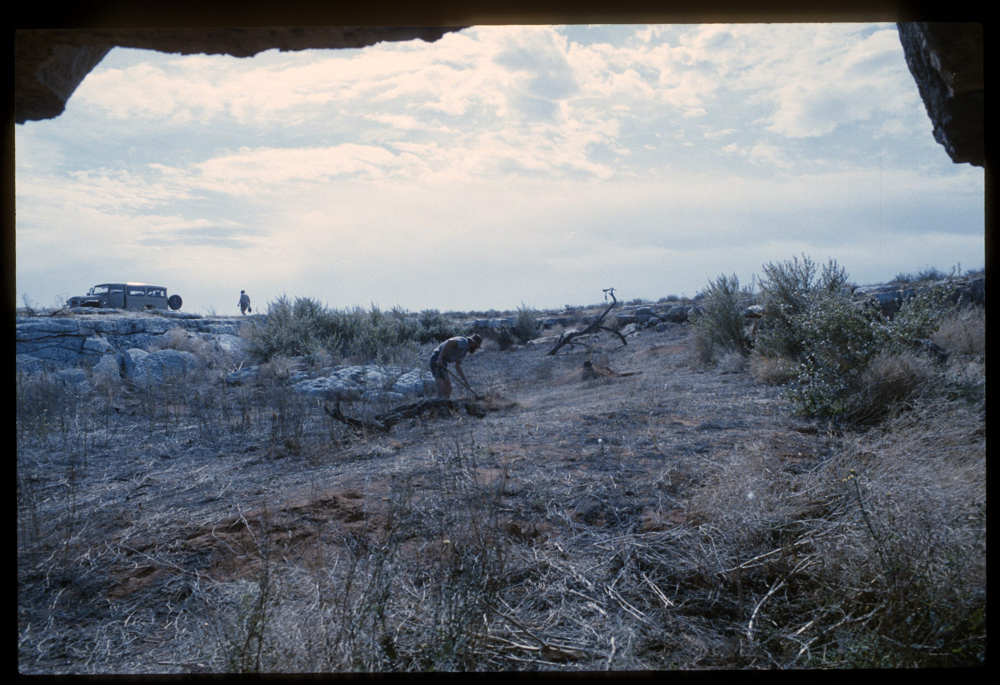
*ASF Joe N. Jennings slide catalogue, JNJ-S-1008-06, Box 1008. Catalogue description: N96 Diprose No 1. [ASF record](https://st1.asflib.net/MEDIA/ASFJJSlidesCatalogue/Box%201008/JNJ-S-1008-06.html).*

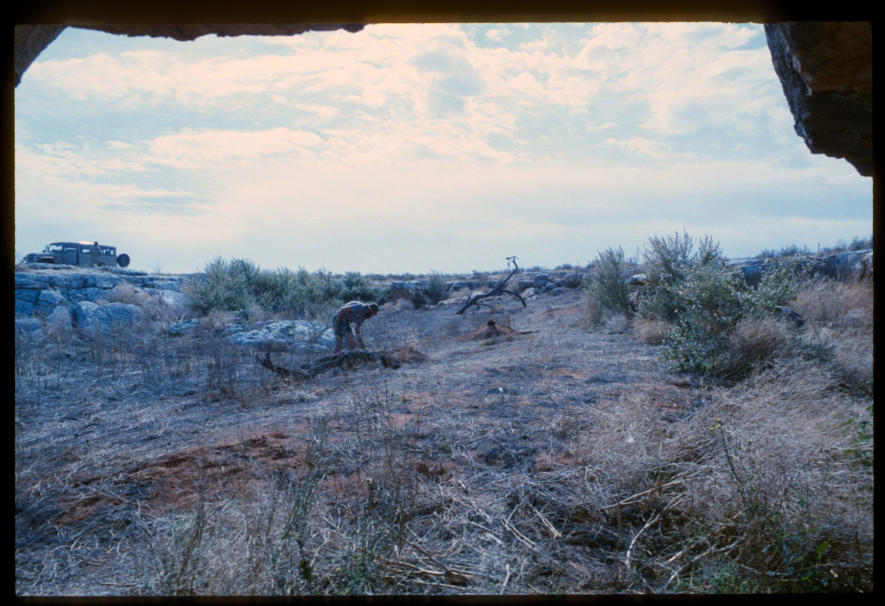
*ASF Joe N. Jennings slide catalogue, JNJ-S-1008-07, Box 1008. Catalogue description: N96 Diprose No 1. [ASF record](https://st1.asflib.net/MEDIA/ASFJJSlidesCatalogue/Box%201008/JNJ-S-1008-07.html).*

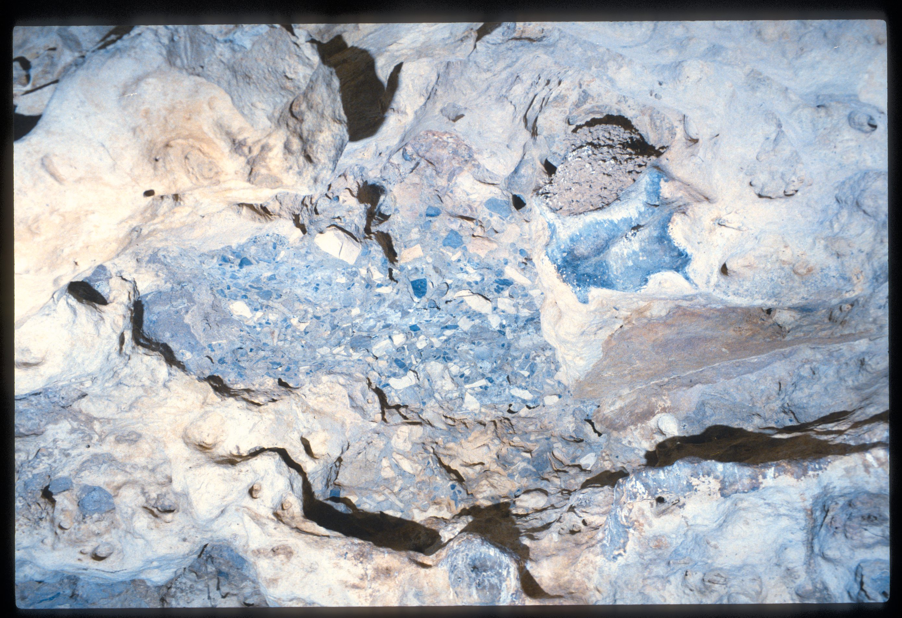
*ASF Joe N. Jennings slide catalogue, JNJ-S-1008-08, Box 1008. Catalogue description: N96 Diprose No 1 - Breccia in cave wall. [ASF record](https://st1.asflib.net/MEDIA/ASFJJSlidesCatalogue/Box%201008/JNJ-S-1008-08.html).*

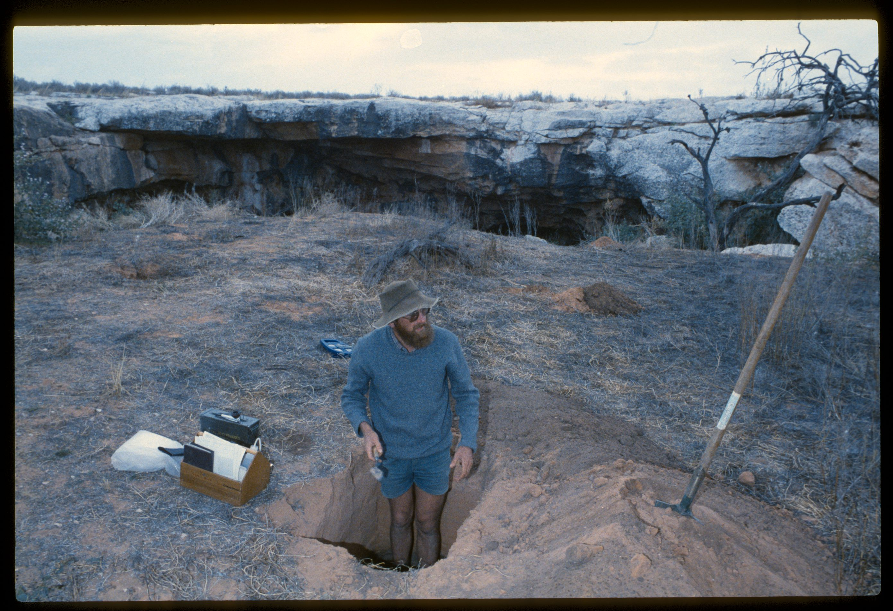
*ASF Joe N. Jennings slide catalogue, JNJ-S-1008-09, Box 1008. Catalogue description: Dug pit in doline of N96 Diprose No 1. [ASF record](https://st1.asflib.net/MEDIA/ASFJJSlidesCatalogue/Box%201008/JNJ-S-1008-09.html).*

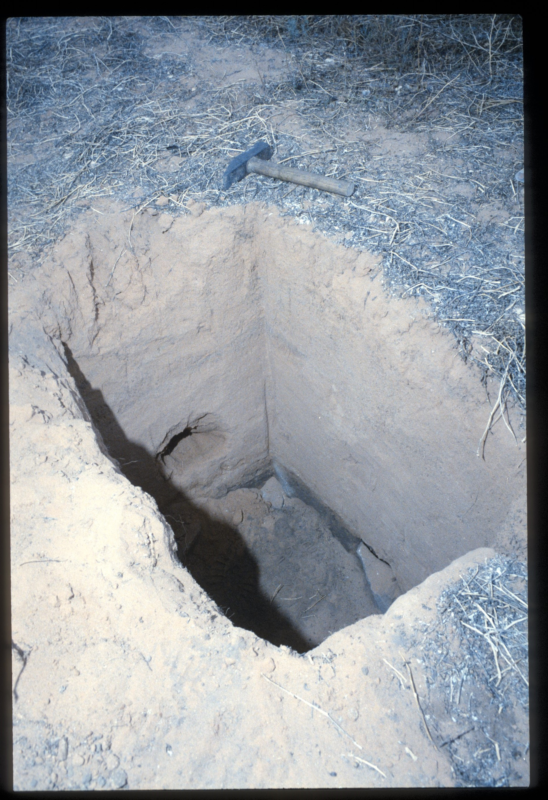
*ASF Joe N. Jennings slide catalogue, JNJ-S-1008-10, Box 1008. Catalogue description: Dug pit in doline of N96 Diprose No 1. [ASF record](https://st1.asflib.net/MEDIA/ASFJJSlidesCatalogue/Box%201008/JNJ-S-1008-10.html).*

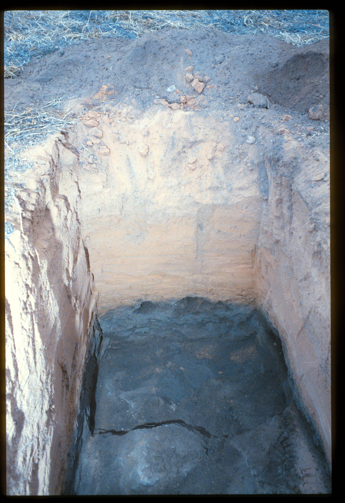
*ASF Joe N. Jennings slide catalogue, JNJ-S-1008-11, Box 1008. Catalogue description: Dug pit in doline of N96 Diprose No 1. [ASF record](https://st1.asflib.net/MEDIA/ASFJJSlidesCatalogue/Box%201008/JNJ-S-1008-11.html).*

### Jimmys Cave + Blowhole

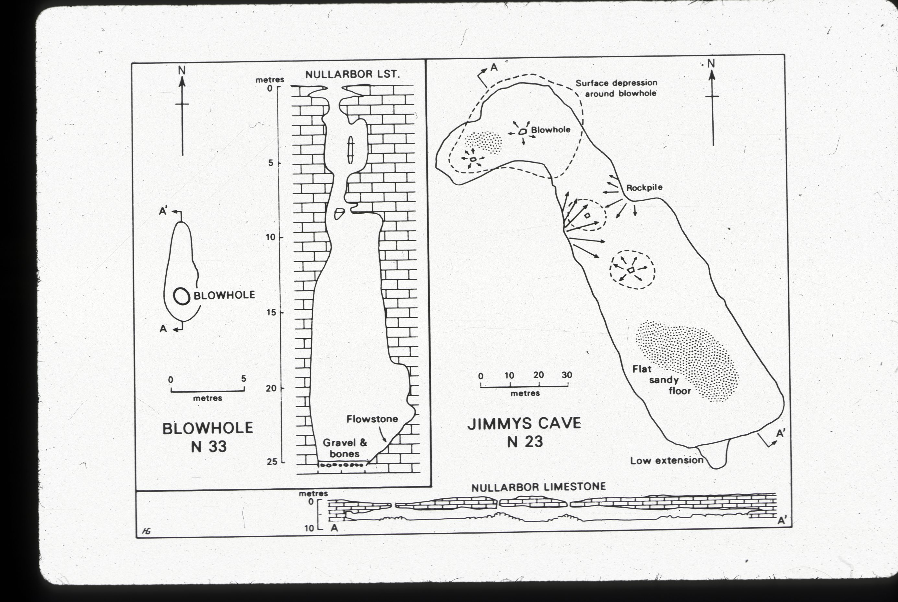
*ASF Joe N. Jennings slide catalogue, JNJ-S-1011-02, Box 1011. Catalogue description: Map - N23 Jimmys Cave - N33 Blowhole. [ASF record](https://st1.asflib.net/MEDIA/ASFJJSlidesCatalogue/Box%201011/JNJ-S-1011-02.html).*

### Telegraph Cave

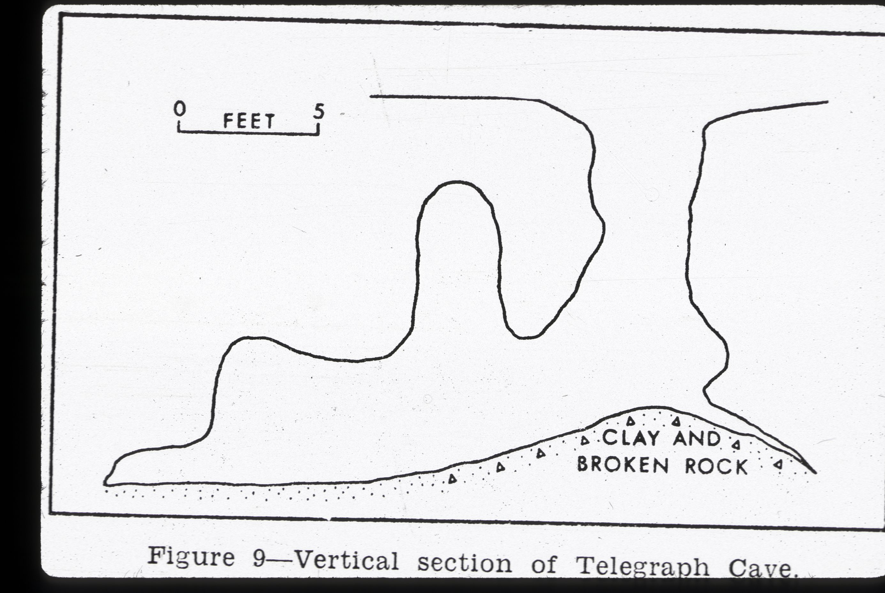
*ASF Joe N. Jennings slide catalogue, JNJ-S-1011-06, Box 1011. Catalogue description: Sketch - Blind shaft - Telegraph cave -Vertical section. [ASF record](https://st1.asflib.net/MEDIA/ASFJJSlidesCatalogue/Box%201011/JNJ-S-1011-06.html).*

### Decoration Cave

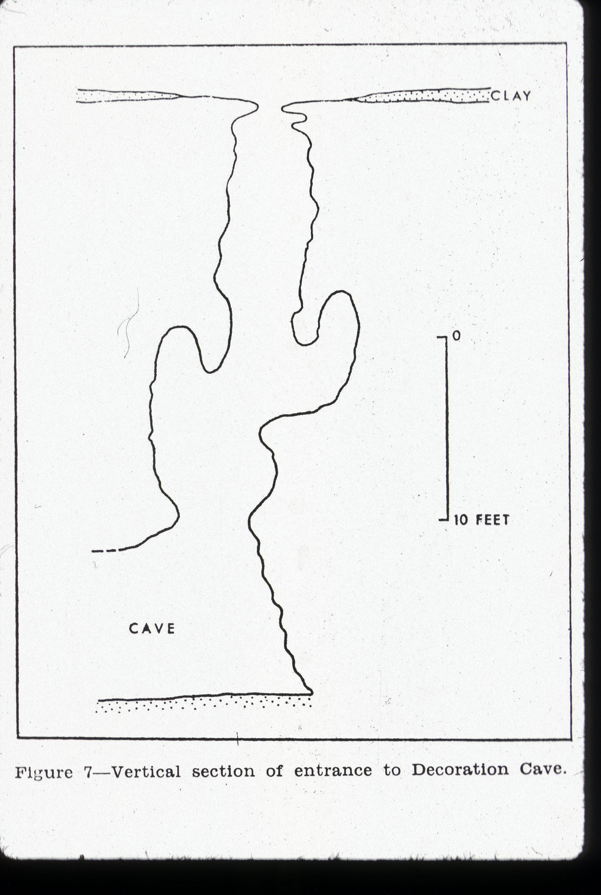
*ASF Joe N. Jennings slide catalogue, JNJ-S-1011-07, Box 1011. Catalogue description: Sketch - Vertical section of entrance to Decoration cave. [ASF record](https://st1.asflib.net/MEDIA/ASFJJSlidesCatalogue/Box%201011/JNJ-S-1011-07.html).*

### Jimmys Cave

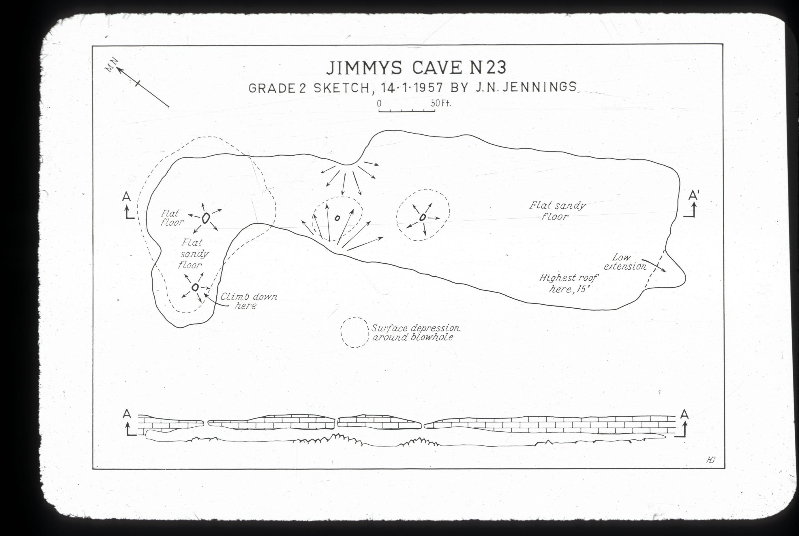
*ASF Joe N. Jennings slide catalogue, JNJ-S-1011-08, Box 1011. Catalogue description: Map - N23 Jimmys cave. [ASF record](https://st1.asflib.net/MEDIA/ASFJJSlidesCatalogue/Box%201011/JNJ-S-1011-08.html).*

### Murrawijinie No. 1 + Gecko Cave

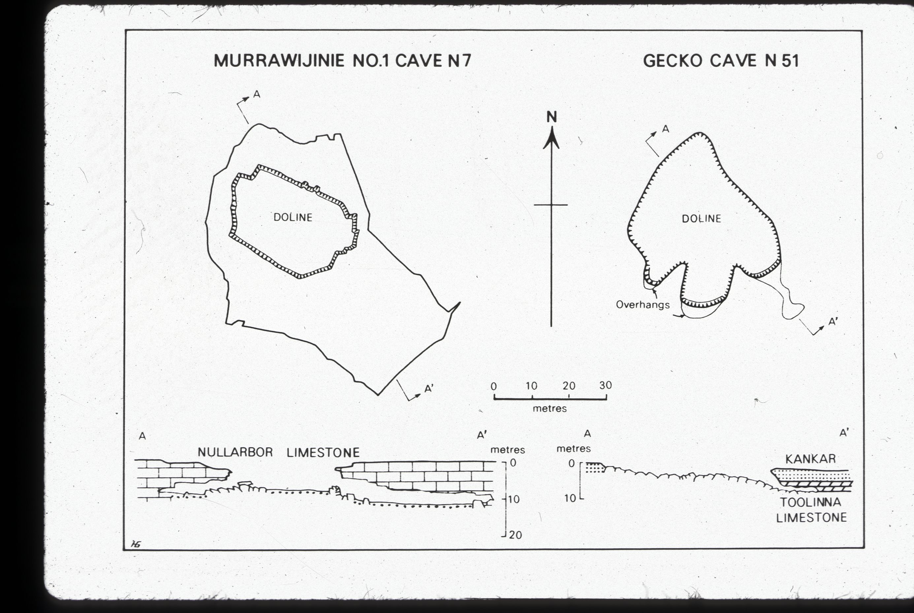
*ASF Joe N. Jennings slide catalogue, JNJ-S-1011-10, Box 1011. Catalogue description: Map - N7 Murrawijinnie No1 - N51 Gecko cave. [ASF record](https://st1.asflib.net/MEDIA/ASFJJSlidesCatalogue/Box%201011/JNJ-S-1011-10.html).*

### Murrawijinie Cave + White Wells Cave

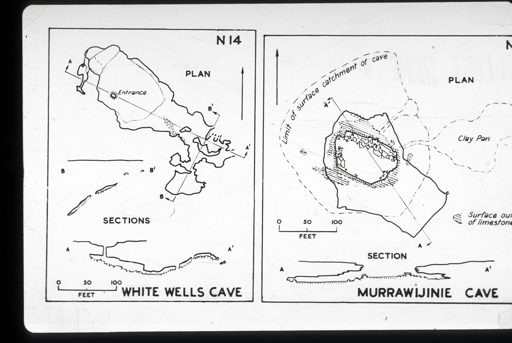
*ASF Joe N. Jennings slide catalogue, JNJ-S-1011-20, Box 1011. Catalogue description: Map - N7 Murrawijinie cave - N14 White Wells cave. [ASF record](https://st1.asflib.net/MEDIA/ASFJJSlidesCatalogue/Box%201011/JNJ-S-1011-20.html).*

<!-- ASF slide images: end -->
