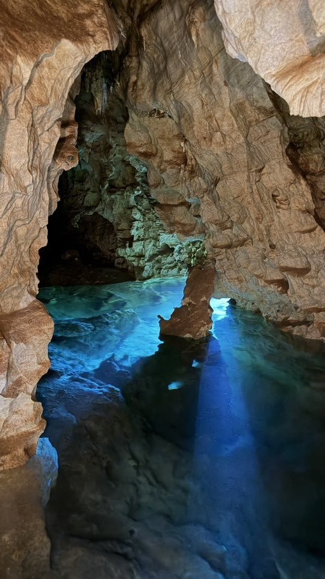

# Sub-regions

No records are included in this section of the prepared update.

# Caves

- [2 Caves](../Thailand/2%20Caves.md)
- [30 Meter Cave](../Thailand/30%20Meter%20Cave.md)
- [Bat Cave - 89b378de](../Thailand/Bat%20Cave%20-%2089b378de.md)
- [Boh Yah Mines](../Thailand/Boh%20Yah%20Mines.md)
- [Khao Sok](../Thailand/Khao%20Sok.md)
- [Long Cave](../Thailand/Long%20Cave.md)
- [Sre Keow](../Thailand/Sre%20Keow.md)
- [Tham Din Pieng cave](../Thailand/Tham%20Din%20Pieng%20cave.md)
- [Tham Lum Pho (Approx)](../Thailand/Tham%20Lum%20Pho%20%28Approx%29.md)
- [Tham Nong Tao](../Thailand/Tham%20Nong%20Tao.md)
- [Tham Phra Wang Daeng](../Thailand/Tham%20Phra%20Wang%20Daeng.md)
- [Tham Phusi Kew Cave](../Thailand/Tham%20Phusi%20Kew%20Cave.md)
- [Tham Pop Kan Mai](../Thailand/Tham%20Pop%20Kan%20Mai.md)
- [Tham Pung Cave](../Thailand/Tham%20Pung%20Cave.md)
- [Tham Vian Thian](../Thailand/Tham%20Vian%20Thian.md)
- [Thep Pratan](../Thailand/Thep%20Pratan.md)
- [Toh Wang](../Thailand/Toh%20Wang.md)
- [Unnamed - 02f5f247](../Thailand/Unnamed%20-%2002f5f247.md)

# About

Mikko Passi - [TechDiveAsia](https://techdiveasia.com/)
- Boh Yai Mine - [Photogrammetry (Facebook)](https://www.facebook.com/watch/?ref=saved&v=1379673419739017)
- [Mikko offering Mine Diving (July 2025)](https://www.facebook.com/mikko.paasi.3/posts/pfbid029iEWFRPMoJtBTKMHHLmj7nbcN4C3rAddHL5BTDD27fcZsw1Wgoujpm8TtnAeLWJbl) 
- [Monthly trips July-Dec (Facebook)](https://www.facebook.com/groups/1966936100285097/permalink/3838406736471348)
	- 2025-2026: Nov 3-9, Dec 13-19, Jan 6-12, Feb 13-19
- [Tham Lomphur & Nong Tao](https://www.facebook.com/reel/828863946136491)

[Blue Label Diving Trips](https://www.bluelabeldiving.com/about-cave-diving-south-thailand/cave-diving-trips-thailand/) - NO LONGER OPERATING

Didier Rateau - [Facebook](https://www.facebook.com/didier.rateau.7)
- https://khao-phu-thong-khao-tha-khanun.blog4ever.com/
- [Expedition Facebook Group](https://www.facebook.com/speleothai)
- [Expedition July19-Sept14](https://www.facebook.com/didier.rateau.7/posts/pfbid0o6u9ruTTVuZycHUzenwHxbNdcZexpgeJ3mYC9nXDgtBsthx3EbocgiDXK6jUiaDNl)

[Liviu Valena](https://www.facebook.com/groups/2205123638/user/100008195562907/) - [Annual trips](https://www.facebook.com/groups/caversgroup/permalink/10160328662813639)
- [2025 Expedition (Jan18-Feb14 & Mar8-April6](https://www.facebook.com/groups/caversgroup/posts/10161124584733639/)
	- [2026 Expedition to North-East Thailand - 25Jan-Feb10](https://www.facebook.com/groups/caversgroup/permalink/10161205268773639)
	- [2026 EXPLO - NE Thailand - Feb 11-15](https://www.facebook.com/groups/caversgroup/permalink/10161722931743639/)
- [Facebook Video - Tham Patihan (Open Sump)](https://www.facebook.com/100008195562907/videos/558454957267274/)

# Cave Notes

- Nong Khai province
Pha Taem National Park
Geo Park Sam Phan Bok
Mukdahan province
Sakon Nakhon Province (Isan)
- Seri Thai System - [Liviu Valenas sharing maps](https://www.facebook.com/groups/caversgroup/permalink/10161346105663639)
[Satun Cave Exploration](https://fb.watch/xcyI8uzTbS/) - Mikko Passi
	- Southern Thailand, near Malaysian border. System is heading straight toward the heart of the Brayabangsa mountain and the sink holes
	- 1850 meters with max depth of 30m and it still keeps going.

- **Krabi Province (Ao Luk, Phang Nga)** – Extensive karst, known for submerged and semi-submerged cave systems. Popular with tech divers.
	- Tham Lumphor / Nong Tao karst area (8.381, 98.736)
		- _Tham Nong Tao / Turtle Swamp Cave_.
		- 
	- Tham Sra Kaeo (8.168790, 98.807632)
- **Trang Province** – Bordering Malaysia, these areas include deep limestone formations with limited but promising cave exploration potential.
- **Chiang Mai/Chiang Rai** (Northern Thailand) – Contains dry karst systems, some caves may include sumps, but most exploration is land-based.

# Trips

- [Trip - Thailand - Boh Yai Mines - 2026 Jan](https://github.com/twosharprocks/digitalgarden/blob/3465901ed77ef68949e31269f6b25078be5e742d/content/posts/Trip%20-%20Thailand%20-%20Boh%20Yai%20Mines%20-%202026%20Jan.md)

# References

- [Thailand Digital Nomad Visa Explained with Requirements, Benefits and How to Apply](https://www.thedigitalnomad.asia/inspiration/digital-nomads/thailand-digital-nomad-visa/)
