# About

Situated to the east of Madura Pass, approximately 1400km from Perth, you’ll find a fascinating cave on the Roe Plain. Here, the limestone surface is in close proximity to the water table. This underwater cave is a complex network of intersecting fissures, with a generally small breakdown passage. It features distinct bedding planes at depths of 3, 5, and 7 meters, which house stunning horizontal elliptical phreatic passages as well as low flat passages, all interconnected. The deepest point is a 7m bedding plane, and so far, 410m of underwater passage has been explored (as of February 2004).

The water in the cave, with a temperature of a cool 16C, is saline at 18,000ppm salt, just slightly less than sea water’s 19,000ppm. It has a unique blue hue, reminiscent of Tommy Grahams Cave located to the west. This cave is particularly interesting to speleological biologists due to its rich biodiversity. It is home to the highest number of troglobitic animal species found in a single cave on the Nullarbor, including two different types of troglobitic spiders, a troglobitic cockroach, an isopod, and an amphipod, which is a small aquatic crustacean.

small enterence with little traffic, ropes recommened to get down due to lose rocks and no defined path.

# Additional Notes

Located East of Madura Pass (1400km E of Perth), this cave is on the Roe Plain where the limestone surface is much closer to the water table. The underwater cave is a set of intersecting network fissures with generally small breakdown passage. Distinct bedding planes at 3, 5 & 7m contain the most beautiful horizontal elliptical phreatic passage as well as low flat passages which helps connect them all together. The maximum depth is a 7m bedding plane and the length of underwater passage explored so far is 410m (4/02).

The chilly 16C water is saline at 18,000ppm salt (sea water being 19,000ppm) and has a distinctive blue hue, similar to Tommy Grahams Cave to the west. This cave is of specific interest to speleological biologists as it contains the most number of troglobitic animal species found in a single cave on the Nullarbor. There are two different types of troglobitic spider, a troglobitic cockroach, an isopod and an amphipod (a tiny aquatic crustacean).
- [Trimix Divers — Nurina Cave](https://www.trimixdivers.com/): www.trimixdivers.com/trimix5/?p=4869

Located East of Madura Pass (1400km E of Perth), this cave is on the Roe Plain where the limestone surface is much closer to the water table (ie. bonus !!). The underwater cave is a set of intersecting network fissures with generally small breakdown passage. Distinct bedding planes at 3, 5 & 7m contain the most beautiful horizontal elliptical phreatic passage (see Gallery) as well as low flat passages which helps connect them all together. The maximum depth is a 7m bedding plane and the length of underwater passage explored so far is 410m (4/02).
The chilly 16C water is saline at 18,000ppm salt (sea water being 19,000ppm) and has a distinctive blue hue, similar to Tommy Grahams Cave to the west. This cave is of specific interest to speleological biologists as it contains the most number of troglobitic animal species found in a single cave on the Nullarbor. There are two different types of troglobitic spider, a troglobitic cockroach, an isopod and an amphipod (a tiny aquatic crustacean).

<!-- ASF slide images: start -->

## ASF slide images

Images are from the ASF Joe N. Jennings slide catalogue. Each caption preserves the catalogue description and links to its source record.

### Nurina Cave

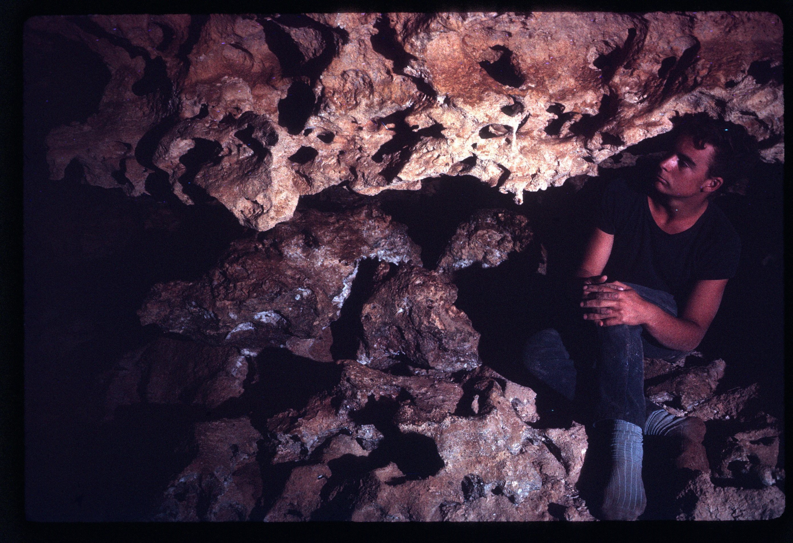
*ASF Joe N. Jennings slide catalogue, JNJ-S-00056, Box 37. Catalogue description: Spongework in New Cave S of Madura Jan 1965. [ASF record](https://st1.asflib.net/MEDIA/ASFJJSlidesCatalogue/Box%2037/JNJ-S-00056.html).*

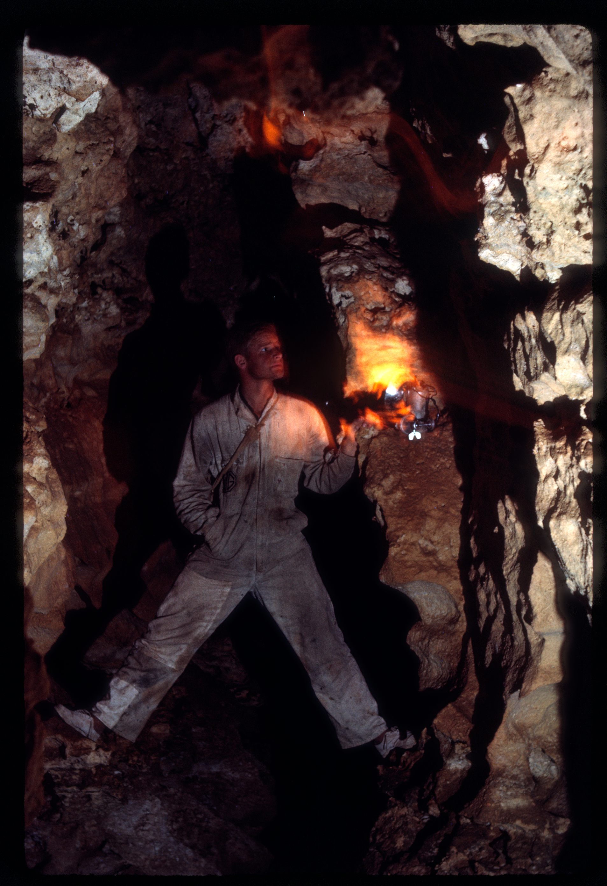
*ASF Joe N. Jennings slide catalogue, JNJ-S-00057, Box 37. Catalogue description: New Cave S of Madura Jan 1965. [ASF record](https://st1.asflib.net/MEDIA/ASFJJSlidesCatalogue/Box%2037/JNJ-S-00057.html).*

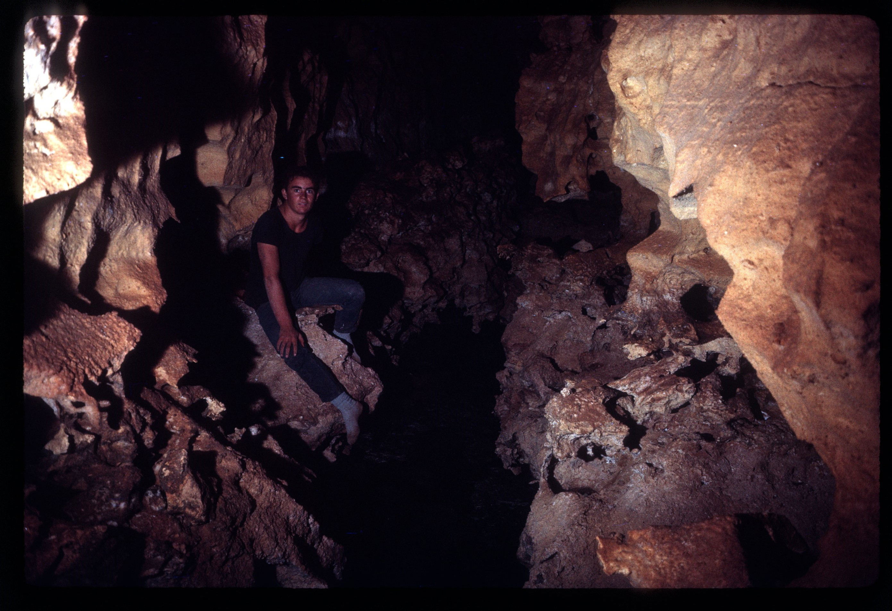
*ASF Joe N. Jennings slide catalogue, JNJ-S-00058, Box 37. Catalogue description: New Cave (now called NURINA) S of Madura Jan 1965. [ASF record](https://st1.asflib.net/MEDIA/ASFJJSlidesCatalogue/Box%2037/JNJ-S-00058.html).*

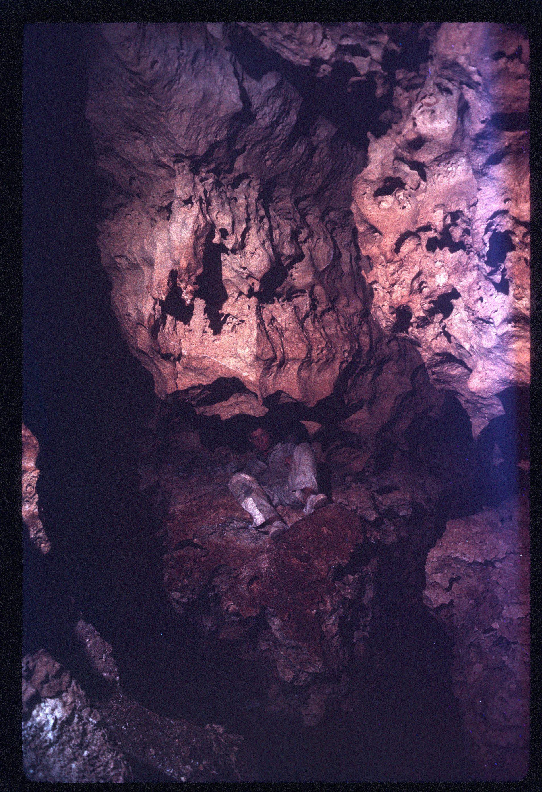
*ASF Joe N. Jennings slide catalogue, JNJ-S-00059, Box 37. Catalogue description: Joint junction in New Cave (now called NURINA) S of Madura Jan 1965. [ASF record](https://st1.asflib.net/MEDIA/ASFJJSlidesCatalogue/Box%2037/JNJ-S-00059.html).*

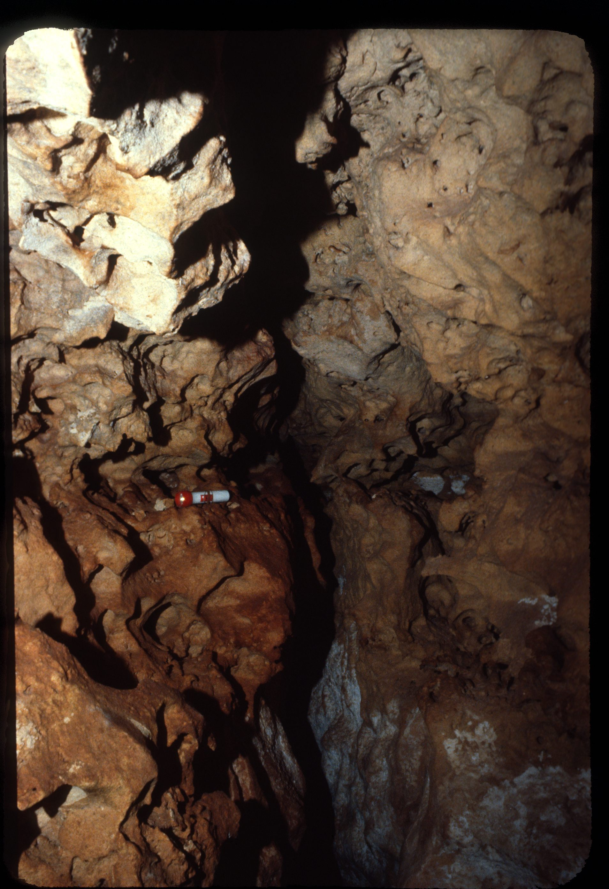
*ASF Joe N. Jennings slide catalogue, JNJ-S-00060, Box 37. Catalogue description: Nurina Cave near Madura. [ASF record](https://st1.asflib.net/MEDIA/ASFJJSlidesCatalogue/Box%2037/JNJ-S-00060.html).*

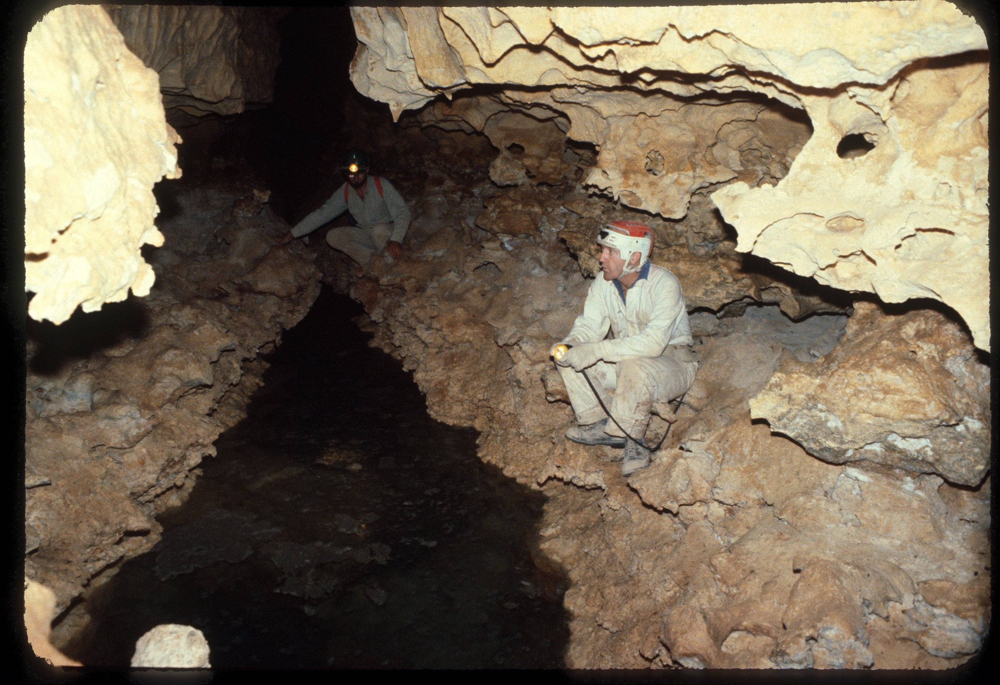
*ASF Joe N. Jennings slide catalogue, JNJ-S-00062, Box 37. Catalogue description: Nurina Cave - Joint & bedding plain spongework. Ground water. [ASF record](https://st1.asflib.net/MEDIA/ASFJJSlidesCatalogue/Box%2037/JNJ-S-00062.html).*

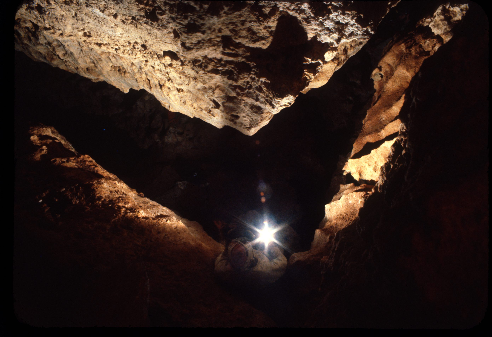
*ASF Joe N. Jennings slide catalogue, JNJ-S-00068, Box 37. Catalogue description: Right angle bend joint passages in Nurina Cave, Madura. [ASF record](https://st1.asflib.net/MEDIA/ASFJJSlidesCatalogue/Box%2037/JNJ-S-00068.html).*

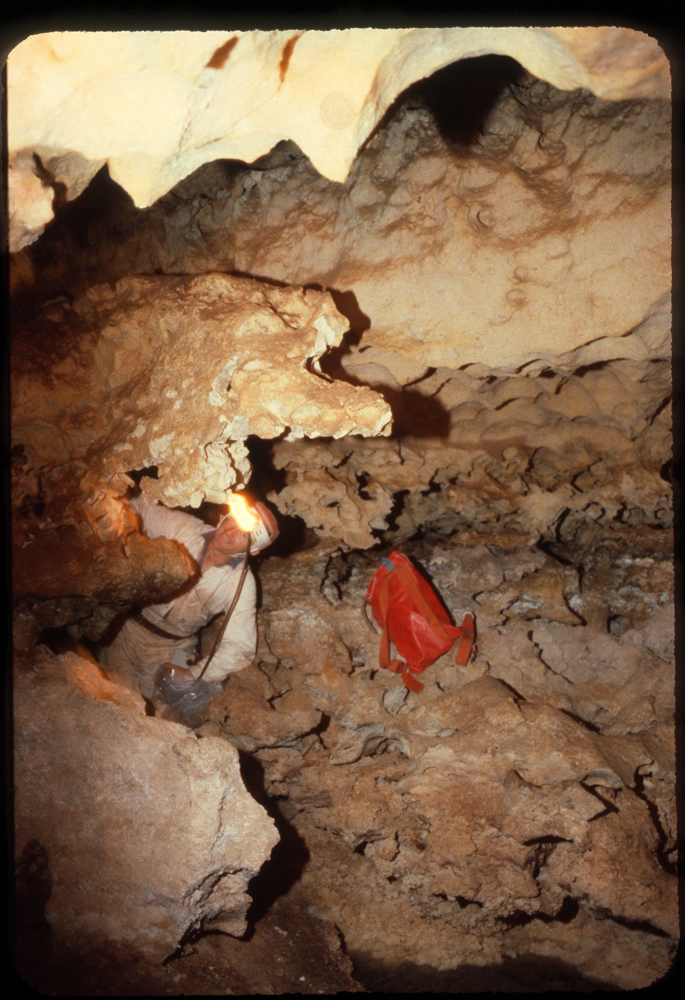
*ASF Joe N. Jennings slide catalogue, JNJ-S-00069, Box 37. Catalogue description: Spongework in Nurina Cave, Madura. [ASF record](https://st1.asflib.net/MEDIA/ASFJJSlidesCatalogue/Box%2037/JNJ-S-00069.html).*

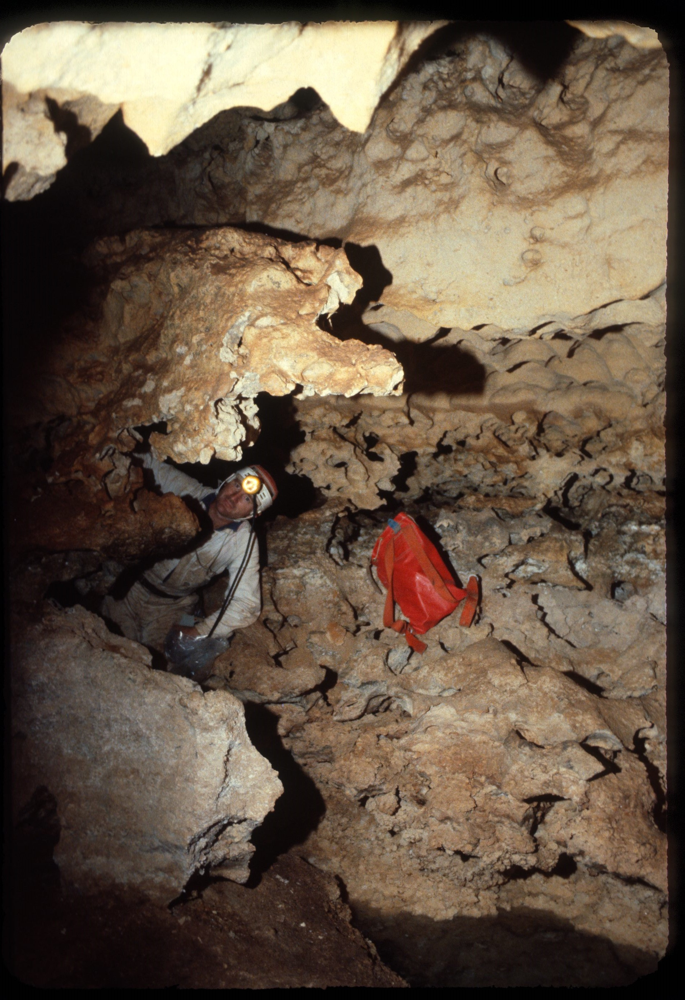
*ASF Joe N. Jennings slide catalogue, JNJ-S-00130, Box 41. Catalogue description: Nurina Cave spongework, Madura. [ASF record](https://st1.asflib.net/MEDIA/ASFJJSlidesCatalogue/Box%2041/JNJ-S-00130.html).*

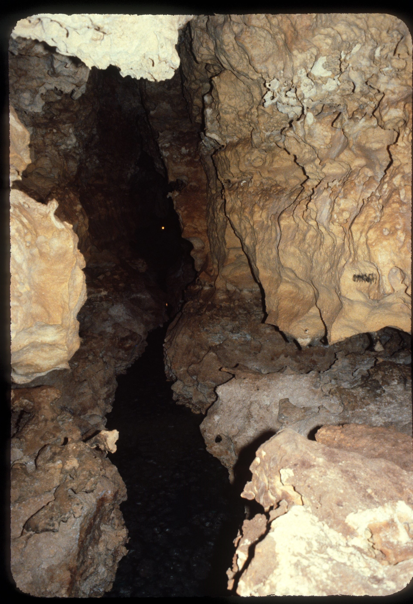
*ASF Joe N. Jennings slide catalogue, JNJ-S-00131, Box 41. Catalogue description: Nurina Cave, Madura. [ASF record](https://st1.asflib.net/MEDIA/ASFJJSlidesCatalogue/Box%2041/JNJ-S-00131.html).*

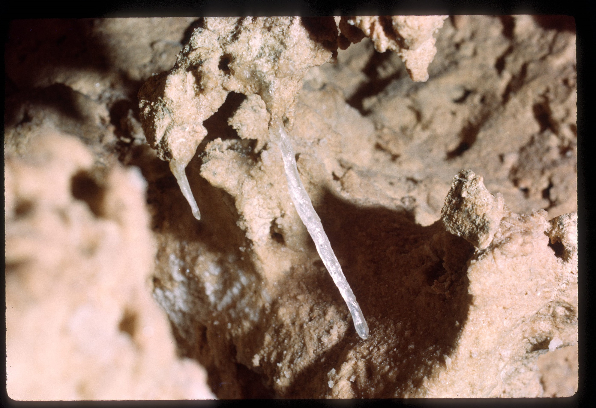
*ASF Joe N. Jennings slide catalogue, JNJ-S-00132, Box 41. Catalogue description: Eccentric decoration in Nurina Cave Jan 1965. [ASF record](https://st1.asflib.net/MEDIA/ASFJJSlidesCatalogue/Box%2041/JNJ-S-00132.html).*

### Nurina Cave + Thylacine Hole

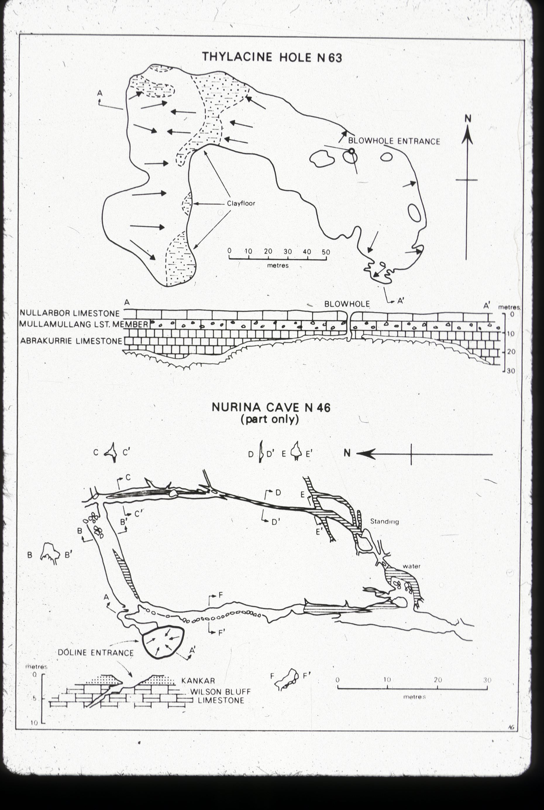
*ASF Joe N. Jennings slide catalogue, JNJ-S-1011-12, Box 1011. Catalogue description: Map - N46 Nurina cave (part only) - N63 Thylacine hole. [ASF record](https://st1.asflib.net/MEDIA/ASFJJSlidesCatalogue/Box%201011/JNJ-S-1011-12.html).*

<!-- ASF slide images: end -->

# Images

- [Nurina Cave - IMG_2110 - a4217b89-69f453d4](../../Assets/bac56d8498c1ae9538ebdf3703ffd4bbd3939fa629766317cb21f9b8f1ba14d7.jpeg)
- [Nurina Cave - IMG_2111 - c71e6885-69f453d4](../../Assets/28f657abd856001afa328bfc5b283893e2bf5445ad005424fa26ba3e0df35018.jpeg)
- [Nurina Cave - IMG_2112 - 0150c170-69f453d4](../../Assets/f68a0c842f917eccdcfa404d5df59ef8fdf99d48ac206ad0e6e7749c27778a85.jpeg)
- [Nurina Cave - nurina - 06986bef-69f453d4](../../Assets/52a4ed2e3beb10adb738c059f89d3cb7ae9ffdd1716d764eba0e55781e91b125.jpg) — MW
- [Nurina Cave - nurina drone - d42d4870-69f453d4](../../Assets/970a1113b6306255d8f758509dfe1ab718808c6cd44f56c712eae67fce2ff533.jpg) — MW
- [Nurina Cave - nurina water - 1b793f4f-69f453d4](../../Assets/d6ad6a693d237ecae26a4dee27ecd11142e04aae1eaf74abc53fb22117f327c1.jpg) — MW
- [Nurina Cave - nurina water2 - 9278781c-69f453d4](../../Assets/26e434351ae847947cb756830bff383bb2cbc9cfdf736916552018f63aa55314.jpg) — MW
- [Nurina Cave - nuruna drone2 - 0431e294-69f453d4](../../Assets/57b27de983f7c74b1f84d67bd5cb09bc4f7c07f4e15f7a38fb062a001cabca73.jpg) — MW

- [Nurina Cave - nuruna drone2 - 0431e294-69f453d4](../../Assets/57b27de983f7c74b1f84d67bd5cb09bc4f7c07f4e15f7a38fb062a001cabca73.jpg)
- [Nurina Cave - nurina water2 - 9278781c-69f453d4](../../Assets/26e434351ae847947cb756830bff383bb2cbc9cfdf736916552018f63aa55314.jpg)
- [Nurina Cave - nurina water - 1b793f4f-69f453d4](../../Assets/d6ad6a693d237ecae26a4dee27ecd11142e04aae1eaf74abc53fb22117f327c1.jpg)
- [Nurina Cave - nurina drone - d42d4870-69f453d4](../../Assets/970a1113b6306255d8f758509dfe1ab718808c6cd44f56c712eae67fce2ff533.jpg)
- [Nurina Cave - nurina - 06986bef-69f453d4](../../Assets/52a4ed2e3beb10adb738c059f89d3cb7ae9ffdd1716d764eba0e55781e91b125.jpg)

# References

- [Cave Atlas](http://caveatlas.com/systems/system.asp?ID=744&co=AU)
