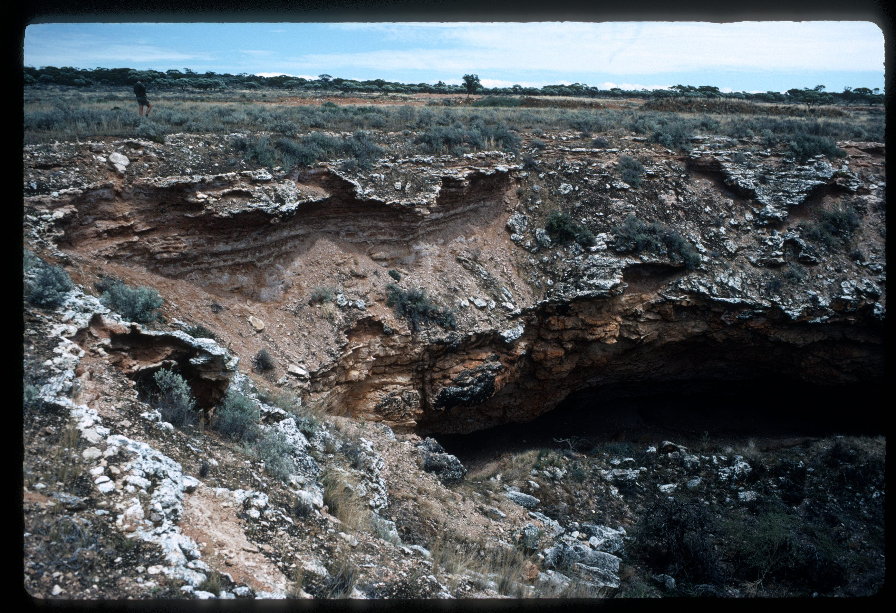
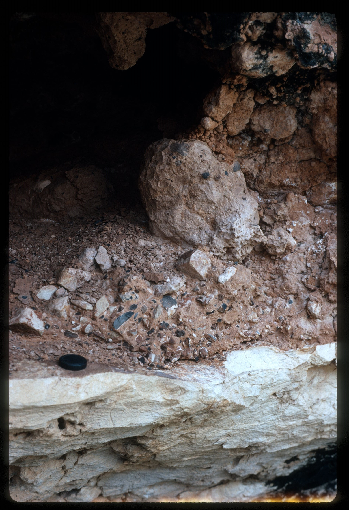

# Source notes

## ASF slide images

Images are from the ASF Joe N. Jennings slide catalogue. Each caption preserves the catalogue description and links to its source record.

*ASF Joe N. Jennings slide catalogue, JNJ-S-1007-20, Box 1007. Catalogue description: Ivy Cave South cave doline - ??. [ASF record](https://st1.asflib.net/MEDIA/ASFJJSlidesCatalogue/Box%201007/JNJ-S-1007-20.html).*

*ASF Joe N. Jennings slide catalogue, JNJ-S-1007-22, Box 1007. Catalogue description: Ivy Cave South cave - Breccia with black ?. [ASF record](https://st1.asflib.net/MEDIA/ASFJJSlidesCatalogue/Box%201007/JNJ-S-1007-22.html).*

<!-- ASF slide images: end -->
