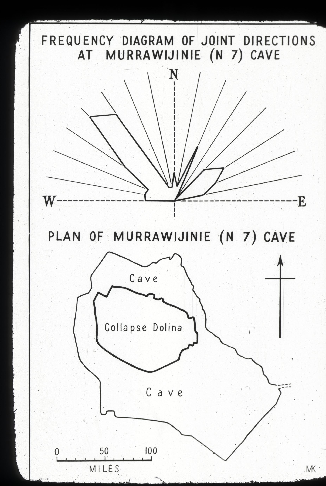

<!-- ASF slide images: start -->
## ASF slide images

Images are from the ASF Joe N. Jennings slide catalogue. Each caption preserves the catalogue description and links to its source record.

*ASF Joe N. Jennings slide catalogue, JNJ-S-1011-09, Box 1011. Catalogue description: Sketch - N7 Murrawijinie cave plan - Frequency of joint directions. [ASF record](https://st1.asflib.net/MEDIA/ASFJJSlidesCatalogue/Box%201011/JNJ-S-1011-09.html).*

<!-- ASF slide images: end -->
