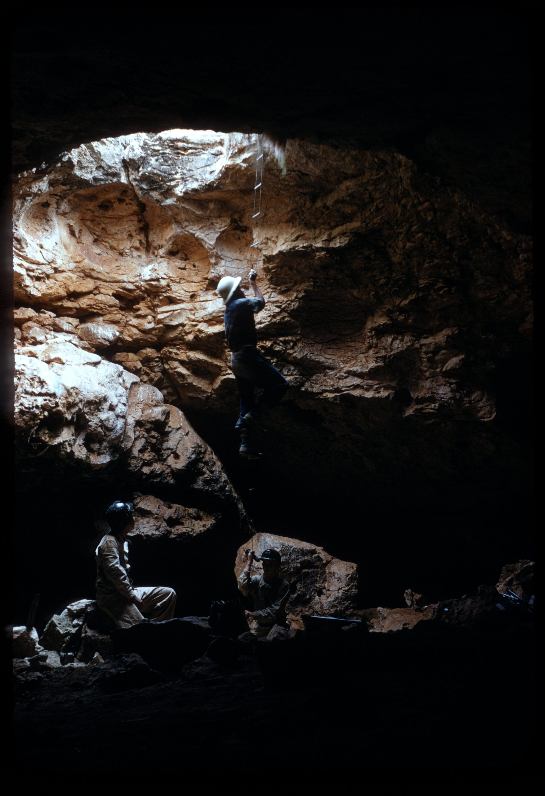
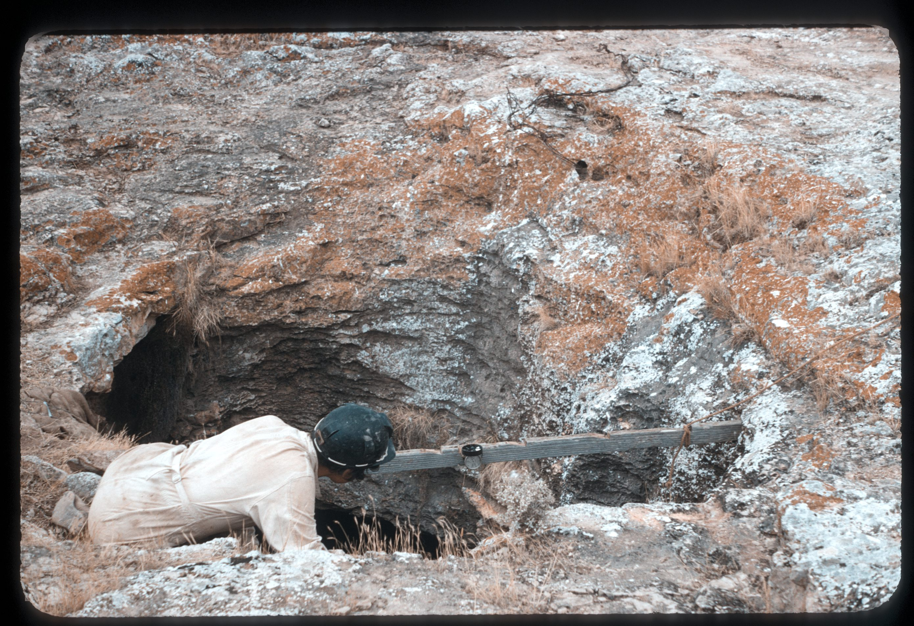
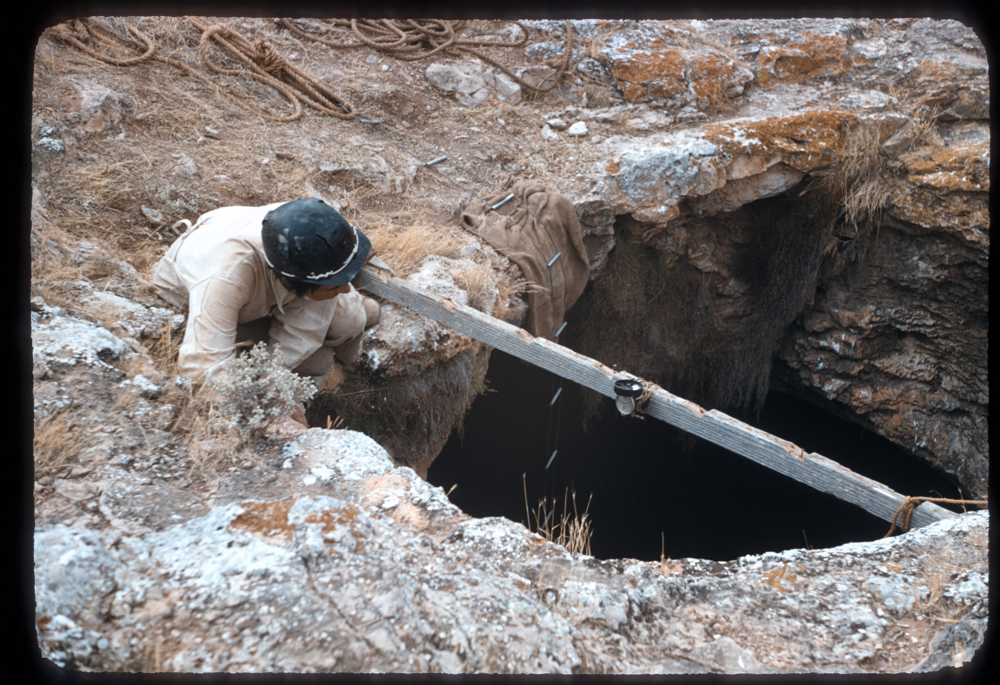
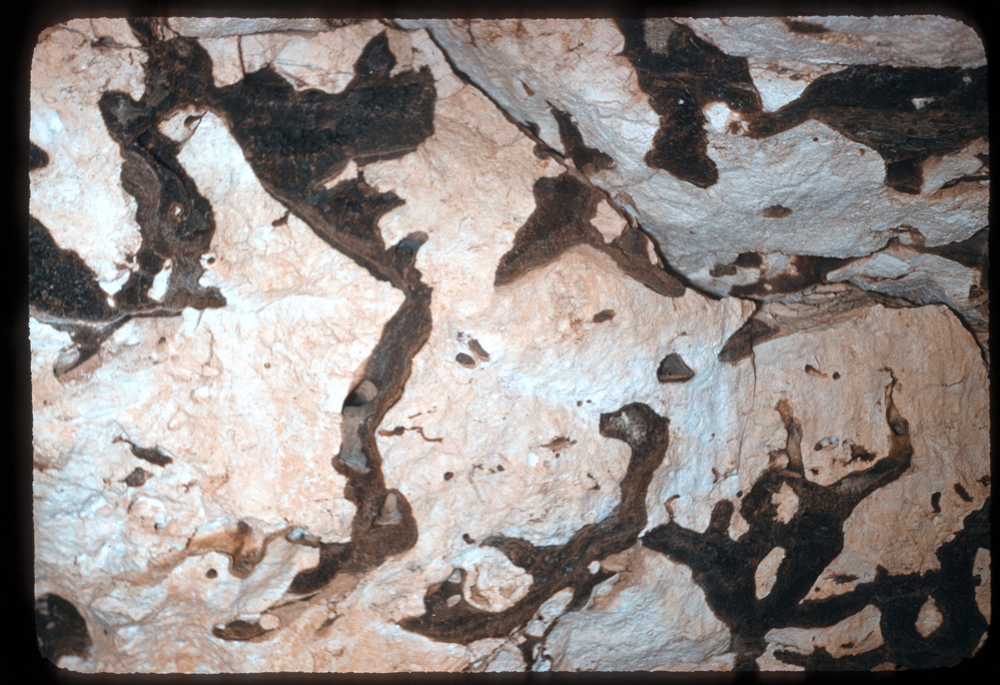
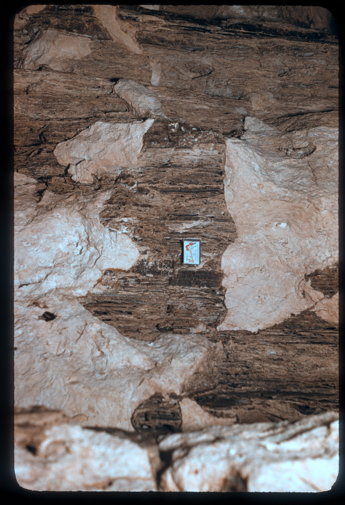
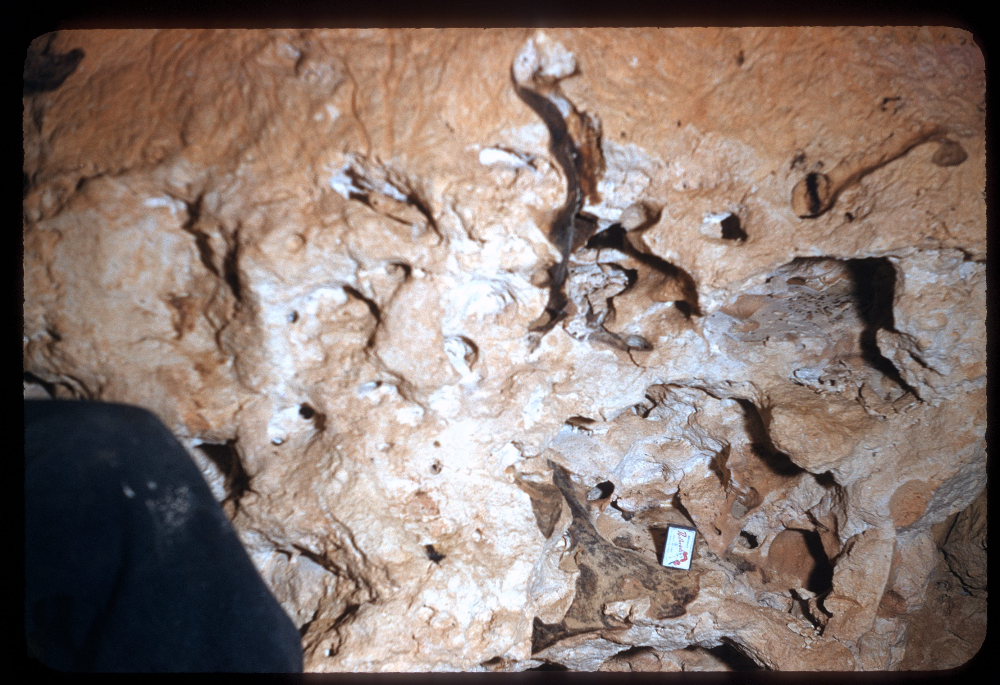

# About

Checked 2024-07 by MW 
6m vertical entrance requiring wire ladder

# Images

- [White Wells Cave - DJI_0006 - f98695e0-232fe0ac](../../Assets/69de509fb7663fbc8d1ae53357ca0587959b4d8f28234e758712d088bdb68095.jpg)
- [White Wells Cave - DJI_0008 - 1eb984ce-232fe0ac](../../Assets/830d5751d39163e792a36eb4125e12f4a5d9c59605b30f094610b01e527a16eb.jpg)
- [White Wells Cave - DJI_0010 - 6cc24c1c-232fe0ac](../../Assets/081d07e6d1ceebe197f895435ac41e787cae1e212c5620dc298993e0ab04cf46.jpg)
- [White Wells Cave - PXL_20240713_024234666 - 33a1367a-232fe0ac](../../Assets/ec6e185b3cf0e348af697f1fa8ae21ca11ea14e98b057a5d95b68059e27f32c8.jpg)
- [White Wells Cave - PXL_20240713_024313358 - cf59cc42-232fe0ac](../../Assets/265f8e26c2f1622a9b606a59ec1e9f2128955943b28ee06b43ebb9e8800e5689.jpg)
- [White Wells Cave - PXL_20240713_024254004 - 0f343424-232fe0ac](../../Assets/7dd989ad0868e91f0bd666a05ec06729919f62d1ca5fe594f641d6f6e5d47b43.jpg)
- [White Wells Cave - PXL_20240713_024302727 - a0993a95-232fe0ac](../../Assets/533408fb4cbe835d635f1fa9b940ed813fb72bbff58f307d4928607b7179dcfa.jpg)
- [White Wells Cave - PXL_20240713_024215934 - 6a734842-232fe0ac](../../Assets/9482b9801987dbe09669c7ad07c036ce1c744a901de00671e1bfc861cbaec2ca.jpg)
- [White Wells Cave - DJI_0007 - 67df4ae8-232fe0ac](../../Assets/5b3a7bde9a4180c40bf53f43bb9f021da06c060a69eca28f2c125e3abcc5c6df.jpg)

## ASF slide images

Images are from the ASF Joe N. Jennings slide catalogue. Each caption preserves the catalogue description and links to its source record.

*ASF Joe N. Jennings slide catalogue, JNJ-S-1007-11, Box 1007. Catalogue description: White Wells Cave. [ASF record](https://st1.asflib.net/MEDIA/ASFJJSlidesCatalogue/Box%201007/JNJ-S-1007-11.html).*

*ASF Joe N. Jennings slide catalogue, JNJ-S-1007-12, Box 1007. Catalogue description: White Wells Cave - Measuring drafts. [ASF record](https://st1.asflib.net/MEDIA/ASFJJSlidesCatalogue/Box%201007/JNJ-S-1007-12.html).*

*ASF Joe N. Jennings slide catalogue, JNJ-S-1007-13, Box 1007. Catalogue description: White Wells Cave - Measuring wind. [ASF record](https://st1.asflib.net/MEDIA/ASFJJSlidesCatalogue/Box%201007/JNJ-S-1007-13.html).*

*ASF Joe N. Jennings slide catalogue, JNJ-S-1007-14, Box 1007. Catalogue description: White Wells Cave - Calcite filled solution tubes. [ASF record](https://st1.asflib.net/MEDIA/ASFJJSlidesCatalogue/Box%201007/JNJ-S-1007-14.html).*

*ASF Joe N. Jennings slide catalogue, JNJ-S-1007-15, Box 1007. Catalogue description: White Wells Cave - ? fill of spongework. [ASF record](https://st1.asflib.net/MEDIA/ASFJJSlidesCatalogue/Box%201007/JNJ-S-1007-15.html).*

*ASF Joe N. Jennings slide catalogue, JNJ-S-1007-16, Box 1007. Catalogue description: White Wells Cave - Spongework. [ASF record](https://st1.asflib.net/MEDIA/ASFJJSlidesCatalogue/Box%201007/JNJ-S-1007-16.html).*

<!-- ASF slide images: end -->
