# About

2021March: MW visited on Foot. Large cave entrance with lots of potential - need to return with dry caving gear.

# Source notes

## Lower South East Cave Reference — Page 494

Lying to the south-east of nearby 5L254, Witch's Cave (apparently so named because it "looks like a witch's cauldron", according to Kevin Mott!) has not yet been entered or explored. It appears as a sheer-sided sinkhole about 12 metres in diameter and 4m or so deep, with much wire rubbish blocking an apparent undercut area on the northwestern (?) side.
A strong outblowing wind was observed by the author during a brief visit in October 1984, indicating either the existence of a large underground expanse or a connection with other features which lie nearby.
Further exploration and mapping is warranted; only a rough sketch is available at this time.

# Images

- [L0253 - Witches Cave - witches - 844eff86-97f8b6c7](../../Assets/3c7d8334a38768bc089ad1bcd07580fccfe0fde1a5032610b22963b52c0ab14b.jpg)
- [L0253 - Witches Cave - witches2 - 9533d210-97f8b6c7](../../Assets/b67fd259a0990d011857c2e41dadc66e91108a0e149a26e08456d7cff2f2f8b0.jpg)

<!-- ASF slide images: start -->
## ASF slide images

Images are from the ASF Joe N. Jennings slide catalogue. Each caption preserves the catalogue description and links to its source record.

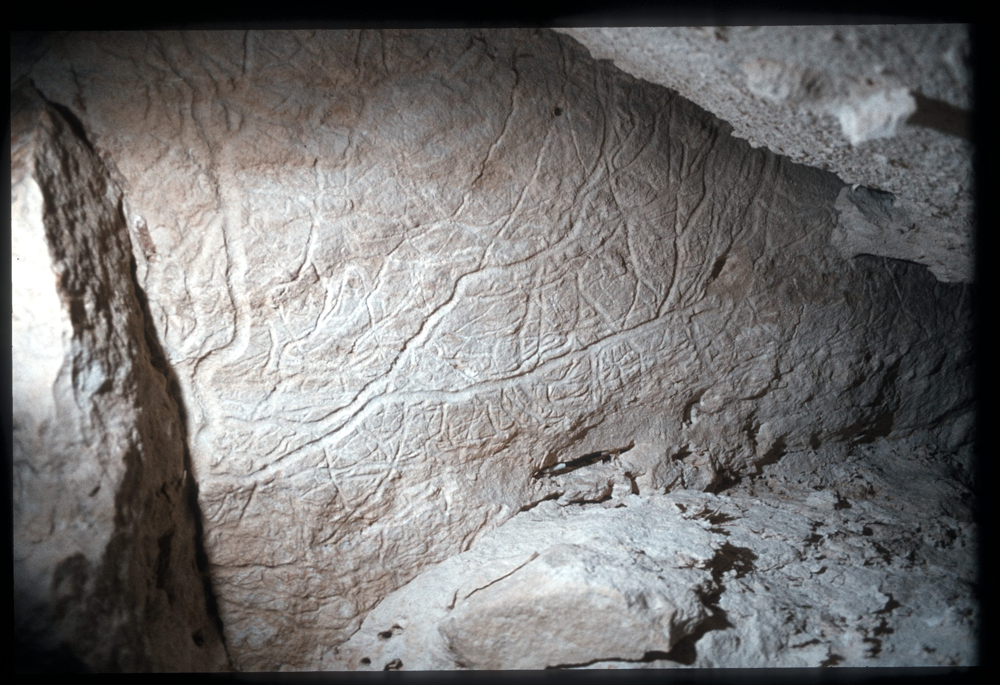
*ASF Joe N. Jennings slide catalogue, JNJ-S-1006-01, Box 1006. Catalogue description: Witches Cave - Wall of anastomoses. [ASF record](https://st1.asflib.net/MEDIA/ASFJJSlidesCatalogue/Box%201006/JNJ-S-1006-01.html).*

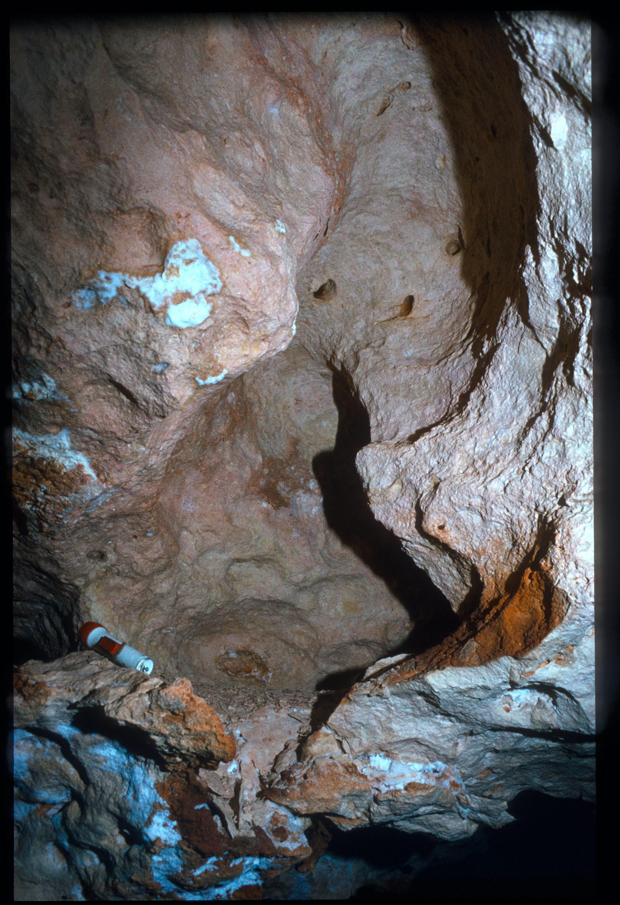
*ASF Joe N. Jennings slide catalogue, JNJ-S-1006-02, Box 1006. Catalogue description: Witches Cave - Tubes into tafoni. [ASF record](https://st1.asflib.net/MEDIA/ASFJJSlidesCatalogue/Box%201006/JNJ-S-1006-02.html).*

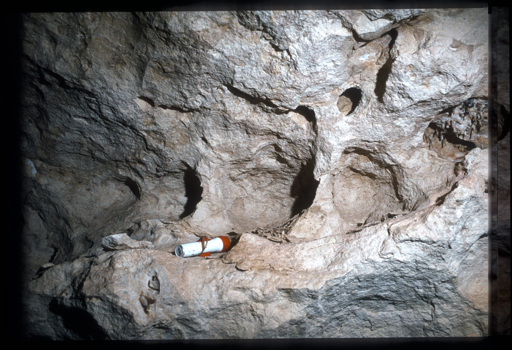
*ASF Joe N. Jennings slide catalogue, JNJ-S-1006-03, Box 1006. Catalogue description: Witches Cave - Tafoni and solution tubes. [ASF record](https://st1.asflib.net/MEDIA/ASFJJSlidesCatalogue/Box%201006/JNJ-S-1006-03.html).*

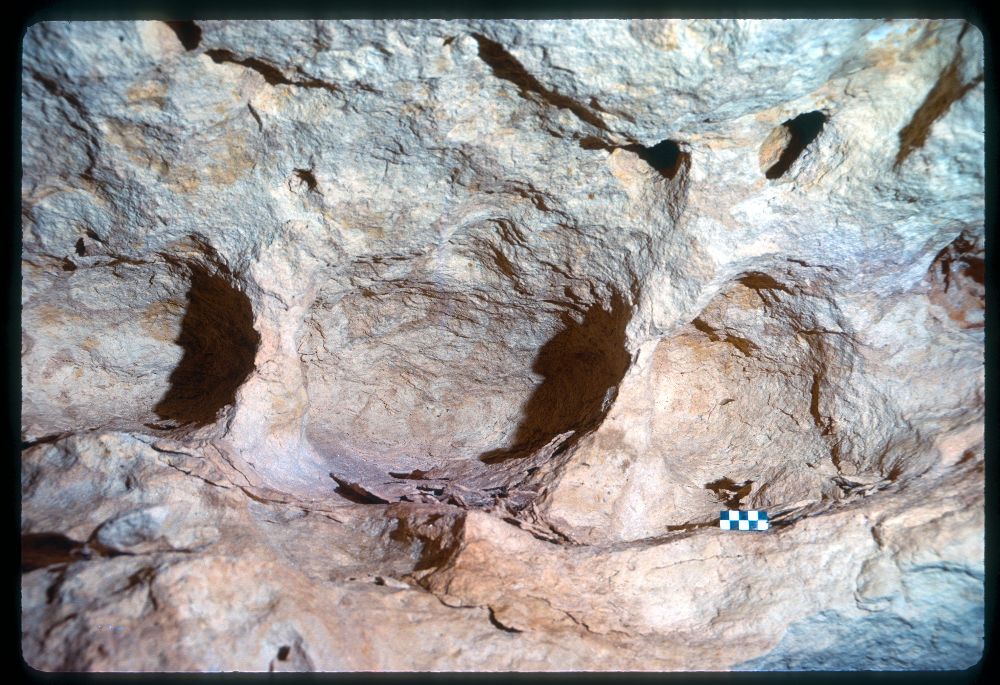
*ASF Joe N. Jennings slide catalogue, JNJ-S-1006-04, Box 1006. Catalogue description: Witches Cave - Tafoni - Internal exfoliation - Salt - Adrian Davey. [ASF record](https://st1.asflib.net/MEDIA/ASFJJSlidesCatalogue/Box%201006/JNJ-S-1006-04.html).*

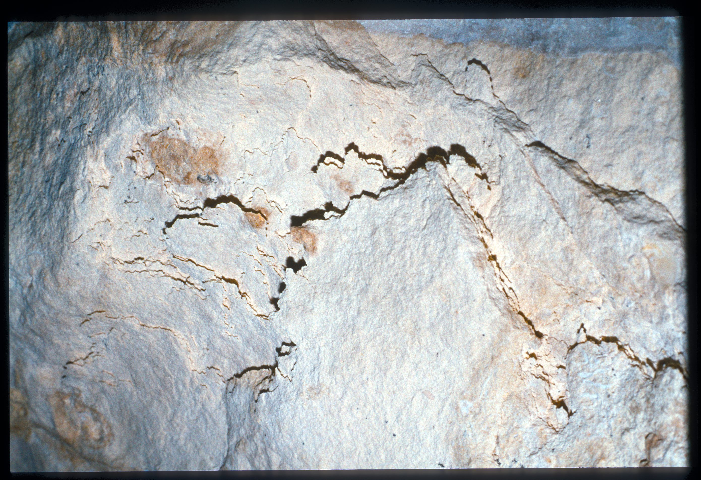
*ASF Joe N. Jennings slide catalogue, JNJ-S-1006-05, Box 1006. Catalogue description: Witches Cave - Roof and wall flaking. [ASF record](https://st1.asflib.net/MEDIA/ASFJJSlidesCatalogue/Box%201006/JNJ-S-1006-05.html).*

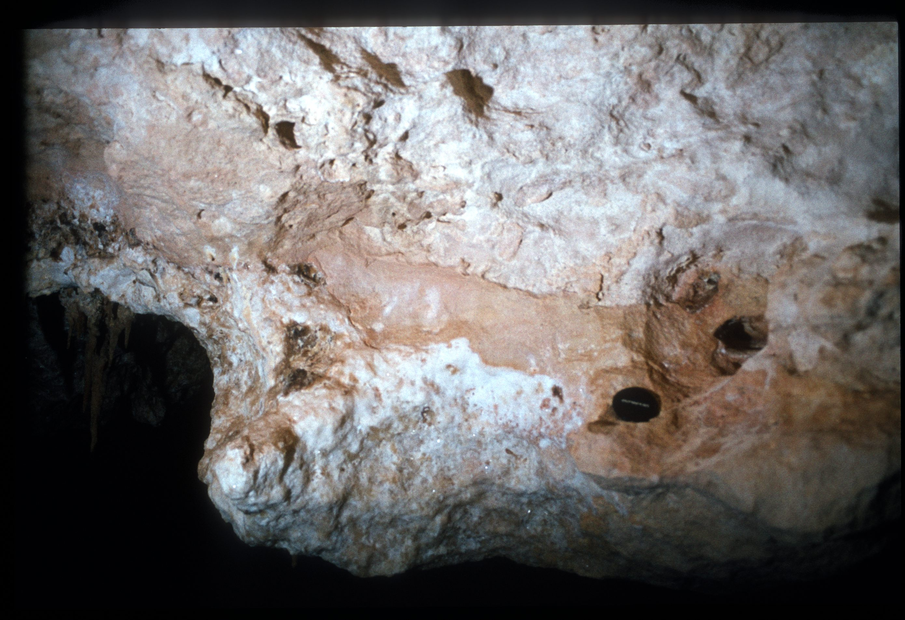
*ASF Joe N. Jennings slide catalogue, JNJ-S-1006-06, Box 1006. Catalogue description: Witches Cave -. [ASF record](https://st1.asflib.net/MEDIA/ASFJJSlidesCatalogue/Box%201006/JNJ-S-1006-06.html).*

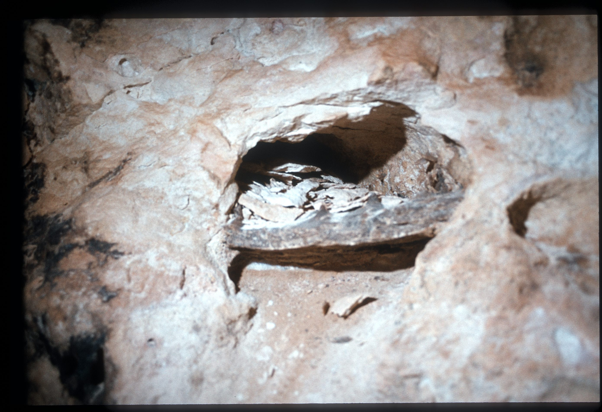
*ASF Joe N. Jennings slide catalogue, JNJ-S-1006-07, Box 1006. Catalogue description: Witches Cave - Tafoni - calcite floor - flakes. [ASF record](https://st1.asflib.net/MEDIA/ASFJJSlidesCatalogue/Box%201006/JNJ-S-1006-07.html).*

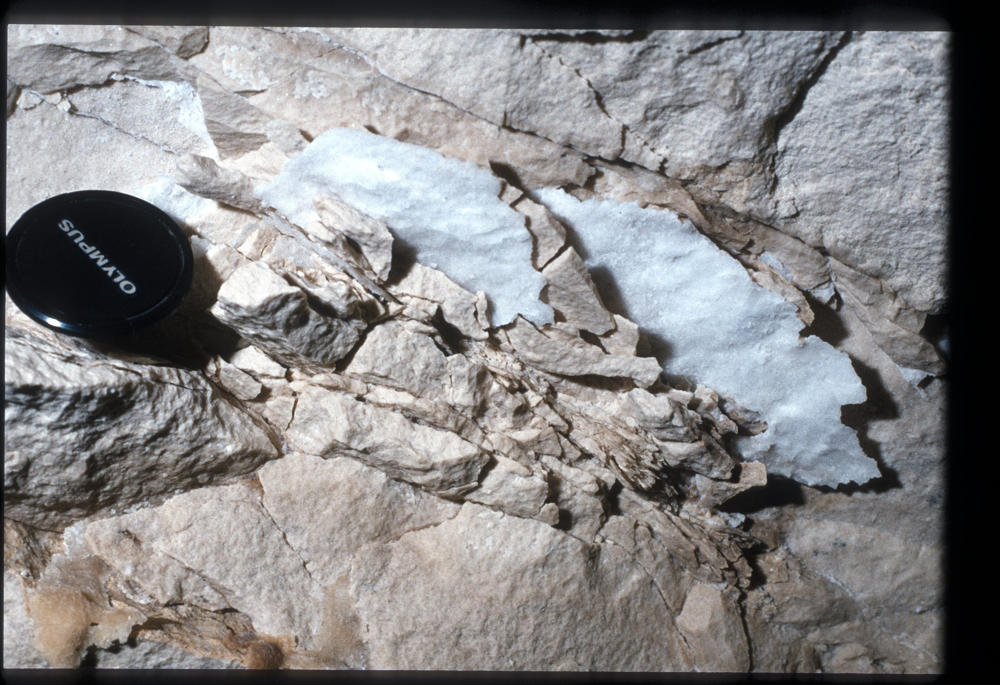
*ASF Joe N. Jennings slide catalogue, JNJ-S-1006-08, Box 1006. Catalogue description: Witches Cave - Salt between flakes. [ASF record](https://st1.asflib.net/MEDIA/ASFJJSlidesCatalogue/Box%201006/JNJ-S-1006-08.html).*

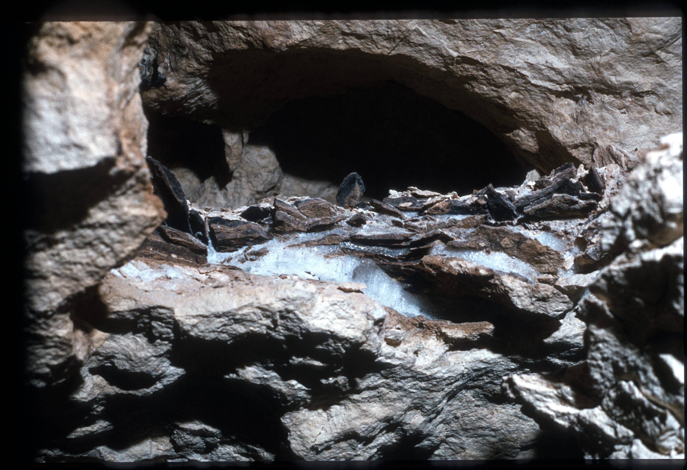
*ASF Joe N. Jennings slide catalogue, JNJ-S-1006-09, Box 1006. Catalogue description: Witches Cave - Salt wedging. [ASF record](https://st1.asflib.net/MEDIA/ASFJJSlidesCatalogue/Box%201006/JNJ-S-1006-09.html).*

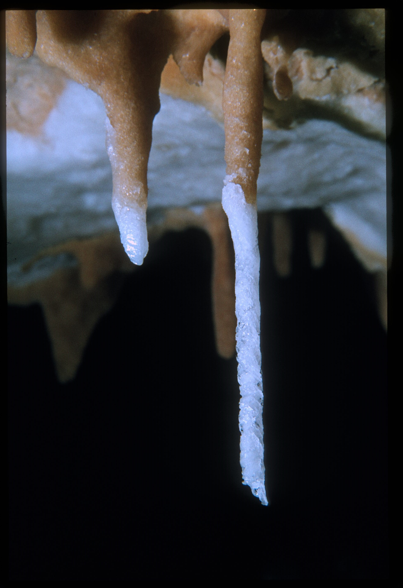
*ASF Joe N. Jennings slide catalogue, JNJ-S-1006-10, Box 1006. Catalogue description: Witches Cave - 'tites' - Adrian Davey. [ASF record](https://st1.asflib.net/MEDIA/ASFJJSlidesCatalogue/Box%201006/JNJ-S-1006-10.html).*

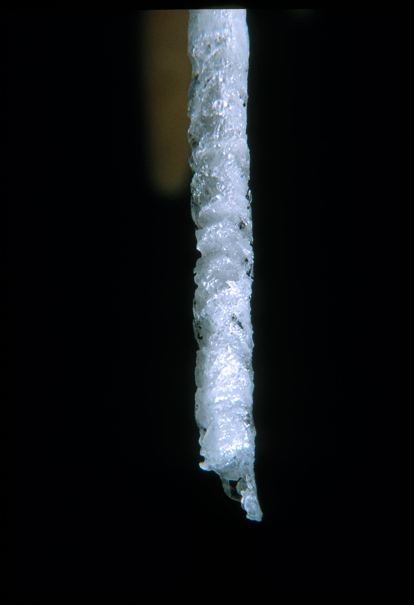
*ASF Joe N. Jennings slide catalogue, JNJ-S-1006-11, Box 1006. Catalogue description: Witches Cave - 'tites' - Adrian Davey. [ASF record](https://st1.asflib.net/MEDIA/ASFJJSlidesCatalogue/Box%201006/JNJ-S-1006-11.html).*

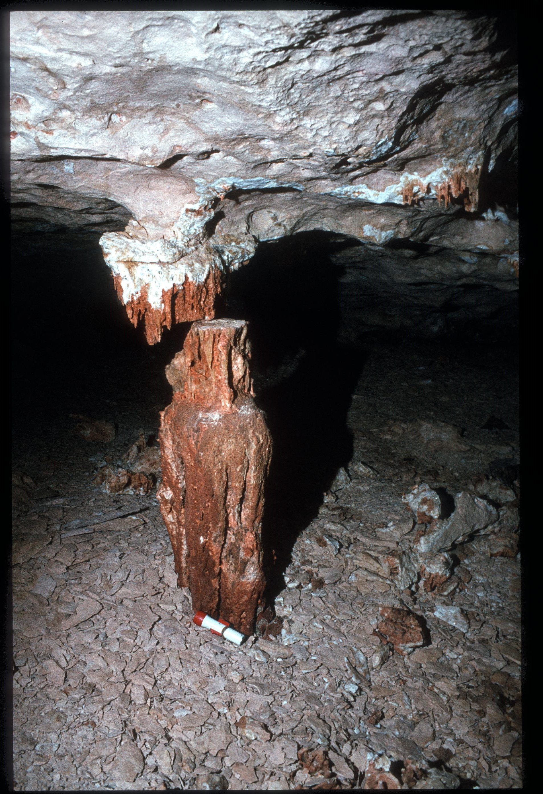
*ASF Joe N. Jennings slide catalogue, JNJ-S-1006-12, Box 1006. Catalogue description: Witches Cave - Lateral shift of column. [ASF record](https://st1.asflib.net/MEDIA/ASFJJSlidesCatalogue/Box%201006/JNJ-S-1006-12.html).*

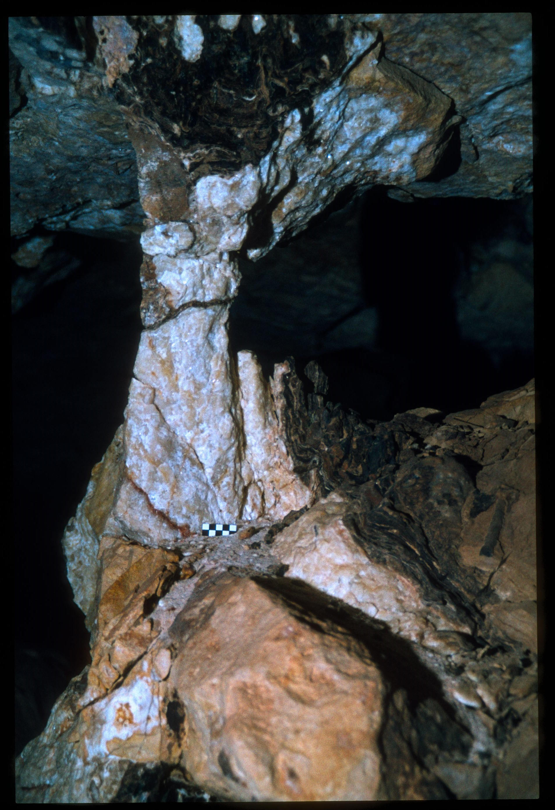
*ASF Joe N. Jennings slide catalogue, JNJ-S-1006-13, Box 1006. Catalogue description: Witches Cave - Cracked column. [ASF record](https://st1.asflib.net/MEDIA/ASFJJSlidesCatalogue/Box%201006/JNJ-S-1006-13.html).*

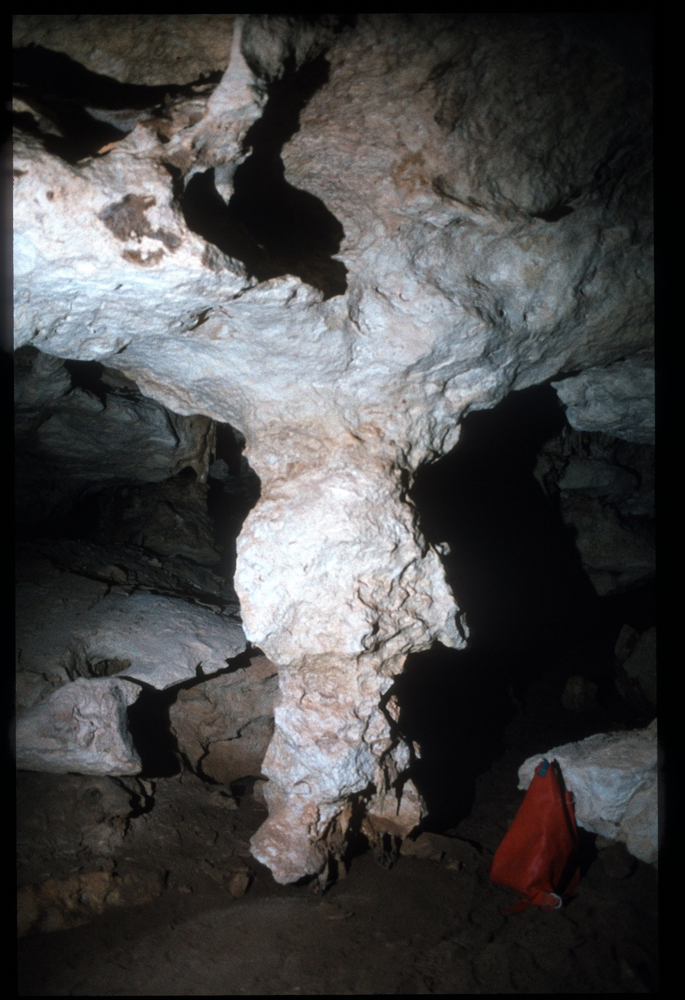
*ASF Joe N. Jennings slide catalogue, JNJ-S-1006-14, Box 1006. Catalogue description: Witches Cave - Rock pendant carved by wedging. [ASF record](https://st1.asflib.net/MEDIA/ASFJJSlidesCatalogue/Box%201006/JNJ-S-1006-14.html).*

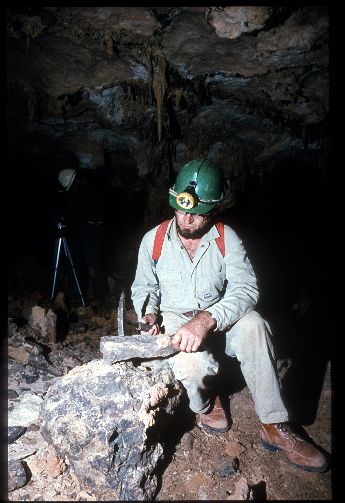
*ASF Joe N. Jennings slide catalogue, JNJ-S-1006-15, Box 1006. Catalogue description: Witches Cave - Albert collecting in Witches cave. [ASF record](https://st1.asflib.net/MEDIA/ASFJJSlidesCatalogue/Box%201006/JNJ-S-1006-15.html).*

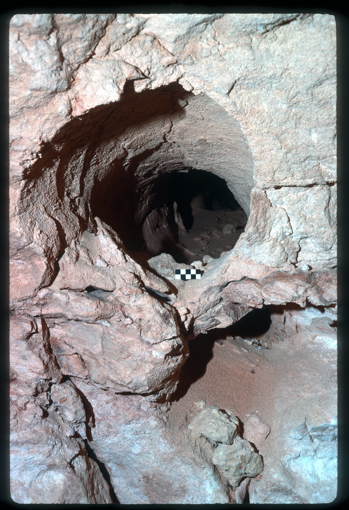
*ASF Joe N. Jennings slide catalogue, JNJ-S-1006-16, Box 1006. Catalogue description: Witches Cave - Adrian Davey. [ASF record](https://st1.asflib.net/MEDIA/ASFJJSlidesCatalogue/Box%201006/JNJ-S-1006-16.html).*

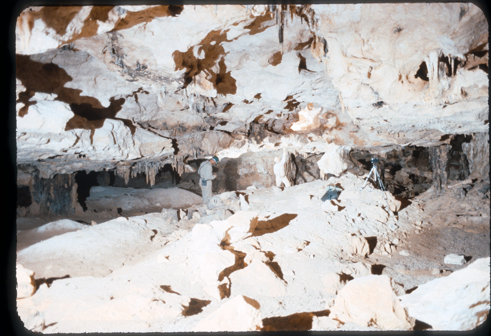
*ASF Joe N. Jennings slide catalogue, JNJ-S-1006-17, Box 1006. Catalogue description: Witches Cave -. [ASF record](https://st1.asflib.net/MEDIA/ASFJJSlidesCatalogue/Box%201006/JNJ-S-1006-17.html).*

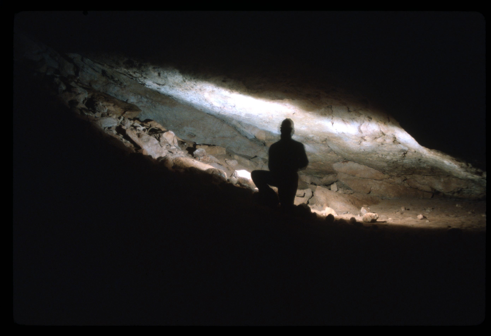
*ASF Joe N. Jennings slide catalogue, JNJ-S-1006-19, Box 1006. Catalogue description: Snake Pit - Adrian Davey. [ASF record](https://st1.asflib.net/MEDIA/ASFJJSlidesCatalogue/Box%201006/JNJ-S-1006-19.html).*

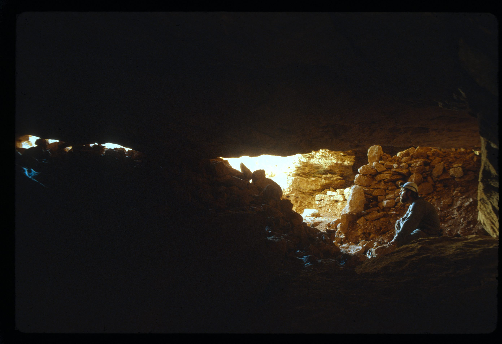
*ASF Joe N. Jennings slide catalogue, JNJ-S-1006-20, Box 1006. Catalogue description: Snake Pit - Abo-site - Adrian Davey. [ASF record](https://st1.asflib.net/MEDIA/ASFJJSlidesCatalogue/Box%201006/JNJ-S-1006-20.html).*

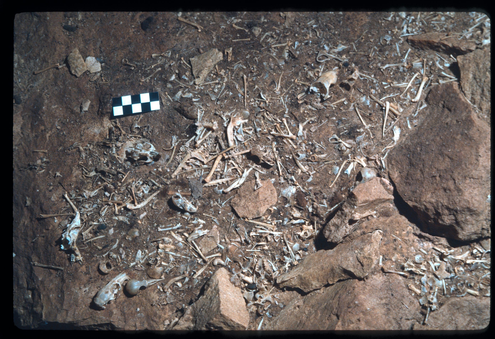
*ASF Joe N. Jennings slide catalogue, JNJ-S-1006-21, Box 1006. Catalogue description: Snake Pit - Mammal Bones - Adrian Davey. [ASF record](https://st1.asflib.net/MEDIA/ASFJJSlidesCatalogue/Box%201006/JNJ-S-1006-21.html).*

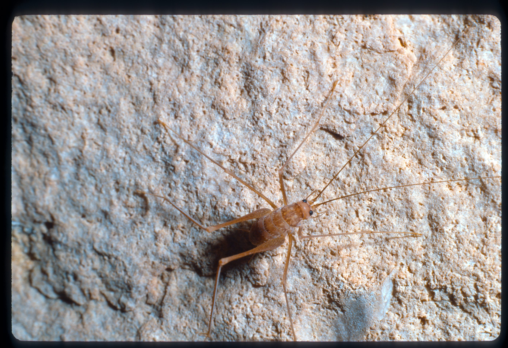
*ASF Joe N. Jennings slide catalogue, JNJ-S-1006-22, Box 1006. Catalogue description: Snake Pit - Trogobite - Adrian Davey. [ASF record](https://st1.asflib.net/MEDIA/ASFJJSlidesCatalogue/Box%201006/JNJ-S-1006-22.html).*

<!-- ASF slide images: end -->

# References

- [Lower South East Cave Reference (Horne, 1993)](../../Regions/Oceania/Australia/5L%20-%20Mt%20Gambier/Maps/Lower%20South%20East%20Cave%20Reference%20%28Horne%2C%201993%29.pdf)
