# About

Includes Elk River

# Additional Notes

- **AgnesMilowka - 2:** http://www.agnesmilowka.com/articles/cave-diving/74-cave-diving-victoria

# Source notes

## ASF slide images

Images are from the ASF Joe N. Jennings slide catalogue. Each caption preserves the catalogue description and links to its source record.

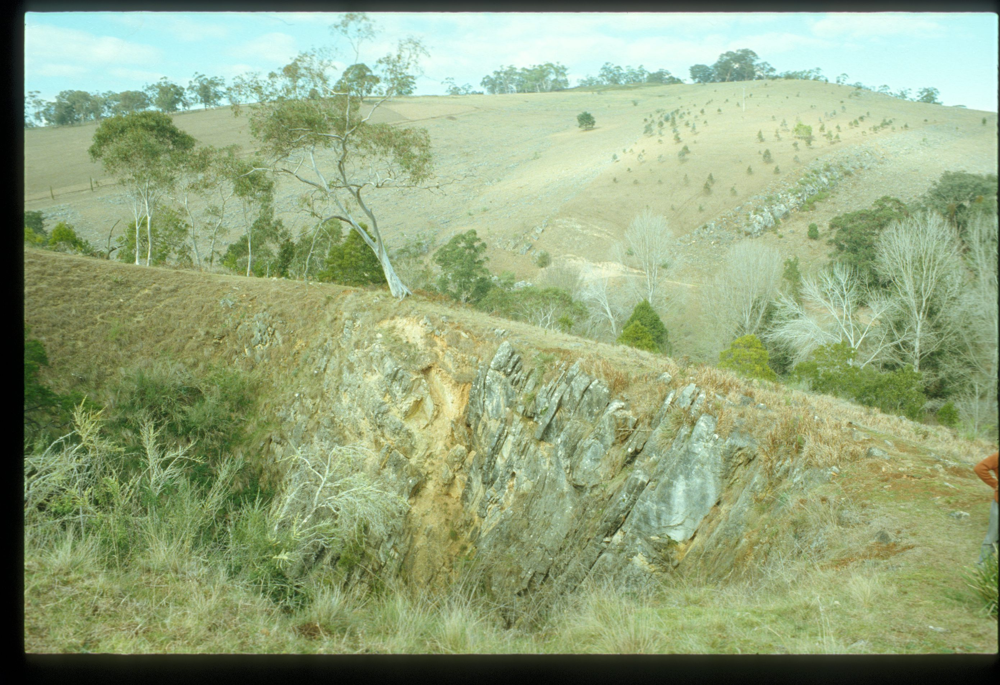
*ASF Joe N. Jennings slide catalogue, JNJ-S-00073, Box 38. Catalogue description: Collapse doline above cave. [ASF record](https://st1.asflib.net/MEDIA/ASFJJSlidesCatalogue/Box%2038/JNJ-S-00073.html).*

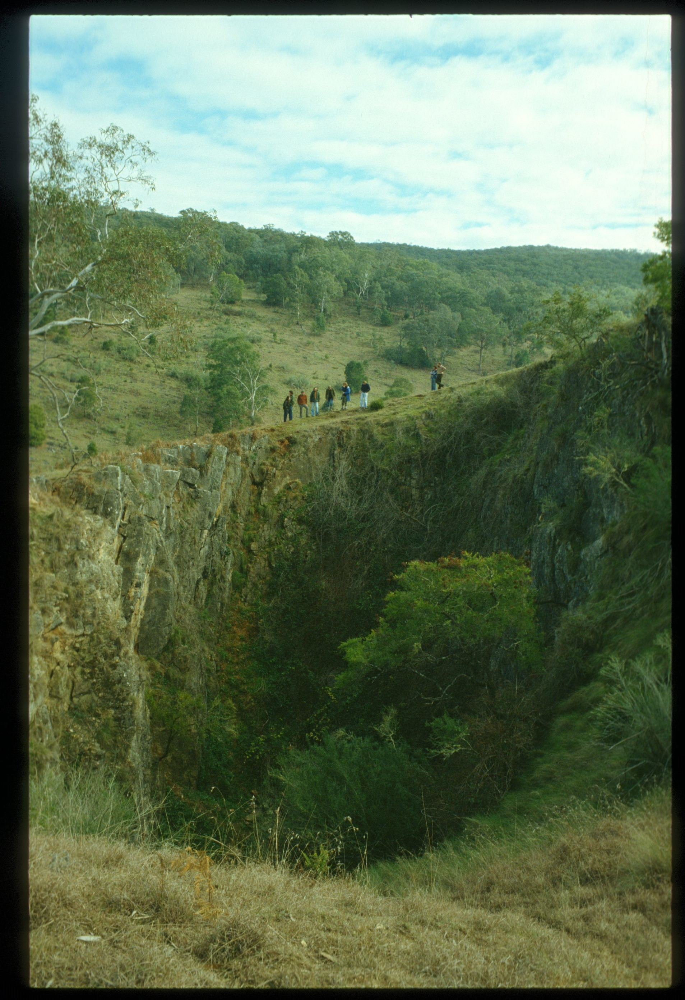
*ASF Joe N. Jennings slide catalogue, JNJ-S-00155, Box 42. Catalogue description: Colapse doline, Buchan. [ASF record](https://st1.asflib.net/MEDIA/ASFJJSlidesCatalogue/Box%2042/JNJ-S-00155.html).*

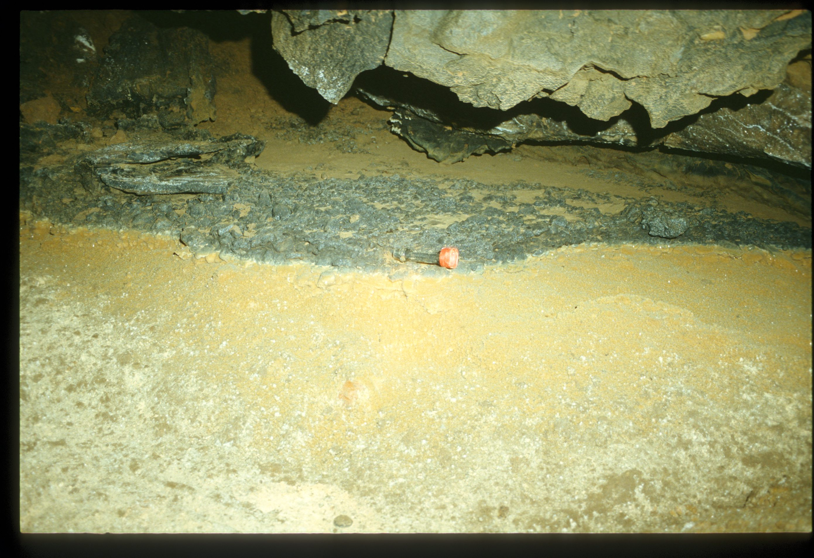
*ASF Joe N. Jennings slide catalogue, JNJ-S-00480, Box 100. Catalogue description: ? Mn patinated old gravels in Federal Cave, Buchan. [ASF record](https://st1.asflib.net/MEDIA/ASFJJSlidesCatalogue/Box%20100/JNJ-S-00480.html).*

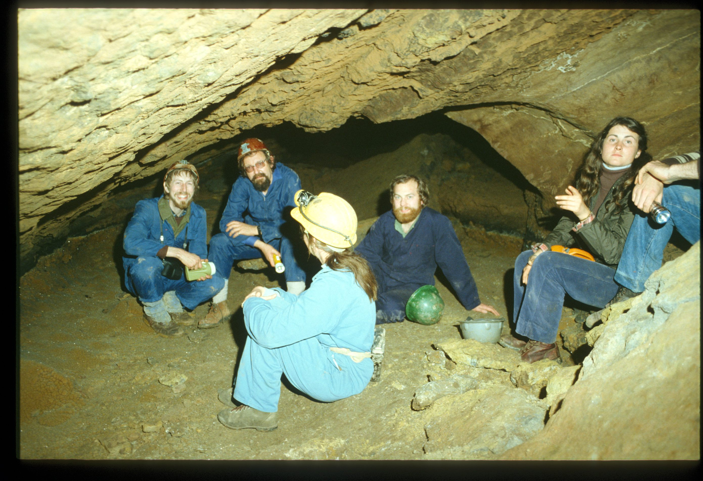
*ASF Joe N. Jennings slide catalogue, JNJ-S-00481, Box 100. Catalogue description: Federal Cave, Buchan, Steve T, Dingle, Sue White. [ASF record](https://st1.asflib.net/MEDIA/ASFJJSlidesCatalogue/Box%20100/JNJ-S-00481.html).*

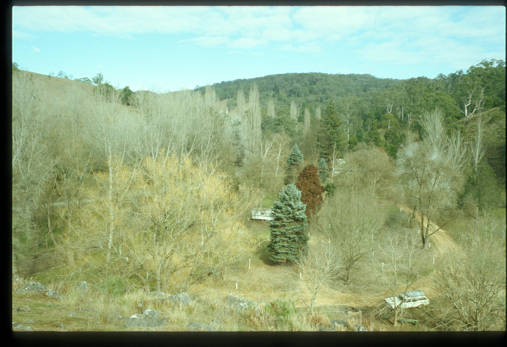
*ASF Joe N. Jennings slide catalogue, JNJ-S-00482, Box 100. Catalogue description: Trees in Caves Reserve, Buchan. [ASF record](https://st1.asflib.net/MEDIA/ASFJJSlidesCatalogue/Box%20100/JNJ-S-00482.html).*

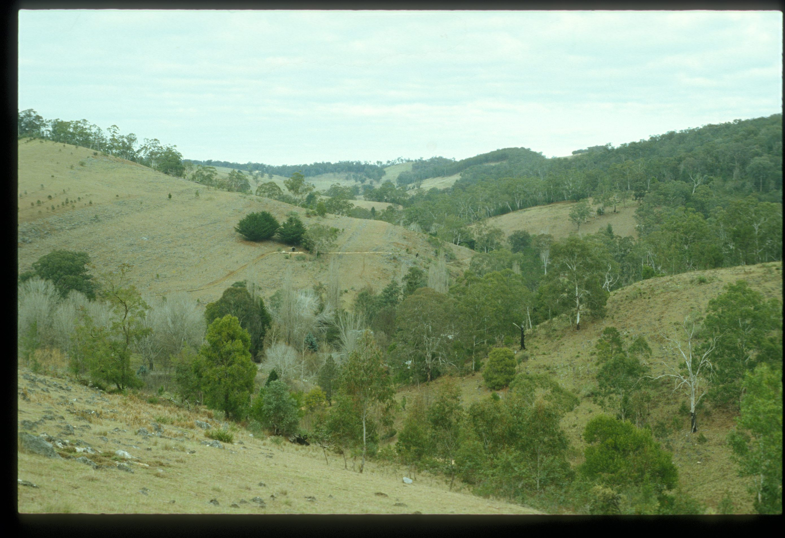
*ASF Joe N. Jennings slide catalogue, JNJ-S-00483, Box 100. Catalogue description: Fairy (cave) Creek, valley-in-valley, Buchan. [ASF record](https://st1.asflib.net/MEDIA/ASFJJSlidesCatalogue/Box%20100/JNJ-S-00483.html).*

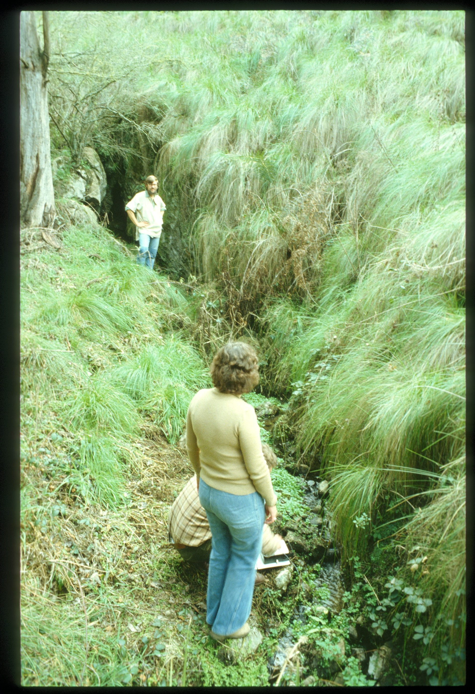
*ASF Joe N. Jennings slide catalogue, JNJ-S-00484, Box 100. Catalogue description: Moon Cave "Efflux", Buchan. [ASF record](https://st1.asflib.net/MEDIA/ASFJJSlidesCatalogue/Box%20100/JNJ-S-00484.html).*

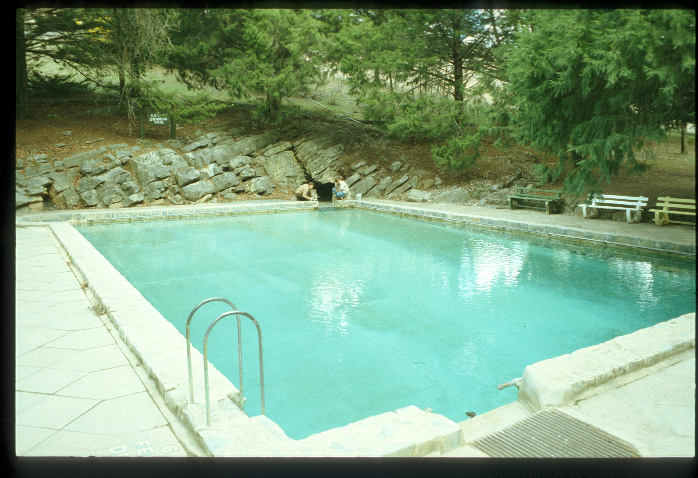
*ASF Joe N. Jennings slide catalogue, JNJ-S-00485, Box 100. Catalogue description: Spring, Buchan, Cave Reserve. [ASF record](https://st1.asflib.net/MEDIA/ASFJJSlidesCatalogue/Box%20100/JNJ-S-00485.html).*

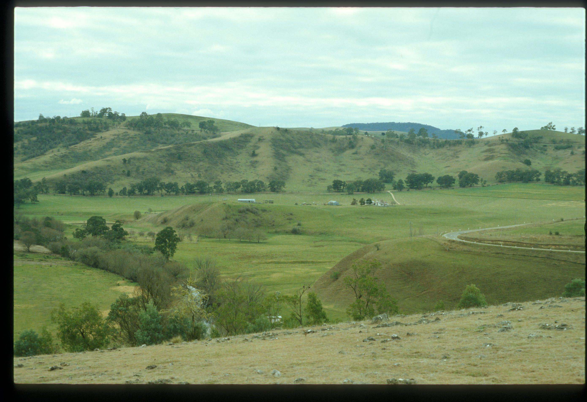
*ASF Joe N. Jennings slide catalogue, JNJ-S-00486, Box 100. Catalogue description: Meander core, Buchan River. [ASF record](https://st1.asflib.net/MEDIA/ASFJJSlidesCatalogue/Box%20100/JNJ-S-00486.html).*

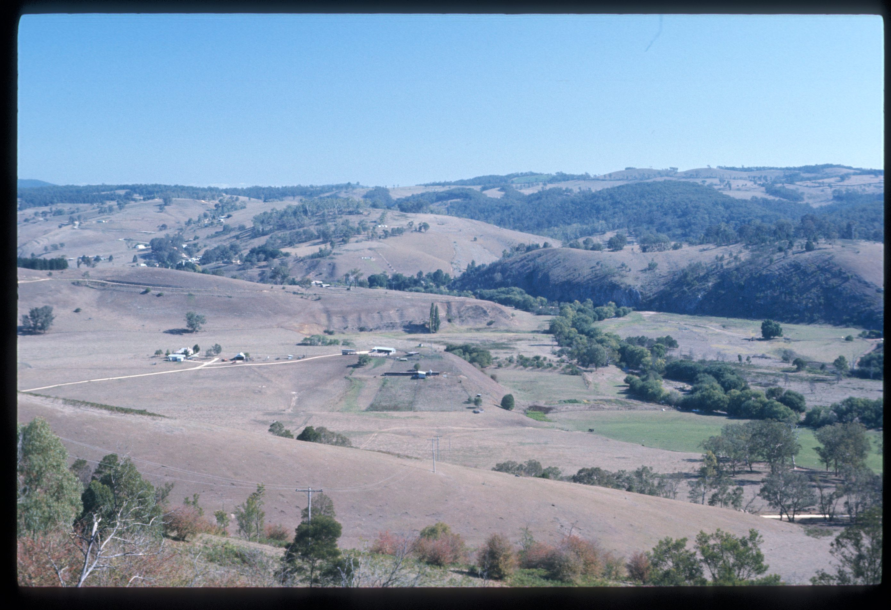
*ASF Joe N. Jennings slide catalogue, JNJ-S-00487, Box 100. Catalogue description: Meander core, Buchan River. [ASF record](https://st1.asflib.net/MEDIA/ASFJJSlidesCatalogue/Box%20100/JNJ-S-00487.html).*

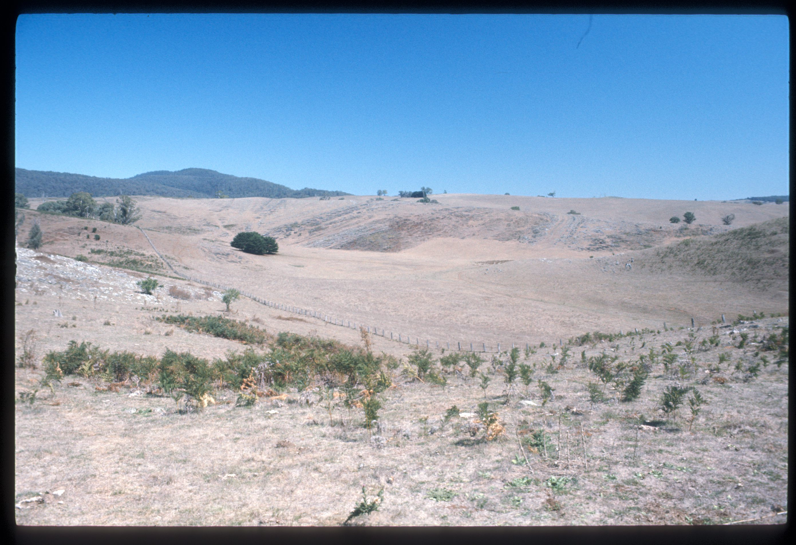
*ASF Joe N. Jennings slide catalogue, JNJ-S-00488, Box 100. Catalogue description: Dry valley, Buchan. ? Former Tara Creek. [ASF record](https://st1.asflib.net/MEDIA/ASFJJSlidesCatalogue/Box%20100/JNJ-S-00488.html).*

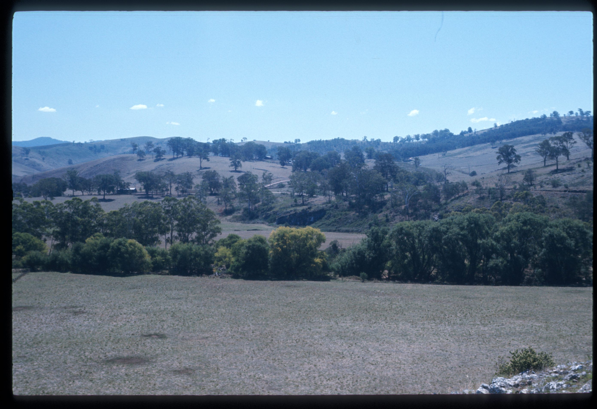
*ASF Joe N. Jennings slide catalogue, JNJ-S-00489, Box 100. Catalogue description: Bar across blind valley, Wilson Cave, Buchan. [ASF record](https://st1.asflib.net/MEDIA/ASFJJSlidesCatalogue/Box%20100/JNJ-S-00489.html).*

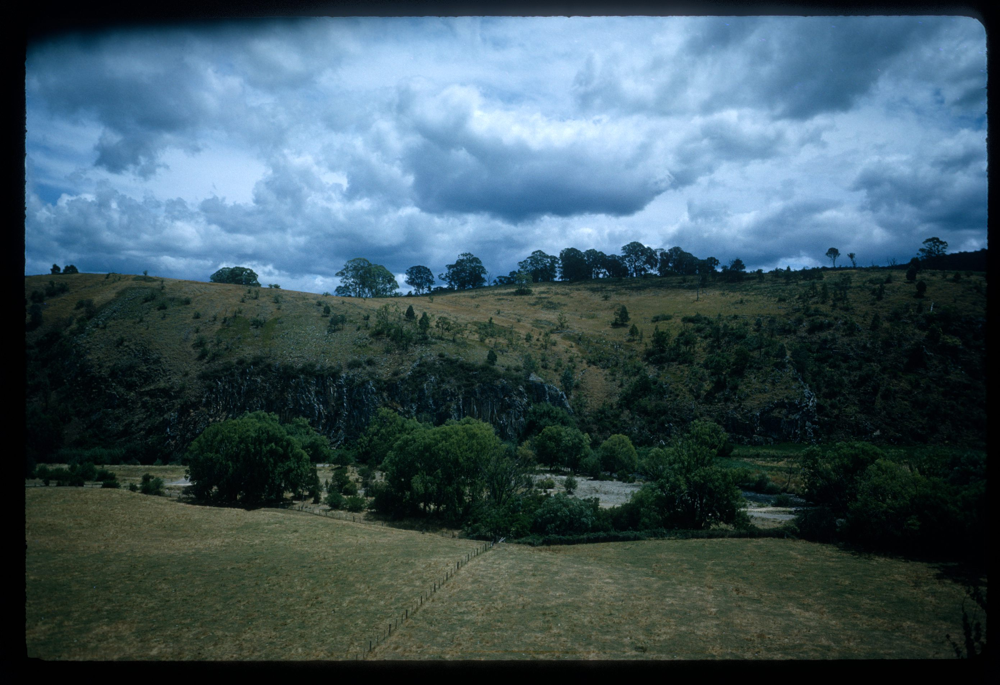
*ASF Joe N. Jennings slide catalogue, JNJ-S-00490, Box 100. Catalogue description: ? Cliffs, Buchan, Feb 1965. [ASF record](https://st1.asflib.net/MEDIA/ASFJJSlidesCatalogue/Box%20100/JNJ-S-00490.html).*

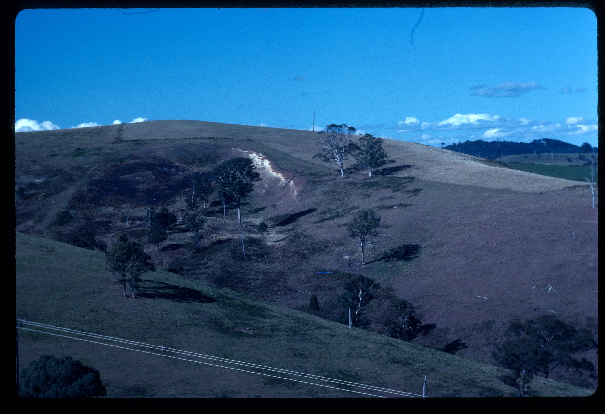
*ASF Joe N. Jennings slide catalogue, JNJ-S-00491, Box 100. Catalogue description: Landslide - debris flow, Taravale formation near Buchan. [ASF record](https://st1.asflib.net/MEDIA/ASFJJSlidesCatalogue/Box%20100/JNJ-S-00491.html).*

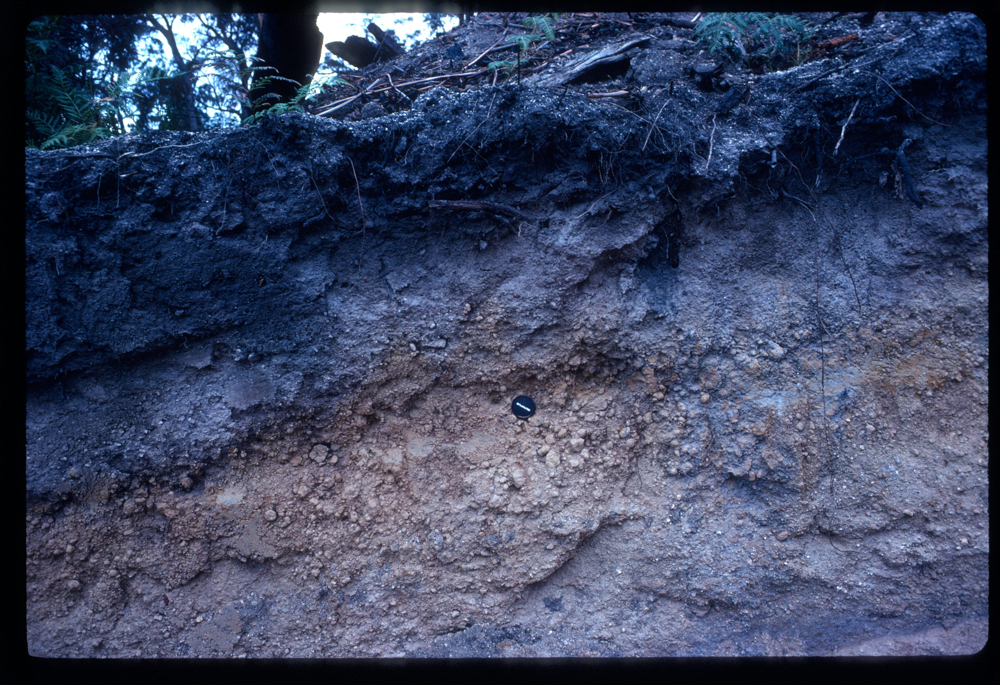
*ASF Joe N. Jennings slide catalogue, JNJ-S-00492, Box 100. Catalogue description: Podsol in tertiary gravels near Buchan. [ASF record](https://st1.asflib.net/MEDIA/ASFJJSlidesCatalogue/Box%20100/JNJ-S-00492.html).*

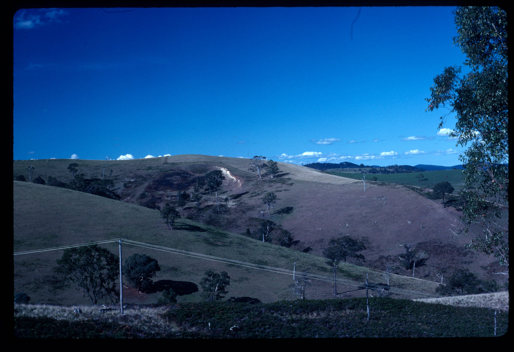
*ASF Joe N. Jennings slide catalogue, JNJ-S-00493, Box 100. Catalogue description: Landslide - debris flow, Taravale formation near Buchan. [ASF record](https://st1.asflib.net/MEDIA/ASFJJSlidesCatalogue/Box%20100/JNJ-S-00493.html).*

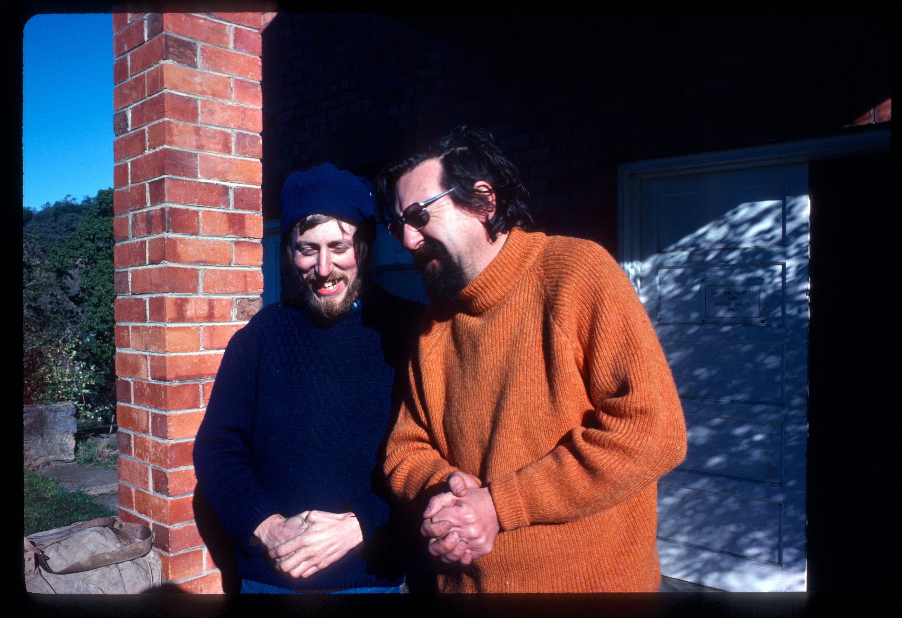
*ASF Joe N. Jennings slide catalogue, JNJ-S-00494, Box 100. Catalogue description: Dingle and Steve T, Buchan, Aug 1979. [ASF record](https://st1.asflib.net/MEDIA/ASFJJSlidesCatalogue/Box%20100/JNJ-S-00494.html).*

<!-- ASF slide images: end -->

# References

- [LizRogers](https://lizrogersphotography.com/2014/05/diving-the-end-of-elk-river/)
- [GoogleMaps](https://goo.gl/maps/H9nbxRaffiACF5dz8)
- [Parks.vic.gov.au](https://www.parks.vic.gov.au/places-to-see/parks/buchan-caves-reserve)
- [AgnesMilowka.com](http://www.agnesmilowka.com/articles/dry-caves/59-elk-river-exploration)
