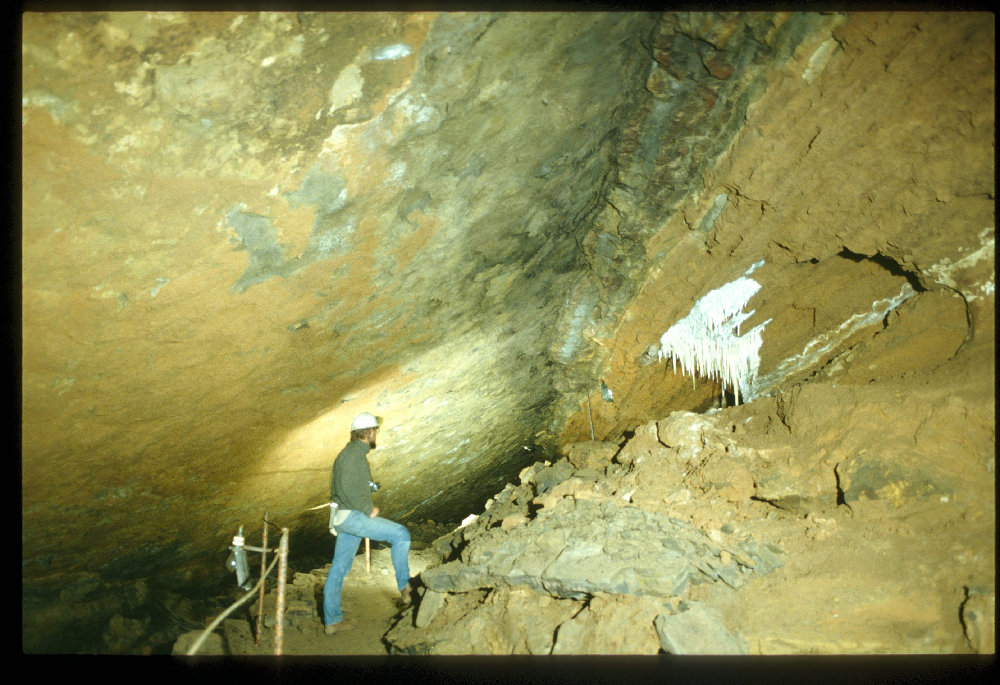
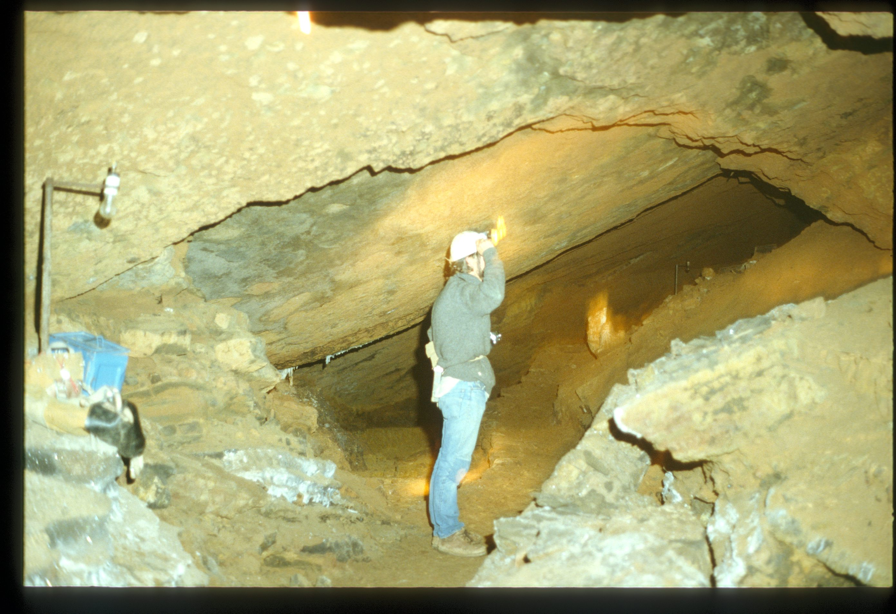
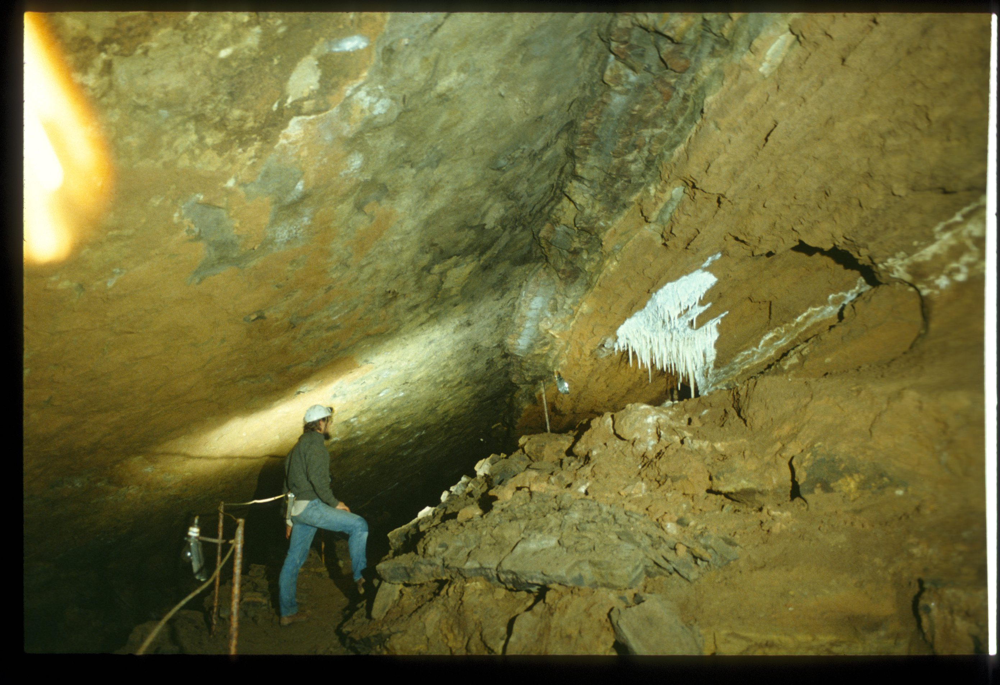
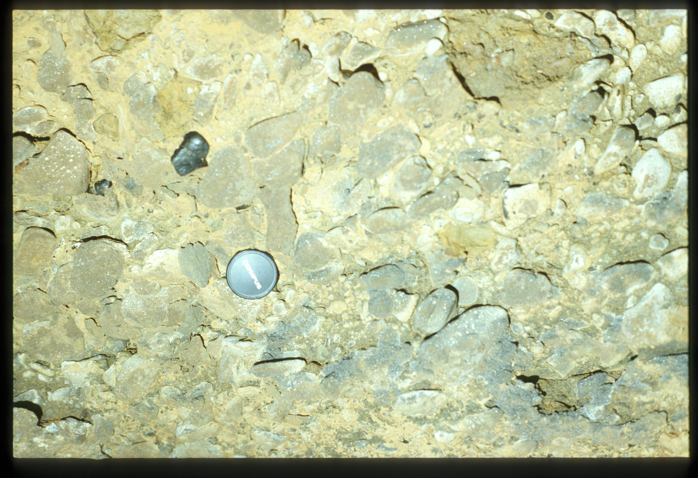
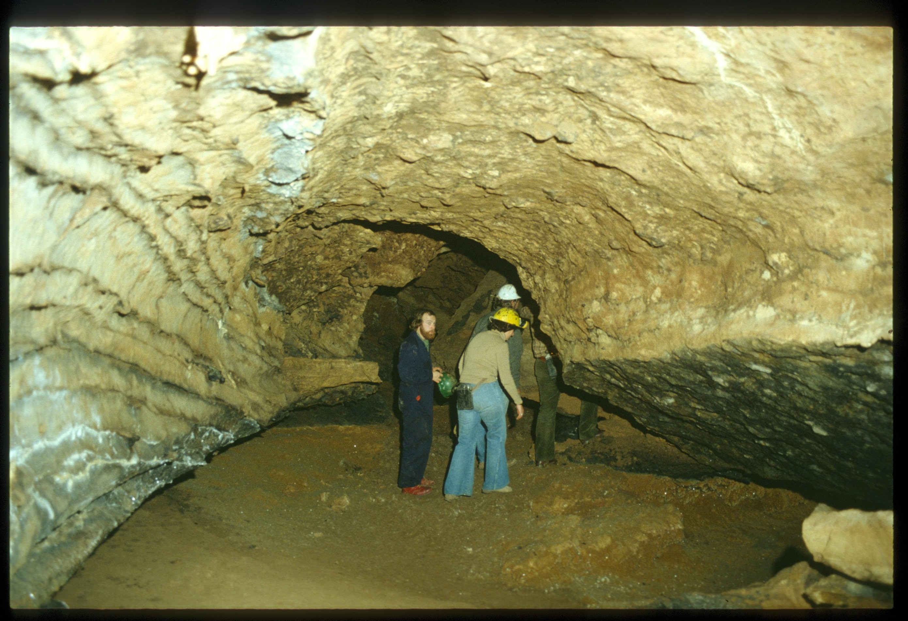
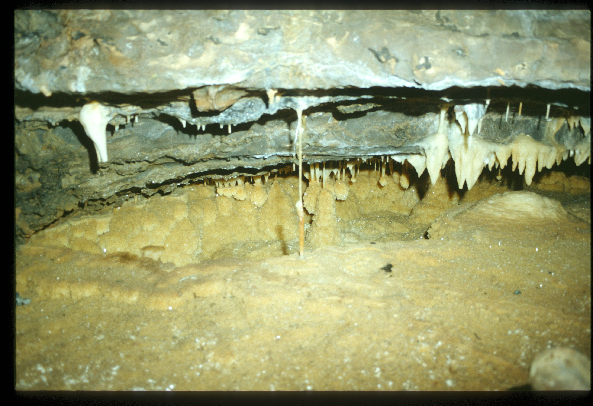
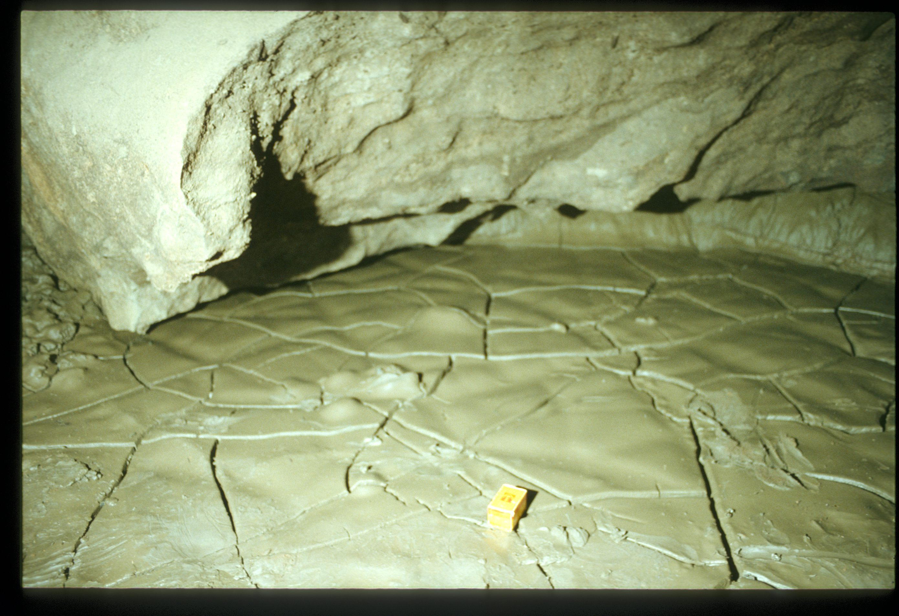
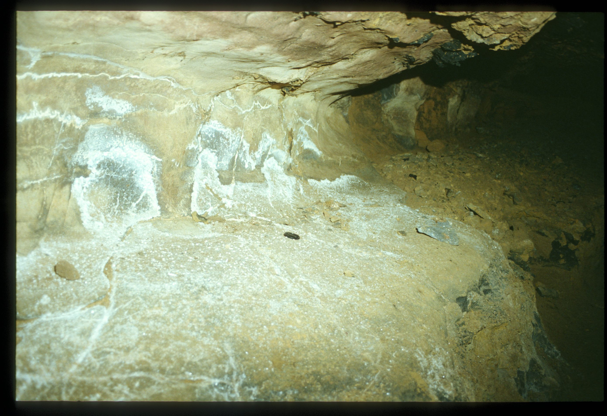
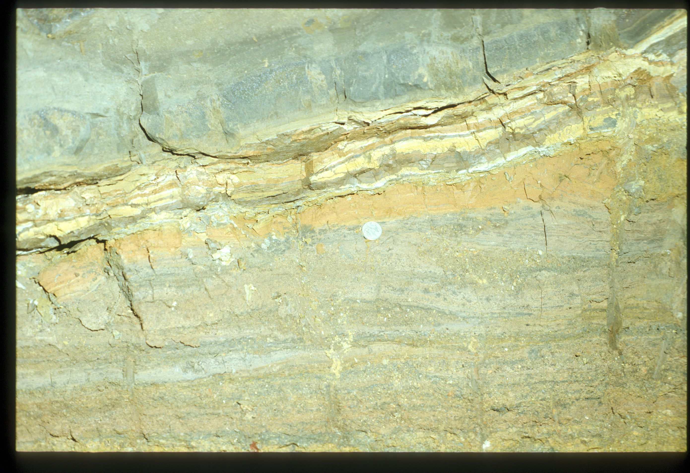
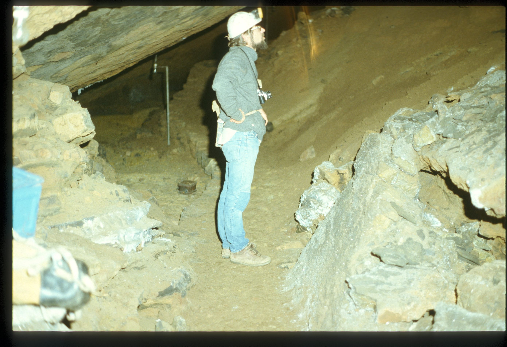

# About

Tourist Cave - Buchan

Federal Cave in the [Buchan Caves](Buchan%20Caves.md) Reserve was originally developed as a show cave, lit by a power generator. In 1970 mains power was connected to [Fairy Cave](Fairy%20Cave.md) and [Royal Cave](Royal%20Cave.md), but Federal Cave was closed to visitors. For many years, the cave was basically left alone, but now the Friends of [Buchan Caves](Buchan%20Caves.md) are restoring this cave. They have installed a wash-water system along the former tourist path, and used it to clean the formations. They also removed the decaying pre-war electrics and hand-rails. The now offered cave tour has a different style that focuses on interpreting the geology of this most interesting cave.

# Source notes

<!-- ASF slide images: start -->
## ASF slide images

Images are from the ASF Joe N. Jennings slide catalogue. Each caption preserves the catalogue description and links to its source record.

*ASF Joe N. Jennings slide catalogue, JNJ-S-00154, Box 42. Catalogue description: Oblique cross-section in dip along strike passage. Federal Cave, Buchan. [ASF record](https://st1.asflib.net/MEDIA/ASFJJSlidesCatalogue/Box%2042/JNJ-S-00154.html).*

*ASF Joe N. Jennings slide catalogue, JNJ-S-00477, Box 100. Catalogue description: Oblique cross-section downdip along strike passage, Federal Cave, Buchan. [ASF record](https://st1.asflib.net/MEDIA/ASFJJSlidesCatalogue/Box%20100/JNJ-S-00477.html).*

*ASF Joe N. Jennings slide catalogue, JNJ-S-00478, Box 100. Catalogue description: Oblique cross-section to strike passage in steep dip, Federal Cave, Buchan. [ASF record](https://st1.asflib.net/MEDIA/ASFJJSlidesCatalogue/Box%20100/JNJ-S-00478.html).*

*ASF Joe N. Jennings slide catalogue, JNJ-S-00074, Box 38. Catalogue description: Old cemented gravels with ? Mn patina on one clast, Federal Cave, Buchan. [ASF record](https://st1.asflib.net/MEDIA/ASFJJSlidesCatalogue/Box%2038/JNJ-S-00074.html).*

*ASF Joe N. Jennings slide catalogue, JNJ-S-00075, Box 38. Catalogue description: Phreatic roof in Federal Cave, Buchan. [ASF record](https://st1.asflib.net/MEDIA/ASFJJSlidesCatalogue/Box%2038/JNJ-S-00075.html).*

*ASF Joe N. Jennings slide catalogue, JNJ-S-00156, Box 42. Catalogue description: Pool deposites, Pendulites, Federal Cave, Buchan. [ASF record](https://st1.asflib.net/MEDIA/ASFJJSlidesCatalogue/Box%2042/JNJ-S-00156.html).*

*ASF Joe N. Jennings slide catalogue, JNJ-S-00474, Box 100. Catalogue description: Fresh mud coating desiccation crack, Federal Cave, Buchan. [ASF record](https://st1.asflib.net/MEDIA/ASFJJSlidesCatalogue/Box%20100/JNJ-S-00474.html).*

*ASF Joe N. Jennings slide catalogue, JNJ-S-00475, Box 100. Catalogue description: Channel incut with gravels, now abandoned, Federal Cave, Buchan. [ASF record](https://st1.asflib.net/MEDIA/ASFJJSlidesCatalogue/Box%20100/JNJ-S-00475.html).*

*ASF Joe N. Jennings slide catalogue, JNJ-S-00476, Box 100. Catalogue description: Crushing of fine grained bedded sediments by roof slab, Federal Cave, Buchan. [ASF record](https://st1.asflib.net/MEDIA/ASFJJSlidesCatalogue/Box%20100/JNJ-S-00476.html).*

*ASF Joe N. Jennings slide catalogue, JNJ-S-00479, Box 100. Catalogue description: Nick White in Federal Cave, Buchan. [ASF record](https://st1.asflib.net/MEDIA/ASFJJSlidesCatalogue/Box%20100/JNJ-S-00479.html).*

<!-- ASF slide images: end -->
