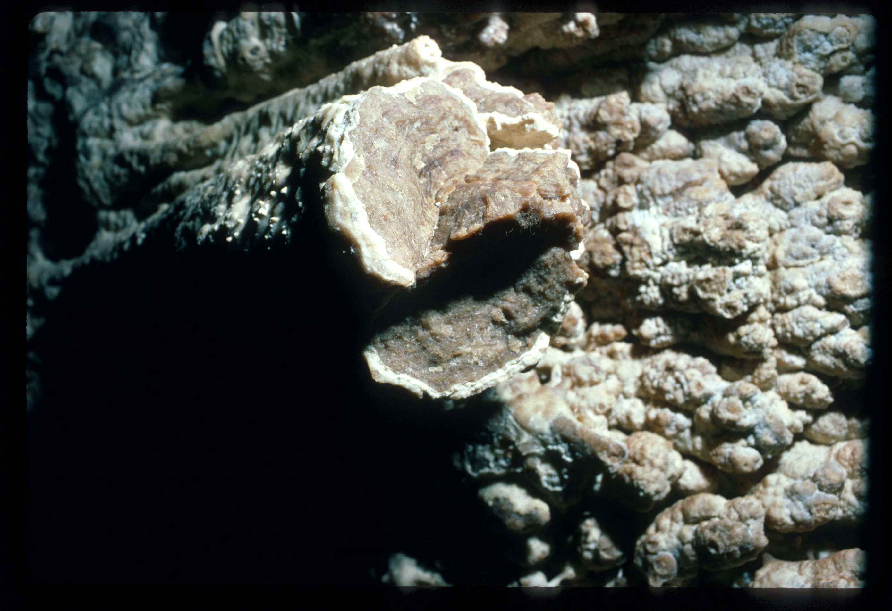
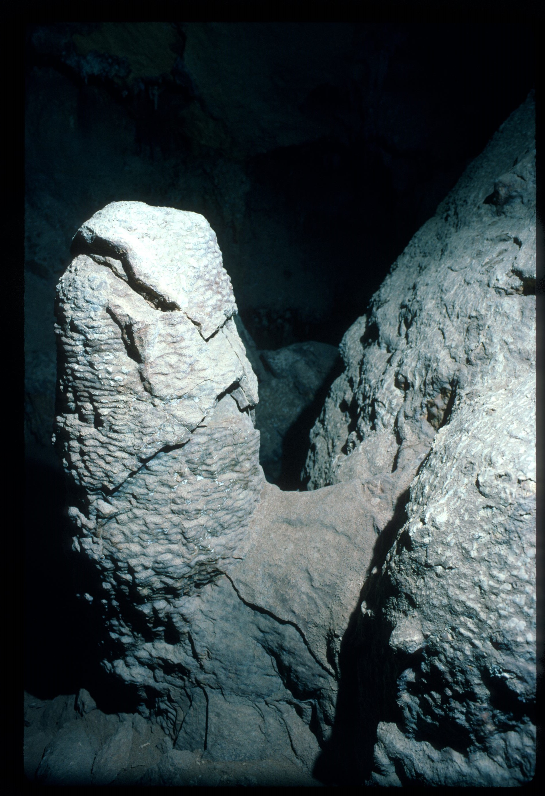
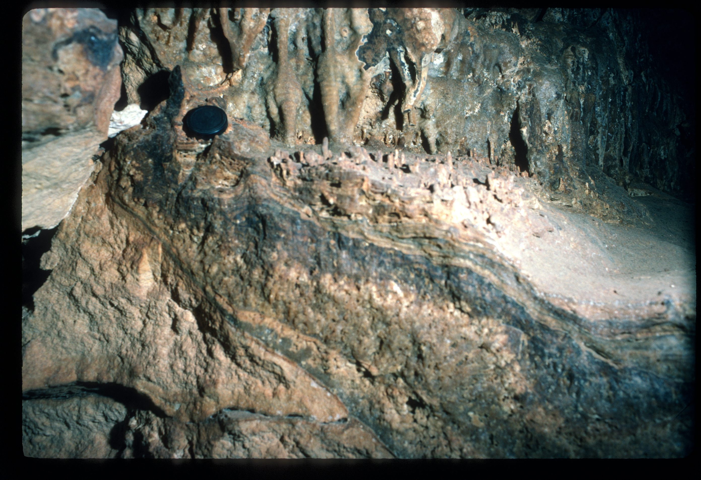
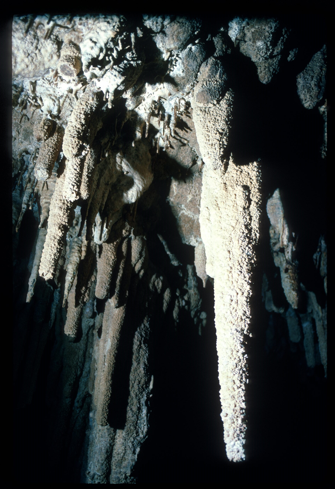
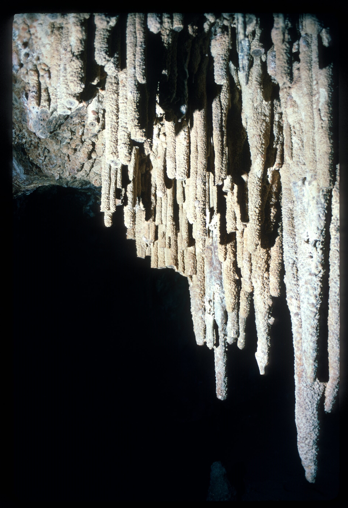
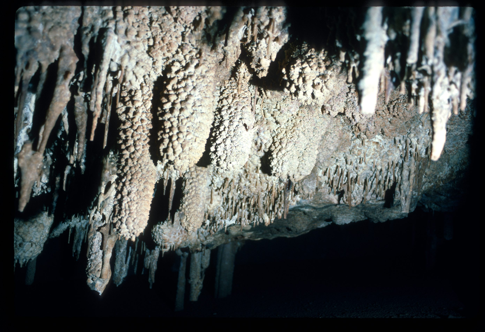
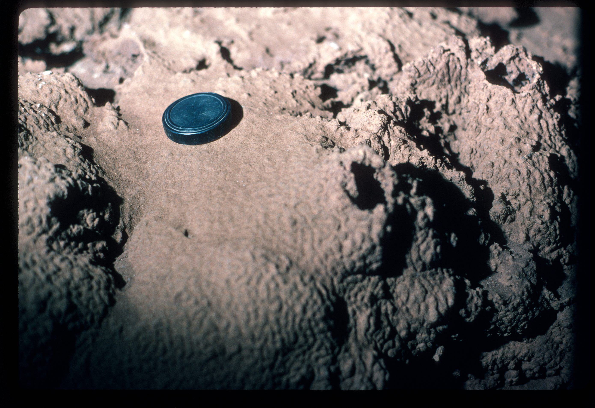
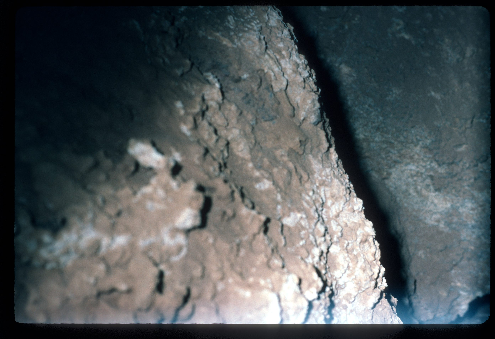
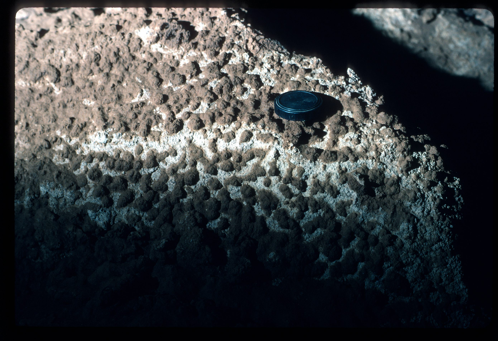

# Source notes

<!-- ASF slide images: start -->
## ASF slide images

Images are from the ASF Joe N. Jennings slide catalogue. Each caption preserves the catalogue description and links to its source record.

*ASF Joe N. Jennings slide catalogue, JNJ-S-00218, Box 44. Catalogue description: Fracture surface (formation), Petrogale Cave. [ASF record](https://st1.asflib.net/MEDIA/ASFJJSlidesCatalogue/Box%2044/JNJ-S-00218.html).*

*ASF Joe N. Jennings slide catalogue, JNJ-S-00219, Box 44. Catalogue description: Fractured stalagmite, Petrogale Cave. [ASF record](https://st1.asflib.net/MEDIA/ASFJJSlidesCatalogue/Box%2044/JNJ-S-00219.html).*

*ASF Joe N. Jennings slide catalogue, JNJ-S-00220, Box 44. Catalogue description: Fractured flowstone, Petrogale Cave. [ASF record](https://st1.asflib.net/MEDIA/ASFJJSlidesCatalogue/Box%2044/JNJ-S-00220.html).*

*ASF Joe N. Jennings slide catalogue, JNJ-S-00221, Box 44. Catalogue description: Stalactites, Petrogale Cave. [ASF record](https://st1.asflib.net/MEDIA/ASFJJSlidesCatalogue/Box%2044/JNJ-S-00221.html).*

*ASF Joe N. Jennings slide catalogue, JNJ-S-00222, Box 44. Catalogue description: Stalactites, Petrogale Cave. [ASF record](https://st1.asflib.net/MEDIA/ASFJJSlidesCatalogue/Box%2044/JNJ-S-00222.html).*

*ASF Joe N. Jennings slide catalogue, JNJ-S-00223, Box 44. Catalogue description: Stalactites, Petrogale Cave. [ASF record](https://st1.asflib.net/MEDIA/ASFJJSlidesCatalogue/Box%2044/JNJ-S-00223.html).*

*ASF Joe N. Jennings slide catalogue, JNJ-S-00224, Box 44. Catalogue description: Phosphate crust, Petrogale Cave. [ASF record](https://st1.asflib.net/MEDIA/ASFJJSlidesCatalogue/Box%2044/JNJ-S-00224.html).*

*ASF Joe N. Jennings slide catalogue, JNJ-S-00225, Box 44. Catalogue description: ? Accidental shot, Petrogale Cave, No, supposebly blisters. [ASF record](https://st1.asflib.net/MEDIA/ASFJJSlidesCatalogue/Box%2044/JNJ-S-00225.html).*

*ASF Joe N. Jennings slide catalogue, JNJ-S-00226, Box 44. Catalogue description: Phosphate crust, Petrogale Cave. [ASF record](https://st1.asflib.net/MEDIA/ASFJJSlidesCatalogue/Box%2044/JNJ-S-00226.html).*

<!-- ASF slide images: end -->
