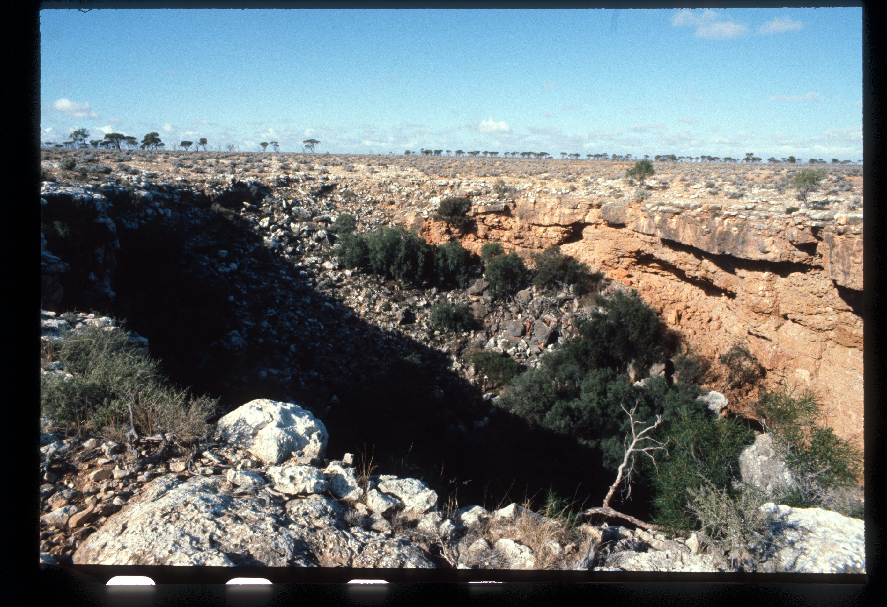
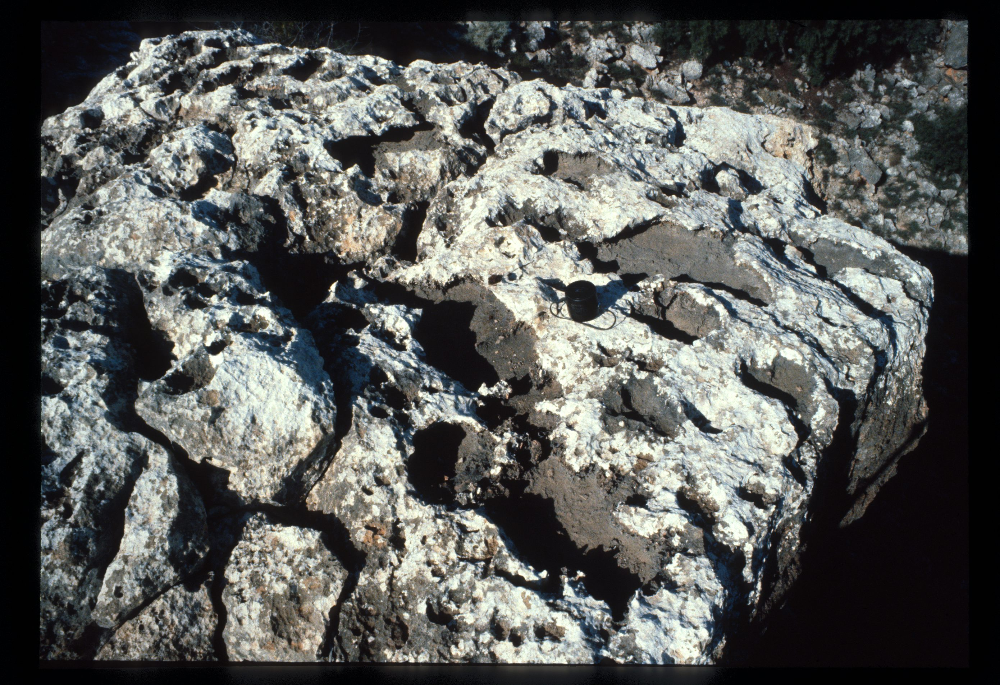
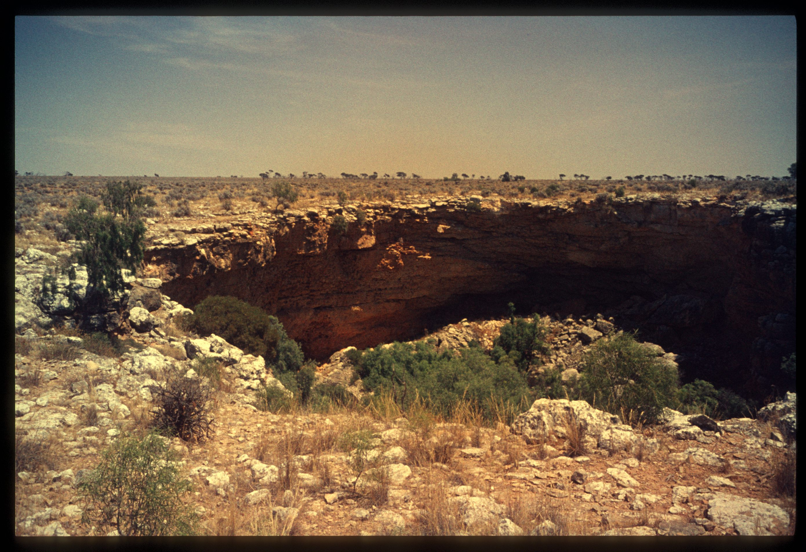

# Source notes

## ASF slide images

Images are from the ASF Joe N. Jennings slide catalogue. Each caption preserves the catalogue description and links to its source record.

*ASF Joe N. Jennings slide catalogue, JNJ-S-00133, Box 41. Catalogue description: Spider Sink, Madura Station. [ASF record](https://st1.asflib.net/MEDIA/ASFJJSlidesCatalogue/Box%2041/JNJ-S-00133.html).*

*ASF Joe N. Jennings slide catalogue, JNJ-S-00134, Box 41. Catalogue description: Solution pans, Spider Sink, Madura Station. [ASF record](https://st1.asflib.net/MEDIA/ASFJJSlidesCatalogue/Box%2041/JNJ-S-00134.html).*

*ASF Joe N. Jennings slide catalogue, JNJ-S-00137, Box 41. Catalogue description: Spider Sink. [ASF record](https://st1.asflib.net/MEDIA/ASFJJSlidesCatalogue/Box%2041/JNJ-S-00137.html).*

<!-- ASF slide images: end -->
