# About

Mark from ExploreOz - does not look correct from satellite
Site should be close to [Old Homestead Cave](Old%20Homestead%20Cave.md)

## ASF slide images

Images are from the ASF Joe N. Jennings slide catalogue. Each caption preserves the catalogue description and links to its source record.

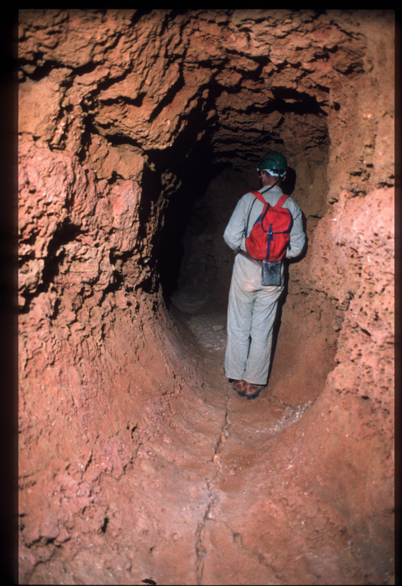
*ASF Joe N. Jennings slide catalogue, JNJ-S-00128, Box 41. Catalogue description: Phreatic passage, Cave near Thampanna RH (Road house). [ASF record](https://st1.asflib.net/MEDIA/ASFJJSlidesCatalogue/Box%2041/JNJ-S-00128.html).*

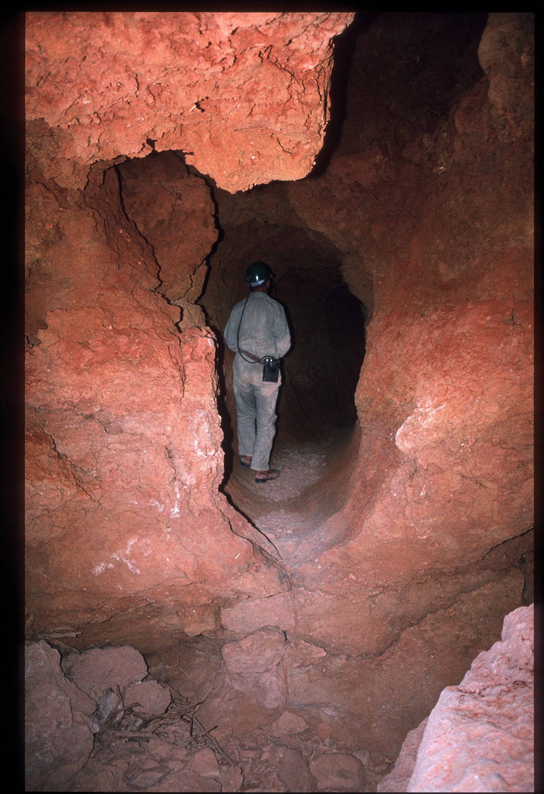
*ASF Joe N. Jennings slide catalogue, JNJ-S-00129, Box 41. Catalogue description: Phreatic passage linking large collapse chamber. Cave near Thampanna RH (Road house). [ASF record](https://st1.asflib.net/MEDIA/ASFJJSlidesCatalogue/Box%2041/JNJ-S-00129.html).*

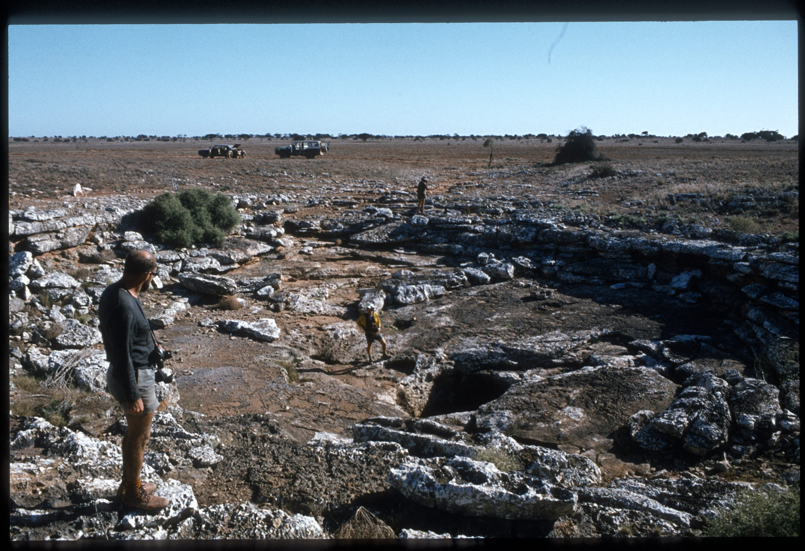
*ASF Joe N. Jennings slide catalogue, JNJ-S-1005-01, Box 1005. Catalogue description: Thampanna Cave near Thampanna Rock Hole. [ASF record](https://st1.asflib.net/MEDIA/ASFJJSlidesCatalogue/Box%201005/JNJ-S-1005-01.html).*

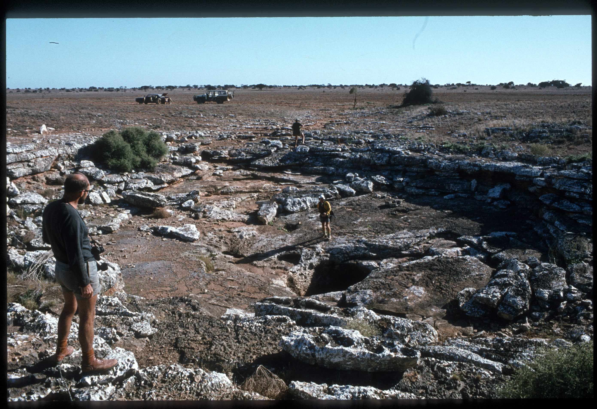
*ASF Joe N. Jennings slide catalogue, JNJ-S-1005-02, Box 1005. Catalogue description: Thampanna Cave near Thampanna Rock Hole. [ASF record](https://st1.asflib.net/MEDIA/ASFJJSlidesCatalogue/Box%201005/JNJ-S-1005-02.html).*

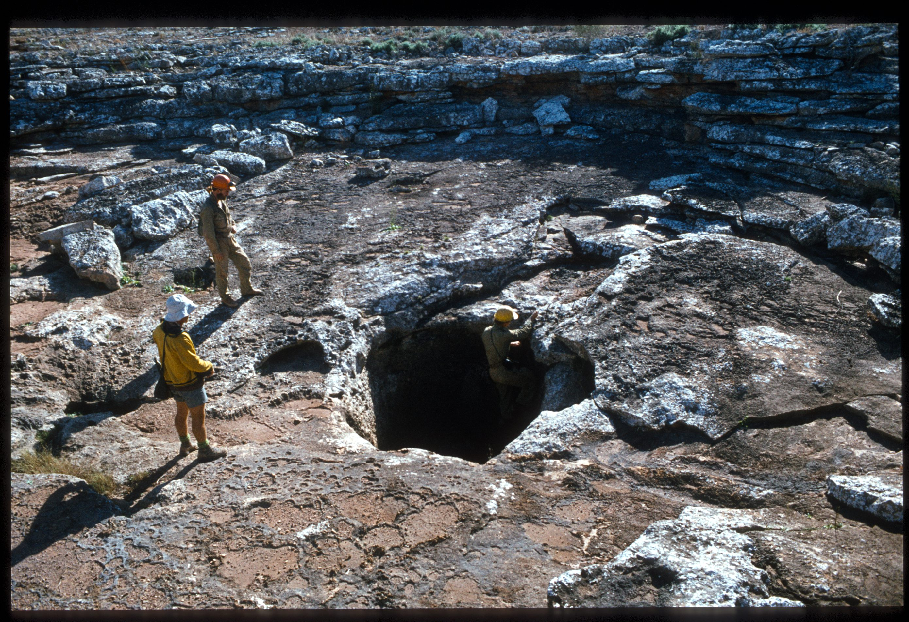
*ASF Joe N. Jennings slide catalogue, JNJ-S-1005-03, Box 1005. Catalogue description: Thampanna Cave near Thampanna Rock Hole. [ASF record](https://st1.asflib.net/MEDIA/ASFJJSlidesCatalogue/Box%201005/JNJ-S-1005-03.html).*

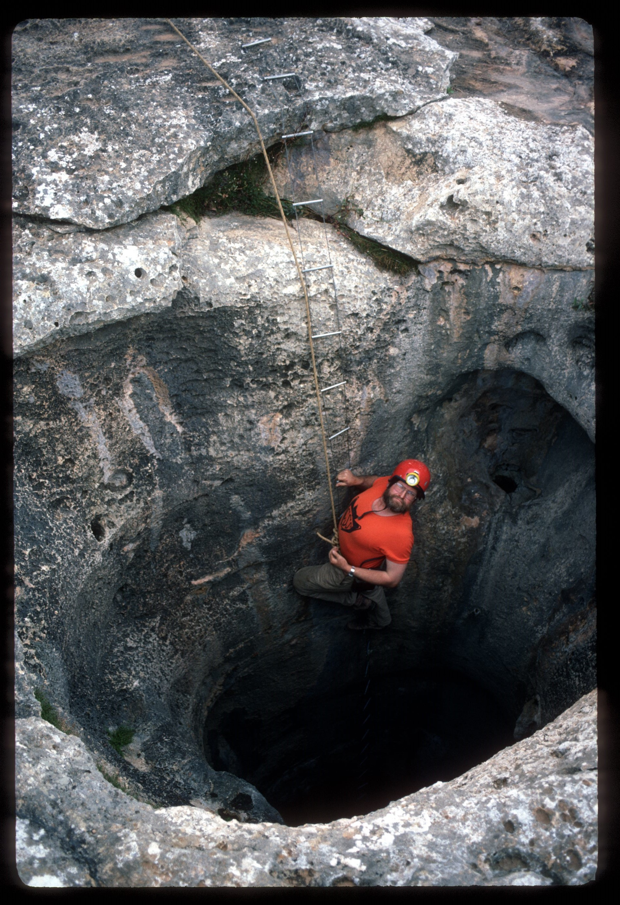
*ASF Joe N. Jennings slide catalogue, JNJ-S-1005-04, Box 1005. Catalogue description: Thampanna Cave entrance shaft. [ASF record](https://st1.asflib.net/MEDIA/ASFJJSlidesCatalogue/Box%201005/JNJ-S-1005-04.html).*

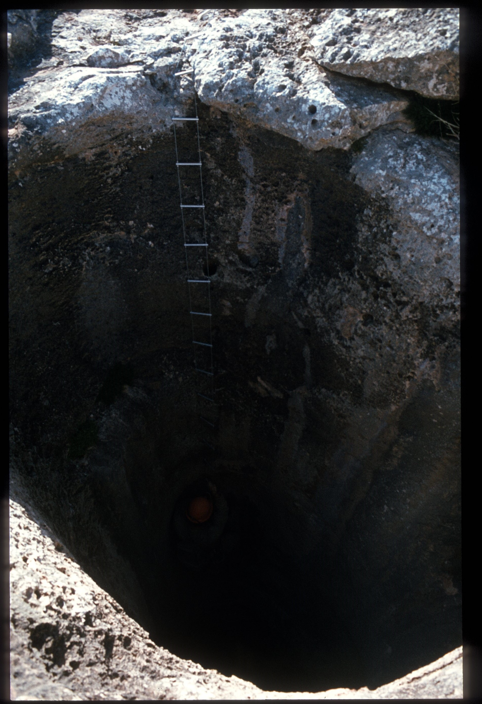
*ASF Joe N. Jennings slide catalogue, JNJ-S-1005-05, Box 1005. Catalogue description: Thampanna Cave entrance shaft. [ASF record](https://st1.asflib.net/MEDIA/ASFJJSlidesCatalogue/Box%201005/JNJ-S-1005-05.html).*

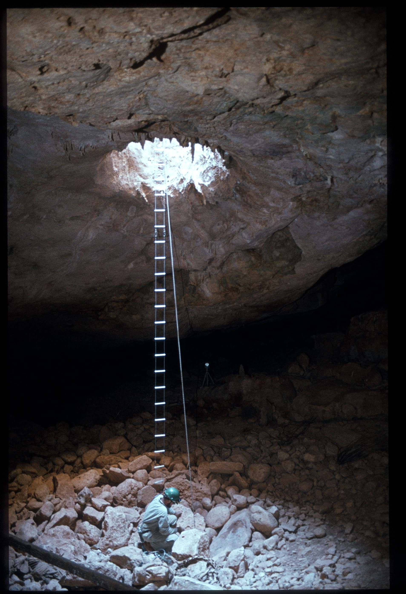
*ASF Joe N. Jennings slide catalogue, JNJ-S-1005-06, Box 1005. Catalogue description: Thampanna Cave - Entrance chamber - Plunge "pool". [ASF record](https://st1.asflib.net/MEDIA/ASFJJSlidesCatalogue/Box%201005/JNJ-S-1005-06.html).*

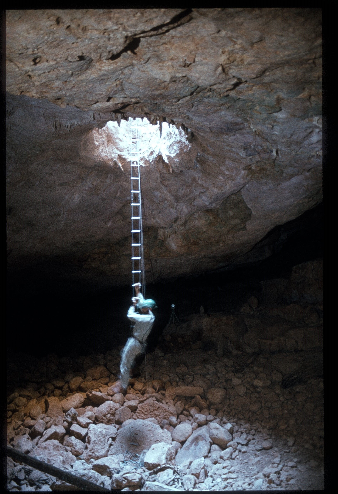
*ASF Joe N. Jennings slide catalogue, JNJ-S-1005-07, Box 1005. Catalogue description: Thampanna Cave - Entrance chamber - Plunge "pool". [ASF record](https://st1.asflib.net/MEDIA/ASFJJSlidesCatalogue/Box%201005/JNJ-S-1005-07.html).*

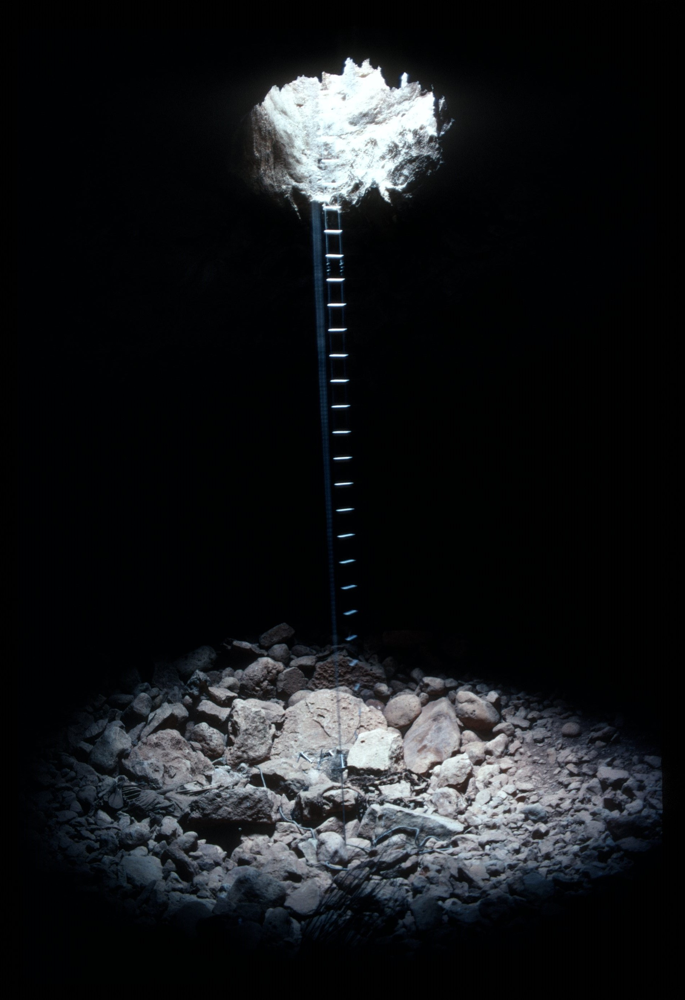
*ASF Joe N. Jennings slide catalogue, JNJ-S-1005-08, Box 1005. Catalogue description: Thampanna Rock Hole - Adrian Davey. [ASF record](https://st1.asflib.net/MEDIA/ASFJJSlidesCatalogue/Box%201005/JNJ-S-1005-08.html).*

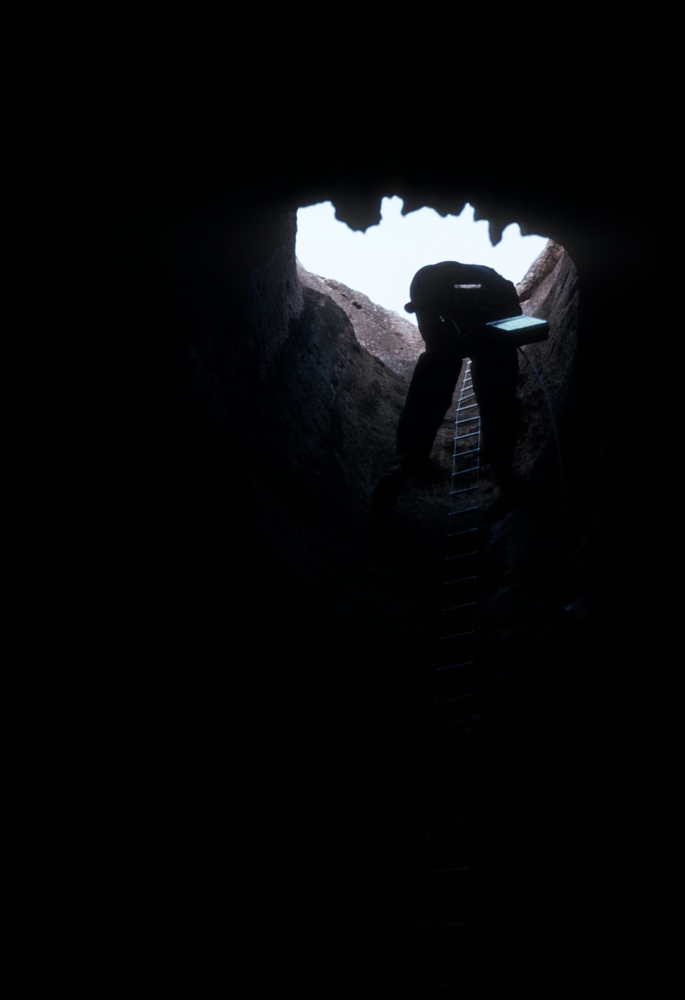
*ASF Joe N. Jennings slide catalogue, JNJ-S-1005-09, Box 1005. Catalogue description: Thampanna Cave entrance shaft. [ASF record](https://st1.asflib.net/MEDIA/ASFJJSlidesCatalogue/Box%201005/JNJ-S-1005-09.html).*

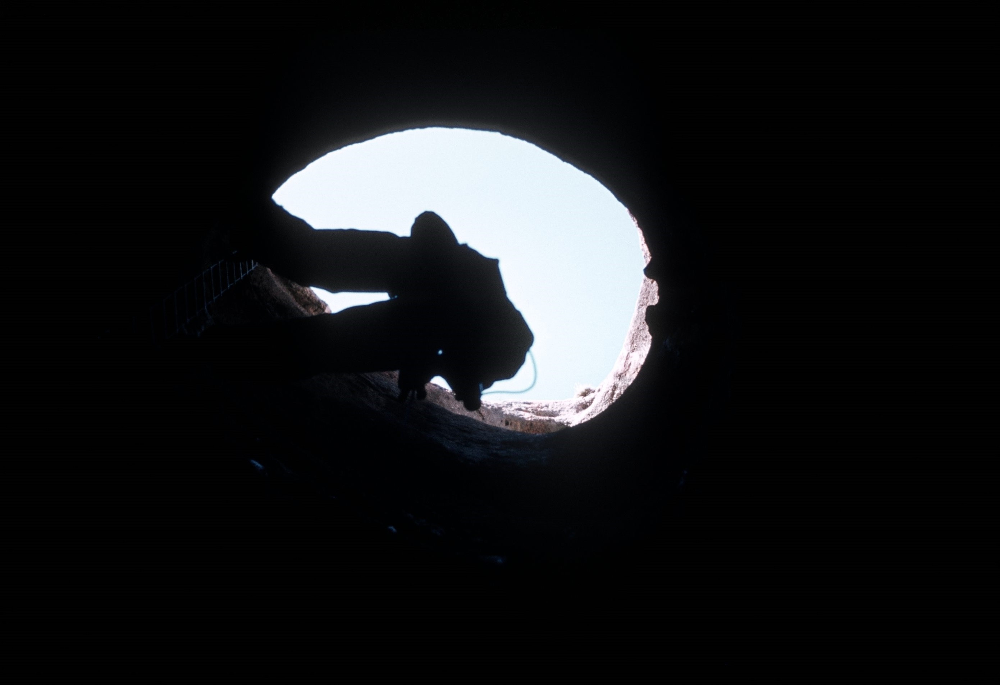
*ASF Joe N. Jennings slide catalogue, JNJ-S-1005-10, Box 1005. Catalogue description: Thampanna Cave entrance shaft. [ASF record](https://st1.asflib.net/MEDIA/ASFJJSlidesCatalogue/Box%201005/JNJ-S-1005-10.html).*

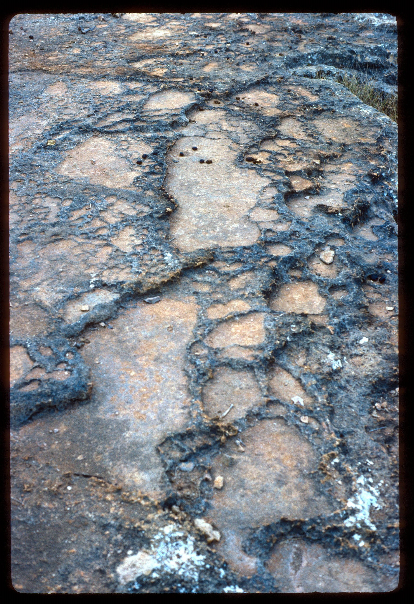
*ASF Joe N. Jennings slide catalogue, JNJ-S-1005-11, Box 1005. Catalogue description: Thampanna Cave - Pits to pans. [ASF record](https://st1.asflib.net/MEDIA/ASFJJSlidesCatalogue/Box%201005/JNJ-S-1005-11.html).*

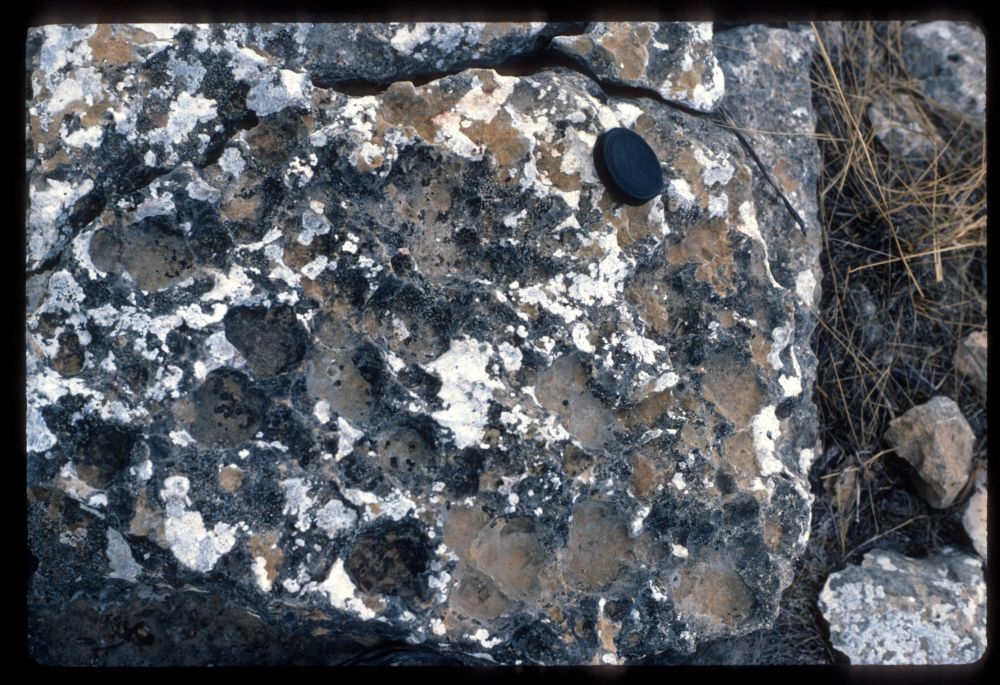
*ASF Joe N. Jennings slide catalogue, JNJ-S-1005-12, Box 1005. Catalogue description: Thampanna Cave - Pitting. [ASF record](https://st1.asflib.net/MEDIA/ASFJJSlidesCatalogue/Box%201005/JNJ-S-1005-12.html).*

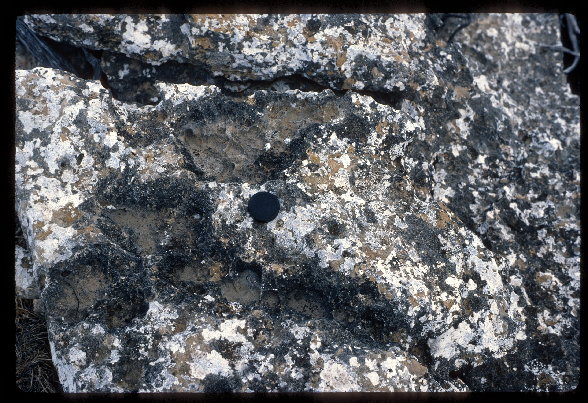
*ASF Joe N. Jennings slide catalogue, JNJ-S-1005-13, Box 1005. Catalogue description: Thampanna Cave - Pitting. [ASF record](https://st1.asflib.net/MEDIA/ASFJJSlidesCatalogue/Box%201005/JNJ-S-1005-13.html).*

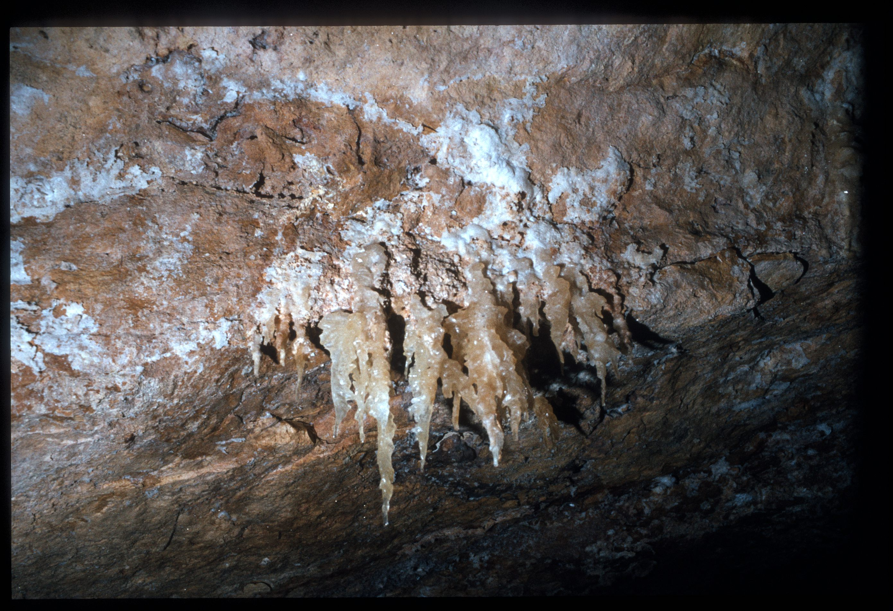
*ASF Joe N. Jennings slide catalogue, JNJ-S-1005-14, Box 1005. Catalogue description: Thampanna Cave - Gypsum stalactites. [ASF record](https://st1.asflib.net/MEDIA/ASFJJSlidesCatalogue/Box%201005/JNJ-S-1005-14.html).*

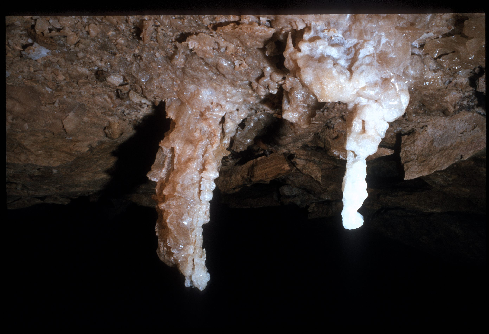
*ASF Joe N. Jennings slide catalogue, JNJ-S-1005-15, Box 1005. Catalogue description: Thampanna Cave - Gypsum stalactites. [ASF record](https://st1.asflib.net/MEDIA/ASFJJSlidesCatalogue/Box%201005/JNJ-S-1005-15.html).*

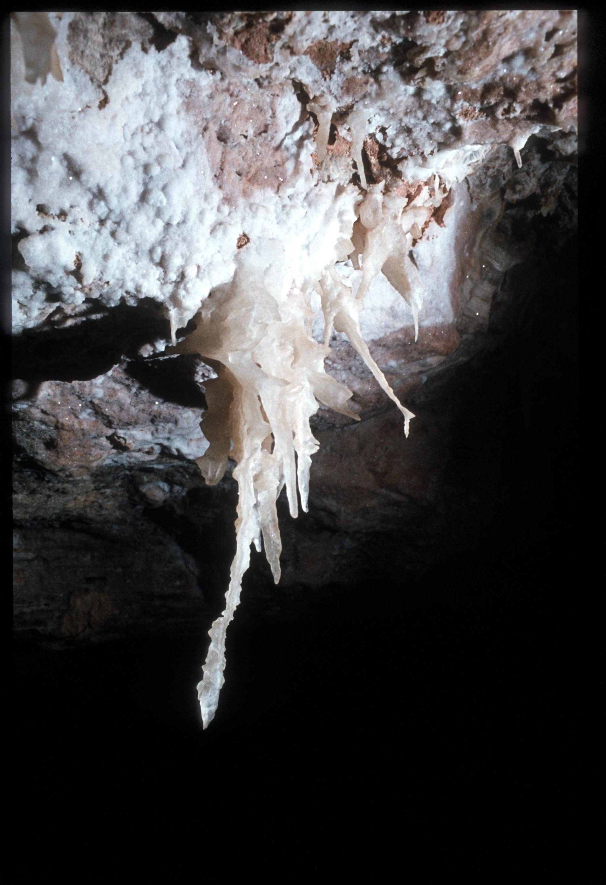
*ASF Joe N. Jennings slide catalogue, JNJ-S-1005-16, Box 1005. Catalogue description: Thampanna Cave - Gypsum stalactites. [ASF record](https://st1.asflib.net/MEDIA/ASFJJSlidesCatalogue/Box%201005/JNJ-S-1005-16.html).*

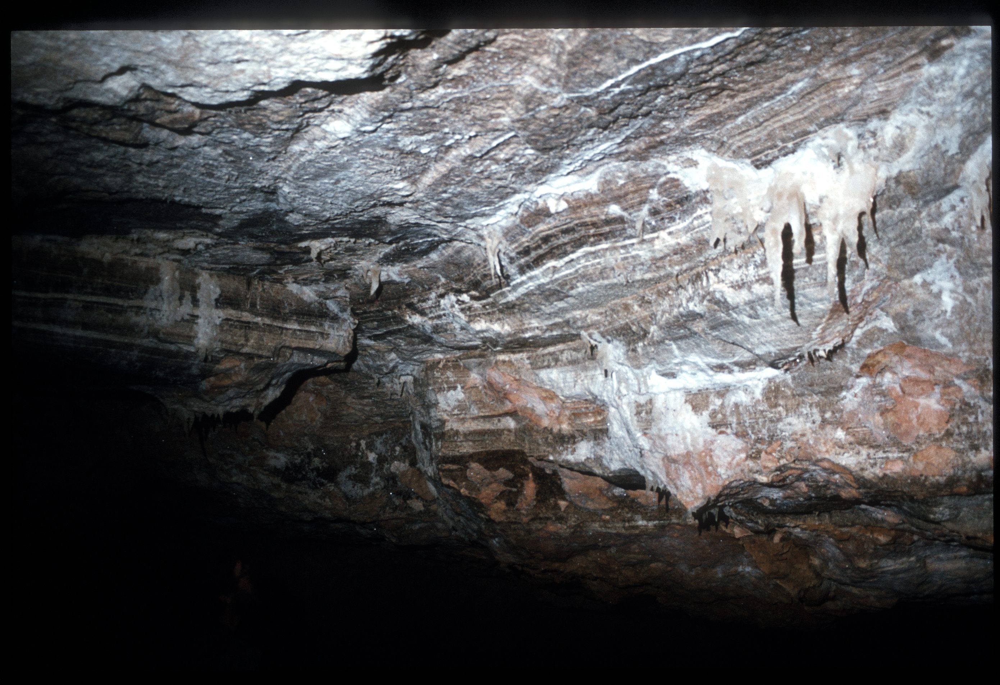
*ASF Joe N. Jennings slide catalogue, JNJ-S-1005-17, Box 1005. Catalogue description: Thampanna Cave - Pool deposit. [ASF record](https://st1.asflib.net/MEDIA/ASFJJSlidesCatalogue/Box%201005/JNJ-S-1005-17.html).*

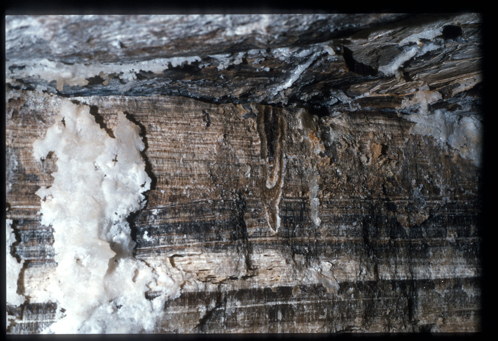
*ASF Joe N. Jennings slide catalogue, JNJ-S-1005-18, Box 1005. Catalogue description: Thampanna Cave - Section of stalactite in pool deposit. [ASF record](https://st1.asflib.net/MEDIA/ASFJJSlidesCatalogue/Box%201005/JNJ-S-1005-18.html).*

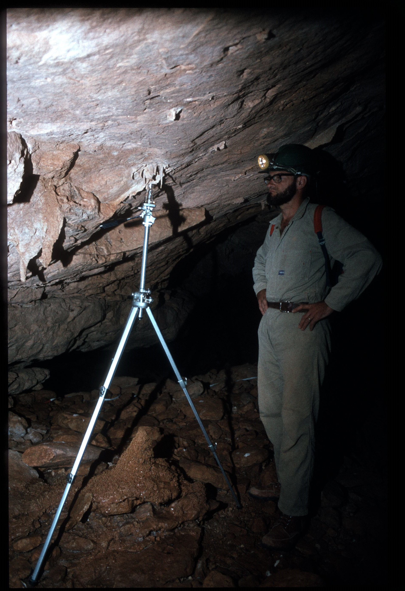
*ASF Joe N. Jennings slide catalogue, JNJ-S-1005-19, Box 1005. Catalogue description: Thampanna Cave - Collecting drips. [ASF record](https://st1.asflib.net/MEDIA/ASFJJSlidesCatalogue/Box%201005/JNJ-S-1005-19.html).*

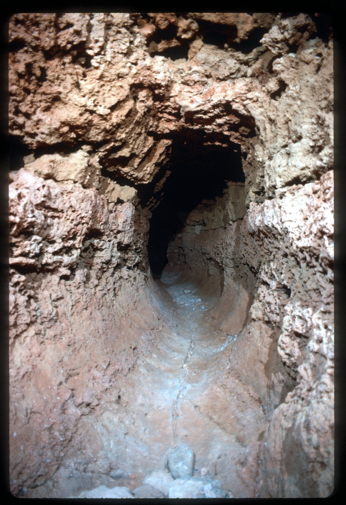
*ASF Joe N. Jennings slide catalogue, JNJ-S-1005-20, Box 1005. Catalogue description: Thampanna Cave - Stream passage - Adrian Davey. [ASF record](https://st1.asflib.net/MEDIA/ASFJJSlidesCatalogue/Box%201005/JNJ-S-1005-20.html).*

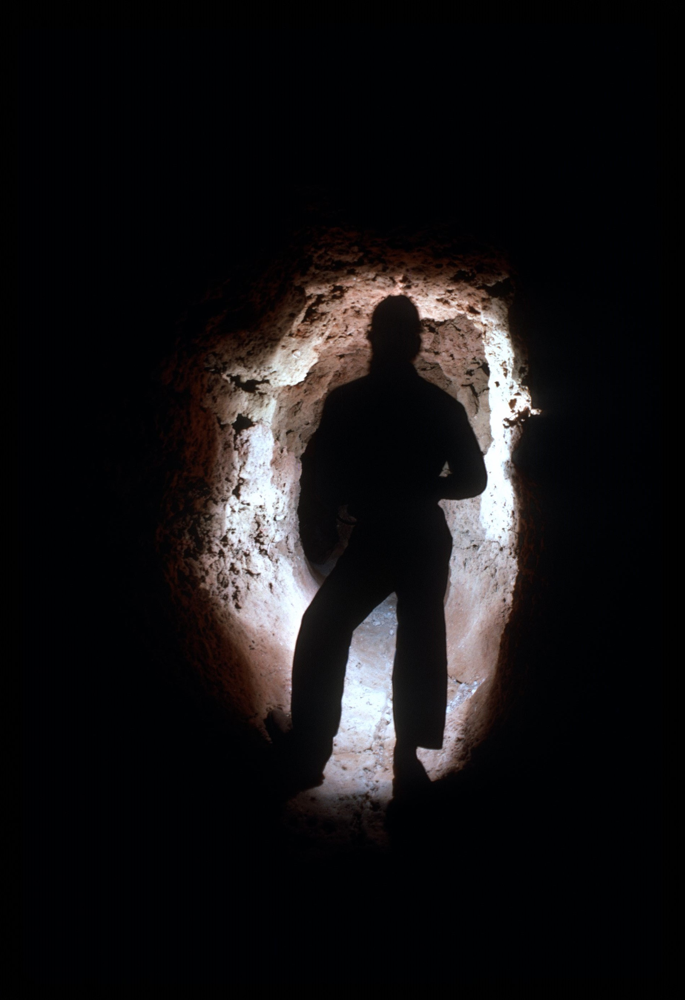
*ASF Joe N. Jennings slide catalogue, JNJ-S-1005-21, Box 1005. Catalogue description: Thampanna Cave - Stream passage - Adrian Davey. [ASF record](https://st1.asflib.net/MEDIA/ASFJJSlidesCatalogue/Box%201005/JNJ-S-1005-21.html).*

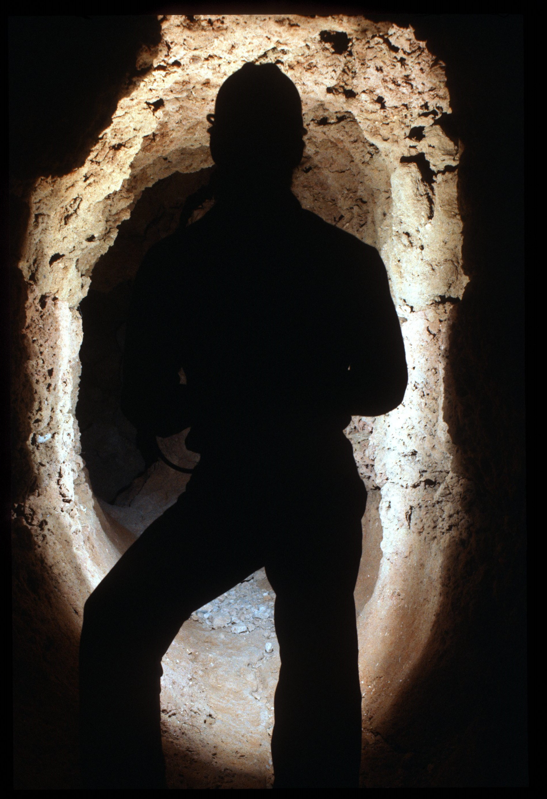
*ASF Joe N. Jennings slide catalogue, JNJ-S-1005-22, Box 1005. Catalogue description: Thampanna Cave - Stream passage - Adrian Davey. [ASF record](https://st1.asflib.net/MEDIA/ASFJJSlidesCatalogue/Box%201005/JNJ-S-1005-22.html).*

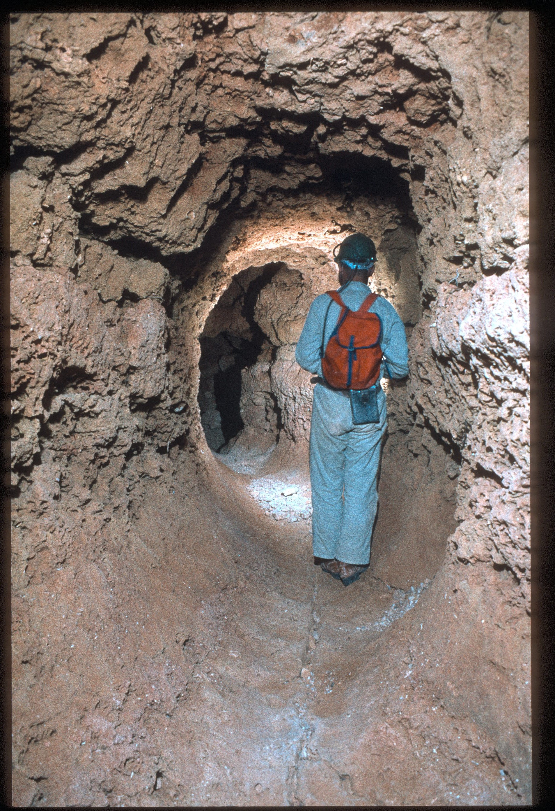
*ASF Joe N. Jennings slide catalogue, JNJ-S-1005-23, Box 1005. Catalogue description: Thampanna Cave - Phreatice passage. [ASF record](https://st1.asflib.net/MEDIA/ASFJJSlidesCatalogue/Box%201005/JNJ-S-1005-23.html).*

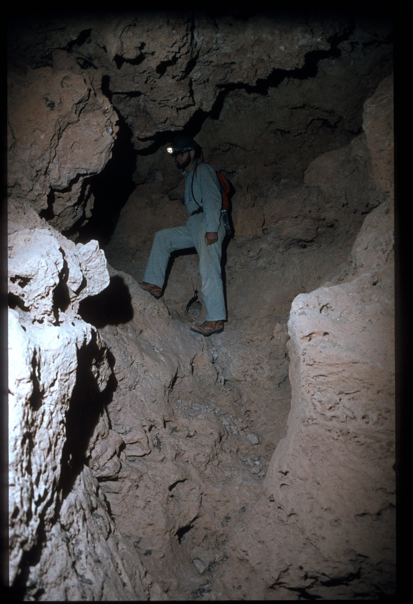
*ASF Joe N. Jennings slide catalogue, JNJ-S-1005-24, Box 1005. Catalogue description: Thampanna Cave - Waterfall passage. [ASF record](https://st1.asflib.net/MEDIA/ASFJJSlidesCatalogue/Box%201005/JNJ-S-1005-24.html).*

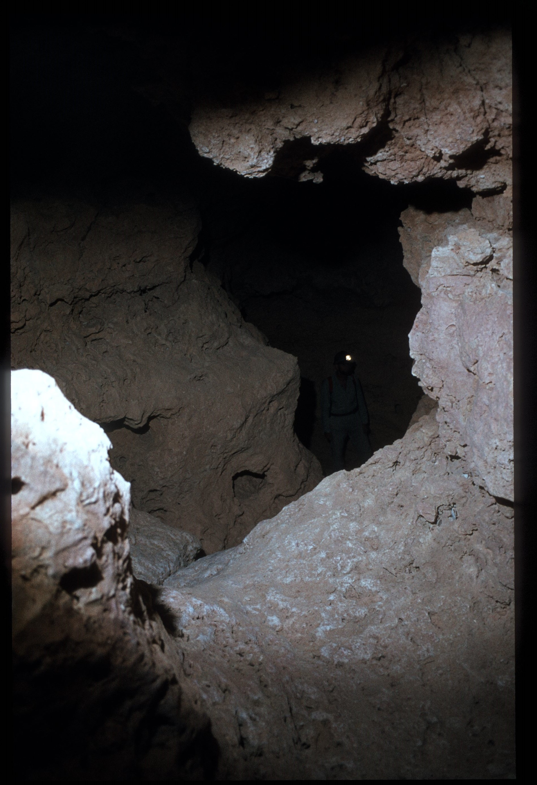
*ASF Joe N. Jennings slide catalogue, JNJ-S-1005-25, Box 1005. Catalogue description: Thampanna Cave - Waterfall passage. [ASF record](https://st1.asflib.net/MEDIA/ASFJJSlidesCatalogue/Box%201005/JNJ-S-1005-25.html).*

<!-- ASF slide images: end -->
