# Source notes

## ASF slide images

Images are from the ASF Joe N. Jennings slide catalogue. Each caption preserves the catalogue description and links to its source record.

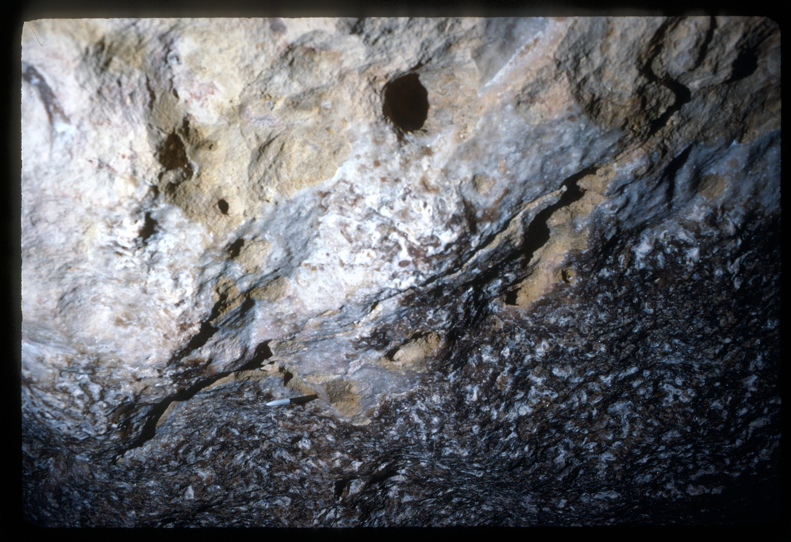
*ASF Joe N. Jennings slide catalogue, JNJ-S-1004-01, Box 1004. Catalogue description: Webbs Cave - Sheared Roof - Spelothems & Bedrock. [ASF record](https://st1.asflib.net/MEDIA/ASFJJSlidesCatalogue/Box%201004/JNJ-S-1004-01.html).*

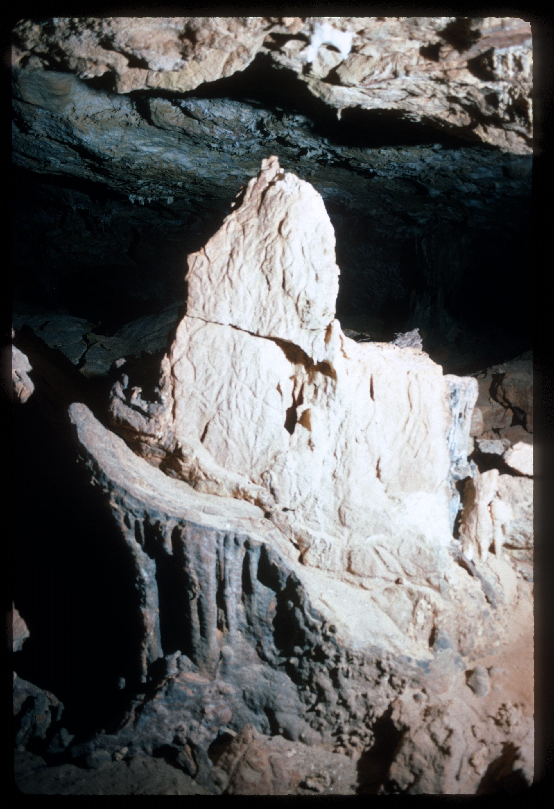
*ASF Joe N. Jennings slide catalogue, JNJ-S-1004-02, Box 1004. Catalogue description: Webbs Cave - Anastomosing half tubes in joint through stalagmite. [ASF record](https://st1.asflib.net/MEDIA/ASFJJSlidesCatalogue/Box%201004/JNJ-S-1004-02.html).*

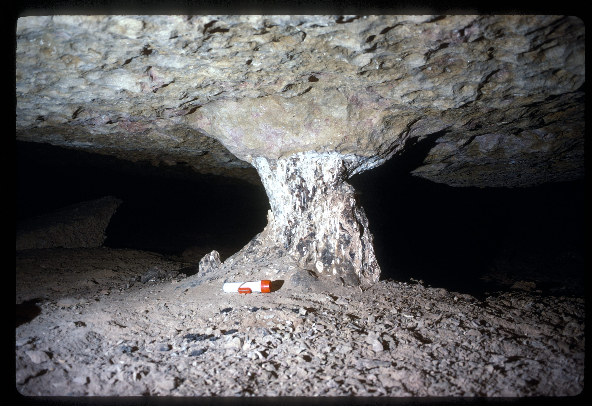
*ASF Joe N. Jennings slide catalogue, JNJ-S-1004-03, Box 1004. Catalogue description: Webbs Cave - Bedrock pedestal & remains of spel-column - Salt Shearing. [ASF record](https://st1.asflib.net/MEDIA/ASFJJSlidesCatalogue/Box%201004/JNJ-S-1004-03.html).*

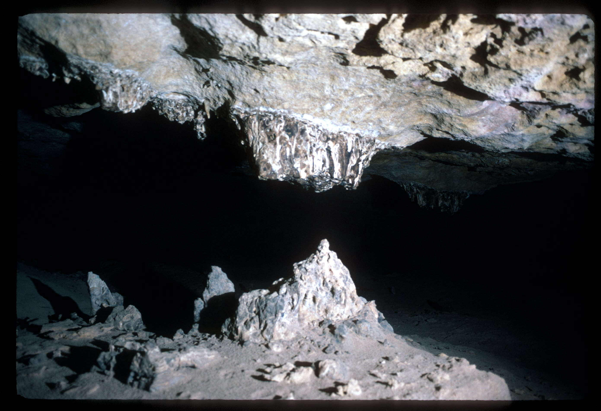
*ASF Joe N. Jennings slide catalogue, JNJ-S-1004-04, Box 1004. Catalogue description: Webbs Cave - Salt wedging into roof. [ASF record](https://st1.asflib.net/MEDIA/ASFJJSlidesCatalogue/Box%201004/JNJ-S-1004-04.html).*

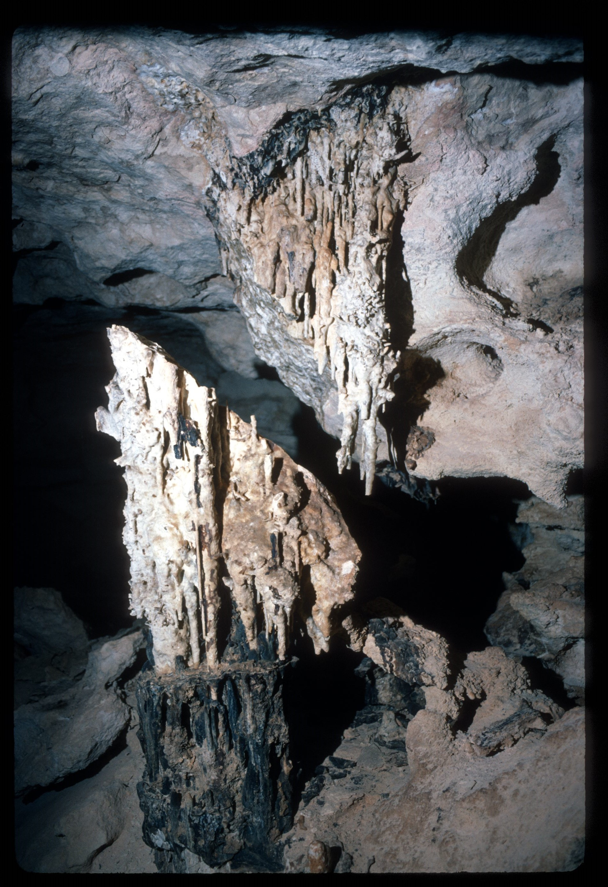
*ASF Joe N. Jennings slide catalogue, JNJ-S-1004-05, Box 1004. Catalogue description: Webbs Cave - Fracture of column. [ASF record](https://st1.asflib.net/MEDIA/ASFJJSlidesCatalogue/Box%201004/JNJ-S-1004-05.html).*

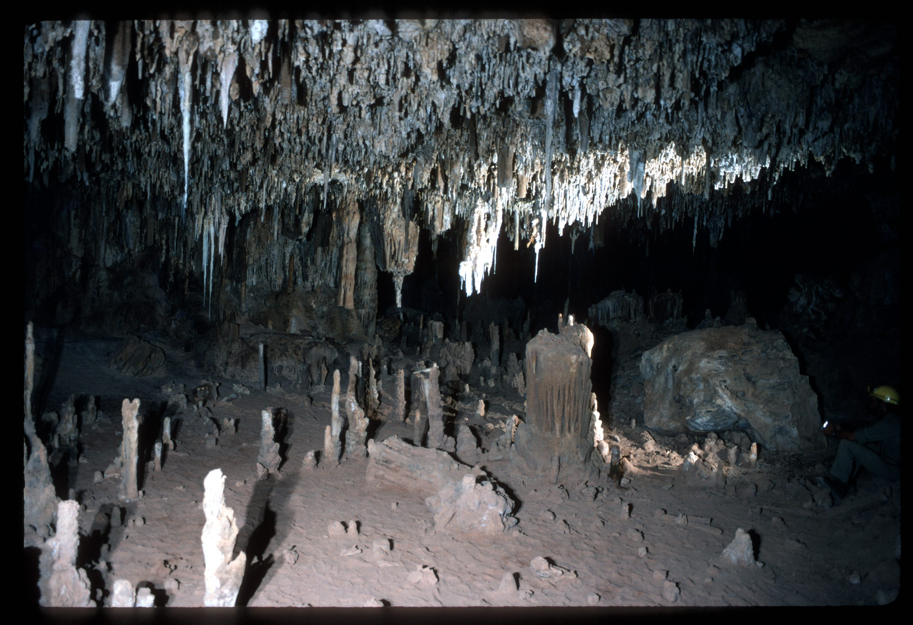
*ASF Joe N. Jennings slide catalogue, JNJ-S-1004-06, Box 1004. Catalogue description: Webbs Cave - Passage. [ASF record](https://st1.asflib.net/MEDIA/ASFJJSlidesCatalogue/Box%201004/JNJ-S-1004-06.html).*

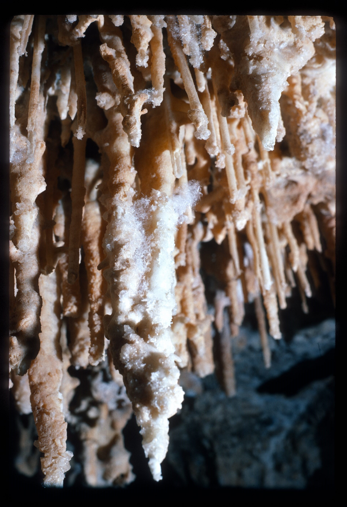
*ASF Joe N. Jennings slide catalogue, JNJ-S-1004-07, Box 1004. Catalogue description: Webbs Cave - Salt angles hair on calcite stalactites. [ASF record](https://st1.asflib.net/MEDIA/ASFJJSlidesCatalogue/Box%201004/JNJ-S-1004-07.html).*

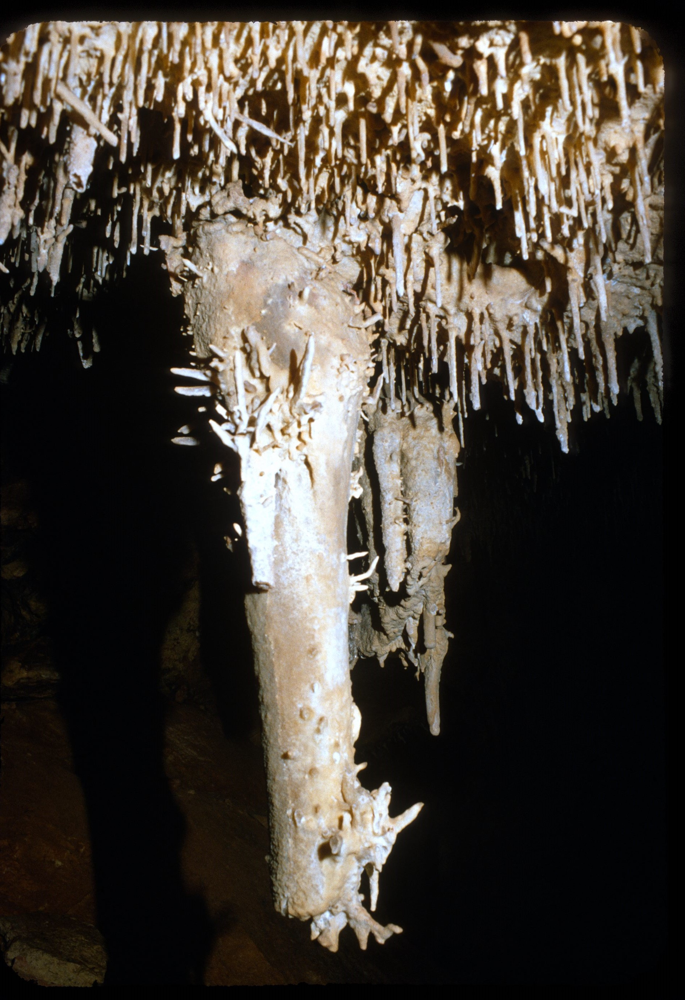
*ASF Joe N. Jennings slide catalogue, JNJ-S-1004-08, Box 1004. Catalogue description: Webbs Cave - Helictites on Stalactite. [ASF record](https://st1.asflib.net/MEDIA/ASFJJSlidesCatalogue/Box%201004/JNJ-S-1004-08.html).*

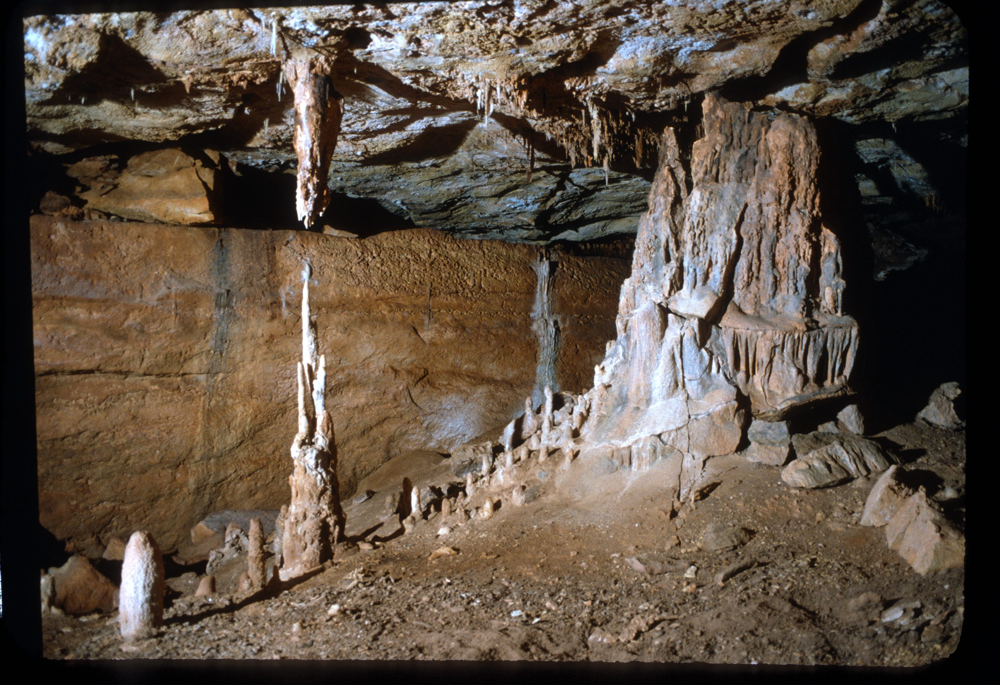
*ASF Joe N. Jennings slide catalogue, JNJ-S-1004-09, Box 1004. Catalogue description: Webbs Cave - Large speleothems. [ASF record](https://st1.asflib.net/MEDIA/ASFJJSlidesCatalogue/Box%201004/JNJ-S-1004-09.html).*

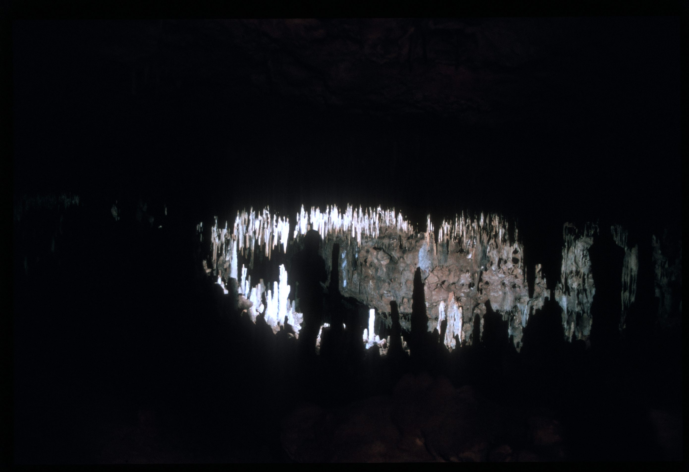
*ASF Joe N. Jennings slide catalogue, JNJ-S-1004-10, Box 1004. Catalogue description: Webbs Cave - Tites & Mites - Andrian Davey. [ASF record](https://st1.asflib.net/MEDIA/ASFJJSlidesCatalogue/Box%201004/JNJ-S-1004-10.html).*

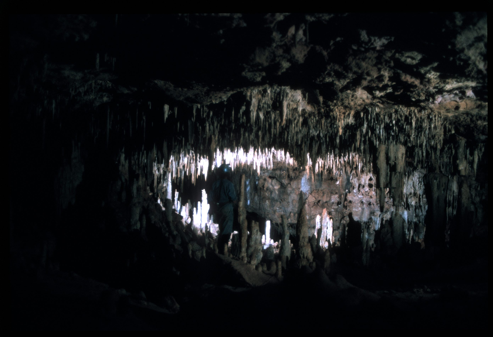
*ASF Joe N. Jennings slide catalogue, JNJ-S-1004-11, Box 1004. Catalogue description: Webbs Cave - Tites & Mites - Andrian Davey. [ASF record](https://st1.asflib.net/MEDIA/ASFJJSlidesCatalogue/Box%201004/JNJ-S-1004-11.html).*

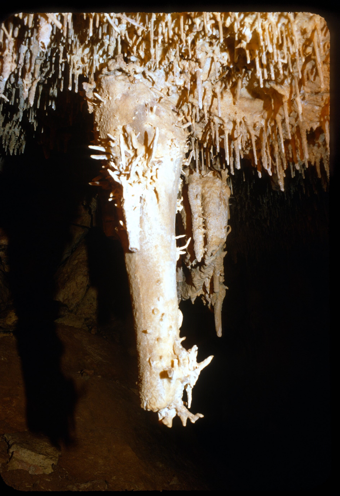
*ASF Joe N. Jennings slide catalogue, JNJ-S-1004-12, Box 1004. Catalogue description: Webbs Cave - Helictites on Stalagmite. [ASF record](https://st1.asflib.net/MEDIA/ASFJJSlidesCatalogue/Box%201004/JNJ-S-1004-12.html).*

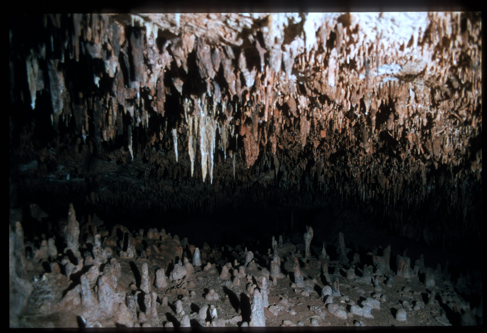
*ASF Joe N. Jennings slide catalogue, JNJ-S-1004-13, Box 1004. Catalogue description: Webbs Cave - Tites & Mites - Andrian Davey. [ASF record](https://st1.asflib.net/MEDIA/ASFJJSlidesCatalogue/Box%201004/JNJ-S-1004-13.html).*

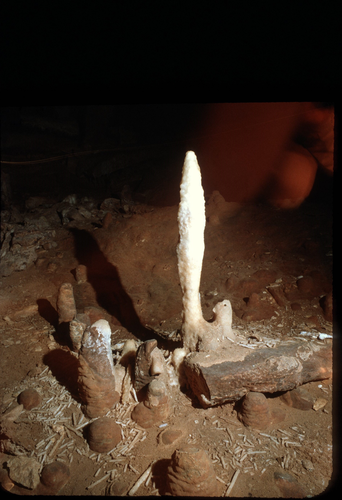
*ASF Joe N. Jennings slide catalogue, JNJ-S-1004-14, Box 1004. Catalogue description: Webbs Cave - Salt on Calcite. [ASF record](https://st1.asflib.net/MEDIA/ASFJJSlidesCatalogue/Box%201004/JNJ-S-1004-14.html).*

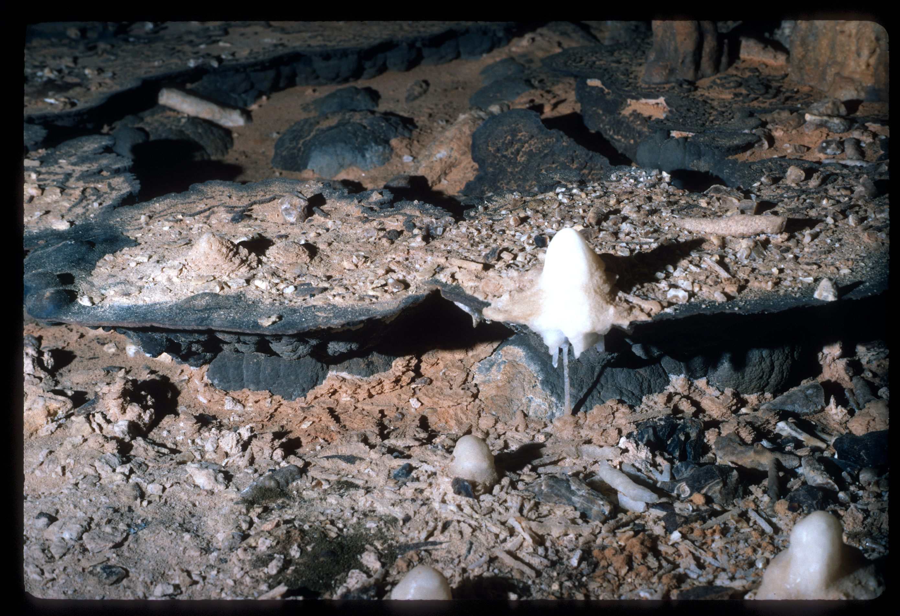
*ASF Joe N. Jennings slide catalogue, JNJ-S-1004-15, Box 1004. Catalogue description: Webbs Cave - Salt stalagmite, etc on black calcite mushrooms. [ASF record](https://st1.asflib.net/MEDIA/ASFJJSlidesCatalogue/Box%201004/JNJ-S-1004-15.html).*

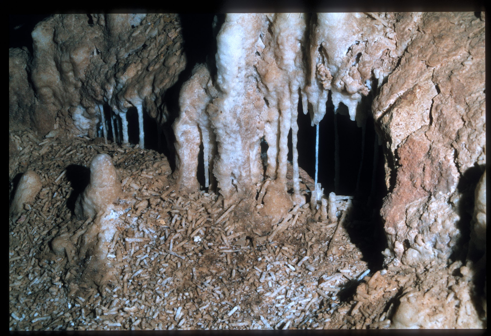
*ASF Joe N. Jennings slide catalogue, JNJ-S-1004-16, Box 1004. Catalogue description: Webbs Cave - Straw debris - Adrian Davey. [ASF record](https://st1.asflib.net/MEDIA/ASFJJSlidesCatalogue/Box%201004/JNJ-S-1004-16.html).*

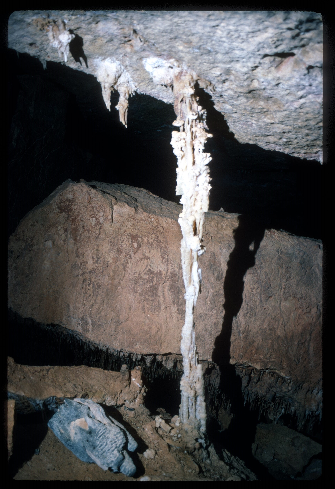
*ASF Joe N. Jennings slide catalogue, JNJ-S-1004-17, Box 1004. Catalogue description: Webbs Cave - Column. [ASF record](https://st1.asflib.net/MEDIA/ASFJJSlidesCatalogue/Box%201004/JNJ-S-1004-17.html).*

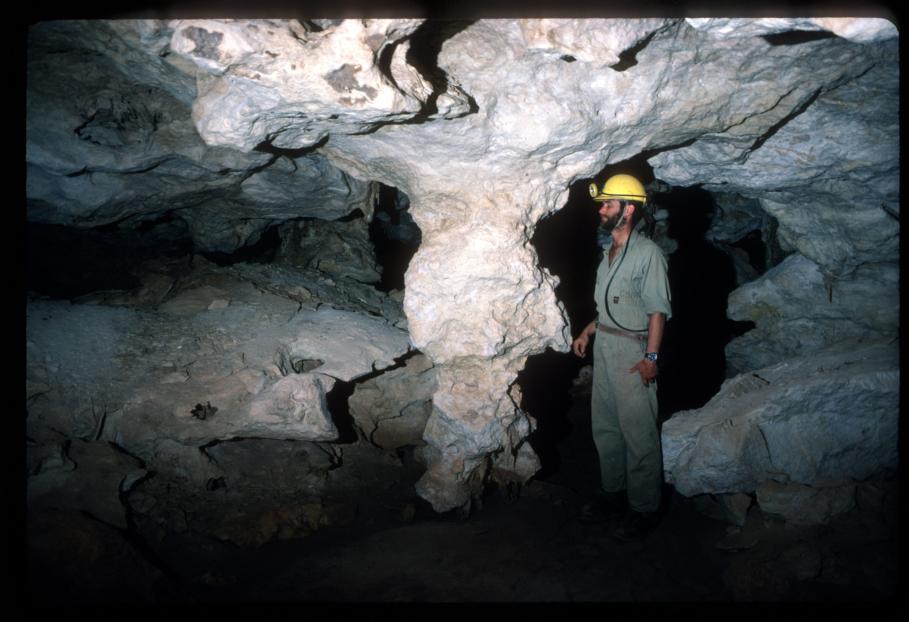
*ASF Joe N. Jennings slide catalogue, JNJ-S-1004-18, Box 1004. Catalogue description: Webbs Cave - Rock pillar eaten by salt wedging. [ASF record](https://st1.asflib.net/MEDIA/ASFJJSlidesCatalogue/Box%201004/JNJ-S-1004-18.html).*

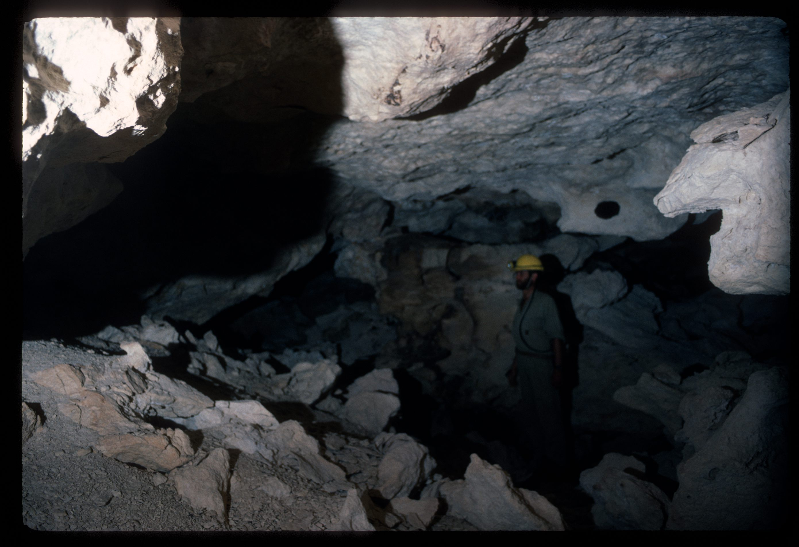
*ASF Joe N. Jennings slide catalogue, JNJ-S-1004-19, Box 1004. Catalogue description: Webbs Cave - Passage. [ASF record](https://st1.asflib.net/MEDIA/ASFJJSlidesCatalogue/Box%201004/JNJ-S-1004-19.html).*

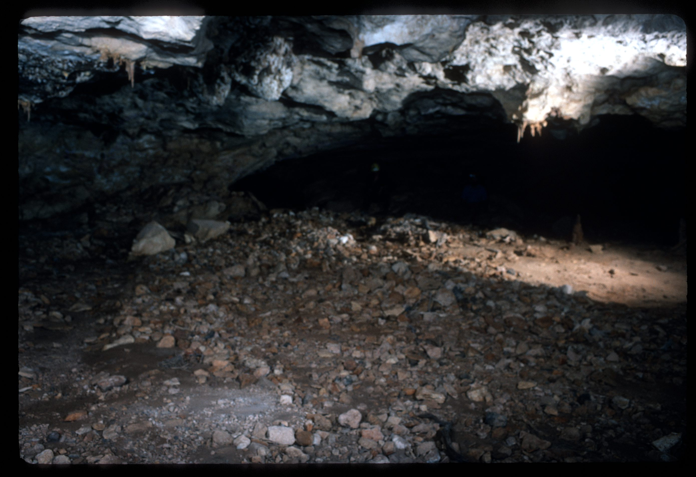
*ASF Joe N. Jennings slide catalogue, JNJ-S-1004-20, Box 1004. Catalogue description: Webbs Cave? - Passage. [ASF record](https://st1.asflib.net/MEDIA/ASFJJSlidesCatalogue/Box%201004/JNJ-S-1004-20.html).*

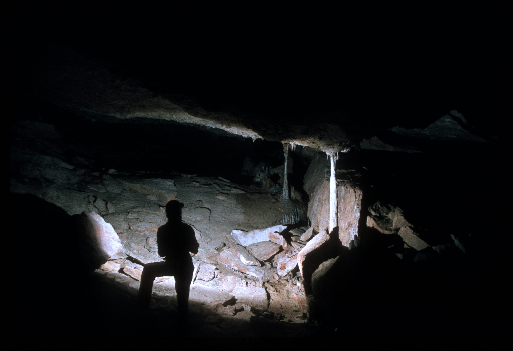
*ASF Joe N. Jennings slide catalogue, JNJ-S-1004-21, Box 1004. Catalogue description: Webbs Cave - Rockfall - Column - Adrian Davey. [ASF record](https://st1.asflib.net/MEDIA/ASFJJSlidesCatalogue/Box%201004/JNJ-S-1004-21.html).*

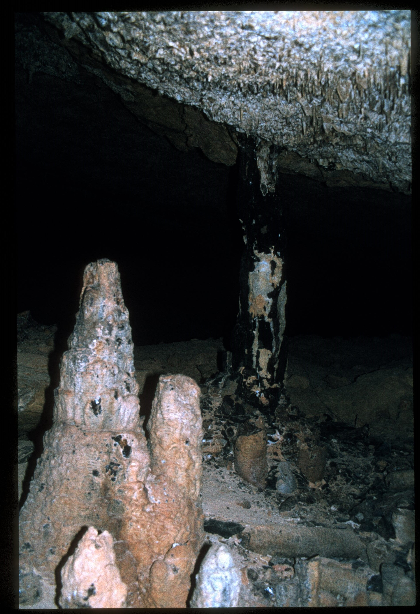
*ASF Joe N. Jennings slide catalogue, JNJ-S-1004-22, Box 1004. Catalogue description: Webbs Cave - Mites - Adrian Davey. [ASF record](https://st1.asflib.net/MEDIA/ASFJJSlidesCatalogue/Box%201004/JNJ-S-1004-22.html).*

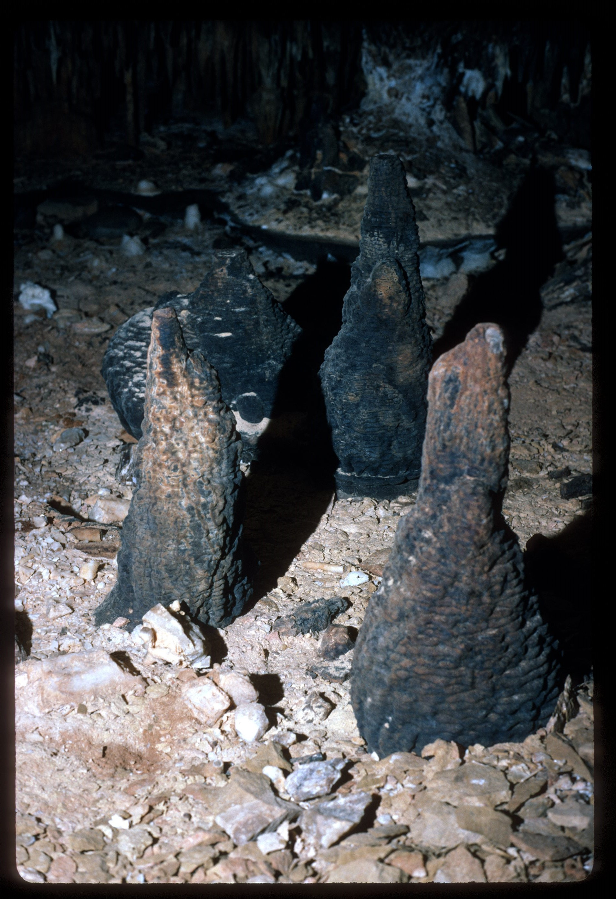
*ASF Joe N. Jennings slide catalogue, JNJ-S-1004-23, Box 1004. Catalogue description: Webbs Cave - Black calcite stalagmites. [ASF record](https://st1.asflib.net/MEDIA/ASFJJSlidesCatalogue/Box%201004/JNJ-S-1004-23.html).*

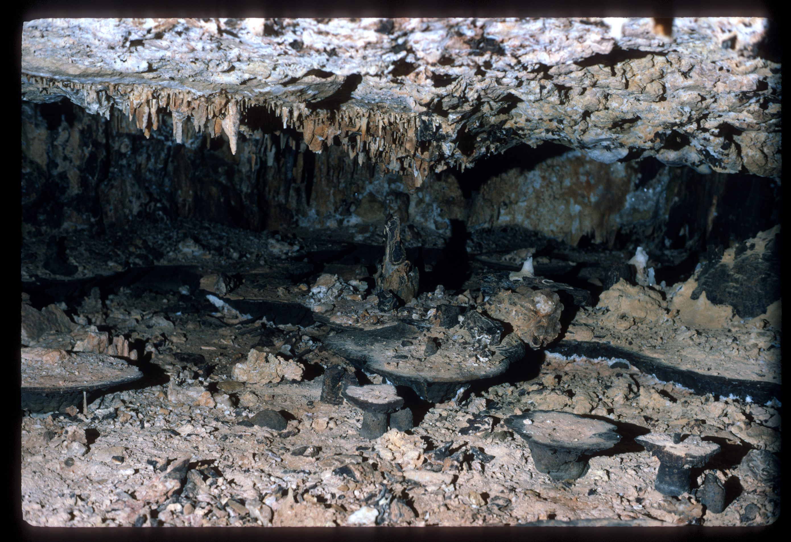
*ASF Joe N. Jennings slide catalogue, JNJ-S-1004-24, Box 1004. Catalogue description: Webbs Cave - Mushrooms - Salt wedging debris. [ASF record](https://st1.asflib.net/MEDIA/ASFJJSlidesCatalogue/Box%201004/JNJ-S-1004-24.html).*

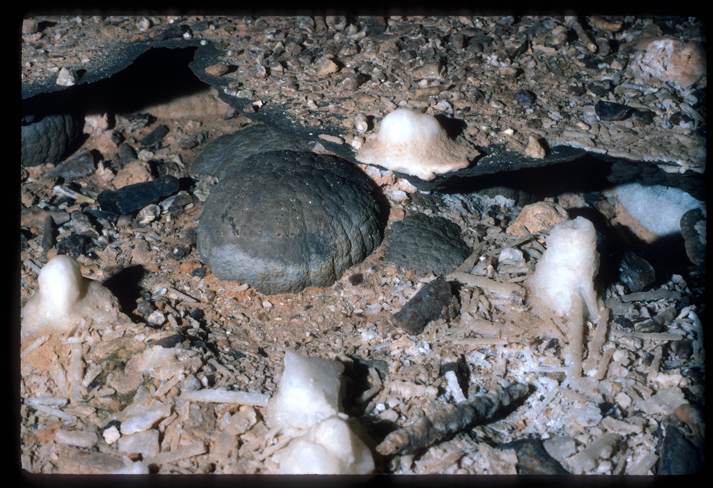
*ASF Joe N. Jennings slide catalogue, JNJ-S-1004-25, Box 1004. Catalogue description: Webbs Cave - Black calcite & salt spelothems - wedging debris. [ASF record](https://st1.asflib.net/MEDIA/ASFJJSlidesCatalogue/Box%201004/JNJ-S-1004-25.html).*

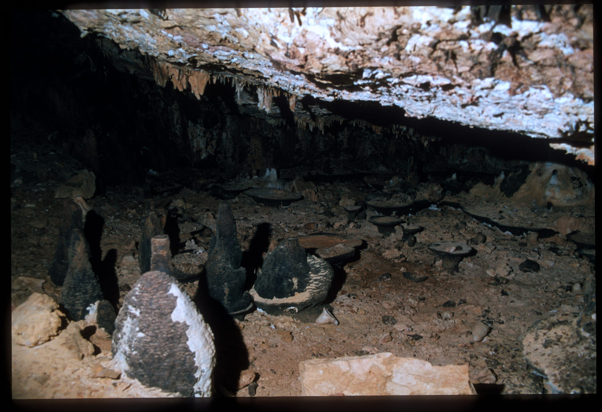
*ASF Joe N. Jennings slide catalogue, JNJ-S-1004-26, Box 1004. Catalogue description: Webbs Cave - Mushrooms - Adrian Davey. [ASF record](https://st1.asflib.net/MEDIA/ASFJJSlidesCatalogue/Box%201004/JNJ-S-1004-26.html).*

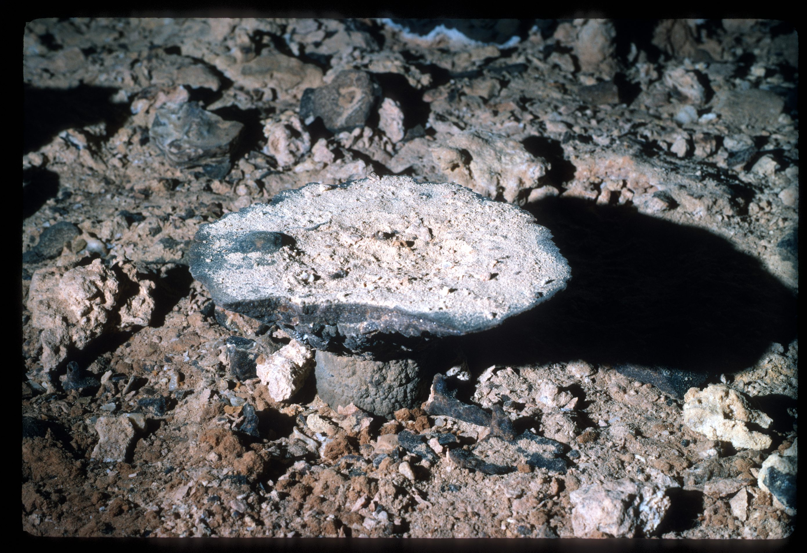
*ASF Joe N. Jennings slide catalogue, JNJ-S-1004-27, Box 1004. Catalogue description: Webbs Cave - Mushrooms. [ASF record](https://st1.asflib.net/MEDIA/ASFJJSlidesCatalogue/Box%201004/JNJ-S-1004-27.html).*

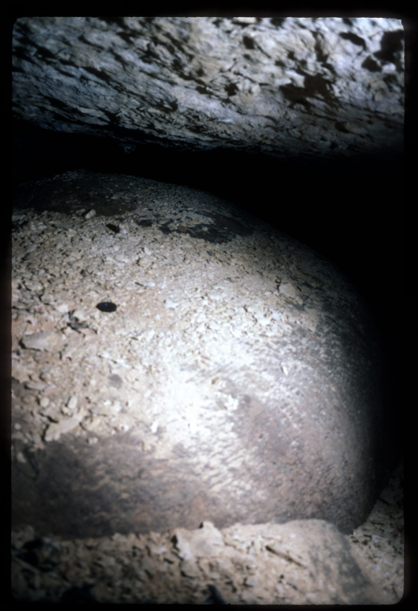
*ASF Joe N. Jennings slide catalogue, JNJ-S-1004-28, Box 1004. Catalogue description: Webbs Cave - Salt wedging debris on flowstone mass. [ASF record](https://st1.asflib.net/MEDIA/ASFJJSlidesCatalogue/Box%201004/JNJ-S-1004-28.html).*

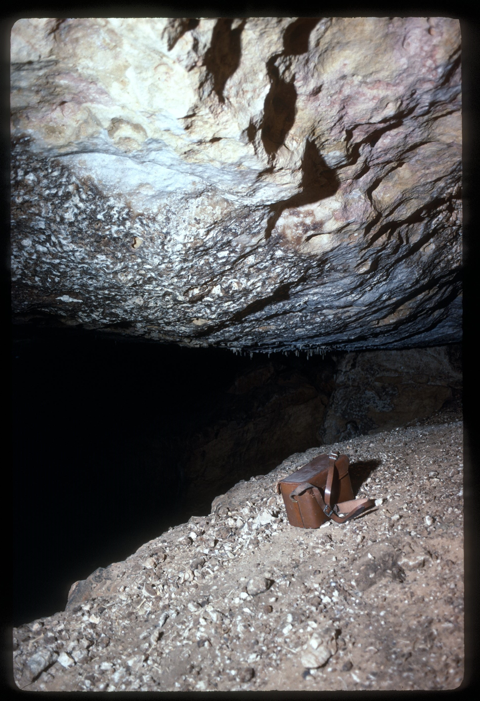
*ASF Joe N. Jennings slide catalogue, JNJ-S-1004-29, Box 1004. Catalogue description: Webbs Cave - Salt shearing. [ASF record](https://st1.asflib.net/MEDIA/ASFJJSlidesCatalogue/Box%201004/JNJ-S-1004-29.html).*

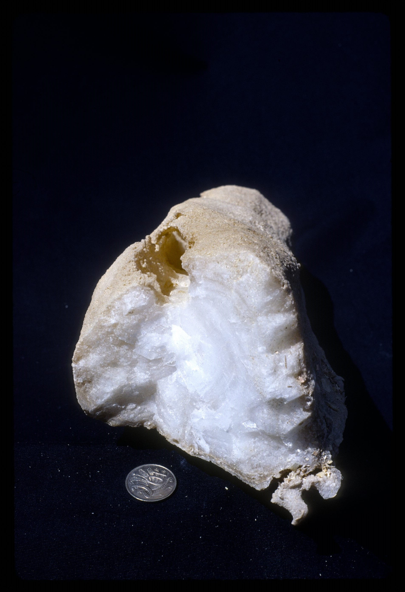
*ASF Joe N. Jennings slide catalogue, JNJ-S-1004-30, Box 1004. Catalogue description: Webbs Cave - Big Sally - Solution tube. [ASF record](https://st1.asflib.net/MEDIA/ASFJJSlidesCatalogue/Box%201004/JNJ-S-1004-30.html).*

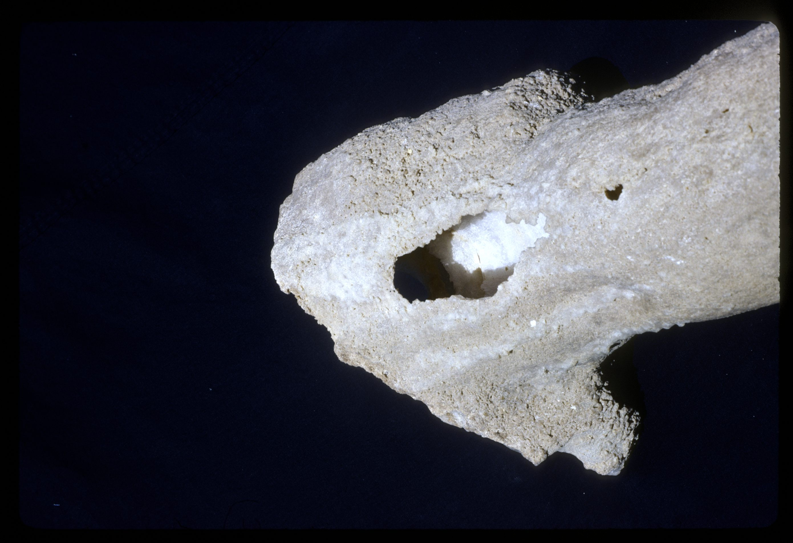
*ASF Joe N. Jennings slide catalogue, JNJ-S-1004-31, Box 1004. Catalogue description: Webbs Cave - Big Sally - Solution tube. [ASF record](https://st1.asflib.net/MEDIA/ASFJJSlidesCatalogue/Box%201004/JNJ-S-1004-31.html).*

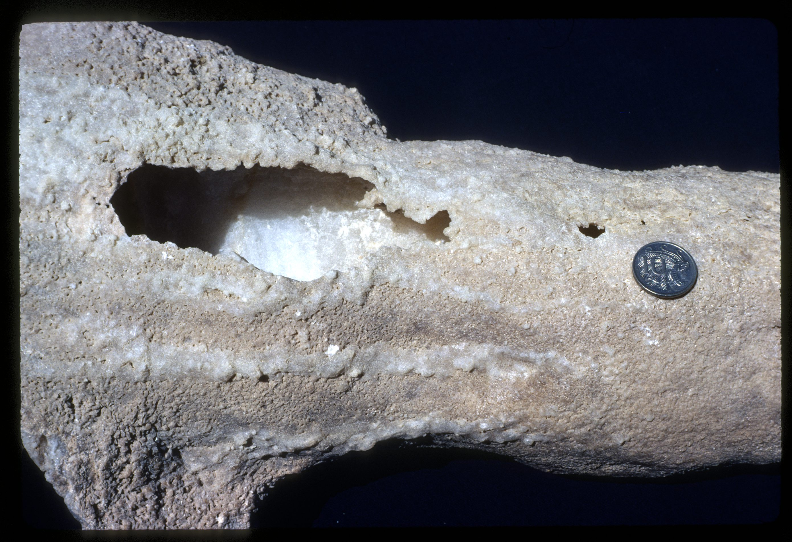
*ASF Joe N. Jennings slide catalogue, JNJ-S-1004-32, Box 1004. Catalogue description: Webbs Cave - Big Sally - Solution tube. [ASF record](https://st1.asflib.net/MEDIA/ASFJJSlidesCatalogue/Box%201004/JNJ-S-1004-32.html).*

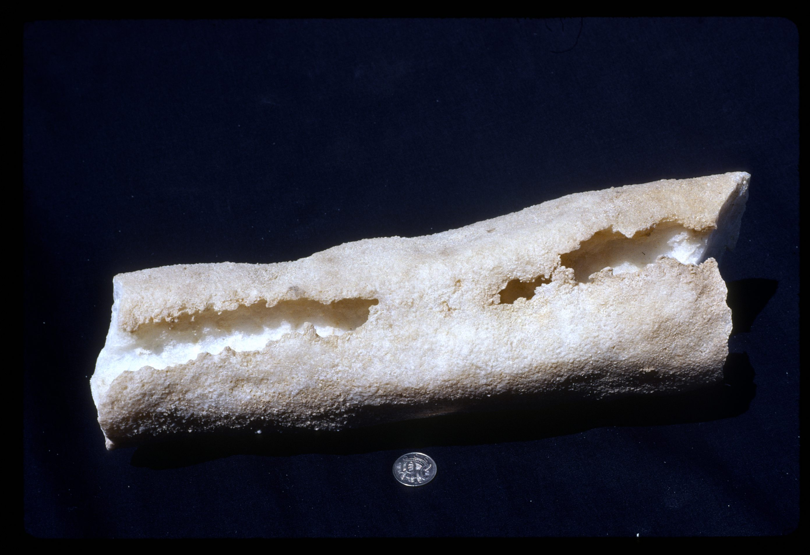
*ASF Joe N. Jennings slide catalogue, JNJ-S-1004-33, Box 1004. Catalogue description: Webbs Cave - Big Sally - Solution tube. [ASF record](https://st1.asflib.net/MEDIA/ASFJJSlidesCatalogue/Box%201004/JNJ-S-1004-33.html).*

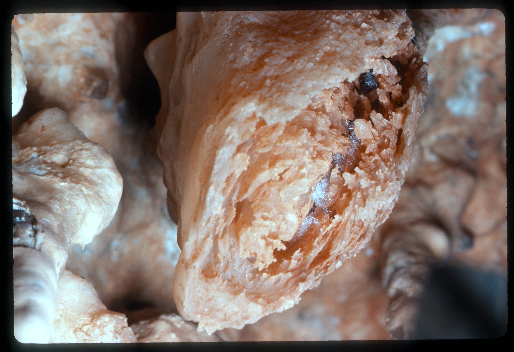
*ASF Joe N. Jennings slide catalogue, JNJ-S-1004-34, Box 1004. Catalogue description: Webbs Cave - Calcite decoration degraded by salt exhudation. [ASF record](https://st1.asflib.net/MEDIA/ASFJJSlidesCatalogue/Box%201004/JNJ-S-1004-34.html).*

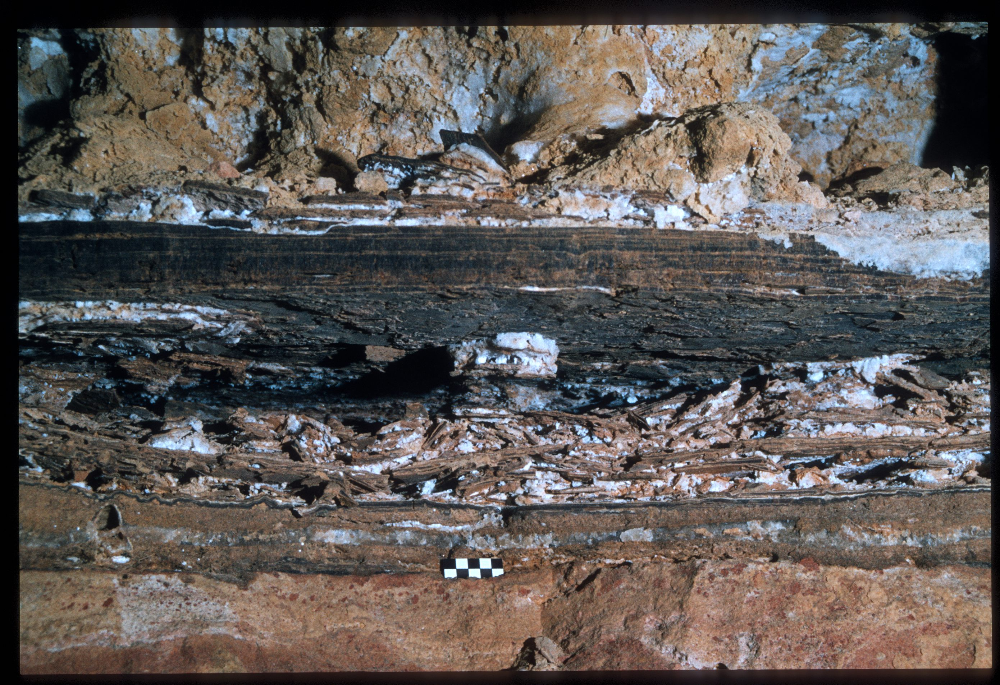
*ASF Joe N. Jennings slide catalogue, JNJ-S-1004-35, Box 1004. Catalogue description: Webbs Cave - Calcite & Gypsum - Adrian Davey. [ASF record](https://st1.asflib.net/MEDIA/ASFJJSlidesCatalogue/Box%201004/JNJ-S-1004-35.html).*

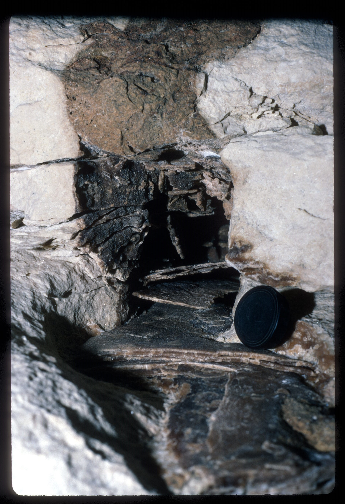
*ASF Joe N. Jennings slide catalogue, JNJ-S-1004-36, Box 1004. Catalogue description: Webbs Cave - Calcite fill shattered by salt wedging. [ASF record](https://st1.asflib.net/MEDIA/ASFJJSlidesCatalogue/Box%201004/JNJ-S-1004-36.html).*

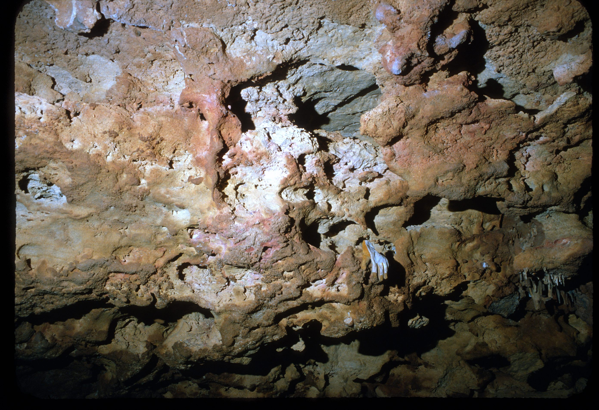
*ASF Joe N. Jennings slide catalogue, JNJ-S-1004-37, Box 1004. Catalogue description: Webbs Cave - Spongework. [ASF record](https://st1.asflib.net/MEDIA/ASFJJSlidesCatalogue/Box%201004/JNJ-S-1004-37.html).*

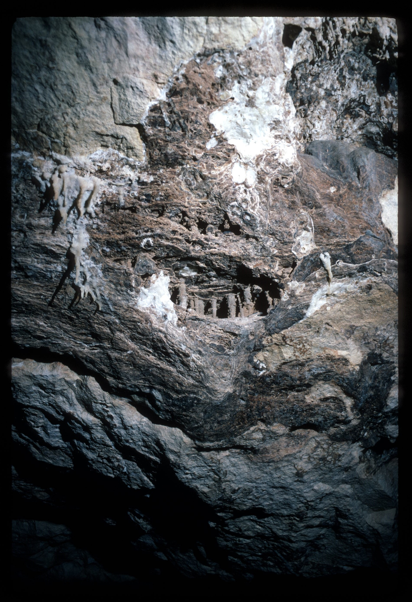
*ASF Joe N. Jennings slide catalogue, JNJ-S-1004-38, Box 1004. Catalogue description: Webbs Cave - Calcite fill solution tubes. [ASF record](https://st1.asflib.net/MEDIA/ASFJJSlidesCatalogue/Box%201004/JNJ-S-1004-38.html).*

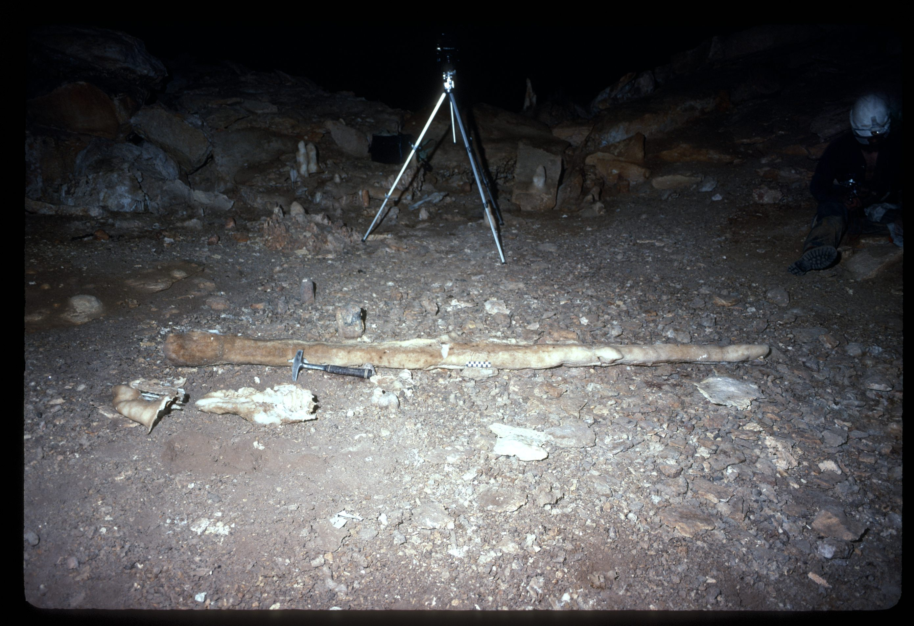
*ASF Joe N. Jennings slide catalogue, JNJ-S-1004-39, Box 1004. Catalogue description: Webbs Cave - 2.5m halite stalagmite. [ASF record](https://st1.asflib.net/MEDIA/ASFJJSlidesCatalogue/Box%201004/JNJ-S-1004-39.html).*

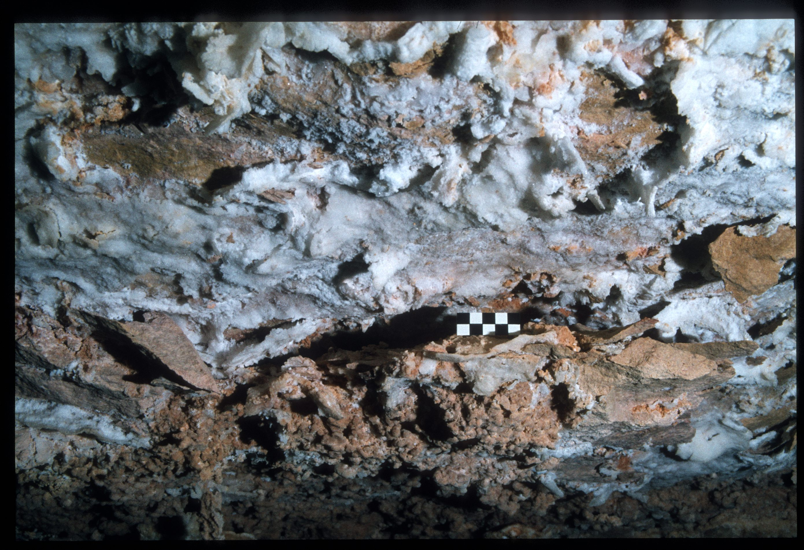
*ASF Joe N. Jennings slide catalogue, JNJ-S-1004-40, Box 1004. Catalogue description: Webbs Cave - Crust - Adrian Davey. [ASF record](https://st1.asflib.net/MEDIA/ASFJJSlidesCatalogue/Box%201004/JNJ-S-1004-40.html).*

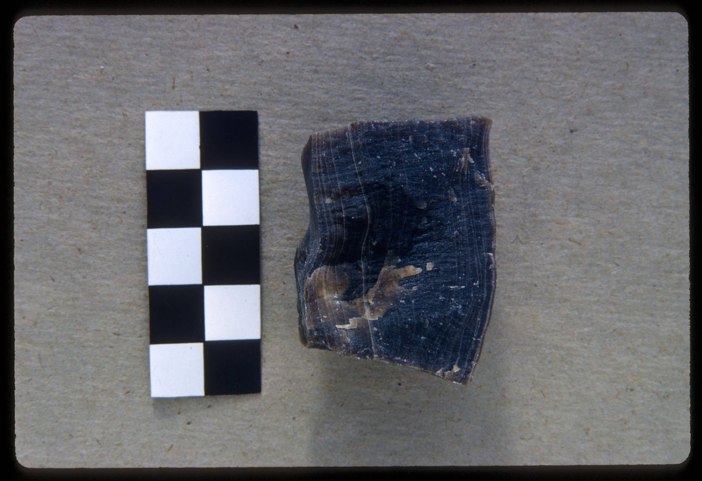
*ASF Joe N. Jennings slide catalogue, JNJ-S-1004-41, Box 1004. Catalogue description: Webbs Cave - Dark calcite natural fracture - Adrian Davey. [ASF record](https://st1.asflib.net/MEDIA/ASFJJSlidesCatalogue/Box%201004/JNJ-S-1004-41.html).*

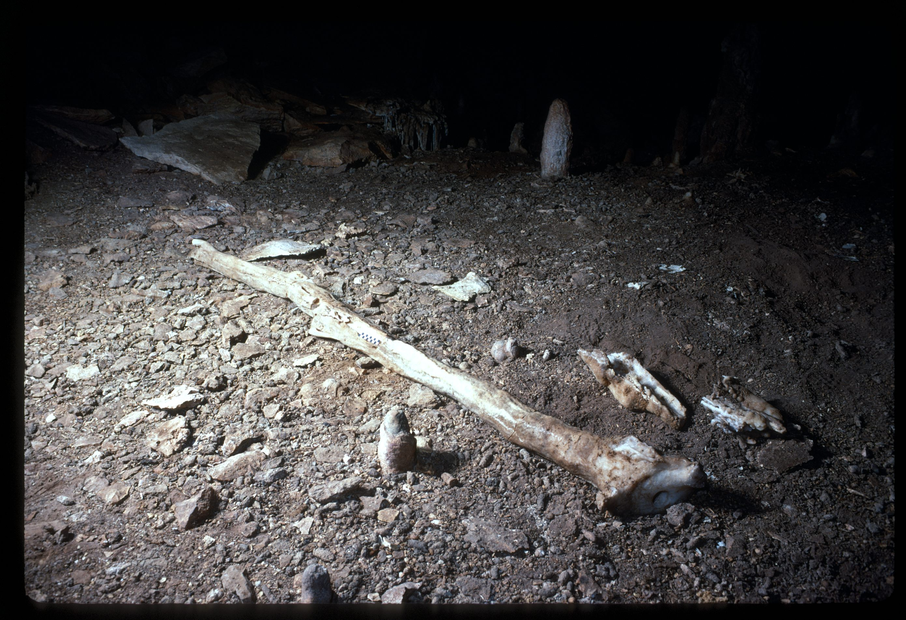
*ASF Joe N. Jennings slide catalogue, JNJ-S-1004-42, Box 1004. Catalogue description: Webbs Cave - 2.5m halite stalagmite. [ASF record](https://st1.asflib.net/MEDIA/ASFJJSlidesCatalogue/Box%201004/JNJ-S-1004-42.html).*

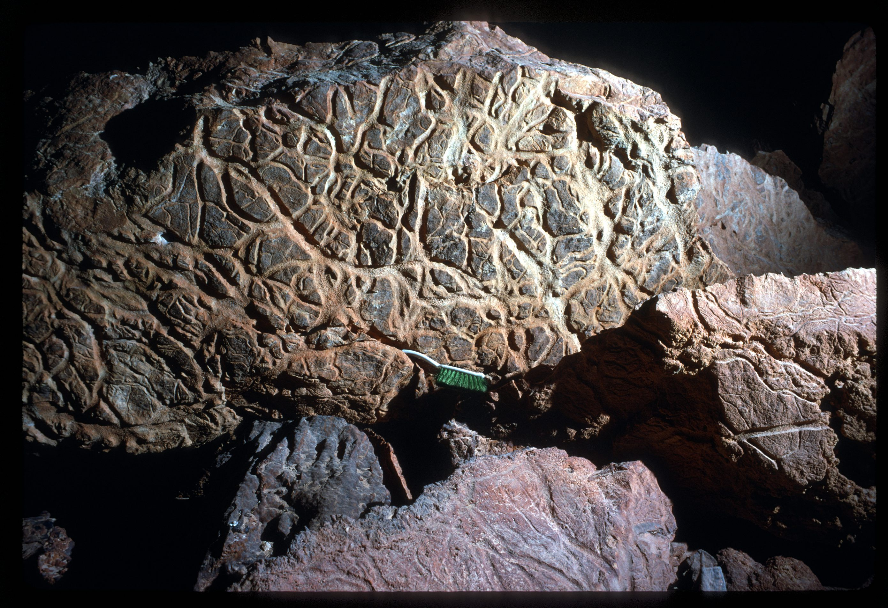
*ASF Joe N. Jennings slide catalogue, JNJ-S-1004-43, Box 1004. Catalogue description: Webbs Cave - Half-tube anastomoses. [ASF record](https://st1.asflib.net/MEDIA/ASFJJSlidesCatalogue/Box%201004/JNJ-S-1004-43.html).*

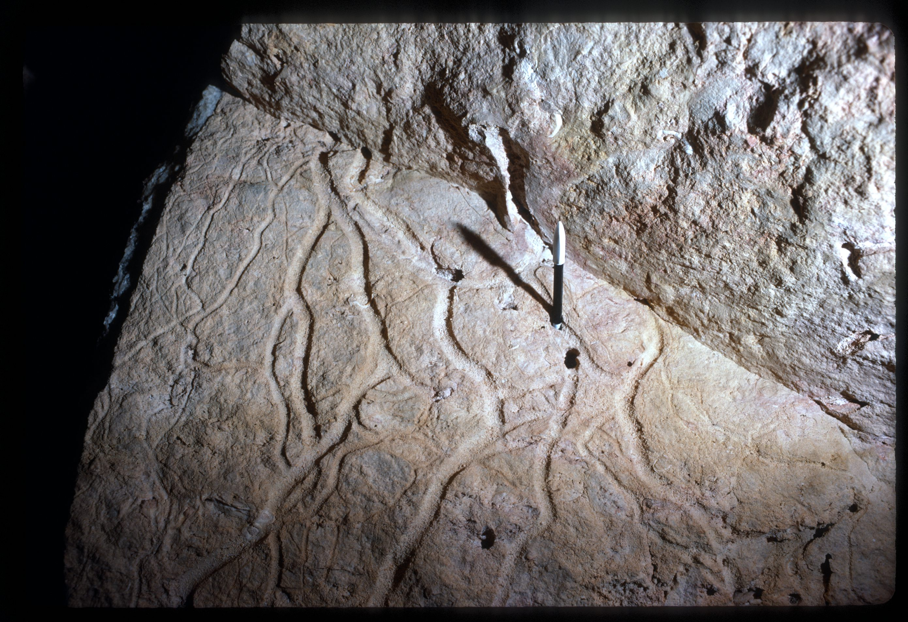
*ASF Joe N. Jennings slide catalogue, JNJ-S-1004-44, Box 1004. Catalogue description: Webbs Cave - Joint anastomes - other side. [ASF record](https://st1.asflib.net/MEDIA/ASFJJSlidesCatalogue/Box%201004/JNJ-S-1004-44.html).*

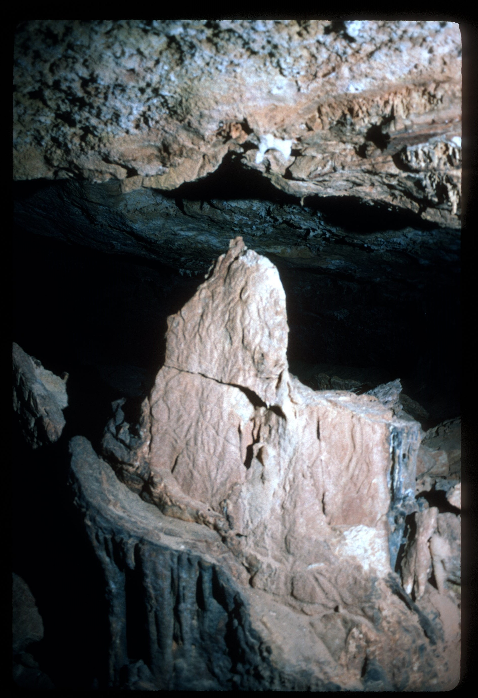
*ASF Joe N. Jennings slide catalogue, JNJ-S-1004-45, Box 1004. Catalogue description: Webbs Cave - Anastomes in joint through stalagmite- other side. [ASF record](https://st1.asflib.net/MEDIA/ASFJJSlidesCatalogue/Box%201004/JNJ-S-1004-45.html).*

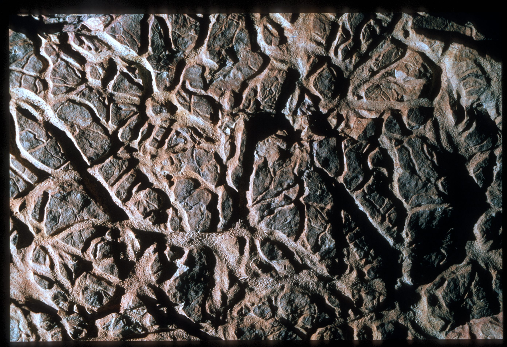
*ASF Joe N. Jennings slide catalogue, JNJ-S-1004-46, Box 1004. Catalogue description: Webbs Cave - Anastomosing half tubes - Adrian Davey. [ASF record](https://st1.asflib.net/MEDIA/ASFJJSlidesCatalogue/Box%201004/JNJ-S-1004-46.html).*

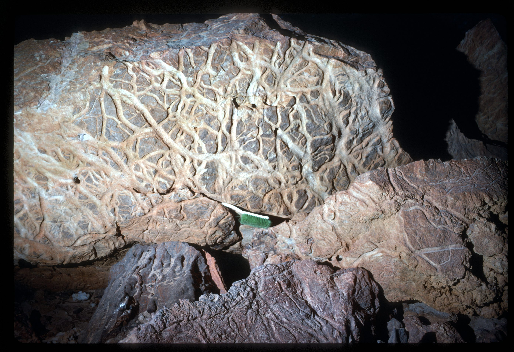
*ASF Joe N. Jennings slide catalogue, JNJ-S-1004-47, Box 1004. Catalogue description: Webbs Cave - Half-tube anastomoses. [ASF record](https://st1.asflib.net/MEDIA/ASFJJSlidesCatalogue/Box%201004/JNJ-S-1004-47.html).*

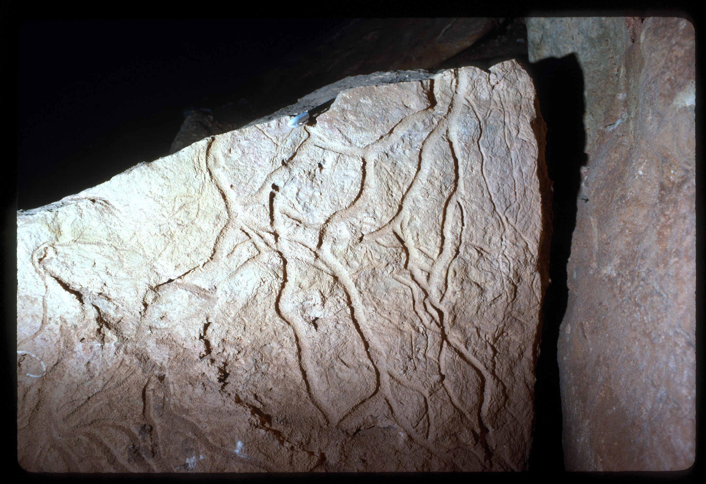
*ASF Joe N. Jennings slide catalogue, JNJ-S-1004-48, Box 1004. Catalogue description: Webbs Cave - Joint anastomoses - one side. [ASF record](https://st1.asflib.net/MEDIA/ASFJJSlidesCatalogue/Box%201004/JNJ-S-1004-48.html).*

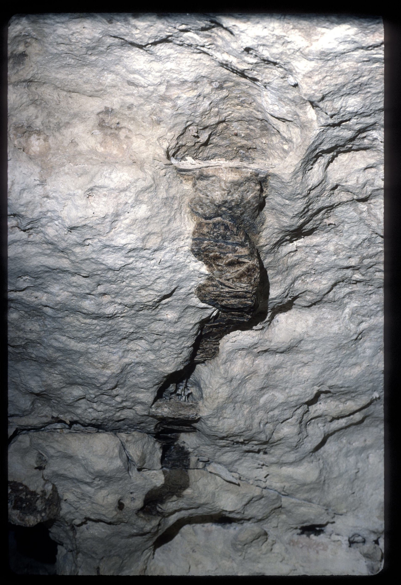
*ASF Joe N. Jennings slide catalogue, JNJ-S-1004-49, Box 1004. Catalogue description: Webbs Cave - Solution tube - Calcite Fill - Salt wedging enlargement. [ASF record](https://st1.asflib.net/MEDIA/ASFJJSlidesCatalogue/Box%201004/JNJ-S-1004-49.html).*

<!-- ASF slide images: end -->
